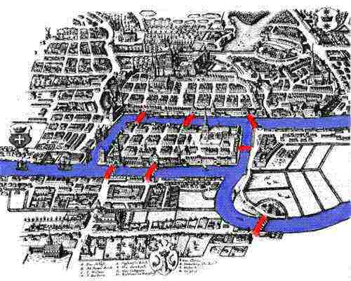

#### ¿Qué metafora utilizarías para describir cómo se trabaja con un repositorio de código?

Notes:

Intenta no pensar demasiado... ¿qué es lo primero que te viene a la cabeza?

Otra forma de hacerse esta pregunta sería: si tuvieses que explicarle
a una persona no técnica (yo pienso en mi madre, por ejemplo) qué es 
un repositorio ¿que analogía utilizarías?

^^^^^^

^^^^^^

^^^^^^

^^^^^^

Estas metáforas ayudan a entender cómo un equipo trabaja con un repositorio

**⚠️ NO REPRESENTAN QUÉ ES UN REPOSITORIO EN GIT ⚠️**

Notes:

Desafortunadamente, ninguna de estas metáforas representa con precisión
qué es un repositorio en git.

^^^^^^

|   |   |
| - | - |
|  |  |

Notes:

Si tuviese que escoger una metáfora para describir qué es un repositorio
en git, escogería el problema de los 
[7 puentes de Könisberg](https://es.wikipedia.org/wiki/Problema_de_los_puentes_de_K%C3%B6nigsberg). La solución del problema por parte de Leonhard Euler dio lugar 
a la teoría de grafos, sin la que git no existiría. 

Un repositorio en git es una estructura de datos con punteros.
En concreto, git almacena los commits en un DAG (Directed Acyclic Graph)
sobre sobre el que se crean punteros (o referencias como ramas 
y etiquetas) de una forma muy similar a como trabajaríamos
como si tuviésemos esta estructura de datos en memoria. 

Sí, se que no es la mejor metáfora para explicarle a mi madre qué 
es un repositorio en git. Las metáforas anteriores con buenas para describir
el concepto de _repositorio_ como sistema para trazar las versiones del código.
Ella no necesita entender el detalle de qué diferencia un repositorio de git 
de otro en Subversion... ¡pero nosotros sí!

^^^^^^

#### La parte más difícil de git es **sacarse de la cabeza las vías del tren** 

Notes:

Las metáforas como las vías del tren, el árbol o el archivador, son sencillas y nos permiten
entender cómo se trabaja con un repositorio: cada persona del 
equipo tiene su _rama_(vía del tren o rama del árbol o carpeta en el archivador)
en la que está su trabajo, y cuando lo termina, se _integra_ en la rama principal.

Pero una cosa es _cómo se usa_ y otra es lo que está ocurriendo cuando ejecutamos
los diferentes comandos de git. Y en git, estas metáforas no describen lo que está 
ocurriendo. Por ejemplo,
las ramas no son contenedores de commits, así que ¡tu código no pertenece a ninguna rama,
ni se puede decir que lo tienes en un archivador!
Y cuando hablamos de rama principal... bueno, eso en realidad es un convenio que
adopta el equipo, ya que para git, la rama _master_ es igual de importante o irrelevante
que el resto de ramas: cambia el nombre de la rama _master_ a cualquier cosas, como
por ejemplo _tortilla-de-patatas-con-cebolla_ y verás que te deja hacerlo, no te 
pondrá ningún problema. Y eso es así porque _master_ es un puntero... pero de esto
hablaremos más adelante.

