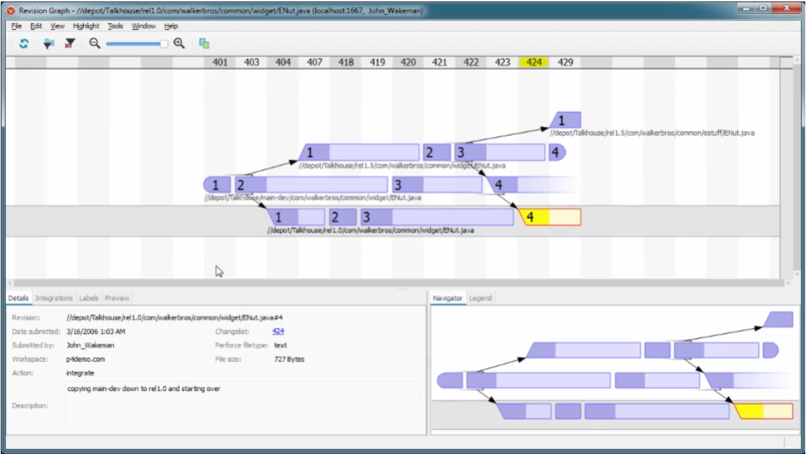
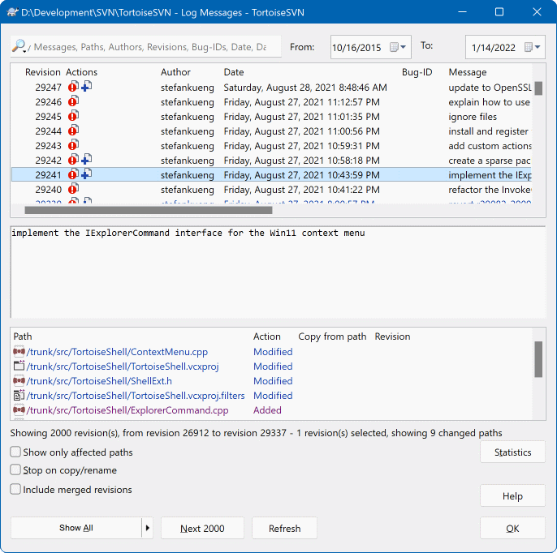
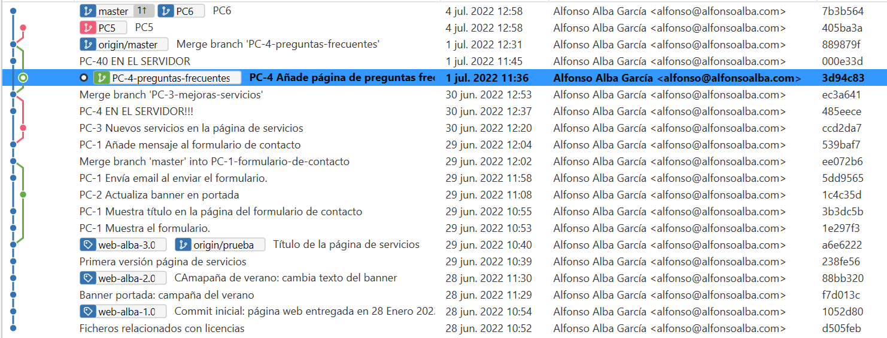

## Sistemas de controls de versiones (SCM)

Notes:

En esta sección veremos qué es un sistema de control de versiones
y cuál es el valor que aporta a los equipos

^^^^^^

#### Sistemas de control de versiones

> Sistema que facilita la gestión de los diversos cambios que se realizan sobre 
  el código fuente.

Responde a tres preguntas:

1. Qué se ha cambiado
1. Cuándo se ha cambiado
1. Quién lo ha cambiado

^^^^^^

#### Historia

El uso de un SCM genera una _historia_ de cambios que se han realizado en el
código fuente

[https://www.perforce.com/video-tutorials/vcs/using-revision-graph](https://www.perforce.com/video-tutorials/vcs/using-revision-graph)

Notes:

Un sistema de control de versiones genera lo que se conoce como historia,
que no es más que una una traza de los cambios que han ocurrido en el código
fuente.

Cada sistema de control de versiones tiene su manera de generar esta historia
y nos facilita herramientas para hacer diferentes operaciones sobre ella.

En esta diapositiva vemos ejemplos de cómo HelixCore, SVN o git nos muestran
la historia, bien del proyecto o de un fichero del mismo.

^^^^^^

#### Historia

[https://tortoisesvn.net/docs/release/TortoiseSVN_es/tsvn-dug-showlog.html](https://tortoisesvn.net/docs/release/TortoiseSVN_es/tsvn-dug-showlog.html)

Notes:

Ejemplo de historia de un respositorio de Subversion usando TortoiseSVN

^^^^^^

#### Historia

Notes:

Ejemplo de historia de un repositorio git visualizada en Sourcetree

^^^^^^

#### Historia

- Revertir cambios anteriores
- Extraer _release notes_ cuando se libera una nueva versión
- Encontrar _bugs_ con más facilidad (por ejemplo `git blame`)

Notes:

¿Qué nos permite la historia de un SCM?

