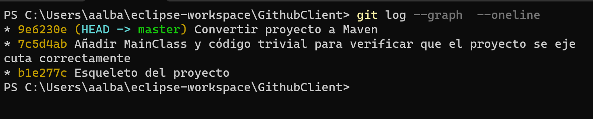
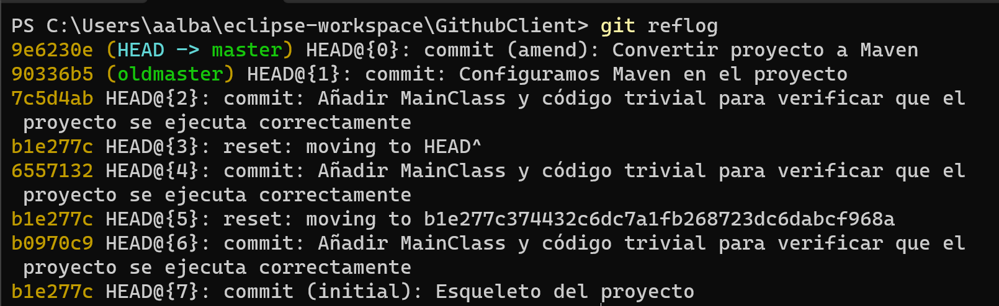
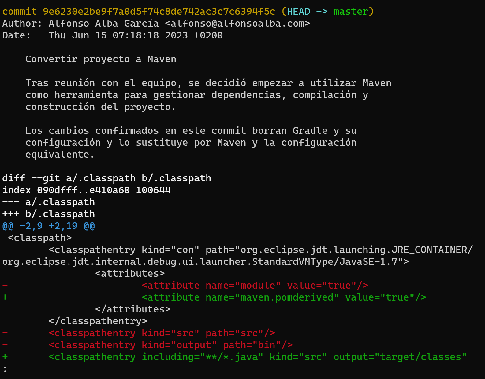

## Buenas prácticas

Notes:

En esta sección veremos una serie de recomendaciones y consejos 
para confirmar nuestros cambios en el repositorio.

^^^^^^

#### Buenas prácticas: Objetivos

- Hacer la historia más fácil de leer: ahorrando tiempo y frustración
- Facilitar las revisiones de código en las _Pull Requests_
- Encontrar errores con más facilidad
- ⚠️ Especialmente importante si trabajas en un equipo

Notes:

Uno de los principales objetivos de los mensajes de los _commits_ 
es comunicar el contexto de los cambios que ocurren en el momento
presente a la persona que los verá en el futuro.

En las siguientes diapositivas veremos varios consejos sobre 
los mensajes pero el más importante es, en difinitiva,
**pensar en los demás**, pensar en las personas que leerán ese 
código sin tener todo el contexto que tú tienes cuando 
confirmas los cambios.

^^^^^^

#### Buenas prácticas: caracteres por línea

### Título: 50 caracteres
### Descripción: 72 caracteres por línea

Recomendado en la [propia documentación de git](https://git-scm.com/docs/git-commit#_discussion)

Notes:

Que el título tenga 50 caracteres se explica por que hay varios 
comandos que muestran información adicional junto al título. 
Limitarlo a 50 caracteres facilita que se muestre la información 
de forma más legible en pantalla.

^^^^^^

#### Buenas prácticas: caracteres por línea

Motivación: Legibilidad de los mensajes cuando se ejecutan comandos por consola


^^^^^^

#### Buenas prácticas: caracteres por línea



Notes:

Si el título es demasiado largo, las líneas del comando `git log` se parten
o no se muestran completas en pantalla.

^^^^^^

#### Buenas prácticas: caracteres por línea



Notes:

Aquí vemos el efecto de tener un título muy largo en el `Reflog` de git.

^^^^^^

#### Buenas prácticas: caracteres por línea



Notes:
Si restringimos la longitud de las líneas de la descripción a 72 caracteres,
esta diapositiva nos muestra cómo se formatea la salida del comando `git show`.
El texto queda muy legible.

^^^^^^ 

#### Buenas prácticas: estilo 

- Escribir la primera letra en mayúsculas
- Utilizar la tercera persona / imperativo
- No poner puntos al final del mensaje 
- Escribir mensajes concisos y descriptivos

```powershell
> git commit -m'Resuelve fallo en formulario de contacto' 
```

Notes:

El uso de maýuscula facilita la lectura de los títulos cuando se muestran varios
de ellos en pantalla. También facilita que se pueda leer con más claridad 
si ese título aparece embebido en otros textos.

El uso del imperativo es una cuestión muy subjetiva. A mi personalmente me parece 
que es más cómodo de leer que un infinitivo:

```text 
Resuelve fallo en formulario de contacto 
```
vs 

```
Resolver fallo en fomulario de contacto 
```

Hay otras alternativas como el presente indicativo `Resuelvo fallo en formulario de contacto`.
La regla que se recomienda es escribir el título del _commit_ como continuación de 
la frase _Este commit..._ Por ejemplo, `Este commit Resuelve fallo en formulario de contacto`.

Con respecto a poner puntos al final de los mensajes... 50 caracteres no son muchos
¿porqué desperdiciarlos? 

^^^^^^ 

#### Buenas prácticas: _commits_ atómicos 

Los cambios que confirmamos deben contener sólo cambios relacionados con una tarea 
o con un _bug_

Notes:
Esto tiene múltiples ventajas que enumeraremos en la siguiente diapositiva.

Por ejemplo, supongamos que estamos cambiando varias vistas de la aplicación
y al hacerlo nos encontramos con un _bug_. En este caso haremos dos _commits_:
1. confirmaremos los cambios que resuelven el problema por un lado 
1. y por otro confirmaremos los cambios relacionados por con las vistas de la aplicación

^^^^^^

#### Buenas prácticas: _commits_ atómicos 

- Facilita la tarea de revertir cambios 
- Facilita el uso de comando como `git rebase` o `git-cherry-pick`
- Facilita la lectura de la historia del repositorio 
- Facilita el encontrar errores con `git-bisect`

Notes:

Más adelante dentro del curso, cuando veamos el uso de los comandos `git-cherry-pick` o 
`git-rebase`, veremos más claramente las ventajas de los _commits_ atómicos. 
De momento diremos que la posibilidad de reescribir la historia y reorganizar los 
_commits_ quedaría muy limitada si no seguimos esta buena práctica. 

Con respecto a revertir los cambios, existe un comando en git, que veremos más 
adelante, que invierte los cambios introducidos en un _commit_. Si tenemos 
una tarea en un solo _commit_ que introduce un _bug_ y localizamos ese commit, podemos
muy facilmente utilizar `git-revert` para deshacer esa tarea. Sin embargo,
si hemos confirmado 6 tareas distintas de una sola vez, el comando `git-revert`
deshará todo lo que esté en ese _commit_. Podríamos hacerlo igualmente, ya que 
el comando `git-revert` permite deshacer cambios parcialmente, pero nos llevará mucho 
más tiempo y será una tarea mucho más propensa a errores ¡especialmente si el 
código no lo has escrito tú o es código muy antiguo!

El uso de esos _commits_ atómicos acompañados de unos buenos mensajes, 
facilitan al equipo del poder leer la historia del repositorio. 

El comando `git-bisect` nos facilita la tarea de encontrar en qué _commit_ se 
introduce un error. Si cuando encuentras ese _commit_, este contiene solo una tarea, 
depurar el fallo será más fácil. Si ese commit contiene cambios relacionados con 4 tareas, 
la persona que tenga que depurar tendrá que revisar más código. 

^^^^^^

#### Buenas prácticas: confirmación de cambios que compilen

En algunos equipos, se acuerda que sólo se pueden confirmar cambios que compilen 

Notes:

Esta regla la he visto en algunos equipos y depende mucho del proyecto y de cómo
sea el flujo de trabajo que el equipo esté utilizando.

Tiene sus ventajas, como que los sistemas de integración contínua no darán 
errores de compilación por cambios que estén confirmados sin haber sido terminados.
La desventaja es que puede restar cierta flexibilidad al equipo a la hora 
trabajar de forma remota. En este caso, mi solución sería 
coordinar bien a los equipos de DevOps y desarrollo para encontrar un punto de equilibrio.
Por ejemplo, el uso de esta regla se puede restringir únicamente a las rama 
`main`/`master` o la rama de desarrollo/integración. 

^^^^^^

#### Buenas prácticas: confirmación de cambios que pasen tests

En algunos equipos, se acuerda que sólo se pueden confirmar cambios que pasen los tests

Notes:
Lo dicho para la diapositiva anterior se puede aplicar a esta.


^^^^^^

#### Buenas prácticas: Qué y porqué

La instantánea de la confirmación de cambios nos permite saber qué ha cambiado 

La descripción del mensaje nos permite explicar 

**qué se ha cambiado** 

**y porqué se han introducido esos cambios**

Notes:

El objetivo de la descripción del mensaje es darle contexto a la persona que 
la lea. El código nos dice qué ha cambiado, pero no nos dice porqué. En la 
siguiente diapositiva vemos un ejemplo de un mensaje de que incluye qué 
se ha cambiado en el commit y porqué se ha hecho. Sin ver el código 
¿eres capaz de imaginarte qué te vas a encontrar en los cambios que se 
han confirmado?

^^^^^^ 
#### Buenas prácticas: Qué y porqué

¿una mejor descripción? 

```text
Tras reunión con el equipo, se decidió empezar a utilizar Maven 
como herramienta para gestionar dependencias, compilación y construcción
del proyecto.

En resumen: los problemas de integración entre SuperCoolTool y gradle 
nos impedían automatizar el despliegue
(más detalles aquí: http://www.nuestradoc/xxxxxxxx )

Los cambios confirmados en este commit borran Gradle
y su configuración y lo sustituye por Maven y la configuración 
equivalente.

Este cambio tiene un impacto en el sistema de integración contínua, 
por lo que se ha actualizado también la configuración de github actions
adecuadamente para que utilice Maven.
```

^^^^^^ 
#### Buenas prácticas: de mi cosecha

- Incluir el identificador de la tarea en el título 

```
> git commit -m'WEB-456 Muestra fecha en color amarillo'
```

- Empezar con `WIP...` el título del mensaje cuando confirmamos
  cambios incompletos

Notes:

**Incluir identificador te tarea**
Algunas prácticas que he usado en algunos proyectos y que me han funcionado.
 
Incluir el código de la tarea facilita ver en la historia a qué tarea 
pertenecen los cambios confirmados en el repositorio. Es especialmente útil 
en ramas de integración en las que acabas mezclando cambios 
que vienen distintas tareas. Tiene una pega y es que consumes parte de esos 50
caracteres del título.

**`WIP...`**
A veces necesitamos confirmar cambios en el repositorio que nos están terminados.
Por ejemplo, creas una rama para actualizar react a la última versión y tras 
trabajar durante unas horas, necesitas cambiar de contexto y trabajar en otra 
cosa. No has terminado de migrar, tienes tests que fallan, código a medio 
cambiar... En estos casos, confirmo los cambios siguiendo este convenio:

- Incluir `WIP` en el título 
- Incluir en la descripción del mensaje qué es lo que he terminado, qué he 
  dejado a medias y dónde debería continuar cuando retome el trabajo
  
^^^^^^ 
#### Buenas prácticas

Las buenas prácticas son eso, buenas prácticas... 

...se pueden cambiar, ignorar totalmente, saltarselas puntualmente
o añadir alguna otra que no esté en esta lista

Seguid todos las mismas prácticas 

Notes: 

Se flexible a la hora de aplicar estas prácticas si lo necesitas. Añade aquellas
reglas que tengan sentido para tu equipo o aquellas que os funcionen
y no utilices aquellas que no.

Por ejemplo, si estás en sistemas críticos de los que dependen la vidas de las 
personas, quizas tiene sentido ser extremadamente estricto con la regla de 
_solo se pueden confirmar cambios que pasen los tests_. En otro tipo de 
proyectos, esa misma regla se puede relajar y aplicarla solo a la rama `main`.

^^^^^^ 

#### Buenas prácticas: mi consejo 

- Usad el sentido común
- Pensad en los demás ¡estais trabajando en equipo!
- Sed prácticos y usad aquello que os funcione


