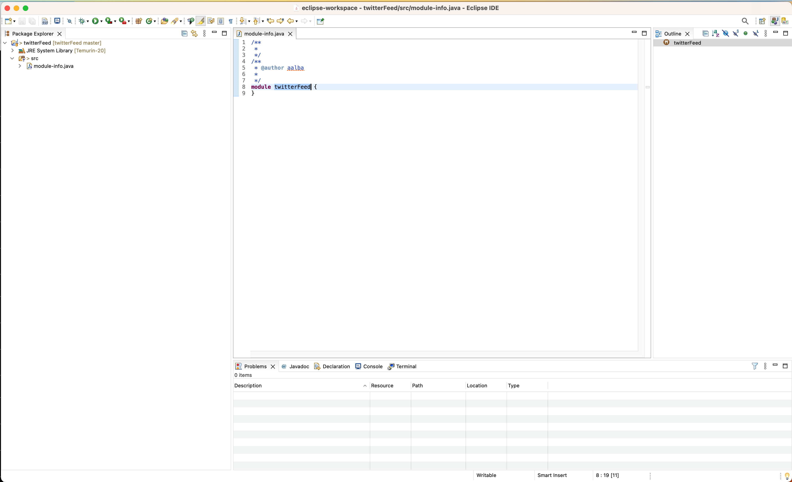
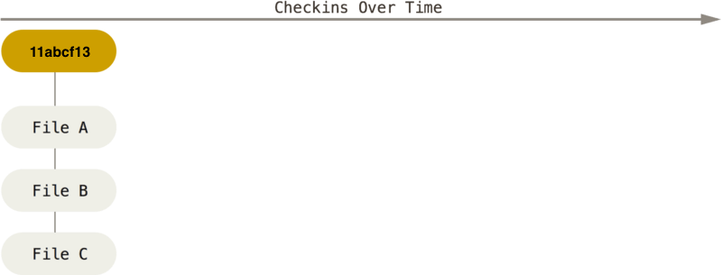
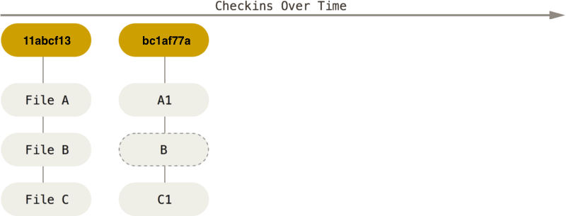
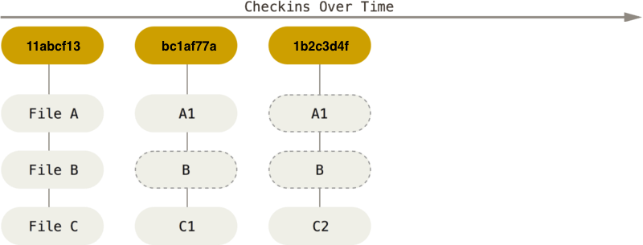
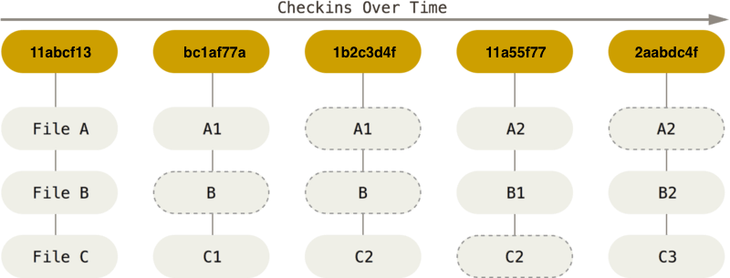
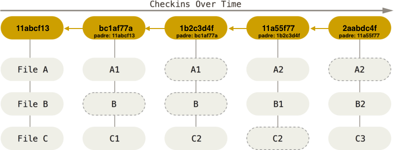

## ¿Cómo funciona git?

asdfa

Notes:

En esta sección veremos cómo funciona git y qué ocurre cuando hacemos un commit

^^^^^^

#### Contexto

- Tenemos un projecto nuevo que vamos a empezar: crear un cliente de twitter
  para la línea de comandos
- El primer paso que daremos será inicializar el proyecto en eclipse o en
  Visual Studio
- Este será nuestro primer comit

^^^^^^

####  El primer commit

Notes:
Inicializamos el proyecto en eclipse. Este será nuestro primer commit

^^^^^^

#### El primer commit

Notes:
Al hacer el commit, git hará lo siguiente:
- crear un snapshot del código, incluyendo todos los ficheros
- añadir una serie de datos a ese snapshot:
  - Nombre
  - Email
  - Fecha
  - Mensaje
- Calcular la suma SHA del conjunto (la instantánea y los datos)
- guardar el commit en el disco duro

^^^^^^

#### El segundo commit

- Supongamos que comenzamos a trabajar en el proyecto
- Modificamos dos de los ficheros: `Fichero A` y `Fichero C`

^^^^^^

#### El segundo commit

Notes:
Al hacer el segundo commit, git hará lo siguiente:
- crear un snapshot del código, incluyendo todos los ficheros
- añadir los datos para ese snapshot:
  - Nombre
  - Email
  - Fecha
  - Mensaje
  - Hash del commit anterior
- Calcular la suma SHA del conjunto (la instantánea y los datos)
- guardar el commit en el disco duro

A bajo nivel lo que realmente ocurre es que como el `Fichero B`
no ha cambiado, se almacena un puntero al fichero que está en la instantánea anterior.
Como hemos comentado antes, esto es un detalle de implementación que está
bien conocer, pero es importante que entendamos que git se comporta como si 
estuviese guardando instantáneas completas de nuestro código.

^^^^^^

#### El segundo commit

Git guarda el hash del commit anterior... al hacerlo, está guardando
un puntero (o referencia) a ese commit 

^^^^^^

#### El tercer commit

Notes:
Si seguimos modificando nuestro código y hacemos un nuevo commit,
volverá a ocurrir lo mismo:

- crear un snapshot del código, incluyendo todos los ficheros
- añadir los datos para ese snapshot:
  - Nombre
  - Email
  - Fecha
  - Mensaje
  - Hash del commit anterior
- Calcular la suma SHA del conjunto (la instantánea y los datos)
- guardar el commit en el disco duro

^^^^^^
#### Varios commits después...

^^^^^^
#### Varios commits después...

Notes:
Misma imagen pero incluyendo una representación del puntero al padre (commit anterior)
que cada instantánea contiene

^^^^^^

¡Esto es lo único que sabe hacer git!

Crear instantáneas y guardarlas en el disco duro
