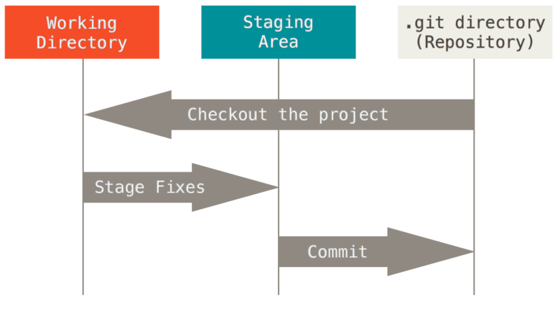

## Estados de los ficheros

Notes:
En esta sección veremos los estados en los que pueden estar
los ficheros y las tres secciones de las que consta un repositorio
en git: el repositorio, el _staging area_ y el área de trabajo.

^^^^^^

#### Secciones de un repositorio git 

^^^^^^

#### Secciones de un repositorio git 

- **Área de trabajo** (_working directory_): carpeta del disco duro que contiene los ficheros del proyecto.
- **Área de preparación** (_staging area_): cambios que incluriá el siguiente  _commit_
- **El directorio de git**: carpeta `.git` con el repositorio 

Notes:

- **Área de trabajo** (_working directory_): carpeta del disco duro que contiene los ficheros del proyecto.
  Es la carpeta que abriremos con nuestro IDE 
  o editor de texto para trabajar en nuestro proyecto.

- **Área de preparación** (_staging area_): Zona en la literalmente preparamos el siguiente commit. 
  Los cambios que subamos a esta sección son lo que formarán parte de la siguiente
  instantánea de nuestro proyecto, es decir, del siguiente _commit_
- **El directorio de git**: carpeta oculta del disco duro en la que se almacena toda la información
  del repositorio:
  - Configuración
  - Base de datos de objetos de git
  - Referencias

^^^^^^

#### Estados de los ficheros

- **Modificado** (_modified_): Cambios en el área de trabajo
- **Preparado** (_staged_): Cambios en el área de preparación (_staging area_)
- **Confirmado** (_committed_): Los cambios se han confirmado en un _commit_

Notes:
La sección en la que estén los ficheros es la que marca el estado del mismo.

^^^^^^
#### Cambios de estado

El flujo de trabajo básico de un repositorio en git sería:
- Extraer una determinada versión de los ficheros (_checkout_)
- Modificar los ficheros en el área de trabajo
- Mover los ficheros al área de preparación 
- Confirmar los cambios (_commit_) en el repositorio (carpeta `.git`)
