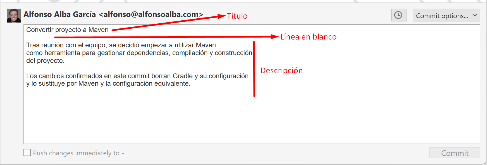

## Mensaje del commit

Notes:

Cuando escribimos el mensaje que acompaña a la confirmación de los cambios,
debemos saber cómo interpreta git el texto del mensaje.

^^^^^^

#### Mensaje del commit



Notes:

Los mensajes de commit tienen esta estructura:

- Título: la primera línea del mensaje 
- Línea en blanco
- Descripción: todo lo que está después de la línea en blanco

^^^^^^

#### Mensaje del commit

- Título: mensaje que se muestra en el log de git,
  y otros muchos lugares como el reflog o rebases interactivos
- Descripción: texto adicional que queramos añadir al mensaje 

^^^^^^ 

#### Mensaje del commit

```powershell
> git commit -m'Convertir proyecto a Maven' -m'Tras reunión con el equipo, 
se decidió empezar a utilizar Maven como herramienta para gestionar 
dependencias, compilación y construcción
del proyecto.

Los cambios confirmados en este commit borran Gradle y su configuración
y lo sustituye por Maven y la configuración equivalente.'
```

Notes:

Si estamos utilizando la consola, podemos utilizar dos veces 
la opción `-m` para indicar el título y la descripción del mensaje cuando 
ejecutamos el comando `git commit`. La primera ocurrencia de `-m` será 
el título y la seguda será la descripción. 

También podemos usar una sola vez la opción `-m` y utilizar una línea
en blanco para separar título y descripción:

```powershell

> git commit -m'Convertir proyecto a Maven

Tras reunión con el equipo, se decidió empezar a utilizar Maven
como herramienta para gestionar dependencias, compilación y construcción
del proyecto.

Los cambios confirmados en este commit borran Gradle y su configuración
y lo sustituye por Maven y la configuración equivalente.'
```


#### Mensaje del commit


