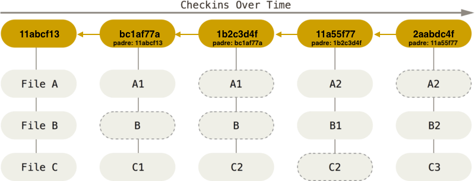

## ¿Qué ocurre cuándo confirmamos los cambios (_commit_)?

Notes:

En esta sección veremos qué ocurre cuando confirmamos los cambios (_commit_)

^^^^^^

Notes:

Volvamos a esta representación de cómo estaba nuestro repositorio tras confirmar
cinco veces nuestros cambios.

^^^^^^

Notes:

En esta diapositiva representamos la historia del repositorio como una estructura de datos en la que 
cada instantánea representa un nodo dentro de esa estructura.

Como vimos en diapositivas anteriores, cada nodo guarda un puntero al nodo anterior (padre)
y no guarda ninguna referencia a los siguientes nodos (hijos)

^^^^^^
### ¿Qué estructura de datos tenemos en pantalla? 

Notes:

Se trata de una [lista simplemente enlazada](https://es.wikipedia.org/wiki/Lista_enlazada). 

Una lista enlazada es un caso particular de un grafo acíclico dirigido (DAG) que es en lo 
que se convertirá el repositorio a medida que vayamos añadiendo 
complejidad a nuestro proyecto.

^^^^^^

#### Lista simplemente enlazada 

Notes:

Siendo una lista simplemente enlazada, en la que cada nodo contiene una referencia
sólo al nodo anterior, la lista podemos recorrerla de derecha a izquierda
según está dibujada en la diapositiva. Es decir, podemos recorrer la lista _hacia atrás_ en la 
historia (hacia nuestros ancestros), pero no podemos recorrer la lista 
desde los commits más viejos hacia los más recientes.

^^^^^^

#### ¿Qué ocurre con el tamaño del repositorio?

Supongamos que nuestro proyecto ocupa 200MB en disco.

Con cada nuevo commit git almacena una instantánea del código y la guarda
el repositorio (carpeta `.git`)

^^^^^^
#### ¿Qué ocurre con el tamaño del repositorio?

Notes:

Si git almacenase una instantánea de verdad con cada nuevo commit, nuestro repositorio crecería 
de tamaño rápidamente. Tanto, que no se podría usar prácticamente para nada debido al 
desorbitado tamaño que requeriría almacenar la información.

^^^^^^

#### ¿Qué ocurre con el tamaño del repositorio?

Notes:

Aunque a alto nivel git se comporta como si realmente estuviese almacenando una instantánea completa
por cada commit, a bajo nivel no se comporta así.

