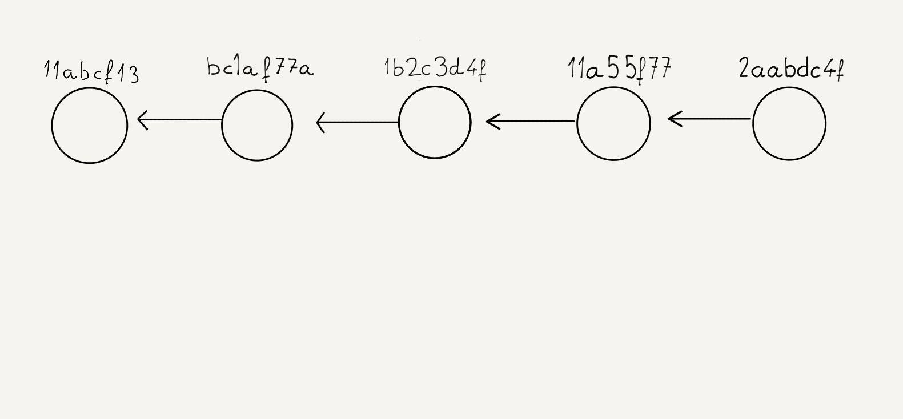
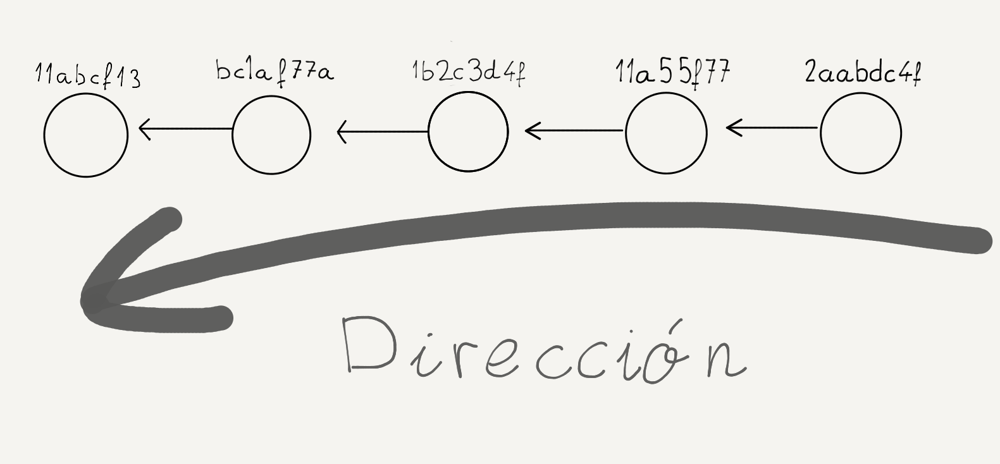
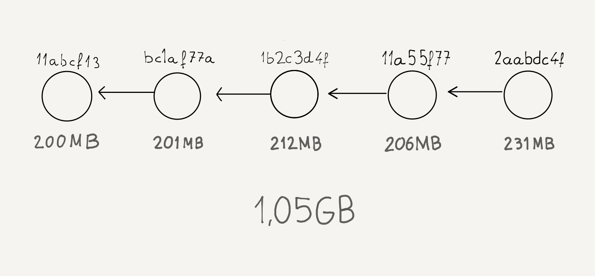
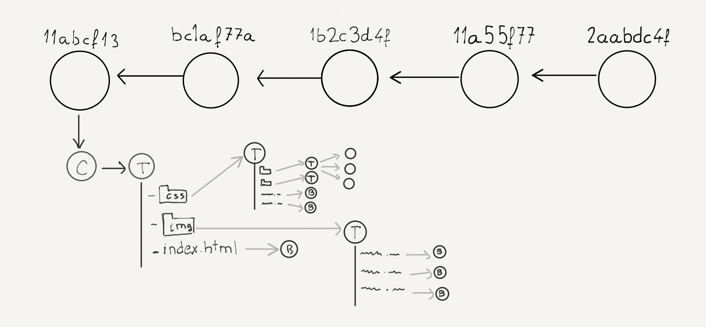
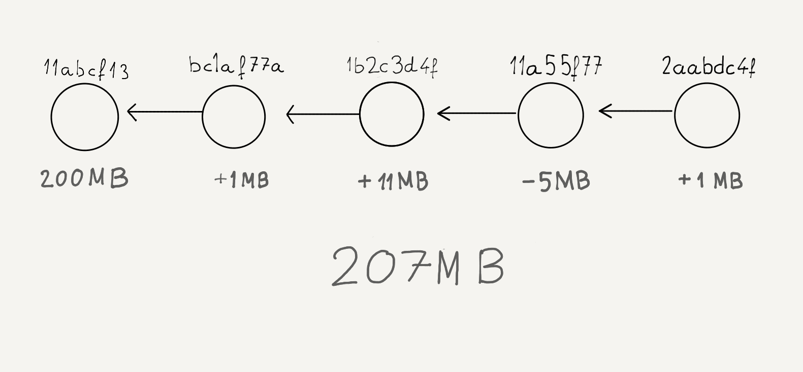

## ¿Qué ocurre cuándo confirmamos los cambios (_commit_)?

Notes:

En esta sección veremos qué ocurre cuando confirmamos los cambios (_commit_)

^^^^^^

Notes:

Volvamos a esta representación de cómo estaba nuestro repositorio tras confirmar
cinco veces nuestros cambios.

^^^^^^

Notes:

En esta diapositiva representamos la historia del repositorio como una estructura de datos en la que 
cada instantánea representa un nodo dentro de esa estructura.

Como vimos en diapositivas anteriores, cada nodo guarda un puntero al nodo anterior (padre)
y no guarda ninguna referencia a los siguientes nodos (hijos)

^^^^^^
### ¿Qué estructura de datos tenemos en pantalla? 

Notes:

Se trata de una [lista simplemente enlazada](https://es.wikipedia.org/wiki/Lista_enlazada). 

Una lista enlazada es un caso particular de un grafo acíclico dirigido (DAG) que es en lo 
que se convertirá el repositorio a medida que vayamos añadiendo 
complejidad a nuestro proyecto.

^^^^^^

#### Lista simplemente enlazada 

Notes:

Siendo una lista simplemente enlazada, en la que cada nodo contiene una referencia
sólo al nodo anterior, la lista podemos recorrerla de derecha a izquierda
según está dibujada en la diapositiva. Es decir, podemos recorrer la lista _hacia atrás_ en la 
historia (hacia nuestros ancestros), pero no podemos recorrer la lista 
desde los commits más viejos hacia los más recientes.

^^^^^^

#### ¿Qué ocurre con el tamaño del repositorio?

Supongamos que nuestro proyecto ocupa 200MB en disco.

Con cada nuevo commit git almacena una instantánea del código y la guarda
el repositorio (carpeta `.git`)

^^^^^^
#### ¿Qué ocurre con el tamaño del repositorio?

Notes:

Si git almacenase una instantánea de verdad con cada nuevo commit, nuestro repositorio crecería 
de tamaño rápidamente. Tanto, que no se podría usar prácticamente para nada debido al 
desorbitado tamaño que requeriría almacenar la información.

^^^^^^

#### ¿Qué ocurre con el tamaño del repositorio?

Notes:

Aunque a alto nivel git se comporta como si realmente estuviese almacenando una instantánea completa
por cada commit, a bajo nivel no se comporta así.

Si miramos en detalle qué es un commit, veríamos que un se trata de un objeto de git que apenas contiene
información:
- Los datos del commit (nombre y correo electrónico del autor, fecha, mensaje y hash del commit aterior)
- Un puntero a otro objeto de objeto de git, que puede ser un objeto de tipo _tree_, que contiene punteros 
  a otros objetos de git de tipo _tree_ o de tipo _blob_. En estos últimos es en los que realmente 
  se almacena el fichero con el código fuente.

Incluso si los cambios que hemos confirmado ocupan varios megabytes, el objeto de tipo _commit_ 
apenas ocupará unos bytes en el disco duro.

Todos estos objetos de git son los que realmente almacenan la instantánea de nuestro código, son los que 
almacenan los ficheros y los cambios que se han producido en ellos. Estos objetos de git se comportan 
como un sistema de ficheros en miniatura y son los que hacen que al confirmar nuevos cambios en el 
repositorio, no se almacenen 200MB más, sino que ocupe un espacio suficiente como para almacenar los cambios.
Por ejemplo, si un fichero no ha cambiado, un objeto de tipo _tree_ puede guardar un puntero al mismo
_blob_ que el _commit_ anterior ya que el contenido del _blob_ no ha cambiado de un commit a otro.

^^^^^^

#### ¿Qué ocurre con el tamaño del repositorio?

Notes:
Esta diapositiva representa lo que realmente ocurre con el tamaño de un repositorio 
cuando se trabaja con él: git optimiza el almacenamiento y aunque a alto nivel
parezca que tenemos instantáneas completas del cógido, el tamaño de la carpeta 
`.git` no se multiplica con cada nuevo commit
