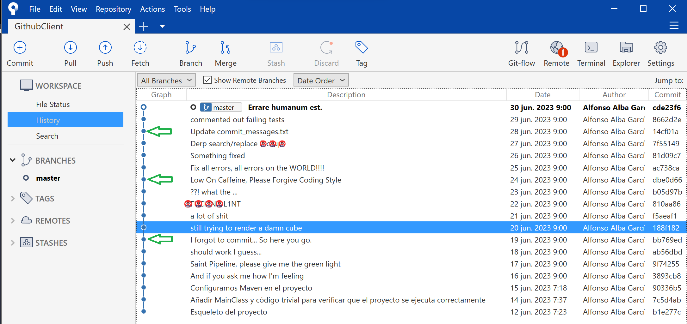

## Etiquetas (_tags_)

Notes:

En esta sección veremos qué son las etiquetas, cómo funcionan y qué 
uso se les puede dar.

^^^^^^

#### Etiquetas

Notes: 

En la sección 2 del curso trabajamos con el flujo de trabajo más sencillo 
con el que podemos trabajar: editamos nuestro código hasta que tenemos 
una funcionalidad terminada y confirmamos los cambios.

Si trabajamos de esta manera durante los próximos días en nuestro repositorio,
acabaríamos con un repositorio parecido al que aparece en esta diapositiva.

Mensajes obtenidos de https://whatthecommit.com/index.txt

^^^^^^

#### Etiquetas 

Supongamos que entre el 15 y el 30 de junio, distribuimos tres versiones 
de nuestra aplicación:

Notes:

Los días 19, 24 y 28 de junio distribuimos una nueva versión de nuestra 
aplicación a nuestros usuarios. ¿Qué podemos hacer para marcar estos 
_commits_?

^^^^^^
#### Etiquetas 

Podríamos apuntar el nombre (_hash_) de los _commits_ en una 
hoja de cálculo, en plan artesanal: 

| nombre | versión |
| ------ | ------- |
| bb769ed | 1.0 |
| dbe0d66 | 1.1 |
| 14cf01a | 2.0 |

Esta no parece la mejor opción...

^^^^^^

#### Etiquetas

Git nos da una manera de **marcar** estos _commits_,

que para nosotros son 
importantes, 

**con una etiqueta (nombre)** 

más sencilla que recordar que el _hash_

Notes:

Como otros sistemas de control de versiones, git nos facilita un comando
para marcar estos _commits_ y localizarlos sin necesidad de tener que
llevar un registro en una hoja de cálculo.

Una etiqueta se puede entender como un post-it que le pegamos a un 
_commit_ con un nombre para recordarlo con más facilidad.

^^^^^^

#### Etiquetas

Notes:

Así quedaría nuestro repositorio con las tres versiones etiquetadas.

En este ejemplo, el criterio utilizado es marcar aquellos cambios confirmados 
que se han distribuido como una nueva versión a nuestros usuarios. En el nombre 
de la etiqueta, pongo el número de la versión.

Más adelante en esta misma sección, comentaremos 
otros criterios para considerar un _commit_ importante y etiquetarlo. 

