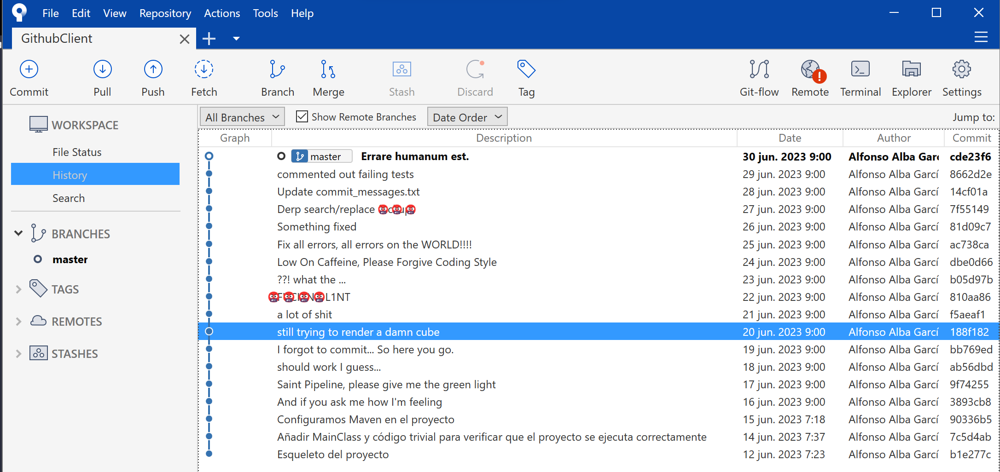
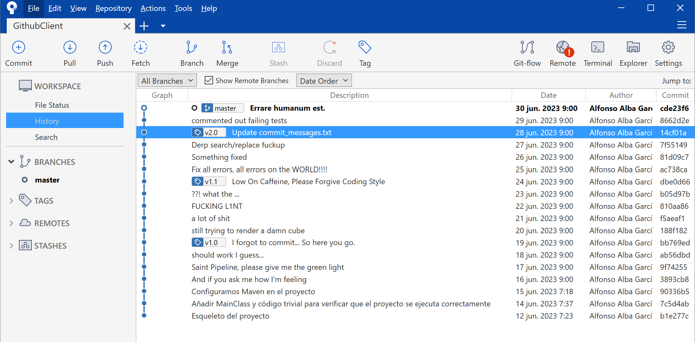

## Etiquetas (_tags_)

Notes:

En esta sección veremos qué son las etiquetas, cómo funcionan y qué 
uso se les puede dar.

^^^^^^

#### Etiquetas



Notes: 

En la sección 2 del curso trabajamos con el flujo de trabajo más sencillo 
con el que podemos trabajar: editamos nuestro código hasta que tenemos 
una funcionalidad terminada y confirmamos los cambios.

Si trabajamos de esta manera durante los próximos días en nuestro repositorio,
acabaríamos con un repositorio parecido al que aparece en esta diapositiva.

Mensajes obtenidos de https://whatthecommit.com/index.txt

^^^^^^

#### Etiquetas 

Supongamos que entre el 15 y el 30 de junio, distribuimos tres versiones 
de nuestra aplicación:


Notes:

Los días 19, 24 y 28 de junio distribuimos una nueva versión de nuestra 
aplicación a nuestros usuarios. ¿Qué podemos hacer para marcar estos 
_commits_?

^^^^^^
#### Etiquetas 

Podríamos apuntar el nombre (_hash_) de los _commits_ en una 
hoja de cálculo, en plan artesanal: 

| nombre | versión |
| ------ | ------- |
| bb769ed | 1.0 |
| dbe0d66 | 1.1 |
| 14cf01a | 2.0 |

Esta no parece la mejor opción...

^^^^^^

#### Etiquetas

Git nos da una manera de **marcar** estos _commits_,

que para nosotros son 
importantes, 

**con una etiqueta (nombre)** 

más sencilla que recordar que el _hash_

Notes:

Como otros sistemas de control de versiones, git nos facilita un comando
para marcar estos _commits_ y localizarlos sin necesidad de tener que
llevar un registro en una hoja de cálculo.

Una etiqueta se puede entender como un post-it que le pegamos a un 
_commit_ con un nombre para recordarlo con más facilidad.

^^^^^^

#### Etiquetas



Notes:

Así quedaría nuestro repositorio con las tres versiones etiquetadas.

En este ejemplo, el criterio utilizado es marcar aquellos cambios confirmados 
que se han distribuido como una nueva versión a nuestros usuarios. En el nombre 
de la etiqueta, pongo el número de la versión.

Más adelante en esta misma sección, comentaremos 
otros criterios para considerar un _commit_ importante y etiquetarlo. 

^^^^^^ 

#### Taller 3.1: Creación y borrado de etiquetas

- Crear etiquetas
- Borrar etiquetas

[Taller 3.1](../../talleres/taller-3-1-go-vscode.html)

^^^^^^

#### Etiquetas: ¿cómo las implementa `git`?

Fichero de texto plano en la carpeta 

`.git/refs/tags/[nombre-de-la-etiqueta]`

que contiene el _hash_ de un objeto de `git`

Notes:

Tras realizar el taller 3.1, tendremos en nuestro duro un fichero de texto en la ruta 
`.git/refs/tags/v0.0`

El hash que se almacena en ese fichero depende del tipo de etiqueta que hayamos creado.
Veremos más detalles en las siguientes diapositivas.

^^^^^^

#### Etiquetas: ¿cómo las implementa `git`?

En git 3.0, se utilizará un fichero indexado (`reftable`) para almacenar las etiquetas

[Ver Git 3.0 Breaking Changes](https://git-scm.com/docs/BreakingChanges#_git_3_0)

Notes:

La manera de almacenar referencias como ficheros en el disco duro acarrea una serie de problemas
que se resolverán con el uso de tablas de referencias (`reftable`):
- Rendimiento: en repositorios con millones de referencias ciertas operaciones como borrar 
  una rama pueden demorarse más de lo deseable
- Dependencia del sistema de ficheros: Window, OSX y Linux tienen distintos sistemas de ficheros.
  En entornos con multiples sistemas operativos esto supone tener que adoptar convenios 
  para evitar los problemas con los nombres de las referencias que veremos en esta sección.

Aunque `reftable` será el formato de almacenamiento por defecto en git 3.0,
actualmente está marcado como una caracteristica experimental y no 
recomiendo su uso. Otras implementaciones de git como `libgit2`, `jgit` o
`gitoxide` todavía no lo soportan (a fecha de diciembre de 2025).

Aún así, a partir de la versión 2.45 de git es posible activar y usar `reftable` si estámos 
interesados en probarlo o jugar con él. 

^^^^^^

#### Tipos de etiquetas 

- Ligera (_lightway_): El fichero contiene el nombre de la confirmación a la que apunta el tag
- Anotada (_annotated_): El fichero contiene el nombre de un objeto de git de tipo `tag`

^^^^^^

#### Tipos de etiquetas: Ligera

El fichero sólo contiene la suma `sha` de la confirmación a la que apunta la etiqueta 

```shell
> cat .git/refs/tags/v0.0
90336b537eea8e9eb05953dcf205aa79b7a8a3c0 
```

^^^^^^

#### Tipos de etiquetas: Ligera

Este tipo de etiqueta se utiliza cuando no necesitamos guardar información adicional sobre el tag


^^^^^^

#### Tipos de etiquetas: Anotada

Este tipo de etiqueta se utiliza cuando 

**queremos almacenar información adicional**

como por ejemplo:

- Comentario
- Quién creó la etiqueta, cuando lo hizo, etc
- Almacenar la firma GPG del snapshot de código

Notes:

Una etiqueta anotada, genera un objeto de git intermedio que contiene la información que queremos
guardar (como el comentario) junto con el hash de la confirmación de cambios a la que apunta 
la etiqueta.

En siguientes talleres inspeccionaremos este objeto de git.

^^^^^^

#### Tipos de etiquetas

Cada cliente de git selecciona un tipo de etiqueta por defecto:

- `Sourcetree` crea etiquetas anotadas por defecto
- `git tag` crea etiquetas ligeras por defecto


Notes:

Cada cliente de git tiene su _opinión_ acerca de qué tipo de etiqueta es la más conveniente.

En el caso de `Sourcetree`, el tipo de etiqueta por defecto es anotada, ya que consideran importante
almacenar información sobre quién y cuándo creó la etiqueta. Sin embargo, si se crean las 
etiquetas usando el comando `git tag` y no se indican más opciones que el nombre de la etiqueta,
esta se creará como etiqueta ligera.


^^^^^^ 

#### Taller 3.2: Etiquetas anotadas vs. etiquetas ligeras

- Crear etiquetas ligeras
- Crear etiquetas anotadas
- Inspeccionar el objeto de tipo `tag`

[Taller 3.2](../../talleres/taller-3-2-java-eclipse.html)

^^^^^^

### Sobre los nombres de las etiquetas

Ya sabemos que una etiqueta es 

**un fichero de texto plano en el disco duro**

¿Qué implicaciones tiene esto?

^^^^^^

#### Sobre los nombres de las etiquetas

⚠️ Podré crear tantas etiquetas como quiera, hasta que me quede sin espacio en el disco duro

^^^^^^

#### Sobre los nombres de las etiquetas

⚠️ No puedo tener dos etiquetas con el mismo nombre 

**porque no puedo tener dos ficheros con el mismo nombre en la misma carpeta del disco duro**

^^^^^^

#### Sobre los nombres de las etiquetas

⚠️ Si mi sistema de fichero es _case sensitive_ (como pasa por defecto en Unix) las 
  etiquetas 

- `v0.0`
- `V0.0`

**son diferentes**

^^^^^^

#### Sobre los nombres de las etiquetas

⚠️ ¡Cuidado con utilizar caracteres especiales! como  UTF-8 

¿los sistemas de ficheros de todo el entorno los soportan?

Notes:

Los sistemas de ficheros que diferencian mayúsculas y minúsculas así como 
el soporte UTF-8 del sistema de ficheros son dos temas a los que normalmente 
no se les presta atención.

Muchas veces he escuchado que al tener todo el entorno en Windows, desde las máquinas de 
desarrollo hasta los servidores en producción, hace que esto no represente un problema.

Sin embargo, es muy probable que si estás utilizando un servidor de git, especialmente
si es alguno de los mayoritarios (GitHub, Bitbucket o GitLab), este se aloje en una máquina 
UNIX (muy probablemente Linux) que tiene un sistema de ficheros diferente al entorno Windows.

Este mismo problema lo tenemos con los nombres de los ficheros de nuestro proyecto.
En UNIX, los ficheros `Main.java` y `main.java` son diferentes. El uso de entornos
integrados de desarrollo (IDEs) y convenciones en los nombres de los ficheros hacen que
estos problemas se minimicen o no existan. Por eso conviene tener convenios similares
para nombrar las referencias.

^^^^^^

#### Sobre los nombres de las etiquetas

⚠️ El número máximo de caracteres que puede tener el nombre de la etiqueta viene determinado
  por el sistema de ficheros

^^^^^^

#### Sobre los nombres de las etiquetas: carpetas

Si utilizas una ruta a una carpeta como prefijo para la etiqueta:

`borrar/antiguo-modulo-facturacion`

- Se crea un fichero `.git/refs/tags/borrar/antiguo-modulo-facturacion`
- Algunos clientes de `git` como `Sourcetree` o `GitKraken` muestran las etiquetas agrupadas en una carpeta

Notes:
El uso de una ruta como prefijo de las etiquetas tiene varios efectos:
- Se crean carpetas con los prefijos dentro de `.git/refs/tags/`, como en el ejemplo de la diapositiva
- Como consecuencia, podríamos tener etiquetas con el mismo *nombre*, pero no con el mismo prefijo. Por ejemplo:
  - `features/un-tag`
  - `hotfixes/un-tag`
- Algunos clientes de `git` nos muestran esas etiquetas agrupagas en una carpeta, lo que puede facilitar
  su visualización 
- Nos facilita la vida a la hora de buscar etiquetas por consola: `git tag -l | grep features` 


Una alternativa al uso de estas rutas como prefijos es utilizar prefijos con guiones o guiones bajos,
por ejemplo `features-un-tag` y `hotfixes-un-tag`. Aunque los clientes gráficos no mostrarán las etiquetas
agrupadas en una carpeta, el comando  `git tag -l | grep features` seguirá filtrando.

^^^^^^

### Una confusión habitual...

**Una etiqueta sólo puede apuntar a una confirmación de cambios**

Una etiqueta en `git` no funciona como una etiqueta en una tienda de ropa, que se 
puede añadir a varios productos

Notes:

Una confusión habitual con las etiquetas de `git` es _confundirlas_ con el concepto
de etiqueta al que estamos familiarizados.

Por ejemplo, en una tienda de ropa podríamos poner una etiqueta `azul` a todas las prendas
de ese color. Sin embargo, no podemos poner una etiqueta `desplegado` en diferentes 
confirmaciones para indicar cuáles de ellas se subieron a producción.
¿cuál es el motivo? ¡no podemos tener dos ficheros en la carpeta `.git/refs/tags/` con el mismo
nombre!

La relación entre una etiqueta y la confirmación podríamos decir que es 1:N, es decir,
una etiqueta solo puede apuntar a una confirmación y una confirmación puede tener N 
etiquetas.

^^^^^^ 

### Recomendaciones

- Fijar un convenio de nombres
- Utilizar caracteres ASCII [a-z], [A-Z], [0-9], `-`, `_` y `.`

Notes:

Para evitar algunos de los problemas derivados de la implementación como ficheros de texto plano,
acordar un convenio de nombres puede resultar útil. Por ejemplo:
- *camel case*: `NombreDeLaEtiqueta`
- *snake case*: `nombre_de_la_etiqueta`
- Utilizar nombre del usuario como prefijo mas *snake case*: `aalbagarcia/nombre_de_la_etiqueta`
- Utilizar nombre del usuario como prefijo mas y guiones como separador: `aalbagarcia/nombre-de-la-etiqueta`

Mi experiencia me ha mostrado que el uso del nombre de usuario como prefijo es muy útil, es un convenio
que he utilizado en varios equipos con los que he trabajado.

Junto al convenio de nombres, también podemos limitar el uso a carateres ASCII para evitar los efectos 
que puede tener el uso de caracteres especiales.


Recordad que el impacto del uso de mayúsculas y minúsculas o caracteres especiales es bajo si 
todos tus entorno de desarrollo, staging, producción, etc utilizan el mismo sistema operativo.
Esto es algo que toma más relevancia cuando se mezclan entornos con diferentes sistemas
operativos como suele ocurrir con Unix y Windows.

^^^^^^

#### Taller 3.2: Tipos de etiquetas

- Etiquetas ligeras (_lightweight tags_)
- Borrar etiquetas (_annotated tags_)

[Taller 3.2](../../talleres/taller-3-2-java-eclipse.html)
