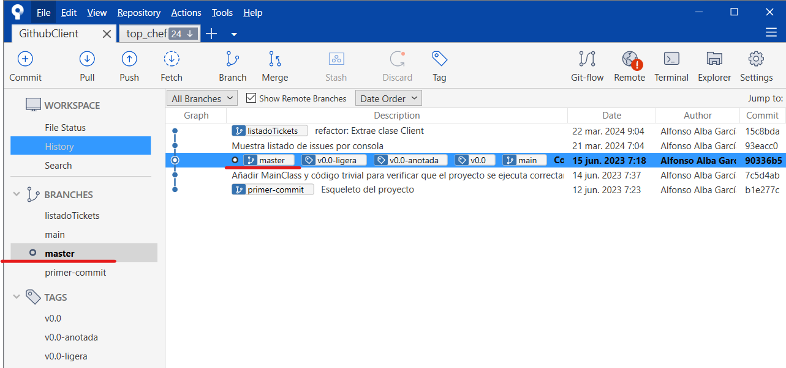
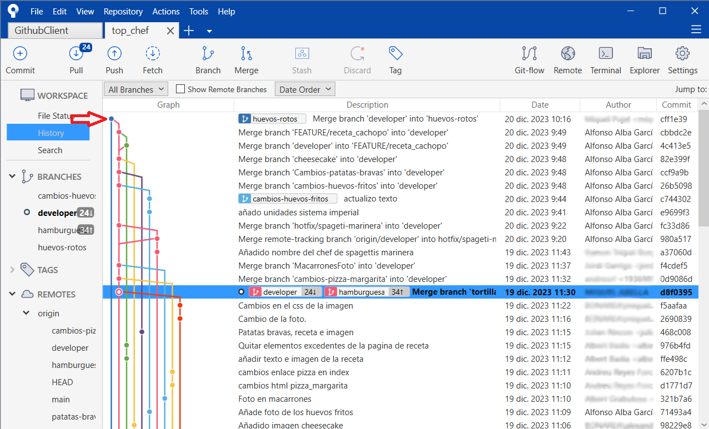

## Integración de ramas (`git merge`)

Notes: 
En esta sección veremos cómo integrar ramas utilizando
el comando `git merge`

^^^^^^

#### Integración de ramas (`git merge`)


¿Para qué se usan las ramas? 

**para disponer de múltiples contextos**

Notes:

Las ramas en los sistemas de control de versiones se utilizan para disponer de varios
contextos en los que poder desarrollar. El caso más habitual es el de los 
*feature branches*, o ramas de funcionalidad, en el que creamos una rama por cada
funcionalidad en la que estamos trabajando.

Disponer de una rama por cada una de esas funcionalidades nos permite cambiar de una otra 
y avanzar en el desarrollo de cada una de ellas.

La pregunta que surge entonces es ¿qué ocurre cuando hemos terminado con una de esas 
funcionalidades y la queremos subir a producción o compartirla con el resto del equipo
en nuestra rama `desarrollo`?

^^^^^^

#### Integración de ramas (`git merge`)

Operación que existe en todos los sistemas de control de versiones

Notes:

La operación de integración, mezcla o *merge* es una operación que existe en todos los sistemas de 
control de versiones. Puede cambiar el nombre, y desde luego cambia la implementación, pero la idea 
o el concepto es el mismo: partiendo de un mismo código fuente, hemos creado dos o más funcionalidades
*en paralelo* y ahora queremos integrarlas (o juntarlas si queremos usar un lenguaje más de andar por casa).

Como he comentado, la implementación de esta operación es totalmente distinta en cada sistema de control
de versiones. Aunque el concepto de mezclar dos ramas existe en  `git` y  `subversion`, la implementación 
en uno y en otro es totalmente diferente.

^^^^^^

#### Integración de ramas (`git merge`)

- Empiezo el trabajo de una nueva funcionalidad A
  en una rama 
- Cuando ese trabajo en A se termine, lo **integraré** en `master` 
- Si mientras estoy trabajando en A, necesito parar y cambiar para desarrollar
  B, utilizo una nueva rama B para esa funcionalidad 
- Cuando termine esa funcionalidad B, la **integraré** en `master`
- Volveré entonces a la rama A para continuar con esa funcionalidad

^^^^^^

#### Integración de ramas (`git merge`)

- *Me voy* a la rama **en la que quiero integrar**
- *Me traigo* la rama que contiene el código que quiero integrar 

^^^^^^

#### Integración de ramas (`git merge`)

¿En qué rama quiero integrar?

💡En `master`

```shell
> git switch master
```
¿En qué rama está el código que quiero integrar en `master`?

💡En `tarea-1234`

```shell
> git merge tarea-1234
```

^^^^^^

#### Integración de ramas (`git merge`)

Haciéndonos estas dos preguntas, nos aseguraremos de integrar las ramas de manera correcta.

^^^^^^

#### Ejercicio 1: *feature branch*
- Objetivo: Obtener listado de *Pull Requests* de un repositorio
- Convenio: `master` apuntará al último código que está en producció> 

Notes:

En este ejercicio vamos a intentar predecir qué va a pasar cuando hagamos las operaciones 
de `git` indicadas en la diapositiva. Debes dibujar paso a paso qué va a pasar en 
`Sourcetree` a medidaEn este punto del curso, especialmente si no 
has trabajado con `git` antes, seguramente pienses que te falta información (cosa que es 
cierta 😁) o que no *sabes* todavía qué va a pasar. Lo sé. El objetivo que busca este 
ejercicio es que utilices tu intuición. Dibuja sin pensarlo demasiado qué crees que va 
a pasar, da igual si aciertas o no, eso no es lo importante. Lo importante de este 
ejercicio es que averigues si tu intuición está bien encaminada o no.

Recomiendo que vayas dibujando progresivamente. Sigue los pasos de la diapositiva
y dibuja qué veremos en `Sourcetree` cuando hagas cada uno de los pasos.


^^^^^^

#### Ejercicio 1: *feature branch*
- Procedimiento:
  - Crear rama 
  - Confirmamos unos primeros cambios al repositorio
  - Confirmamos unos segundos cambios al repositorio
  - Validamos que está listo para distribuir (esto no se dibuja)
  - Desplegamos (= integrar cambios en `master` y distribuir un nuevo `jar`)
- Dibujalo en `paint` y compartelo en el chat (o comparte tu pantalla)

^^^^^^

#### *fast-forward merge* 

**¿Qué es un *fast-forward merge*?**

Ocurre cuando hay una ruta directa en la estructura de datos que une

la rama que se quiere integrar 

con la rama activa

Notes:

Cuando ejecutamos la operación de integración, `git` utiliza un algoritmo para recorrer grafos y verifica si
existe una ruta en la estructura de datos que une la rama que se quiere integrar (en realidad la confirmación
al que apunta esa rama) con la rama activa.

Si esa ruta existe, `git` moverá la rama activa y hará que apunte a la misma confirmación a la que apunta
la rama que queremos integrar.

^^^^^^

#### *fast-forward merge* 

**¿Qué es un *fast-forward merge*?**

Si esa ruta directa existe, significa que 

ya existe una confiración en el repositorio que contiene:

código rama activa + código que queremos integrar

`git` **mueve el puntero al último commit de la rama que queremos integrar**

Notes:

La existencia de esa ruta entre ambas ramas implica que ya existe una confirmación en el repositorio que contiene
el código de la rama activa más el código que queremos integrar. Por este motivo `git` sólo tiene que mover
la rama activa y hacer que apunte a la misma confirmación a la que apunta rama que queremos integrar. Es decir,
`git` lo único que hace en este tipo de integración es mover un puntero.
^^^^^^

#### *fast-forward merge*: Ejemplos 




Notes:

Este es el caso que veremos en los talleres. Aquí se ve muy bien cómo, efectivamente, la rama `listadoTickets` ya
contiene el código que ta tenemos en `master` más el código que queremos integrar.

^^^^^^

#### *fast-forward merge*: Ejemplos 




Notes:

Al integrar la rama `huevos-fritos` en la rama `develop`, `git` verifica que existe un camino en el grafo que une
ambos *commits*. Eso sigfica que ya existe una confirmación que contiene lo que hay en la rama activa (`develop`)
y el código que queremos integrar (`huevos-fritos`). Por este motivo `git` sólo moverá el puntero.

^^^^^^

#### *fast-forward merge*

No hace falta *saber* si al ejecutar `git merge` 

este será *fast-forward* o no

`git` sabe si lo tiene que hacer o no

Notes:

Cuando ejecutamos el comando `git merge`, es `git` (en la configuración por defecto) quién decide si hace 
*fast-foward* o no. Sin embargo, es importante entender en qué consiste esta operación para entender
por qué el grafo del repositorio queda como queda después de ejecutar el comando `merge`.

Entendiendo esta operación podemos decidir si queremos o no que `git` haga las integraciones de código de esta manera,
como veremos en diapositivas posteriores.

^^^^^^

#### Ejercicio 2: Cambio de contexto 

- Objetivo: cambio de contexto 
- Convenio: `master` apuntará al último código que está en producción 


Notes:
Seguimos dibujando, mismas instrucciones del ejercicio anterior

En este caso, usaremos las ramas para cambiar de contexto. Empezamos a desarrollar una 
tarea en una rama y, sin llegar a terminar el trabajo, nos vemos en la necesidad
de implementar y desplegar otra tarea. Una vez terminado el trabajo en esta segunda
rama, volvemos a la primera y la terminamos.

^^^^^^

#### Ejercicio 2: Cambio de contexto 

- Procedimiento (parte 1/2):
  - Crear rama
  - Confirmamos unos primeros cambios en esa rama
  - Confirmamos unos segundos cambios en esa rama
  - Nos piden hacer otra tarea
  - Crear rama para la segunda tarea
  - Confirmar los cambios de la segunda tarea
  - Deplegar los cambios de la segunda tarea

^^^^^^

#### Ejercicio 2: Cambio de contexto 

- Procedimiento (parte 2/2):
  - Volver a la primera rama 
  - Confirmar los cambios que finalizan esta tarea
  - Desplegar

^^^^^^

#### *Merge commits* 

^^^^^^

#### *Merge commits*: `--no-ff`

¿qué perdemos con un *fast-forward* merge? info de quién y cuándo se hace el merge

Si queremos esa info, podemos forzar ese merge commit

HAcer captura del ejemplo 1 de ff pero haciéndolo no-ff

Notes:
Los principales proveedores de servidores de git hacen en al integrar un PR sea --no-ff

^^^^^^ 

#### Notas sobre los ejercicios

- Utiliza las preguntas:
  - ¿qué quiero hacer con mi vida?
  - ¿en qué rama quiero integrar?
  - ¿dónde está el código que quiero integrar?


- No hay recetas: debemos tener claro qué queremos conseguir 
  (qué queremos hacer con nuestra vida) antes de hacer las operaciones de `git`
- Hay dos tipos de merge: *fast-forward* y *non fast-forward*, este último genera un *merge commit*

^^^^^^ 

#### Notas sobre los ejercicios

- Recuerda el objetivo del ejercicio: ver cómo va tu intuición 

¿Tienes las vías del tren todavía en tu cabeza?


^^^^^^

#### Taller 3.6: *feature branches* y *fast-forward merge* 

[Ir al Taller 3.6](../../talleres/taller-3-6-go-vscode.html)

^^^^^^

#### Taller 3.7: Cambio de contexto y *merge commits*

[Ir al Taller 3.7](../../talleres/taller-3-7-go-vscode.html)
