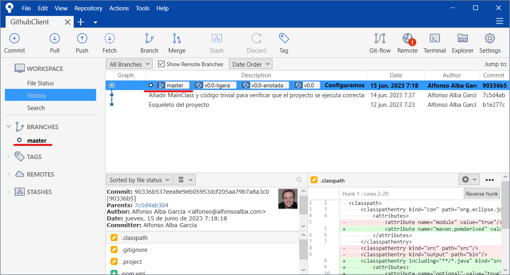
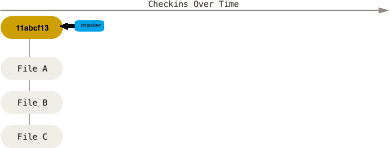
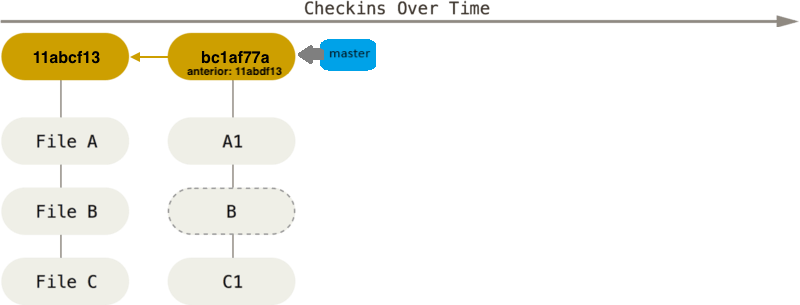
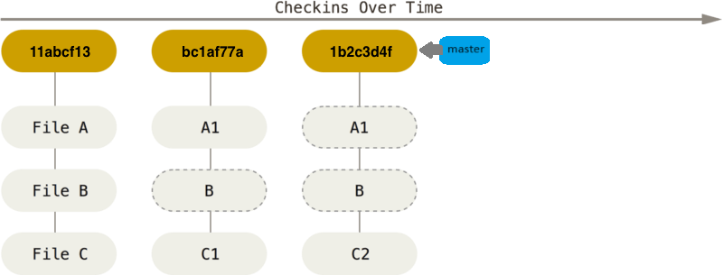
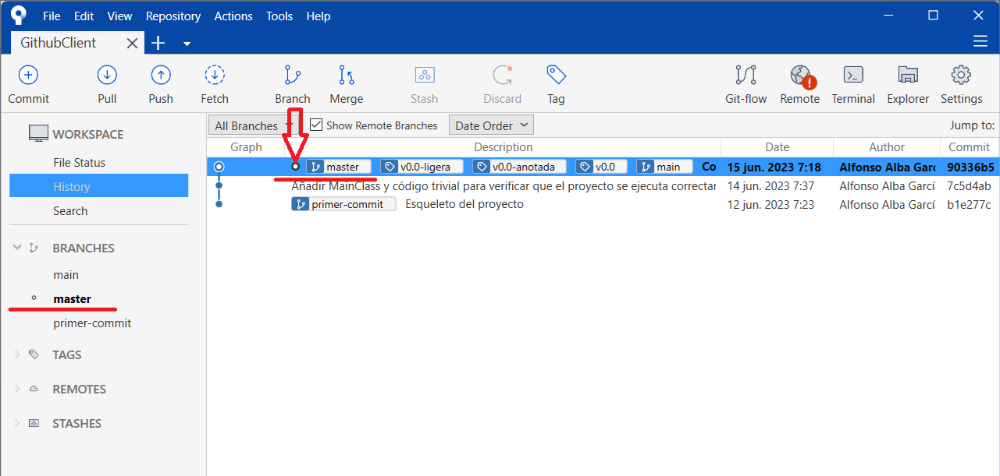
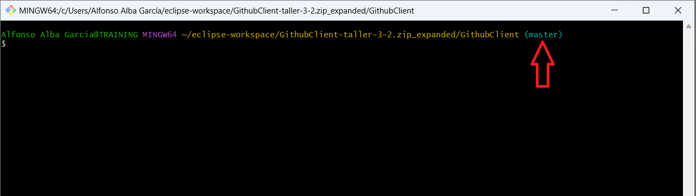

## Ramas (*branches*)

Notes: 
En esta sección veremos qué son las ramas, cómo funcionan y qué 
uso les podemos dar.

^^^^^^

#### ¿Qué es una rama en `git`?

Una rama en `git` es como una etiqueta

Es un fichero de texto plano que se guarda en el disco duro

y contiene el *hash* de una confirmación 

^^^^^^

#### ¿Qué NO es una rama en `git`?

Una rama 

**NO ES CONTENEDOR DE *COMMITS***

Una rama en git 

**ES UN PUNTERO CON UN NOMBRE**

^^^^^^ 

#### ¿Qué es una rama?



Notes:
Si miramos nuestro repositorio veremos que hasta el momento hemos estado 
trabajando con una única rama: **master**

^^^^^^

#### ¿Qué es una rama?

```shell 
> cat .git/refs/heads/master
90336b537eea8e9eb05953dcf205aa79b7a8a3c0 

```
Notes:

Una rama en git es un fichero de texto plano que está en la carpeta 
`.git/refs/heads` que contiene el _checksum_ de la confirmación a la que apunta
la rama, en nuestro caso `90336b537eea8e9eb05953dcf205aa79b7a8a3c0`.

^^^^^^

#### ¿Qué es una rama?

En un commit se guarda información:
- Nombre y correo electrónico del autor
- Fecha
- Mensaje
- *checksum* de la confirmación/es anterior/es

**No se almacena a qué rama se confirmaron los cambios**

Notes:
`git` no guarda la rama a la que se confirmaron los cambios cuando estos se 
confirmaron. De hecho, la frase *confirmar los cambios en una rama* no tiene
ningún sentido ni es correcta ya que **las ramas en `git` no son contenedores
de *commits***. Aunque es una expresión que se utiliza constantemente,
es importante entender que los cambios se confirman y punto, no se confirman 
*a una rama*. En las siguientes diapositivas seguiremos explorando esta idea.


^^^^^^

#### ¿Qué es una rama?

¿Qué ocurrió cuando confirmamos los primers cambios?



Notes:

Cuando confirmamos los primeros cambios, `git` creó el *snapshot*, añadió los datos
(nombre, correo electrónico, fecha, mensaje y *cheksum* de la confirmación anterior)
lo guardo los objetos de `git` en la carpet `.git/objects`. Hasta aquí es lo 
que ya sabíamos que pasaba. Pero hizo algo más:
- creó la rama `master`
- hizo que la rama `master` apuntase a la confirmación que acabamos de crear

^^^^^^

#### ¿Qué es una rama?

¿Porqué `git` llamó `master` a la rama?

Es el nombre que se utiliza por defecto

Se puede cambiar mediante configuración 

```shell 
> git config --global init.defaultBranch main
```

Notes:

Cuando inicializamos el repositorio utilizando `git init`, se crea una rama  que se llama
`master` por defecto. Hasta la versión 2.28 de `git`, el nombre de esta rama estaba 
puesta en el código fuente de `git`. A raíz del asesinato de George Floyd y de las protestas 
encabezadas por la organización *Black Lives Matter* en 2020 
([más información](https://www.cnet.com/tech/computing/microsofts-github-is-removing-coding-terms-like-master-and-slave/)), `Microsoft` encabezó una 
iniciativa a través de la cual se decidió dar la opción de cambiar este nombre
(que tiene connotaciones racistas para muchas personas)
mediante la configuración de `git`. 

A lo largo de 2020 y 2021, los principales servidores de `git` (`GitLab`, `GitHub`, 
`Bitbucket`, `Azure DevOps`) cambiaron el nombre de la rama por defecto de sus repositorios 
a `main`.

¿Porqué no se ha puesto `main` por defecto? Empezar un repositorio nuevo con `main` en lugar
de `master` es algo trivial. Sin embargo, cambiar el nombre de la rama principal en 
un reposotorio ya existente con un equipo de múltiples personas integrado con sistemas
de integración contínua, no es una tarea que se haga de manera directa. Para mantener 
compatibilidad hacia atrás y evitar obligar a los equipos a hacer este cambio, 
se decició hacerlo por configuración. Así, cada equipo puede decidir qué hacer 
con sus repositorios existentes sin presión externa.


- [Regarding Git and Branch Naming](https://sfconservancy.org/news/2020/jun/23/gitbranchname/)
- [GitHub Blog: introducing init.defaultBranch](https://github.blog/2020-07-27-highlights-from-git-2-28/#introducing-init-defaultbranch)
- [GitHub - Repositorio con explicación](https://github.com/github/renaming)
- [Gitlab - New git default branch name](https://about.gitlab.com/blog/2021/03/10/new-git-default-branch-name/)
- [Superuser -  Change git init default branch](https://superuser.com/questions/1419613/change-git-init-default-branch-name)
^^^^^^

#### ¿Qué es una rama?

¿Qué ocurrió cuando confirmamos los siguientes cambios?



Notes:

Casi lo mismo que cuando confirmamos los primeros cambios, pero sin crear la rama:
`git` creó el *snapshot*, añadió los datos
(nombre, correo electrónico, fecha, mensaje y *cheksum* de la confirmación anterior)
guardó los objetos de `git` en la carpeta `.git/objects`, e hizo que la rama `master`
apuntase a la última confirmación.

^^^^^^

#### ¿Qué es una rama?

¿Qué ocurrió cuando confirmamos los ultimos cambios?



^^^^^^

#### ¿Qué es una rama?: qué ocurre cuando confirmamos los cambios

- Crea una foto del código fuente completa
- Añade nombre, correo electrónico, *checksum* de la confirmación anterior, etc
- Calcula el *checksum*
- Guarda los objetos de git en la carpeta `.git/objects`
- **Mueve la rama activa para que apunte al último *commit***

^^^^^^

#### ¿Qué es una rama?

<u>Fichero en el disco duro</u> que contiene el *checksum* de una confirmación de cambios 

Notes:

Una rama es un fichero en el disco duro, lo que significa que todo lo que hablamos para las 
etiquetas se aplica también a las ramas.

^^^^^^ 

#### ¿Qué es una rama?

- Podemos crear tantas como queramos
- No puedo tener dos ramas con el mismo nombre
- Cuidado con los caracteres especiales y las mayúsculas / minúsculas
- Máximo número de caracteres marcado por el sistema de ficheros
- Se pueden usar *carpetas* para agrupar las ramas 
- A un *commit* pueden apuntar múltiples ramas, pero una rama sólo puede apuntar a un *commit* 
- Recomendable acordar un convenio para nombrarlas

Notes:

Como he comentado en la diapositiva anterior, una rama se implementa en `git` como una etiqueta. Es un fichero, 
por lo tanto, todo lo que dijimos sobre los nombres de las etiquetas es aplicable a los nombres de las ramas.

^^^^^^
#### ¿Qué es master?

`master` es un puntero a los últimos cambios confirmados

Recuerda que `git` creó `master` cuando confirmamos los primeros cambios y le puso ese nombre porque está en la configuración

`master` para `git` no significa nada

**`master` significa algo para nosotros pero no para git** 

Notes:

Normalmente, los equipos de desarrollo usan las ramas de nombre `master`, `main` o `produccion` para saber cuál es el 
último *commit* que está en producción. 

Pero esto es un convenio. Es algo que decidimos *nosotros*. Para `git`, la rama `master` es igual de importante 
o de irrelevante que el resto de las ramas que tengamos en nuestro repositorio. Para `git`, 
`master` no es más que un puntero a una confirmación de cambios.

^^^^^^

#### Taller 3.3: Renombrando `master`

[Ir al Taller 3.3](../../talleres/taller-3-3-java-eclipse.html)

^^^^^^

#### Taller 3.4: Creación y borrado de ramas locales


[Ir al Taller 3.4](../../talleres/taller-3-4-java-eclipse.html)

^^^^^^

#### Rama activa: HEAD

`HEAD` es un puntero que le dice a `git` cuál es la rama activa 

```shell
> cat .git/HEAD 
ref: refs/heads/master
```

**HEAD apunta a la rama cuya instantánea estoy viendo en mi área de trabajo**

**HEAD apunta a la rama que apuntará a la siguiente confirmación de cambios**

Notes:
En el taller anterior (3.4) creamos varias ramas en el repositorio. Tuvimos cuidado de 
no cambiar la rama activa cuando lo hicimos, de forma que durante todo el taller, la rama
activa (`master`) no cambió.

^^^^^^

#### Rama activa: HEAD

¿Cómo sabemos cuál es la rama activa?




Notes:

En `SourceTree` la rama activa se nos indica de dos maneras:
- En negrita con un punto blanco en la sección *Branches* en el menú de la izquierda
- Con un punto blanco en el *log*

^^^^^^

#### Rama activa: HEAD

```shell
> git branch 
  main
* master
  primer-commit
```

```shell
> git status
On branch master
nothing to commit, working tree clean
```

```shell
> git branch --show-current # git >= 2.22
master
```
Notes:

Utilizando la línea de comandos disponemos de varios comandos para ver cuál es la rama activa.

Si estás utilizando un intérprete como `bash`, `zsh` o `git bash` (Windows), es sencillo configurar
el *prompt* del sistema para que muestre la rama activa. Si abrís una consola en la carpeta
del proyecto desde `SourceTree` veréis que el *prompt* ya está cofigurado para que la muestre:



^^^^^^

#### Cambiar rama activa

Comandos que cambian la rama activa: `git checkout` y `git switch`

- `HEAD` apunta la nueva rama 
- En el área de trabajo veremos la instantánea a la que apunta la nueva rama activa 

En `SourceTree` se realiza haciendo doble click sobre la rama que queremos activar

Notes:

Cambiar la rama activa no es simplemente cambiar `HEAD`. Es decir, no vale editar el fichero 
`.git/HEAD` a mano y cambiar 

```
ref: refs/heads/master
```
por

```
ref: refs/heads/prueba
```

Al cambiar la rama activa, no sólo se cambia a dónde apunta `HEAD`. `git` se encarga de *cambiar* 
también nuestro área de trabajo y extrae en él la instantánea a la que apunta la nueva rama activa.

¿Qué ocurre si en la nueva instantánea no existen ficheros que existen en el área de trabajo? `git`
los borrará. Cuando cambiamos la rama activa, es como si `git`:
- Guardase los cambios que hay en el área de trabajo
- Borra el área de trabajo
- Extrae la nueva instantánea (nueva rama activa)
- Recupera los cambios en el área de trabajo

No es exactamente esto lo que hacen los comandos, pero nos sirve para entender a grandes rasgos qué ocurre.

## ¿porqué hay dos comandos?

Tradicionalmente, el comando que se utilizaba para cambiar de rama era `git checkout`. 
El problema es que ese comando sirve para muchas cosas. Por ejemplo, para recuperar
la versión de un fichero de una instantánea anterior, o para sacar los ficheros del 
área de ensayo.

Con objeto de poder diferenciar los dos usos (cambiar de rama vs. recuperar ficheros)
en la versión 2.23 se introdujo el comando `git switch` que es el que se recomienda
usar para cambiar de rama.

`git` intenta no romper compatibilidad hacia atrás, por lo que el comando `git checkout` sigue pudiendo
hacer la operación. Eso sí, las nuevas opciones y funcionalidades relacionadas con cambiar de rama 
sólo se implementan ya para el comando `git switch`.

^^^^^^

#### Taller 3.5: Cambiar la rama activa

[Ir al Taller 3.5](../../talleres/taller-3-5-java-eclipse.html)

^^^^^^

#### Integración de ramas (`git merge`)


¿Para qué se usan las ramas? 

**para disponer de múltiples contextos**

Notes:

Las ramas en los sistemas de control de versiones se utilizan para disponer de varios
contextos en los que poder desarrollar. El caso más habitual es el de los 
*feature branches*, o ramas de funcionalidad, en el que creamos una rama por cada
funcionalidad en la que estamos trabajando.

Disponer de una rama por cada una de esas funcionalidades nos permite cambiar de una otra 
y avanzar en el desarrollo de cada una de ellas.

La pregunta que surge entonces es ¿qué ocurre cuando hemos terminado con una de esas 
funcionalidades y la queremos subir a producción o compartirla con el resto del equipo
en nuestra rama `desarrollo`?

^^^^^^

#### Integración de ramas (`git merge`)

Operación que existe en todos los sistemas de control de versiones

Notes:

La operación de integración, mezcla o *merge* es una operación que existe en todos los sistemas de 
control de versiones. Puede cambiar el nombre, y desde luego cambia la implementación, pero la idea 
o el concepto es el mismo: partiendo de un mismo código fuente, hemos creado dos o más funcionalidades
*en paralelo* y ahora queremos integrarlas (o juntarlas si queremos usar un lenguaje más de andar por casa).

Como he comentado, la implementación de esta operación es totalmente distinta en cada sistema de control
de versiones. Aunque el concepto de mezclar dos ramas existe en  `git` y  `subversion`, la implementación 
en uno y en otro es totalmente diferente.

^^^^^^

#### Integración de ramas (`git merge`)

- Empiezo el trabajo de una nueva funcionalidad A
  en una rama 
- Cuando ese trabajo en A se termine, lo **integraré** en `master` 
- Si mientras estoy trabajando en A, necesito parar y cambiar para desarrollar
  B, utilizo una nueva rama B para esa funcionalidad 
- Cuando termine esa funcionalidad B, la **integraré** en `master`
- Volveré entonces a la rama A para continuar con esa funcionalidad

^^^^^^

#### Integración de ramas (`git merge`)

- *Me voy* a la rama **en la que quiero integrar**
- *Me traigo* la rama que contiene el código que quiero integrar 

^^^^^^

#### Integración de ramas (`git merge`)

¿En qué rama quiero integrar?

💡En `master`

```shell
> git switch master
```
¿En qué rama está el código que quiero integrar en `master`?

💡En `tarea-1234`

```shell
> git merge tarea-1234
```

^^^^^^

#### Integración de ramas (`git merge`)

Haciéndonos estas dos preguntas, nos aseguraremos de integrar las ramas de manera correcta.

^^^^^^

#### Ejercicio 1: *feature branch*
- Objetivo: Obtener listado de *Pull Requests* de un repositorio
- Convenio: `master` apuntará al último código que está en producció> 

Notes:

En este ejercicio vamos a intentar predecir qué va a pasar cuando hagamos las operaciones 
de `git` indicadas en la diapositiva. Debes dibujar paso a paso qué va a pasar en 
`Sourcetree` a medidaEn este punto del curso, especialmente si no 
has trabajado con `git` antes, seguramente pienses que te falta información (cosa que es 
cierta 😁) o que no *sabes* todavía qué va a pasar. Lo sé. El objetivo que busca este 
ejercicio es que utilices tu intuición. Dibuja sin pensarlo demasiado qué crees que va 
a pasar, da igual si aciertas o no, eso no es lo importante. Lo importante de este 
ejercicio es que averigues si tu intuición está bien encaminada o no.

Recomiendo que vayas dibujando progresivamente. Sigue los pasos de la diapositiva
y dibuja qué veremos en `Sourcetree` cuando hagas cada uno de los pasos.


^^^^^^

#### Ejercicio 1: *feature branch*
- Procedimiento:
  - Crear rama 
  - Confirmamos unos primeros cambios al repositorio
  - Confirmamos unos segundos cambios al repositorio
  - Validamos que está listo para distribuir (esto no se dibuja)
  - Desplegamos (= integrar cambios en `master` y distribuir un nuevo `jar`)
- Dibujalo en `paint` y compartelo en el chat (o comparte tu pantalla)

^^^^^^

#### *fast-forward merge* 


^^^^^^

#### Ejercicio 2: Cambio de contexto 

- Objetivo: cambio de contexto 
- Convenio: `master` apuntará al último código que está en producción 


Notes:
Seguimos dibujando, mismas instrucciones del ejercicio anterior

En este caso, usaremos las ramas para cambiar de contexto. Empezamos a desarrollar una 
tarea en una rama y, sin llegar a terminar el trabajo, nos vemos en la necesidad
de implementar y desplegar otra tarea. Una vez terminado el trabajo en esta segunda
rama, volvemos a la primera y la terminamos.

^^^^^^

#### Ejercicio 2: Cambio de contexto 

- Procedimiento (parte 1/2):
  - Crear rama
  - Confirmamos unos primeros cambios en esa rama
  - Confirmamos unos segundos cambios en esa rama
  - Nos piden hacer otra tarea
  - Crear rama para la segunda tarea
  - Confirmar los cambios de la segunda tarea
  - Deplegar los cambios de la segunda tarea

^^^^^^

#### Ejercicio 2: Cambio de contexto 

- Procedimiento (parte 2/2):
  - Volver a la primera rama 
  - Confirmar los cambios que finalizan esta tarea
  - Desplegar

^^^^^^

#### *Merge commits* 

^^^^^^ 

#### Notas sobre los ejercicios

- Utiliza las preguntas:
  - ¿qué quiero hacer con mi vida?
  - ¿en qué rama quiero integrar?
  - ¿dónde está el código que quiero integrar?


- No hay recetas: debemos tener claro qué queremos conseguir 
  (qué queremos hacer con nuestra vida) antes de hacer las operaciones de `git`
- Hay dos tipos de merge: *fast-forward* y *non fast-forward*, este último genera un *merge commit*

^^^^^^ 

#### Notas sobre los ejercicios

- Recuerda el objetivo del ejercicio: ver cómo va tu intuición 

¿Tienes las vías del tren todavía en tu cabeza?


^^^^^^

#### Taller 3.6: *feature branches* y *fast-forward merge* 

[Ir al Taller 3.6](../../talleres/taller-3-6-java-eclipse.html)

^^^^^^

#### Taller 3.7: Cambio de contexto y *merge commits*


^^^^^^
- Operaciones sobre ramas
  - Crear y borrar ramas
  - Cambiar la rama principal (`git switch`)
  - Merge
- ¿Qué es master? Cambiar el nombre de master por tortilla_de_patatas, etc...

- Ejercicio 1 (dibujando): crear rama y mergear
- Ejercicio 2 (dibujando): cambio de contexto, crear rama, cambiar de rama, desplegar, cambiar a primera rama, terminar y mergear
- Taller 1 
- Taller 2

- Más sobre nombres de ramas:
  - usar sistemas de gestion de proyectos y poner en la rama el código de la tarea
  - Poner el nombre del ticket en la descripción de la tarea
