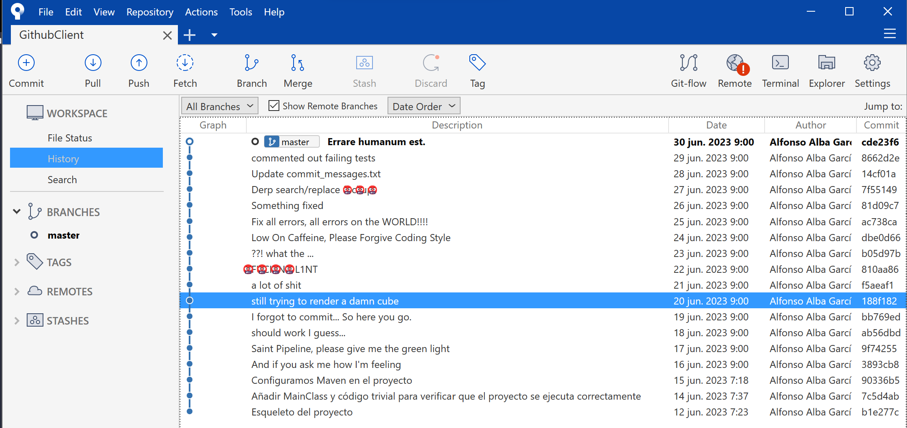

## Referencias

Notes:

En esta sección veremos qué son las referencias y los distintos tipos de 
referencias que nos podemos encontrar.

^^^^^^

#### Git sólo sabe hacer tres cosas

1. ✅ Crear instantáneas de código (_snapshots_)
1. ✅ Almacenar esos snapshots en una estructura de datos
1. Gestionar punteros

Notes:
En la introducción del curso, comentamos que git sólo sabe hacer tres cosas.
Ya hemos visto cómo crea instantáneas de código y almacena esas instantáneas 
en una estructura de datos que, hasta el momento, ha sido una lista 
simplemente enlazada.

En esta sección veremos qué son las referencias y cómo se usan.

^^^^^^

#### Referencias

- Etiquetas (_tags_)
- Ramas (_branches_)
- HEAD
- Ramas remotas (_remote branches_)

Notes:

Git utiliza estos 4 tipos de referencias, que definiremos en las siguientes
diapositivas. En esta seccion hablaremos sólo de etiquetas y ramas. 
De HEAD y las ramas remotas hablaremos más adelante en el curso.

^^^^^^

#### Etiquetas

Notes: 
Mensajes sacados de https://whatthecommit.com 

^^^^^^

