## Borrado y recuperación del grafo

Notes:
En esta sección, vamos a eliminar (casi) todas las referencias, perdiendo todas las confirmaciones de cambios que hemos 
hecho. ¿Tendremos después manera de recuperarlas?

^^^^^^

#### Borrando el grafo

¿Qué ocurriría si borramos la rama `listadoTickets`?


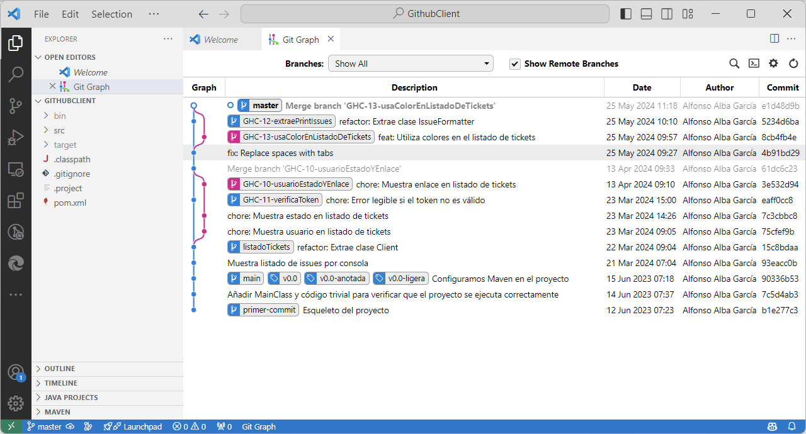

Notes:

Antes de pasar a la siguiente diapositiva, intenta adivinar cómo va cambiar
el grafo.

^^^^^^

#### Borrando el grafo

Seguiríamos viendo todo el repositorio

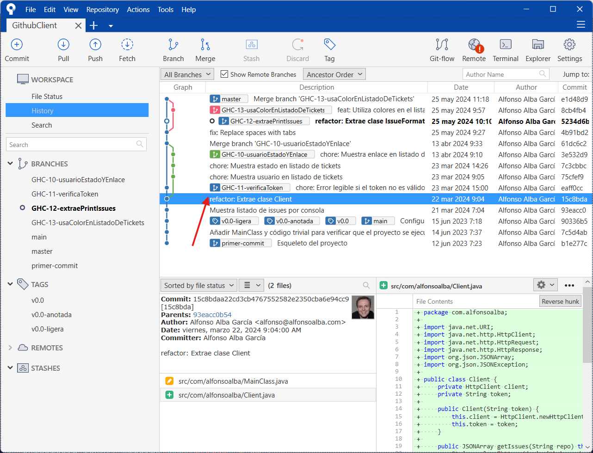

Notes:

Si borramos la rama `listadoTickets`, lo único que veremos en el grafo es que desaparece esa referencia, eso es todo. 

Cuando `Sourcetree` recorra la carpeta `.git/refs`, dibujará el resto de referencias y como desde `master` podemos 
llegar a todas las confirmaciones de cambios, seguiremos
viendo todo el grafo.

^^^^^^

#### Borrando el grafo


¿Y si borramos la rama `GHC-12-extraePrintIssues`

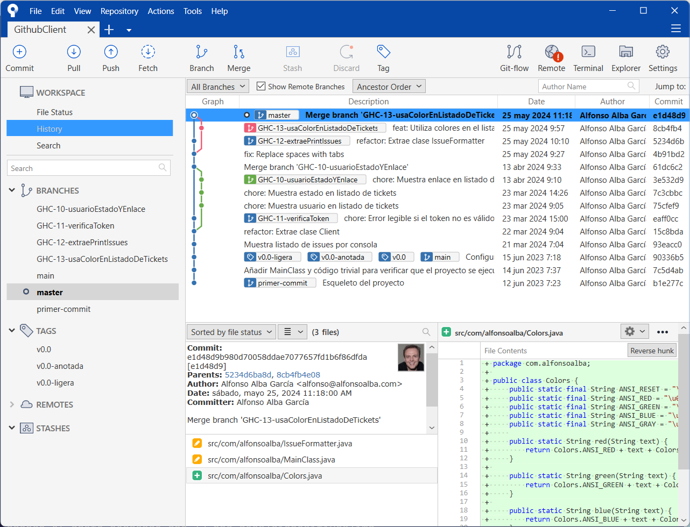

Notes:

Antes de pasar a la siguiente diapositiva, intenta adivinar cómo va cambiar
el grafo.

^^^^^^

#### Borrando el grafo


Seguiremos viendo todo el grafo

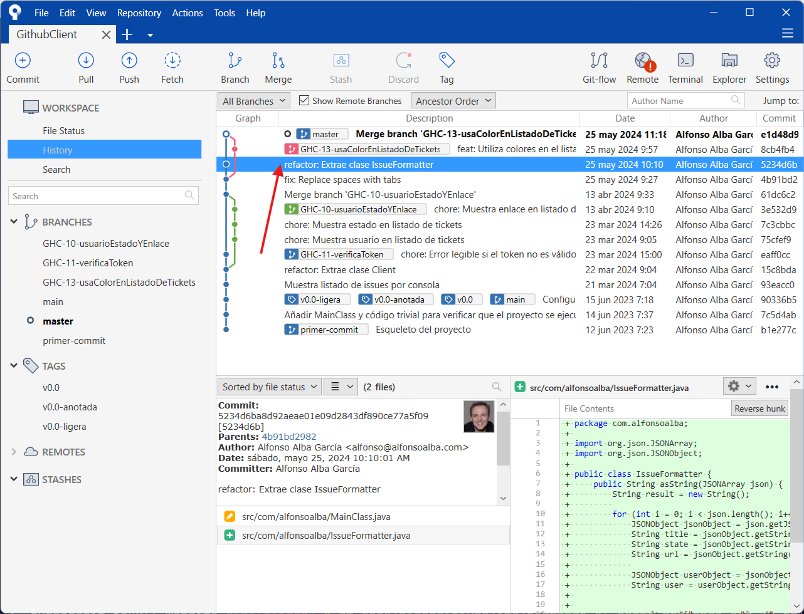

Notes:

Estamos en la misma situación de antes: como desde `master` podemos llegar a todas las confirmaciones de cambios,
lo único que veremos en `Sourcetree` es que la referencia `GHC-12-extraePrintIssues` desaparece.


^^^^^^

#### Borrando el grafo


¿Y si borramos la rama `master`?

😱😱😱😱😱

Notes:

Antes de pasar a la siguiente diapositiva, intenta adivinar cómo va cambiar
el grafo.

^^^^^^

#### Borrando el grafo


En este caso dejamos de ver dos `commits`


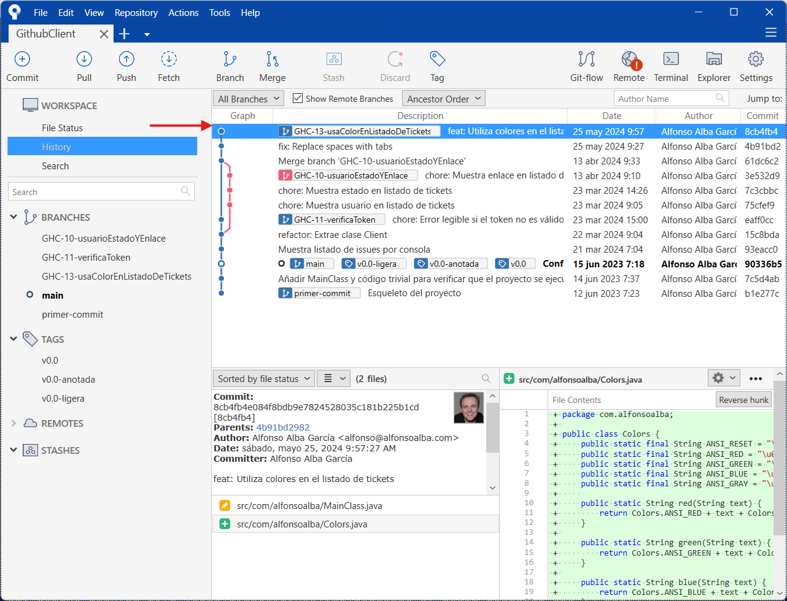

Notes:

Al borrar `master`, `Sorcetree` no tiene ninguna referencia que le lleve a las confirmaciones 
`e1d48d9` ni `5234d6b` (puedes buscarlas en las diapositivas anteriores). Por este motivo,
no las dibuja.

^^^^^^

#### Borrando el grafo


¿Y si borramos todas las referecinas excepto la rama `main`?

😱😱😱😱😱 😱😱😱😱😱 😱😱😱😱😱

Notes:

Antes de pasar a la siguiente diapositiva, intenta adivinar cómo va cambiar
el grafo.

^^^^^^

#### Borrando el grafo


Solo veremos tres confirmaciones de cambios


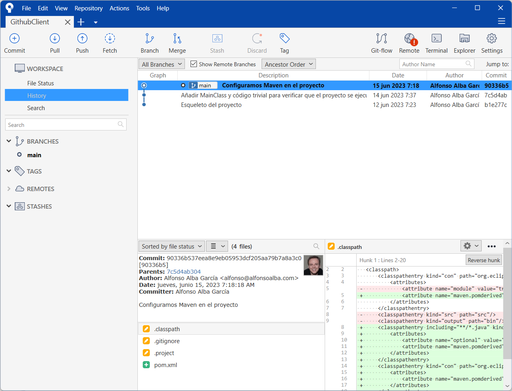

Notes:

Al borrar todas las referencias excepto `main`, `Sourcetree` sólo tiene un punto de entrada: la rama `main`. Ve que 
la rama apunta a la confirmación `90336b5`, la dibuja y sigue dibujando sus ancestros. Eso es lo que vemos 
en la captura de pantalla.

^^^^^^

#### Borrado de ramas 

Notes:
Para poder hacer el taller, necesitamos borrar ramas. Hablaremos de nuevo sobre borrardo de ramas
cuando hayamos visto cómo funcionan los repositorios remotos e introduzcamos
las ramas remotas.

^^^^^^

#### Borrado de ramas: `Sourcetree`

- En el menú de la izquierda, en la sección de ramas, hacer clic con el botón derecho sobre la rama que queremos borrar
- Seleccionar *Delete...*
- Confirmar el borrado

Notes:

Estos son los pasos a seguir para borrar una rama utilizando `Sourcetree`

^^^^^^

#### Borrado de ramas: `Sourcetree`

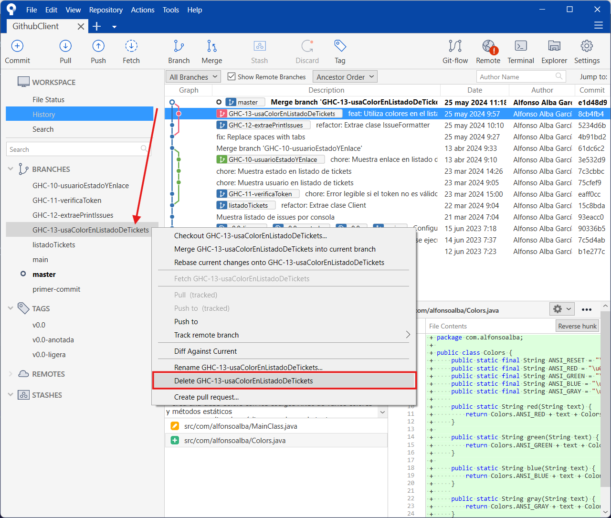

^^^^^^

#### Borrado de ramas: `Sourcetree`

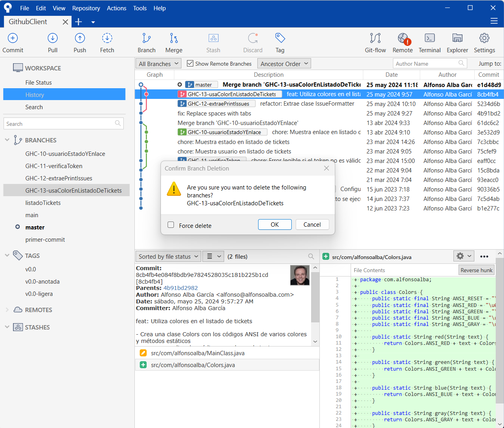

^^^^^^

#### Borrado de ramas: consola

```shell
> git branch -d [nombre-de-la-rama]
```

Notes:

La manera de borrar ramas es utilizar la opción `-d` del comando `git branch`.

^^^^^^

#### Borrado de ramas

No se puede borrar la rama activa

```shell
> git switch GHC-12-extraePrintIssues
> git branch -d GHC-12-extraePrintIssues
error: cannot delete branch 'GHC-12-extraePrintIssues' used by worktree at 'C:/Users/Alfonso Alba García/eclipse-workspace/GithubClient'
```

Notes:
No se puede borrar la rama activa de un repositorio. En la diapositiva vemos el mensaje de error que nos muestra 
git si intentamos borrarla.

Técnicamente, no es sólo la rama activa, sino cualquier rama que sea la rama activa en un `worktree`.
Un `worktree` es una carpeta, fuera de nuestro repositorio, en el que podemos hacer `checkout` de otra
rama. Es decir, `git` permite tener varias áreas de trabajo en carpetas diferentes, fuera de la carpeta 
del repositorio principal, cada una de ellas con una rama 
activa diferente.

```
/eclipse-workspace
|
|-/GithubClient       <----- Nuestro repositorio 
|
|-/GithubClient-GHC-24   <----- Carpeta (worktree) en la que la rama principal es GHC-24
```

Si una rama es la rama activa en alguno de estos `worktrees`, no se puede borrar.

^^^^^^

#### Borrado de ramas: forzar el borrado

Cuando borramos la rama con `Sourcetree` teníamos la opción al confirmar de *forzar el borrado*


^^^^^^

#### Borrado de ramas: ¿Cuándo forzar el borrado?
 
- No relacionado con la *importancia* de la rama 
- Es necesario forzar el borrado **si la rama que se quiere borrar NO está integrada en la rama activa**

Note:

Un error común al principio es pensar que la *importancia* de una rama
tiene algo que ver con tener que forzar el borrado. Recuerda
que para `git` todas las ramas tienen la misma importancia: ninguna.

Cuando vamos borrar una rama `git` hace una comprobación: ¿está la rama que queremos borrar
integrada en la rama activa? Si la rama está integrada no hace falta forzar el 
borrado. 

Eso significa que para borrar una rama, dependiendo de desde donde la queramos borrar
tendremos o no que forzar el borrado. Es un poco antiintuitivo, sí, pero si lo
pensamos un poco tiene su lógica: cuando borramos una rama, borramos uno de los
*puntos de entrada* para dibujar el grafo. Si la rama que queremos borrar no está
integrada en la rama activa, `git` piensa que puede haber confirmaciones de cambios
que dejemos de ver, y nos obliga a forzar el borrado. 

Podría implementarse un algoritmo de borrado que sea: si no puedo llegar a la 
rama que quiero borrar desde ninguna otra rama, entonces no hace falta forzar el
borrado. El problema de este algoritmo, en repositorios con cientos de miles
de ramas o con ramas muy antiguas, es que puede hacerse muy ineficiente.

^^^^^^

#### Borrado de ramas: ¿Cuándo forzar el borrado?

¿Cómo sabe `git` si una rama está integrada?

Si puedo llegar de la rama activa a la rama que quiero borrar **siguiendo el grafo**, la rama está integrada

Notes:

Para saber si una rama está integrada en la rama activa, `git` aplica un algoritmo
para recorrer grafos. Si puedo llegar de la rama activa a la rama que quiero borrar,
entonces la rama está integrada en la rama activa **y no hace falta forzar el borrado**.


^^^^^^

#### Borrado de ramas: Ejemplo 1

Para borrar `GHC-13` hay que forzar el borrado

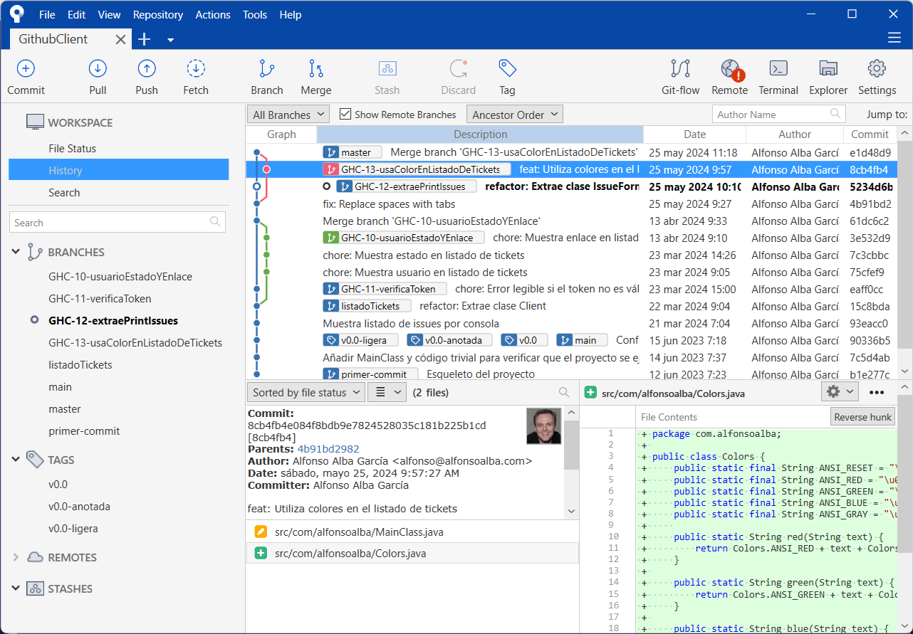

Notes:
Para poder borrar la rama `GHC-13` siendo `GHC-12` la rama activa, **es necesario forzar el borrado**
ya que no podemos llegar de `GHC-12` a `GHC-13`.

^^^^^^

#### Borrado de ramas: Ejemplo 2

Para borrar `GHC-13` NO hay que forzar el borrado


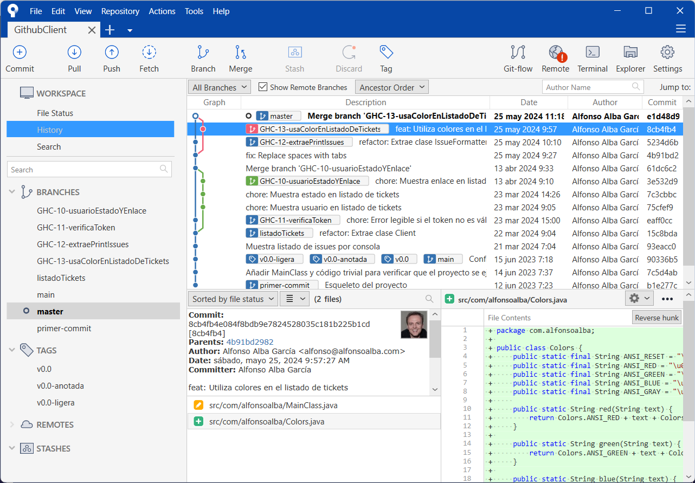

Notes:
Para borrar la rama `GHC-13` siendo `master` la rama activa, **NO es necesario forzar el borrado**
ya que podemos llegar de `master` a `GHC-13`.

Este es un buen ejemplo de cómo para borrar una misma rama tenemos que forzar el borrado
o no dependiendo de cuál sea la rama activa.

^^^^^^

#### Borrado de ramas: Forzar el borrado

En nuestro repositorio

si hacemos `master` la rama activa, podemos borrar cualquier rama

sin forzar el borrado 


^^^^^^

#### Borrando el grafo

[Taller 4.2: Borrando el grafo](../../talleres/taller-4-2-java-eclipse.html)

^^^^^^

#### Borrando el grafo

Tras el taller, así ha quedado nuestro repositorio


^^^^^^

## Recuperando el grafo

Notes:

Estamos en el punto en el que hemos borrado todas las referencias excepto una. Como resultado, hemos *perdido*
toda la historia posterior a esa referencia. Hemos visto cómo nuestros objetos de git siguen en la carpeta
`.git/objects` y por lo tanto, el problema que tenemos es que no vemos la historia **porque no tenemos ninguna rama
que nos permita llegar a las confirmaciones de cambios**.

En esta sección vamos a ver cómo podemos *recuperar* esas confirmaciones y volver a ver nuestro grafo completo.

^^^^^^

#### Recuperando el grafo: ¿qué necesitamos?

Para poder **ver** de nuevo toda la historia del repositorio

basta con

**crear una etiqueta o una rama que apunte a los últimos cambios que confirmamos**

Notes:

Si creamos un rama o una etiqueta que apunte a los últimos  cambios confirmados, tendremos un *punto de entrada*
le permitirá a `Sourcetree` llegar a todas las confirmaciones de cambios y con ello dibujar el grafo completo.

^^^^^^

#### Recuperando el grafo: ¿qué necesitamos?

¿cómo sabemos cuáles fueron los *últimos cambios confirmados*

si no vemos el grafo?

🤔

Notes:

Buena pregunta...

En las siguientes diapositivas y talleres, veremos cuatro maneras de averiguar cuál es el *hash* de los
últimos cambios que confirmamos.

^^^^^^

#### Recuperando el grafo 1: haciendo trampas

Basta mirar las capturas del final del taller 3.8

para averiguar cuál es el *hash* de los últimos cambios confirmados

**en mi repositorio**:

`e1d48d9`

Notes:

¡Esa anotación es importante! ese es el *hash* de mis últimos cambios. Si hiciste tú el taller,
y confirmaste tus cambios, ese *hash* no te sirve. Tienes que encontrar el tuyo.


^^^^^^

#### Recuperando el grafo 1: haciendo trampas

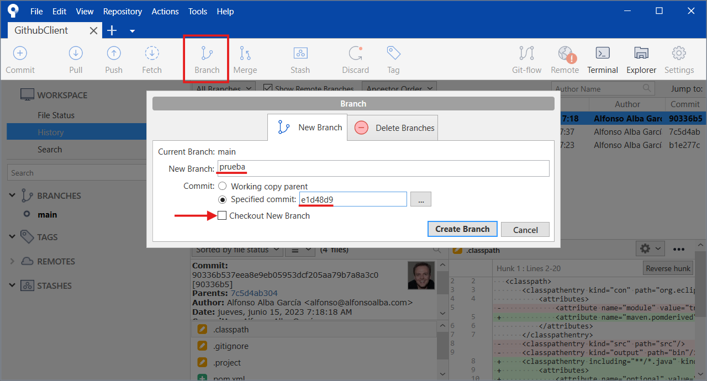

Notes:

En `Sourcetree`, hacemos clic sobre el icono *Branch* del menú superior para crear una nueva rama.
En la ventana modal que se abre, rellenamos
la información que ves en la diapositiva. No vamos a hacer que la nueva rama sea la rama activa, por lo que desmarcamos
el cuadro *Checkout New Branch*. Creamos la rama y...

(Puedes hacer lo mismo pero creando una etiqueta)


^^^^^^

#### Recuperando el grafo 1: haciendo trampas

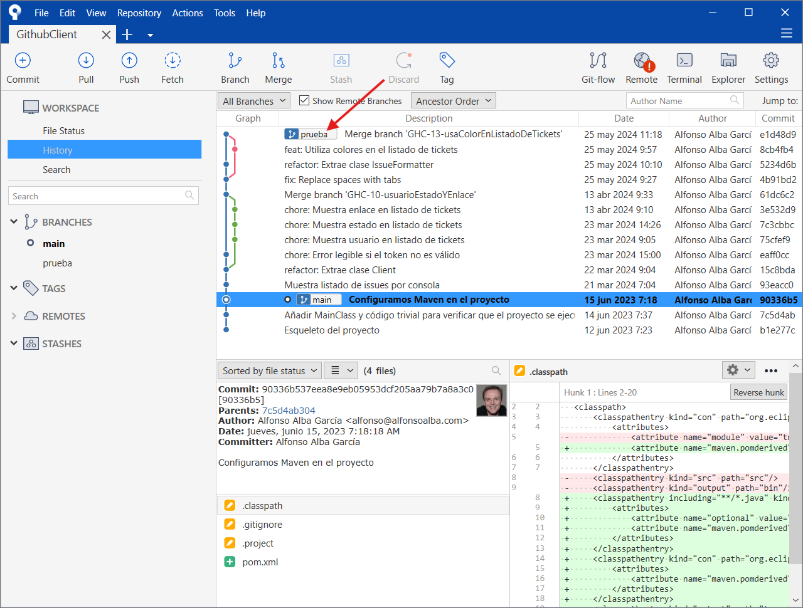

Notes:

Tras crear la rama, `Sourcetree` ya dispone de punto de entrada que apunta a los últimos cambios confirmados. A partir
de ahí, va siguiendo los padres de los distintos `commits` y puede pintar el grafo completo hasta los
primeros cambios que confirmamos.


^^^^^^

#### Recuperando el grafo 1: haciendo trampas

Pero...

Vosotros no podéis hacer trampa...

¡No tenéis capturas de pantalla!

Notes:

Si habéis seguido los talleres confirmando vuestros propios cambios, tendréis vuestros propios *commits*.
A no ser que os hayáis dedicado hacer capturas de pantalla, no sabéis cuál el es *hash* de los
últimos cambios confirmados.

¿Qué hacemos en este caso?

^^^^^^

#### Recuperando el grafo 2: Usando la copia de seguridad

Podemos obtener el *hash* de la última confirmación de cambios usando la copia de seguridad

que creamos en le taller 4.1

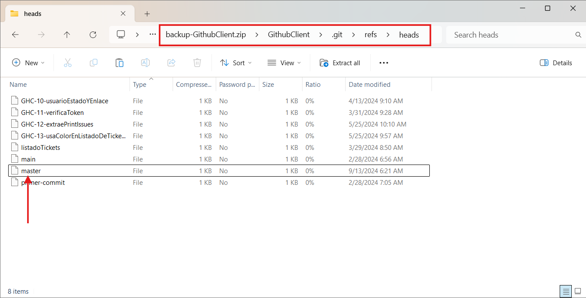

Notes:

Usando un poco de memoria, podemos recuperar el *hash* de los últimos cambios confirmados
desde la copia de seguridad. 

Digo usando la memoria porque teniéndolo reciente, me acuerdo que los últimos cambios que
confirmamos en ese repositorio fue cuando integramos las ramas `GHC-12` y `GHC-13` en la
rama `master`. Así que la rama que apunta a esos cambios es `master`.


^^^^^^

#### Recuperando el grafo 2: Usando la copia de seguridad


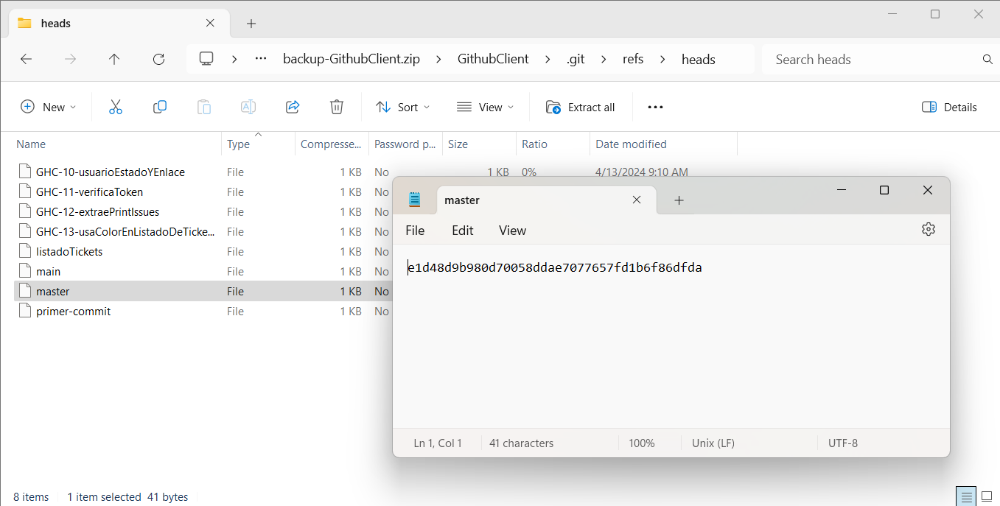

Notes:

Localizado el fichero de la rama `master` dentro del fichero `.zip` con la copia de seguridad,
podemos abrirlo y obtener el `hash` de los últimos cambios que confirmamos: `e1d48d9`

^^^^^^

#### Recuperando el grafo 3: Usando `git reflog`

Pero ¿qué pasa si no tenemos copia de seguridad? 

Notes:

¿qué hacemos si no tenemos copia de seguridad? ¿o si la copia de seguidad no es reciente y no 
contiene las últimas operaciones que hemos realizado con `git`?

Por suerte, `git` no nos hace depender de la existencia de esa copia de seguidad. Dispone de una herramienta que podemos
utilizar para obtener el `hash` de los últimos cambios confirmados: el `reflog`


^^^^^^

#### Recuperando el grafo 3: Usando `git reflog`

El `reflog` es un log de todos los movimientos de la rama `HEAD`

Cada vez que se hace una operación de `git` que cambia la rama `HEAD`

esta operación queda registrada en el `reflog`


^^^^^^

#### Recuperando el grafo 3: Usando `git reflog`

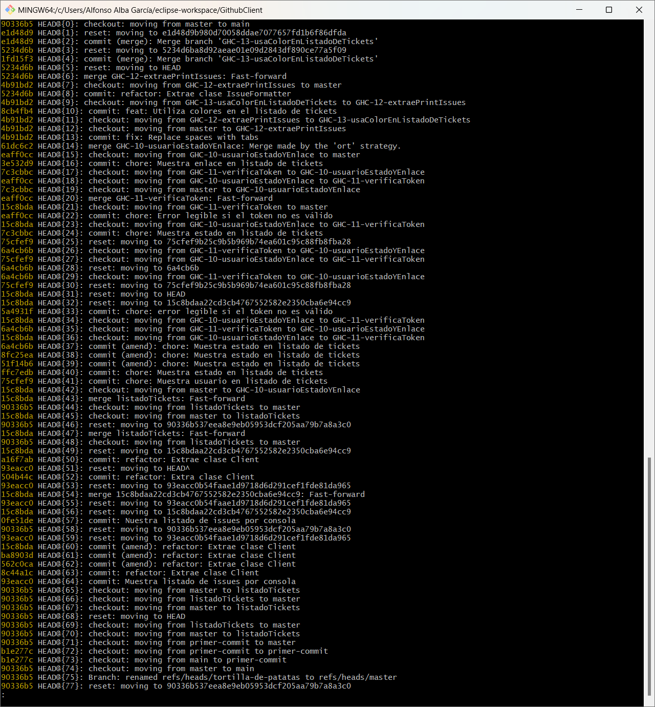

Notes:

Aquí vemos la salida del comando `reflog` utilizando `git-bash`. El comando que se ha ejecutado es 

```shell
> git reflog --no-decorate
```

Si ejecutáis este comando en vuestros repositorios, **no obtendréis el mismo resultado**, veréis **vuestro** propio
log de **vuestra** rama `HEAD`.

^^^^^^

#### Recuperando el grafo 3: Usando `git reflog`

Muestra cada movimiento de `HEAD` en orden cronológico inverso

Si vamos abajo del todo veremos los  primeros `commits` que hicimos

```shell
90336b5 HEAD@{0}: checkout: moving from master to main
e1d48d9 HEAD@{1}: reset: moving to e1d48d9b980d70058ddae7077657fd1b6f86dfda    
...
...
90336b5 HEAD@{93}: Branch: renamed refs/heads/tortilla-de-patatas to refs/heads/master
90336b5 HEAD@{95}: Branch: renamed refs/heads/master to refs/heads/tortilla-de-patatas
90336b5 HEAD@{97}: commit: Configuramos Maven en el proyecto
7c5d4ab HEAD@{98}: commit: Añadir MainClass y código trivial para verificar que el proyecto se ejecuta correctamente
b1e277c HEAD@{99}: reset: moving to HEAD^
6557132 HEAD@{100}: commit: Añadir MainClass y código trivial para verificar que el proyecto se ejecuta correctamente
b1e277c HEAD@{101}: reset: moving to b1e277c374432c6dc7a1fb268723dc6dabcf968a
b0970c9 HEAD@{102}: commit: Añadir MainClass y código trivial para verificar que el proyecto se ejecuta correctamente
b1e277c HEAD@{103}: commit (initial): Esqueleto del proyecto
```

^^^^^^

#### Recuperando el grafo 3: Usando `git reflog`

Cuando se ejecutó la operación 

`commit (initial): Esqueleto del proyecto`

la rama `HEAD` acabó apuntando a `b1e277c`

Notes:

Cada línea del `reflog` representa una operación de `git` que resulta en un movimiento de `HEAD`. Si vamos al final
del `reflog`, veremos las primeras operaciones que hicimos en el repositorio.

Cada línea consta de tres partes:
- el `hash` del *commit* al que punta `HEAD` después de hacer la operación
- `HEAD@{xxx}` referencia relativa: en este caso se podría leer como *hace 103 `commits` desde `HEAD`*
- la operación de `git` que se realiza

Así, si miramos la línea `HEAD@{98}`, cuando realizamos la operación `commit: Añadir MainClass y código trivial para verificar que el proyecto se ejecuta correctamente`,
la rama `HEAD` acabó apuntando al `commit` `7c5d4ab`.

^^^^^^

#### Recuperando el grafo 3: Usando `git reflog`


[Taller 4.3: Recuperando el grafo usando el reflog](../../talleres/taller-4-3-java-eclipse.html)

Notes:
En este taller vamos a utilizar el `reflog` para encontrar el *hash* de la confirmación de cambios
que necesitamos.

^^^^^^

#### Recuperando el grafo 3: Usando `git reflog`

- El `reflog` se almanena en la carpeta `.git/logs`
- Cada rama tiene su propio `reflog`
- Puedes ver el `reflog` de una rama usando 

```shell
git reflog [nombre-de-la-rama]
```
- ⚠️ El `reflog` se borrar junto con la rama

Notes:
El `reflog` se almacena en la carpeta local `.git/logs`. Aunque lo veremos con más detalle cuando 
hablemos de los repositorios remotos,
os puedo adelantar que este fichero no se sube ni se comparte. Es local, y cada miembro del equipo tendrá el suyo.

Cada rama tiene su propio `reflog`. Desafortunadamente, según tenemos el repositorio en este momento,
solo tenemo el `reflog`` de `HEAD` y el de `main`, que son las únicas ramas que no hemos borrado.
Para ver el reflog de `main`:

```shell
> git reflog main
90336b5 (HEAD -> main) main@{0}: branch: Created from master
```

Es un `reflog` muy corto, ya que la única operación que hicimos con `main` fue crear la rama.

Cuando recuperemos el backup un poco más adelante dentro de este capítulo, restauraremos las ramas
y sus correspondiente ficheros del `reflog`.

^^^^^^

#### Recuperando el grafo 4: Usando `git fsck`

- Usar el  `reflog` puede resultar tedioso y complicado
- Como alternativa, podríamos utilizar el comando `git fsck`
- Este comando tiene una opción para buscar *commits* a los que no se llega 

^^^^^^

#### Recuperando el grafo 4: Usando `git fsck`

```shell
> git fsck --dangling --no-reflogs

Checking object directories: 100% (256/256), done.
dangling tag 17bcbe076477313dbc773b00dce1128cdfd336b3
dangling commit 340e38f687014d7fb132300afbaeeb31da412e84
dangling commit 562c0cac173baf6b540d734420c1b3f284e3fb17
dangling commit 6a4cb6b550115d8d19b0381cc6a413960d7bee93
dangling commit 7dea8d2bd4e0b91fc6b328918eb7385f6150bf6d
dangling commit 8b34e845c13a763fa74c61a0f87f33477a6e9c42
dangling commit 8c44a1c274d420aba230d5192863fad6c77084f4
dangling commit 8fc25eadb4c5c21b25f8d57f729c0e767b07d6bc
dangling blob c990776696d4bf61e6be5f83fc972286b5645d1e
dangling blob cbac45762d17959d101567ac5a9e759d4d931c88
dangling tag e000cf7291ddcc98987e9f4347e16ed1d33fcc4c
dangling commit 0fe51deb55a8ea0b1333081db6f75956da54f112
dangling blob 1e279f392585e8ecbe0f5a375089971d845d6cc7
dangling commit 1fd15f38ea0c38ac5aec2cbe6e20094a90ad2e57
dangling tag 38cda6be6091efdc4ca4b1f4fb2b55805b48a19b
dangling commit 504b44cd42bc257962d895e8c6e802ccb81ca60d
dangling commit 51f14b65aada67d8355933e9946dc2246b7c82e0
dangling commit 5a4931f1ba7d6d987883cd65ac3c9bef09a31f05
dangling commit 65571328775f319f21a597c16d2eebaa456a3299
dangling blob 676b788b016874949fb87a5d1cb0af3d321e6b87
dangling tag 6c9560765e7e9e51c2a1f89089d30073451c1f66
dangling tree 8c19ca7477100f071180ea360bdf39cf61ca581c
dangling blob a15bfbfd13ac02994552098defc62f35d47db03f
dangling commit a16f7abbe7c5228469eefdd5a623c4b5e8450b02
dangling commit b0970c9b01f7be0ef7f1de6d213d7bd0b5bd347b
dangling commit ba8903d5a6a7515ce01b32a7fa9e07ef39a0c480
dangling commit e40958a9ab2bc60651b403b1de591edd66590eb6
dangling commit ffc7edbfa788f4047460f92837028ffd7d4a7f5a
```

^^^^^^

#### Recuperando el grafo 4: Usando `git fsck`

Mirando los objetos de tipo `commit` que reporta el comando `git fsck`

podemos encontrar ese `merge commit` que hemos dejado de ver

```shell 
> for hash in $(git fsck --dangling --no-reflogs | grep commit | cut -f 3 -d ' '); do git show -s --format=oneline $hash ; done | grep -i merge

Checking object directories: 100% (256/256), done.
e1d48d9b980d70058ddae7077657fd1b6f86dfda Merge branch 'GHC-13-usaColorEnListadoDeTickets'
```
