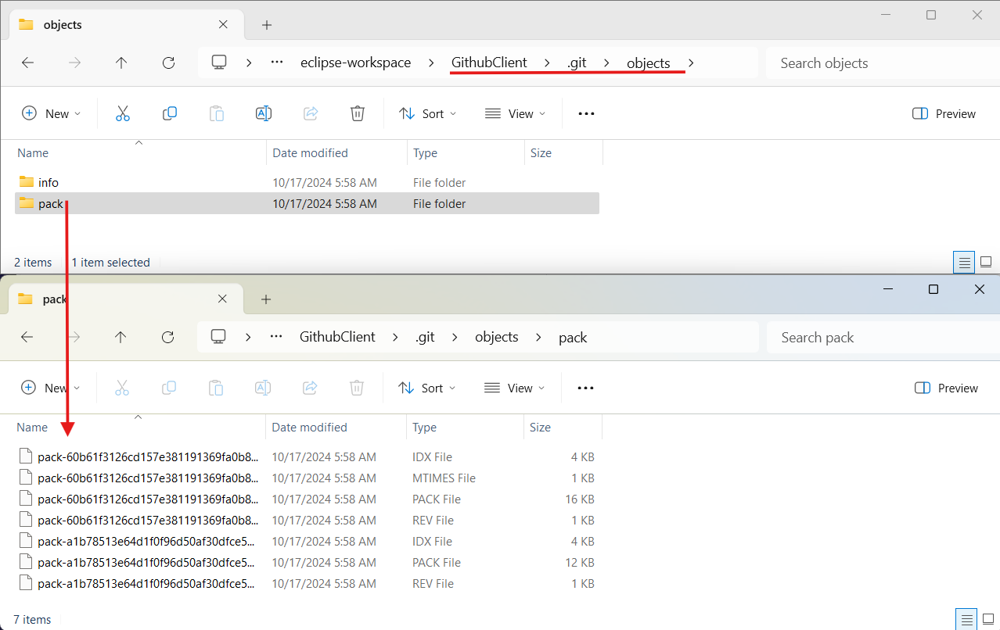

## Borrando la historia del repositorio

Notes:

En las secciones anteriores, vimos cómo se *dibuja* el grafo, cómo se utilizan las referencias como *puntos de entrada*
para llegar a las confirmaciones de cambios y como, si esas referencias desaparecen dejamos de ver
parte de la historia.

En esta sección vamos a dar el siguiente paso que es borrar de nuestro duro, las
confirmaciones de cambios. En otras palabras, que nuestros *commits* desaparezcan de la carpeta `.git/objects`.

^^^^^^

#### El comando `git gc`

El comando `git gc` (de *Garbage Collector*) hace dos cosas:

1. Optimiza el repositorio (empaqueta y crea *deltas*)
1. Borra *ficheros que ya no son necesarios*

Notes:

Este comando realiza una serie de tareas de mantenimiento dentro del repositorio actual como:
- comprimir y empaquetar las revisiones de archivos (para reducir el espacio en disco y aumentar el rendimiento)
- eliminar objetos inaccesibles que pueden haber sido creados por llamadas anteriores de `git add` o `git rebase`
- purgar el `reflog`, metadatos de `rerere` o `worktrees` obsoletos

Para purgar el `reglog`, `git gc` utiliza el comando `git reflog expire`. Entender cómo funciona este comando
ayuda a entender lo que hace el recolector de basura.

^^^^^^

#### El comando `git gc`

Algunos comandos de `git` lo ejecutan automáticamente:

- `git pull`
- `git push`

Notes:

En realidad, los comandos que ejecutan  `git gc` son comandos como 
`git-fetch`, `git-commit`, `git-am`, `git-receive-pack` y `git-rebase`.
Más información en 
[esta pregunta de stack overflow](https://stackoverflow.com/questions/5137447/list-of-all-commands-that-cause-git-gc-auto)

Algunos de estos comandos ejecutan `git gc` con la opción `--quiet` y por ese motivo
no vemos la salida típica de `git gc` al ejecutar. Otros comando como `git push` no utilizan esta opción
y sí vemo al comando `git gc` en acción.

^^^^^^

#### El comando `git gc`

```shell
> git gc
Enumerating objects: 94, done.
Counting objects: 100% (94/94), done.
Delta compression using up to 16 threads
Compressing objects: 100% (79/79), done.
Writing objects: 100% (94/94), done.
Total 94 (delta 37), reused 0 (delta 0), pack-reused 0 (from 0)
Enumerating cruft objects: 103, done.
Traversing cruft objects: 126, done.
Counting objects: 100% (103/103), done.
Delta compression using up to 16 threads
Compressing objects: 100% (82/82), done.
Writing objects: 100% (103/103), done.
Total 103 (delta 34), reused 0 (delta 0), pack-reused 0 (from 0)
```

Notes:

Este es un ejemplo de una ejecución del comando `git gc`.


^^^^^^

#### El comando `git gc`

Empaquetado de objetos de `git`:



Notes:
Por un lado, como resultado de la ejeción de este comando, veremos que la carpeta `.git/objects` ha cambiado.

Los objetos de `git` han quedado empaquetados en una serie de ficheros indexados que se conocen como `packs`.
Es en este punto cuando, como resultado del proceso de empaquetado y compresión, `git` genera
los `deltas`. Estos `deltas` son una optimización mediante la cual, en lugar de guardar las dos versiones completas
de un fichero entre dos confirmaciones de cambios, `git` guarda la diferencia entre las dos versiones.

^^^^^^

#### El comando `git gc`

Borra objetos de `git` si:

- Son más antiguos de 14 días (Configurable mediante `gc.pruneExpire`)
- No tienen ninguna referencia que permita llegar a ellos (*unreachable*)

Notes:

Referencias son:
- ramas
- tags
- **entradas en el `reflog`**

Si un objeto de `git` tiene una rama, un tag o una entrada en el `reflog` que permitan llegar hasta ese objeto,
el recolector de basura no lo borrará.

^^^^^^

#### El comando `git gc`

Eso significa que mientras los *commits* estén en el `reflog` no serán eliminados

a pesar de que no los veamos

(siempre que uses la configuración por defecto de `git`)

Notes:

Hemos visto en esta sección que puede haber confirmaciones de cambios que no veamos porque no existe una rama o tag
que nos permita llegar a ellos.

Si esas confirmaciones de cambios están en el `reflog`, el recolector de basura no las borrará.

Esta afirmación es correcta siempre que no hayas cambiado la configuración por defecto de `git` y no
expires el `reflog` en tus ratos libres.

^^^^^^

#### El comando `git gc`

Entonces, ¿qué pasa con esas confirmaciones de cambios que no se ven?

¿se quedan eternamente viviendo en la carpeta `.git/objects`?

🤔

^^^^^^

#### El comando `git gc`

Una de las tareas de *limpieza* de `git gc` es limpiar el `reflog`

Para ello utiliza el comando `git reflog expire`

Este comando va quitando entradas del `reflog`

^^^^^^

#### El comando `git gc`

- Borrar los entradas más antiguas de 90 días de la rama activa
- Borrar las entradas de *commits* a los que no se puede llegar más antiguas de 30 días

Notes:
El comando `git reflog expire` borra por defecto las entradas 
más antiguas de 90 días, configuración que se encuentra en 
`gc.reflogExpire`.

También borra las entradas a las que no se puede llegar desde la rama activa si son más antiguas de 30 días. Este parámetro
es configurable también a través de `gc.reflogExpireUnreachable`

Estas dos opciones están documentadas en la documentación del
comando `git gc`.

^^^^^^


#### El comando `git gc`

[Taller 4.4: borrando la historia del repositorio](../../talleres/taller-4-4-java-eclipse.html)
^^^^^^

#### El comando `git gc`

Como hemos visto en el taller, los objetos de `git`

se van borrando solos a medida que pasa el tiempo

o tenemos que ir a borrarlos a conciencia para que desaparezcan antes


