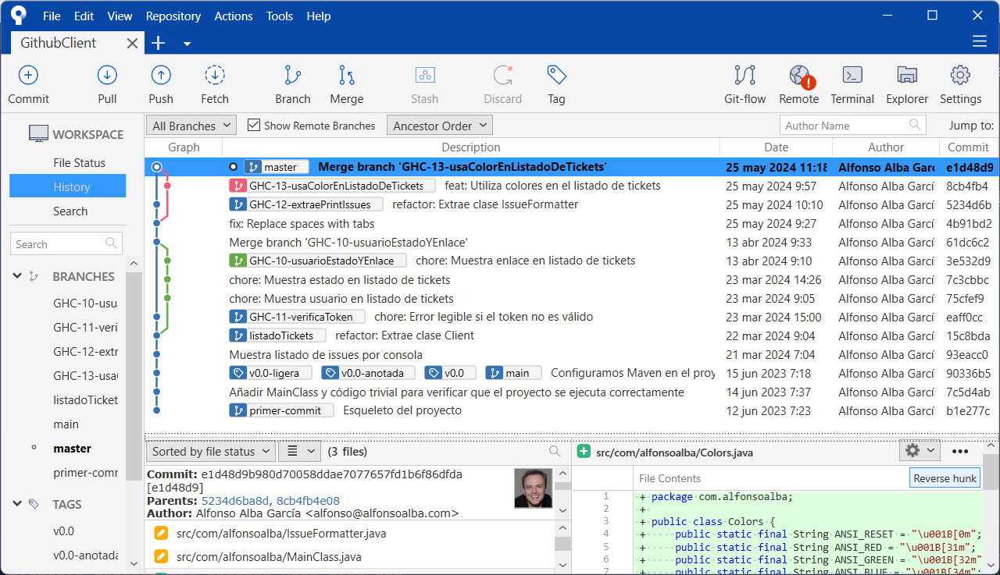
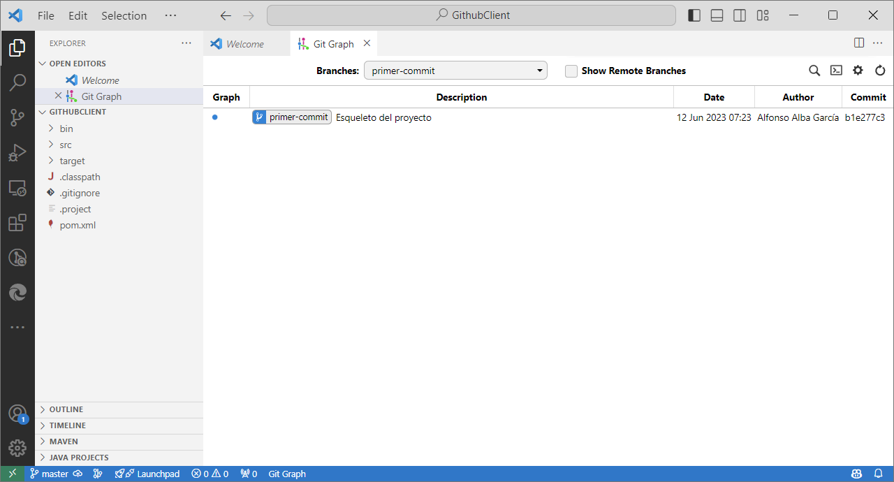
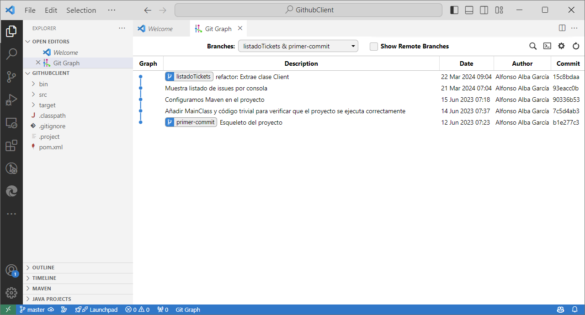
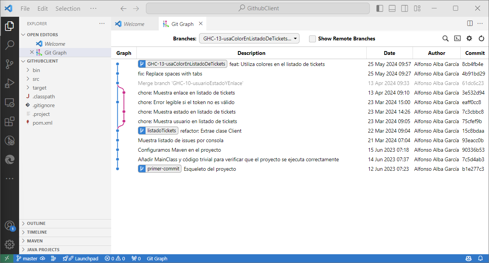
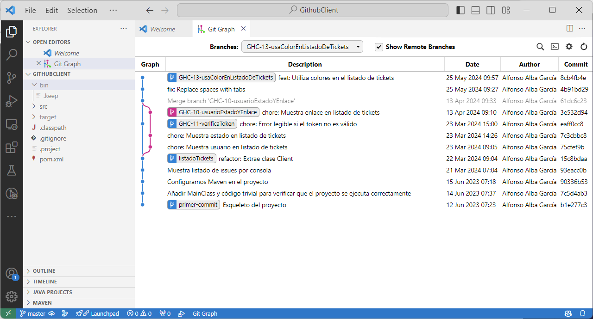
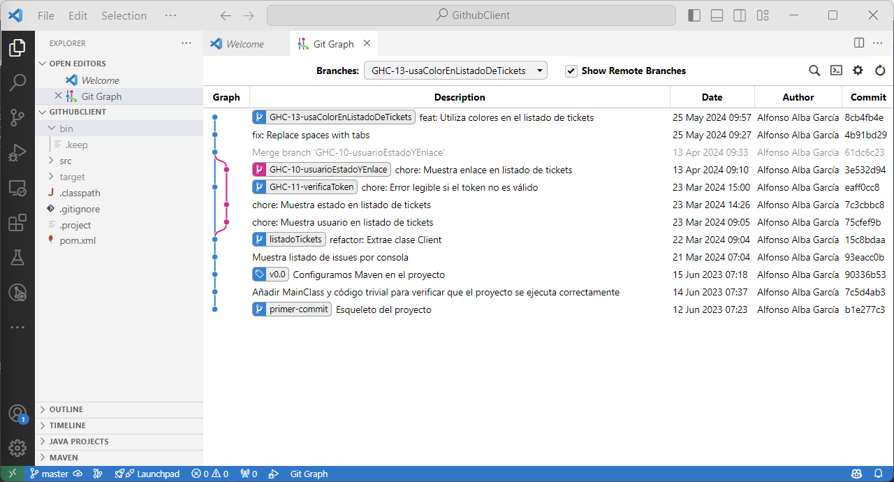
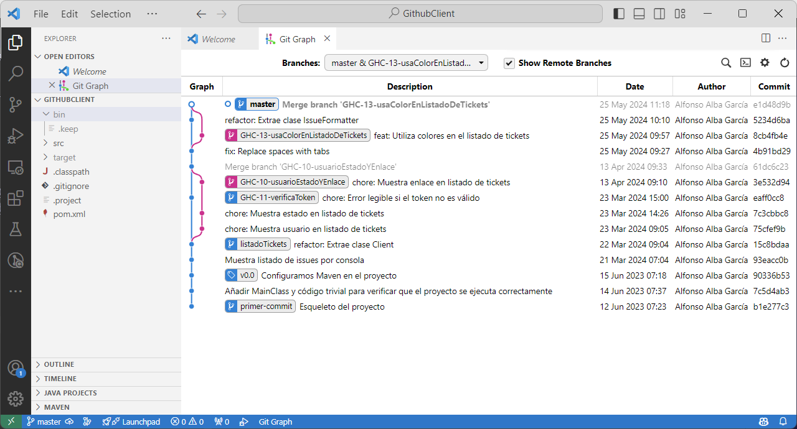
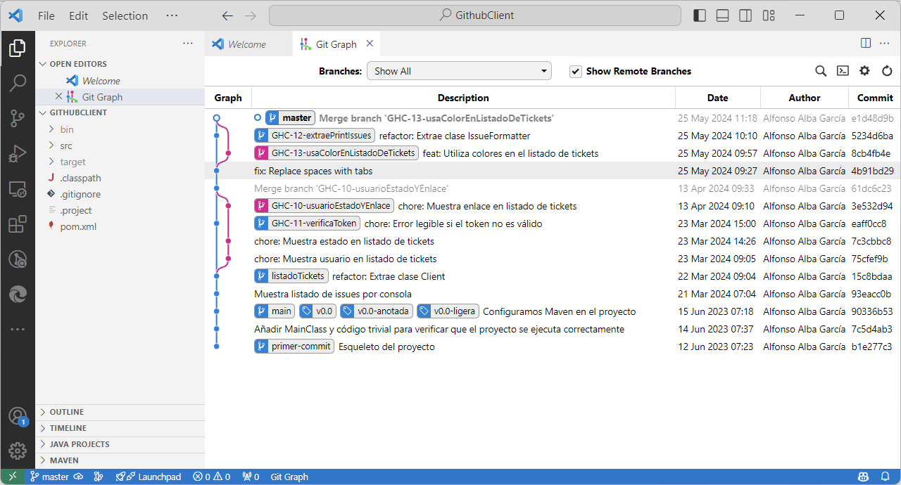

## Dibujando el grafo

Notes:

En esta sección vamos a ver cómo las herramientas gráficas *dibujan* el grafo de nuestro repositorio.

^^^^^^

#### Dibujando el grafo

¿Cómo dibuja `Sourcetree` el grafo?

^^^^^^

#### Dibujando el grafo

1. Va a la carpeta `.git/refs`
1. Selecciona uno de las referencias
1. Dibuja todos los *commits* a los que puede llegar desde esa referencia
1. Vuelve al paso 2 si queda alguna referencia por dibujar

Notes:

Las herramientas que nos muestran representaciones gráficas del repositorio, funcionan de la manera descrita
en la diapositiva.

Utilizan las referencias que se encuentran en la carpeta `.git/refs` como *puntos de entrada*. 
Abren uno de los ficheros de esa carpeta, resuelven el *hash* de la confirmación de cambios a la que apunta,
y a partir de ahí, va siguiendo los enlaces a los padres. Recuerda que cuando confirmas los cambios
o creas un *merge commit* se guarda junto a la instantánea una referencia a la confirmación de cambios anterior.
Así que cuando se dibuja el grafo, lo que se hace es seguir los enlaces hacia los ancestros. 
Cuando se encuentran con un *merge commit*, siguen la cadena de ancestros de ambos padres.

^^^^^^

#### Dibujando el grafo

`Sourcetree` no permite dibujar sólo una referencia (etiqueta o rama)

Utilizaré otra herramienta para las siguientes capturas

Notes:

Una funcionalidad que echo en falta en `Sourcetree` es precisamente el 
dibujar sólo una rama o etiqueta. Es decir, muestrame los *commits* a los que se llega desde una 
rama o una etiqueta.

En las siguientes capturas, utilizaré la extensión *Git Graph* de Visual Studio Code, que es 
gratuita, para mostrar el grafo. Otra herramienta que permite hacerlo
es *GitKraken*, aunque es de pago para uso profesional.

^^^^^^

#### Dibujando el grafo

Notes:

Supongamos que nuestro cliente de `git`, en este caso `VisualStudio Code`, entra en la carpeta `.git/refs/heads` y 
selecciona la referencia `primer-commit`. Dibuja la confirmación y la que apunta la referencia y todos sus ancestros,
que en este caso no tiene porque es la primera confirmación de cambios del repositorio. Ahí queda la cosa
por el momento: no se muestra nada más.

^^^^^^

#### Dibujando el grafo

Notes:

El cliente selecciona la siguiente rama, que resulta ser `listadoTickets`. Hace lo mismo, dibuja la confirmación 
de cambios a la que apunta la rama, y luego sus cuatro ancestros. Aunque realmente solo dibujará tres porque el 
primer ancestro, el `commit` `b1e277c` ¡ya lo teníamos dibujado de la diapositiva anterior!
  

^^^^^^

#### Dibujando el grafo

Notes:

De nuevo, el cliente selecciona otra rama: `GHC-13-usaColorEnListadoDeTickets`. Dibuja la confirmación a la que
apunta la rama `8cb4fb4`, y añade al grafo 6 de los ancestros, ya que todos los ancestros entre `15c8bda`
y `b1e277c` ya los tenía dibujados.

^^^^^^

#### Dibujando el grafo

Notes:

Todavía no hemos terminado. Nos quedan ramas y etiquetas todavía por dibujar en la carpeta `.git/refs`.
Selecciona ahora la rama `GHC-10-usuarioEstadoYEnlace`, que apunta a la confirmación `3e532d9` pero esa confirmación
ya la tenemos dibujada, así que sencillamente dibuja la rama en esa confirmación de cambios. Cuando selecciona la
siguiente rama, `GHC-11-verificaToken` que apunta a `eaff0cc`, la confirmación ya está dibujada en pantalla, así que
sólo dibuja la rama. En este caso, no se han dibujado `commits` nuevos.

^^^^^^

#### Dibujando el grafo

Notes:

Ahora el cliente de `git` selecciona una etiqueta, en este caso `v0.0`. Ve a qué confirmación apunta (`90336b5`)
y como ya está dibujada, sólo añade el tag. Al igual que en la diapositiva anterior, no se dibujan confirmaciones
nuevas.

^^^^^^

#### Dibujando el grafo

Notes: 
El cliente de `git` selecciona la rama `master`, dibuja la confimación de cambios a la que apunta, `e1d48d9`,
y dibuja también sus ancestros. `Sourcetree` sólo añade dos confirmaciones nuevas al grafo 
que está dibujando (`e1d48d9`, y `5234d6b`) ya que todos los demás ancestros de `e1d48d9` están ya
dibujados.

^^^^^^

#### Dibujando el grafo

Notes:
Llegados a este punto, en el que tenemos ya todas las confirmaciones de cambio dibujadas, el cliente de git termina
de procesar las referencias que le quedan en la carpeta `.git/refs` (las ramas `GHC-12-extraePrintIssues` y `main`, y 
los tags `v0.0-anotada` y `v0.0-ligera`).

^^^^^^

#### Dibujando el grafo

Lo más importante de este proceso es darse cuenta de que: 

1. Las ramas y las etiquetas **son punteros**
1. Esos punteros se usan como **puntos de entrada** a la estructura de datos
1. Desde esos puntos de entrada seguimos los punteros hacia los ancestros

¿Qué pasaría si esos puntos de entrada empiezan a *desaparecer*? 🤔

Notes:

Una vez hecha la copia de seguridad y habiendo entendido cómo aparece en pantalla nuestro grafo, estamos en
condiciones de romper el repositorio ¡Vamos allá! (y así de paso responderemos a la pregunta que acabamos de plantear)
