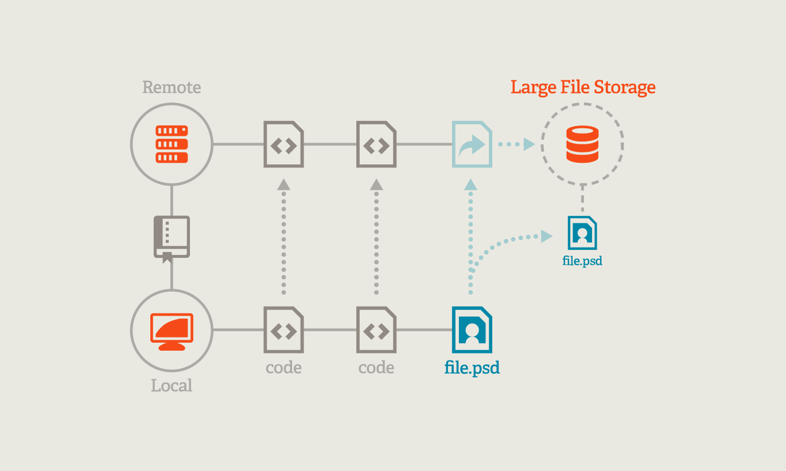

#### Git LFS

Extensión de git facilita el versionado de ficheros grandes.

* Web: [https://git-lfs.com/](https://git-lfs.com/)
* GitHub: [https://github.com/git-lfs/git-lfs](https://github.com/git-lfs/git-lfs)

^^^^^^

#### Git LFS

Cuando hacemos un commit e incluimos un fichero binario, este fichero forma
parte del _snapshot_

Si modificamos ese fichero binario en un commit posterior, git guardará
la nueva versión completa del fichero en el _snapshot_

* El tamaño del repositorio aumentará 💸
* Las operaciones de red tardan más ⏱️

Notes:

Los ficheros binarios no se benefician de los algoritmos de bajo nivel que 
git utiliza para optimizar el almacenamiento (como por ejemplo el uso de 
deltas)

Si tenemos un repositorio con muchos ficheros binarios de cierto
tamaño que cambian con regularidad o ficheros de varios cientos de megas 
que queremos incluir (por ejemplo, los ficheros `.psd` con los diseños
o un algún fichero de vídeo o texturas para hacer tests),
el tamaño de nuestros commits, y por lo tanto el del repositorio empezará 
a crecer y ciertas operaciones de red como el clonado del repositorio
o un simple fetch llevarán tiempo.

Tenemos, además, el problema añadido de gestionar conflictos en ficheros 
binarios, problema para el que git no ofrece ningún tipo de herramienta y
requieren intervención manual y aplicaciones externas. (Nota: Git LFS no 
aporta herramientas adicionales para ayudarnos a gestionar estos 
conflictos 😢)

^^^^^^
#### Git LFS - ¿Cómo funciona?



Sustituir el fichero por un puntero y almacenar el fichero fuera del 
_snapshot_ 

Notes:

La solución propuesta por el proyecto es sustituir el fichero binario 
que se almacenaría en el _snapshot_ por un _puntero_. Este puntero
es un fichero que contiene el tamaño del fichero y el `oid` (Object ID).
Este valor es el que utiliza `git-lfs` para descargar el fichero completo
del servidor de almacenamiento.

^^^^^^
#### Git LFS - ¿Cómo funciona?

```
version https://git-lfs.github.com/spec/v1
oid sha256:4d7a214614ab2935c943f9e0ff69d22eadbb8f32b1258daaa5e2ca24d17e2393
size 12345
(ending \n)
```
Notes: 

Este es un ejemplo de un puntero a un fichero que utiliza `git-lfs` y que 
sustituirá al fichero real en nuestros commits.

La especificación completa del puntero podéis encontrarla
[aquí](https://github.com/git-lfs/git-lfs/blob/main/docs/spec.md)

^^^^^^
#### Git LFS - ¿Cómo funciona?

Los ficheros físicos se almacenarán en nuestra carpeta `.git`:

`.git/lfs/objects/{OID-PATH}`

`OID-PATH` = OID[0:2]/OID[2:4]/OID

por ejemplo `.git/lfs/objects/4d/7a/4d7a214614a...ab786`

^^^^^^
#### Git LFS - ¿Cómo funciona?

**El servidor de git debe tener soporte para Git LFS** 

GitLab, GitHub, Bitbucket o GitTea tienen soporte

Notes:

Los servidores mayoritarios tienen soporte para Git LFS. 

Analizar los planes de precios ya que aunque todos ofrecen un espacio
limitado gratuito, este no suele ser suficiente para cubrir las 
necesidades de un equipo profesional.

^^^^^^
#### Git LFS - No es oro...

- No es fácil de usar
- Requiere entender cómo funciona para resolver problemas
- Preparaos para usar la consola
- Está pensado para ingenieros, no para creativos
- No aporta herramientas adicionales para la gestión de conflictos

Notes:

`git-lfs` no es un comando sencillo de utilizar. Requiere entender como funciona
tanto un repositorio en git como el comando en sí. Está pensado para 
ser usado por ingenieros. Con esto quiero decir que 
**no cubre las necesidades** que una persona que trabaja con creatividades puede tener para trazar,
visualizar y gestionar múltiples versiones de imágenes, vídeos o texturas
de un juego en 3D por ejemplo. 

Además, cuando tenemos conflictos entre ficheros binarios, la única
opción que tenemos es extraer las diferentes versiones al disco duro
y utilizar herramientas externas para _ver_  el contenido de esos
ficheros y tomar una decisión sobre qué hacer con ellos.


^^^^^^
#### Git LFS - ¿Cuándo utilizarlo?

✅ Si tenemos sólo algunos ficheros binarios de unos Kilobytes o incluso unos
pocos megabytes (los assets de una página web)

❌ Ficheros con varias decenas de megabytes o más grandes o ficheros 
binarios que cambian muy a menudo

Notes:

¿Cuándo debemos empezar a utilizar `git lfs`?

Si estamos gestionando assets de un proyecto como puede ser una página web,
normalmente estos ficheros son de unos Kilobytes o megabytes y no cambian 
a diario. En este caso, no merece la pena utilizar Git LFS.

Situaciones en las que tendría sentido utilizar `git-lfs`:
- Proyecto en el que tenemos muchos ficheros binarios que cambian 
  con regularidad. Si no usamos `git-lfs`, los cambios en los binarios se 
  almacenarán en los commits en forma de una nueva versión completa del
  binario. Un `pull` hará que nos descarguemos, por lo tanto, todas las 
  versiones incluidas en todos los commits que nos descarguemos. Si usamos
  `git-lfs`, los commits no contendrán los binarios si no un puntero a ellos,
  reduciendo el tamaño del commit y con ello el tiempo de descarga. Además,
  podremos decidir qué versión de los binarios queremos ver en nuestro
  área de trabajo
- Necesitamos almacenar junto al código ficheros de gran tamaño. Por ejemplo,
  en un repo de documentación, queremos añadir vídeos con demos. Esos vídeos
  los almacenaremos en `git-lfs`.


^^^^^^
#### Git LFS - ¿Cuándo utilizarlo?

No hay receta

Entender cómo funciona y utilizar el sentido común

Notes:

Aunque hay casos de uso muy claros, como los que hemos comentado en 
diapositvas anteriores.

Nos encontraremos sin embargo en situaciones en las que no 
tendremos tan claro si su uso nos aportará algún valor o no. Como ya hemos
visto en ocasiones anteriores en ese curso, con el ecosistema de git
el mejor enfoque es entender cómo funcionan las herramientas para poder
aplicarlas cuando resuelven los problemas para los que estas 
han sido creadas.

^^^^^^
#### Git LFS - ¿Cuándo utilizarlo?

¿Y si `git + git-lfs` no es la solución? 🤔

- Subversion
- [PlasticSCM para juegos](https://unity.com/solutions/version-control)
- [Perforce / Helix Core](https://www.perforce.com/products/helix-core)

Notes:

Sobre Subversion: esta herramienta está más preparada para gestionar ficheros
binarios.

Existen algunos proyectos, como por ejemplo juegos, para los que git no 
va a ser la mejor opción por cómo gestiona los ficheros binarios. Al final,
`git-lfs` se limita a sustituir un fichero por un puntero, pero no facilita
más herramientas. ¿Se cubre con ello las necesidades que un equipo de 
diseño 3D puede tener para trabajar simultáneamente con ficheros? 

En mi opinión
(personal e intransferible) ni siquiera usando `git-lfs` vamos a poder igualar 
la capacidad que sistemas de control de versiones tienen para trabajar con 
ficheros de este tipo. Es por ello que conviene evaluarlos

¿Es git la mejor herramienta para nuestro equipo en estos casos?
