# Taller 2.1 (versión Go con Visual Studio Code): esqueleto del proyecto y primer _commit_

## Requisitos
Para realizar este taller es necesario tener instalado el siguiente software:
- SourceTree
- git
- Interprete de `go`

## Objetivos
- Inicializar el proyecto y realizar nuestro primer commit

## Inicializar el proyecto 

Creamos una carpeta para el proyecto:

```powershell
PS C:\Users\Alfonso Alba García\MyStuff> mkdir github-client

    Directory: C:\Users\Alfonso Alba García\MyStuff


Mode                 LastWriteTime         Length Name
----                 -------------         ------ ----
d-----        12/14/2025   9:12 AM                github-client
```

Puedes crear esta carpeta donde lo necesites. No hace falta que la crees
en la misma ruta que he utilizado en mi máquina.

Una vez creada la carpeta, entramos en ella e inicializamos el proyecto siguiendo
[las recomendaciones del lenguage `go`](https://go.dev/doc/modules/managing-dependencies#naming_module)
sobre el nombre de sus módulos:

```powershell 
> go mod init aalbagarcia/github-client
go: creating new go.mod: module aalbagarcia/github-client
```

Donde `aalbagarcia` es el prefijo (que he hecho coincidir con mi usuario de Github) y `github-client` 
es el nombre del módulo.

Creamos el fichero `main.go` y añadimos las siguientes líneas:

```go
// main.go
package main

import "fmt"

func main() {
  fmt.Println("Mi cliente de Github")
}
``` 

Ejecutamos el código para verificar que todo está configurado correctamente:

```powershell
> go run .
Mi cliente de Github
```
## Inicializando el repositorio

⚠️ Realizar la operación una sola vez, bien usando `SourceTree` o la consola. Ambas operaciones
son idénticas, lo único que cambia es el cliente de git que la ejecutará.

### Usando SourceTree
Abrimos `SourceTree` y en la pantalla de inicio, hacemos clic sobre 
el icono `Create`:

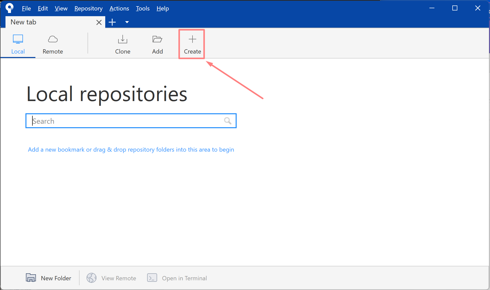

En la ventana emergente, seleccionar la ruta al proyecto, que 
en este ejemplo es `C:\Users\Alfonso Alba García\MyStuff\github-client\`. Una vez
seleccionada la ruta, hacemos click en `Create`

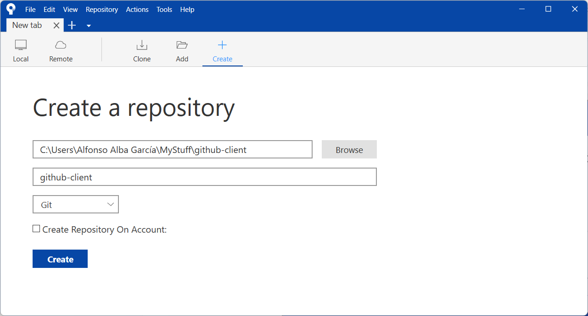 

Al hacerlo, `SourceTree` nos mostrará un aviso de que la carpeta no está vacía: 

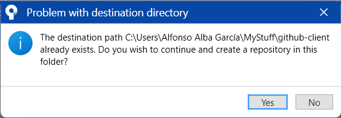

Hacemos click en `Yes` para continuar. Si todo ha ido bien, `SourceTree` nos llevará 
a la pantalla con el repositorio:

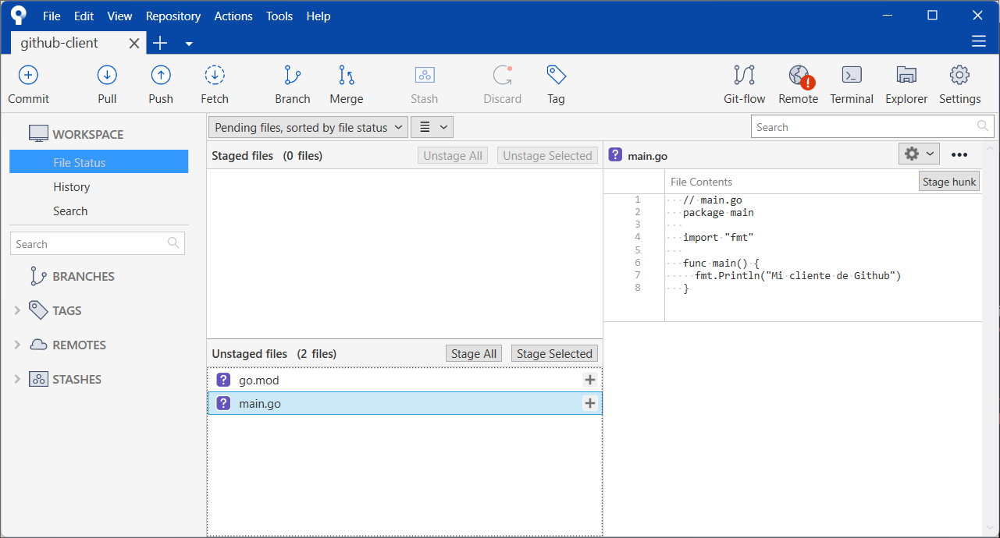

### Usando la consola

Abrir una consola PowerShell y ejecutar los siguientes comandos:

```powershell
> cd 'C:\Users\Alfonso Alba García\MyStuff\github-client\'
> git init
Initialized empty Git repository in  C:/Users/Alfonso Alba García/MyStuff/github-client/.git
```

Si estás en `Linux` o `MacOS`, sólo tienes que adaptar las rutas a tu sistema operativo.
Por ejemplo, `/home/aalba/MyStuff/GitHubClient`.

## La carpeta .git

Tras ejecutar el comando `git init`, aparecerá la carpeta oculta `.git/` en la propia 
carpeta del proyecto:

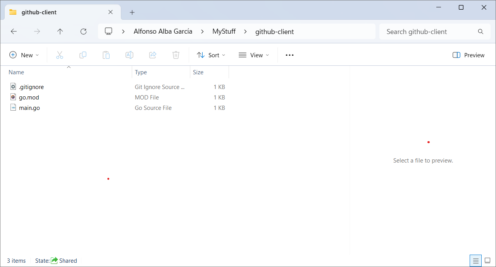

Usando la consola también podemos ver esta carpeta:

```powershell
PS C:\Users\Alfonso Alba García\MyStuff\github-client> Get-ChildItem -Force


    Directory: C:\Users\Alfonso Alba García\MyStuff\github-client


Mode                 LastWriteTime         Length Name
----                 -------------         ------ ----
d--h--        12/14/2055   9:53 AM                .git
-a----        12/14/2055   9:22 AM             44 go.mod
-a----        12/14/2055   9:36 AM            101 main.go
```

La carpeta `.git/objects` contiene los objetos de git (`commit`, `tree`, `blob`, etc) que 
se generan al hacer un commit. En este momento, esa capeta está vacía ya que 
nuestro repositorio no contine ningún commit:

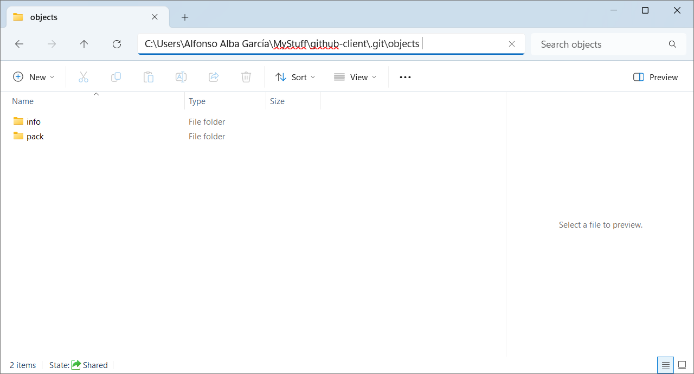

## El fichero .gitignore 

Antes de continuar y hacer el primer commit, debemos añadir al proyecto un fichero 
`.gitignore`. Hablaremos en profundidad sobre este fichero más adelante en el curso.
De momento, solo diré que es un fichero _especial_ que git utiliza para 
no hacer seguimiento de ciertos ficheros.

Para ello, iremos a la página web [gitignore.io](https://gitignore.io), introducimos
`Go` en el buscador y hacemos click en el botón `Create`. Obtendremos una 
página web en texto plano con el contenido del fichero `.gitignore`. 
Creamos el fichero dentro de la carpeta de nuestro proyecto 
(`C:\Users\Alfonso Alba García\MyStuff\github-client\.gitignore`)
con el texto que acabamos de copiar, y lo guardamos.

¡Ya estamos en condiciones de hacer el primer commit!

## El primer commit

Abrir `SourceTree` y en la parte izquierda hacer clic sobre 
`File Status`. En la ventana, veremos dos secciones: _Staged files_ y _Unstaged files_.

En la sección _Unstaged files_ (la que está debajo) 
veremos los cambios que hay en nuestro 
área de trabajo. En la sección de _Staged files_ vemos los 
ficheros que están preparados. `SourceTree` nos muestra lo que ha cambiado
en el área de trabajo **con respecto al commit anterior**. Dado que no 
hay commit anterior todavía, git nos dice que estamos viendo ficheros 
nuevos para él (de ahí el icono con la interrogación que `SourceTree`
utiliza para representarlos):


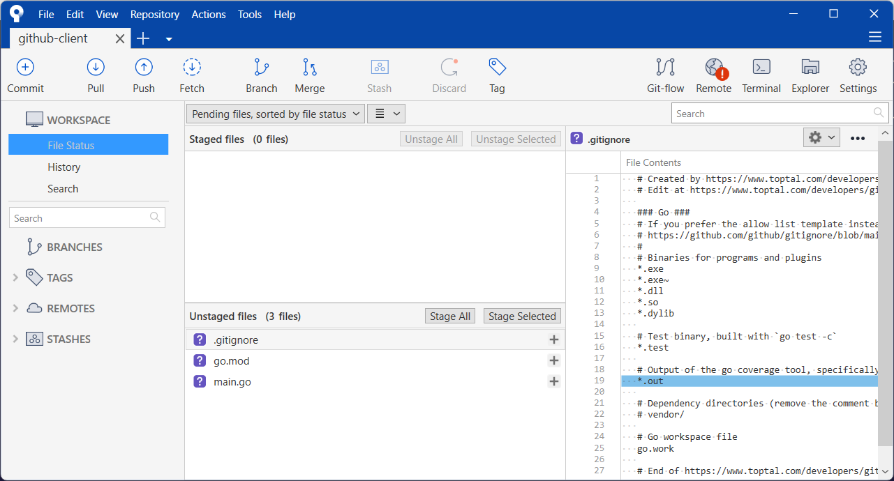


### Preparación de los ficheros 

Hacemos clic sobre el botón `Stage all` que está en la ventana _Unstaged files_.
Al hacerlo, veremos que todos los ficheros suben al área de preparación (_staging area_):

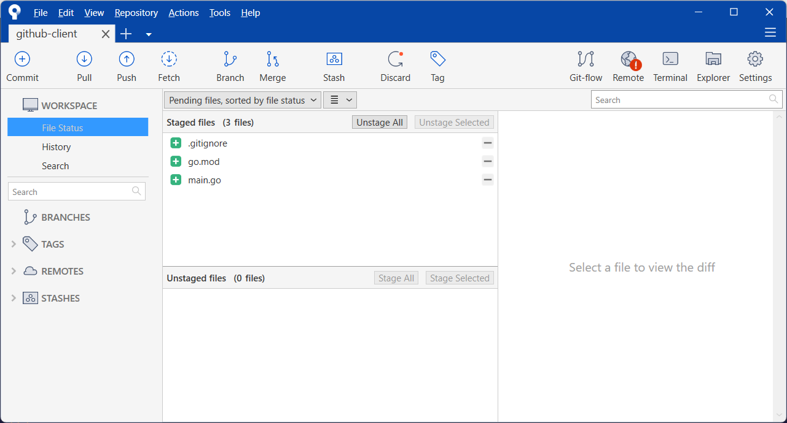

### Haciendo (por fin) el primer commit

#### Usando `Sourcetree`

A continuación, hacemos clic sobre el botón `Commit` que está en la parte 
superior izquierda de la aplicación. Al hacerlo, en la parte inferior de la 
pantalla aparecerá el formulario para escribir el mensaje y confirmar los cambios. Escribiremos 
"Esqueleto del proyecto". Para finalizar, hacemos clic sobre el botón `Commit`
que está en la parte inferior derecha, debajo del espacio para escribir 
el mensaje. Al hacerlo, confirmaremos los cambios en el repositorio:

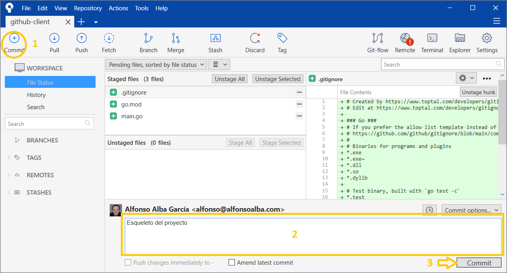

Una vez confirmados los cambios, `SourceTree` nos mostrará la historia del 
repositorio:

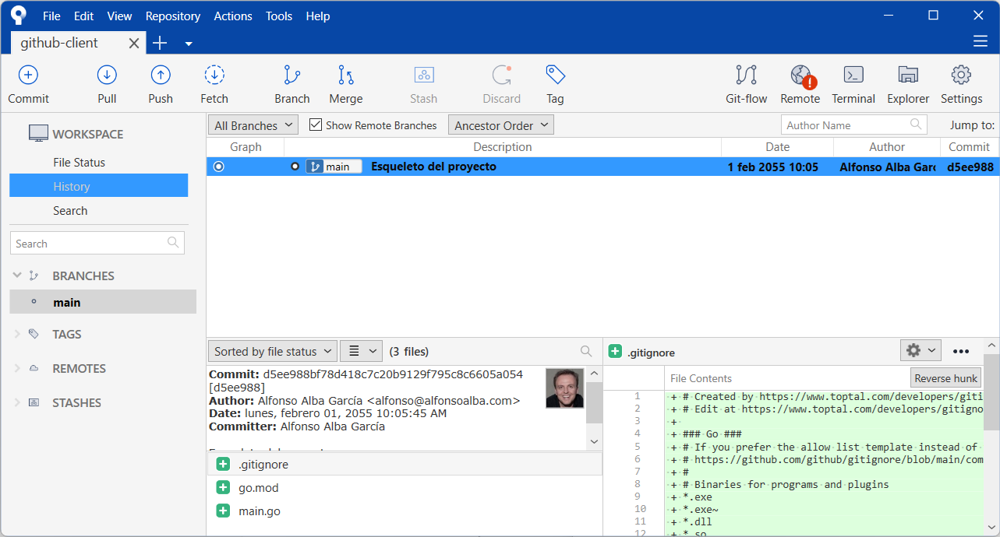

(Si no te aparece esta vista después de confirmar los cambios, puedes acceder
a ella haciendo click sobre `History` en la parte izquierda de la pantalla). 

En esta vista, cuando seleccionamos un _commit_, podremos ver toda su información:
- Nombre (_hash_) de los cambios confirmados
- Autor (nombre y correo electrónico)
- Mensaje
- Fecha
- Nombre (_hash_) del _commit_ anterior, que en este caso no aparece porque
  este es el primero del repositorio
- Cambios que se han confirmado, que en este caso son todo ficheros nuevos al 
  ser nuestro primer _commit_

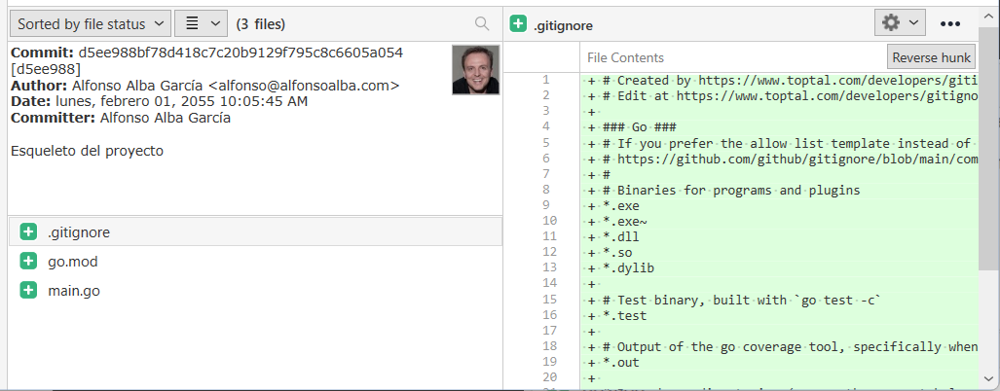

### Usando la consola

Usamos el comando `git status` para ver el estado en el que están los ficheros:

```
> git status
On branch main

No commits yet

Untracked files:
  (use "git add <file>..." to include in what will be committed)
        .gitignore
        go.mod
        main.go

nothing added to commit but untracked files present (use "git add" to track)
```

El comando `git status` tiene varias secciones, aunque en este momento sólo vemos
una de ellas: *Untracked files*. Esta sección muestra los ficheros que `git` no está siguiendo.
Dado que es el primer commit, todos los ficheros que creemos serán nuevos y aparecerán en
esta sección.

Preparamos los ficheros subiéndolos al área de preparación (*staging area*) usando el comando
`git add`:

```shell
> git add .
```

Este comando añade al área de preparación todos los cambios que estén en el área de trabajo. Si
volvemos a ejecutar el comando `git status`:

```shell
> git status

On branch main

No commits yet

Changes to be committed:
  (use "git rm --cached <file>..." to unstage)
        new file:   .gitignore
        new file:   go.mod
        new file:   main.go

```

observarmos que los ficheros han pasado a la sección *Changes to be committed*. Para confirmar los cambios,
usamos el comando `git commit`:

```shell
> git commit -m'Esqueleto del proyecto'
[main (root-commit) d5ee988] Esqueleto del proyecto
 3 files changed, 38 insertions(+)
 create mode 100644 .gitignore
 create mode 100644 go.mod
 create mode 100644 main.go
```

Para ver la historia de una manera similar a como la muestra `SourceTree` utilizaremos el comando
`git log`:

```shell
>  git log --format='%Cblue%h%Creset %<(50,trunc)%s %Cgreen%an(%ae)%Creset %ah' --graph
* d5ee988 Esqueleto del proyecto                             Alfonso Alba García(alfonso@alfonsoalba.com) Feb 1 2055
```

Como formatear la salida del comando `git log` se puede ver en 
[la documentación del comando](https://git-scm.com/docs/git-log#_pretty_formats) y no vamos a entretenernos ahora
en ese detalle. La versión abreviada, que muestra únicamente el grafo, es la siguiente:

```shell
> git log --oneline --graph
* d5ee988 (HEAD -> main) Esqueleto del proyecto
```

este será el comando que utilizaremos en muchas ocasiones en los talleres que haremos durante el curso.
