# Taller 1 (versión Java con Eclipse): esqueleto del proyecto y primer _commit_

## Requisitos
Para realizar este taller es necesario tener instalado el siguiente software:
- SourceTree
- git
- eclipse
- Java 

## Objetivos
- Inicializar el proyecto y realizar nuestro primer commit

## Inicializar el proyecto en eclipse

Ir a `File` -> `New` -> `Project` y en la ventana que se abre seleccionar `Java project`.

En la pantalla de configuración del proyecto, seleccionamos:
- Nombre: `GithubClient`
- JRE: el que instala eclipse por defecto, en nuestro caso es `JavaSE-1.7`

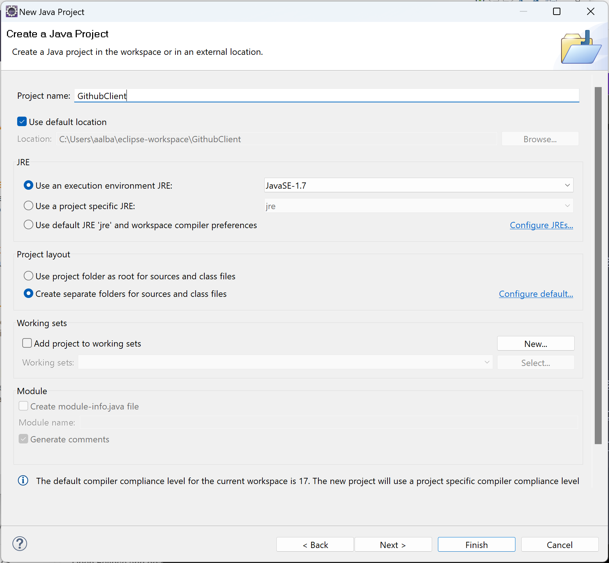

Hacemos clic sobre `Next`. Llegamos a la siguiente pantalla:

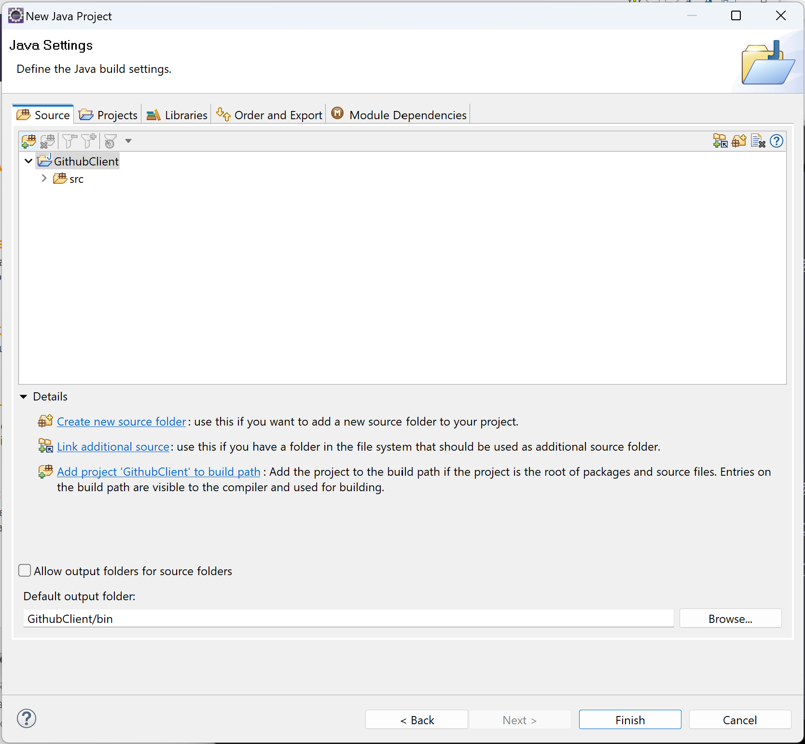

De momento no incluiremos ninguna dependencia, las iremos añadiendo 
a medida que las vamos necesitando. Hacemos clic sobre `Finish`,
y si el editor nos pregunta, aceptamos que nos lleve a la vista de Java.




## Inicializando el repositorio

⚠️ Realizar la operación una sola vez, bien usando `SourceTree` o la consola. Ambas operaciones
son idénticas, lo único que cambia es el cliente de git que la ejecutará.

### Usando SourceTree
Abrimos `SourceTree` y en la pantalla de inicio, hacemos clic sobre 
el icono `Create`:

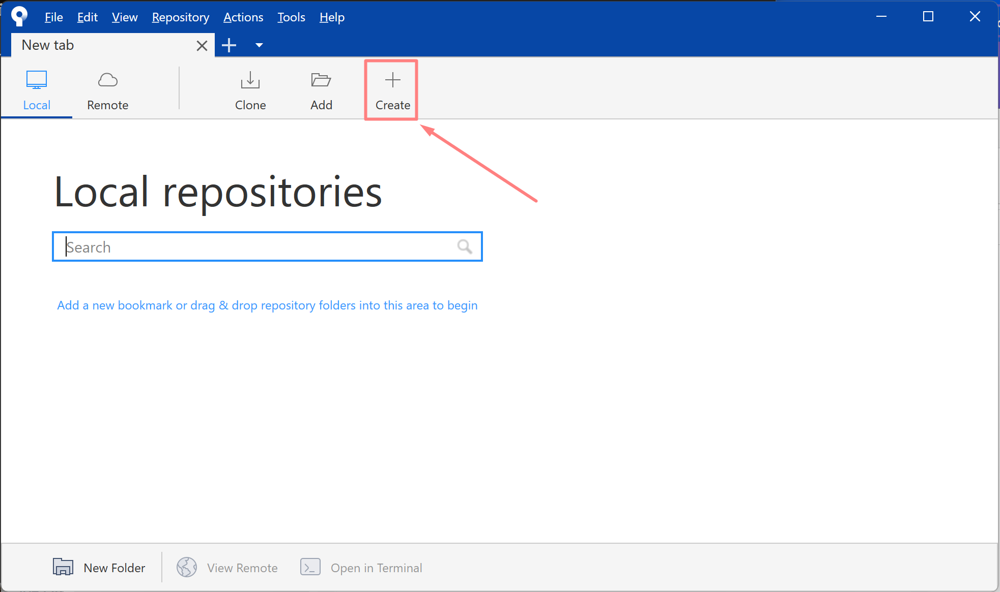

En la ventana emergente, seleccionar la ruta al proyecto de eclipse, que 
en este ejemplo es `C:\Users\aalba\eclipse-workspace\GithubClient`. Una vez
seleccionada la ruta, hacemos click en `Create`

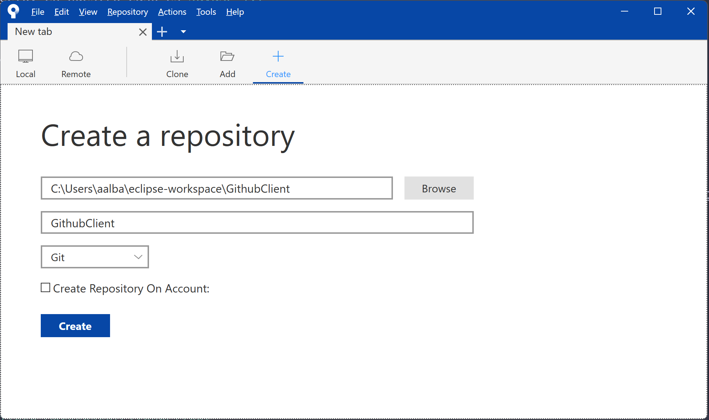 

Al hacerlo, `SourceTree` nos mostrará un aviso de que la carpeta no está vacía: 

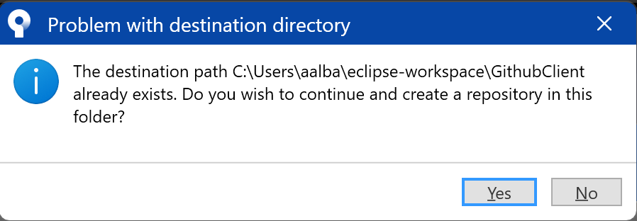

Hacemos click en `Yes` para continuar. Si todo ha ido bien, `SourceTree` nos llevará 
a la pantalla con el repositorio:

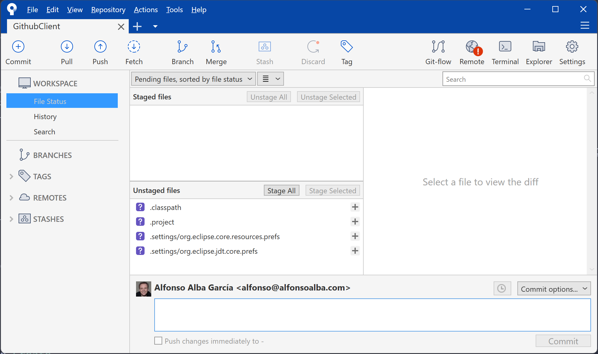

### Usando la consola

Abrir una consola PowerShell y ejecutar los siguientes comandos:

```powershell
> cd C:\Users\aalba\eclipse-workspace\GithubClient
> git init
Initialized empty Git repository in C:/Users/aalba/eclipse-workspace/GithubClient/.git/
```

Si estás en `Linux` o `MacOS`, sólo tienes que adaptar las rutas a tu sistema operativo.
Por ejemplo, `/home/aalba/workspace/GitHubClient`.

## La carpeta .git

Tras ejecutar el comando `git init`, aparecerá la carpeta oculta `.git/` en la propia 
carpeta del proyecto:

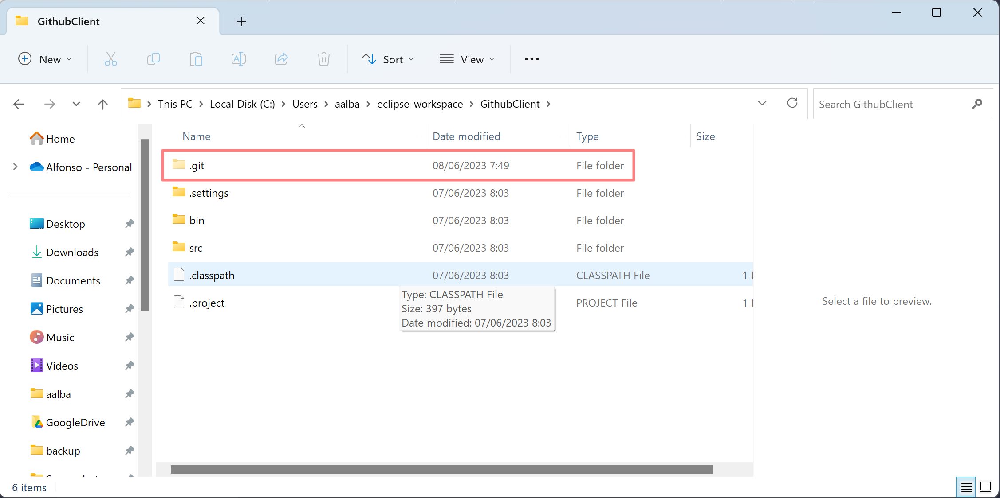

Usando la consola también podemos ver esta carpeta:

```powershell
PS C:\Users\aalba\eclipse-workspace\GithubClient> Get-ChildItem -Force


    Directory: C:\Users\aalba\eclipse-workspace\GithubClient


Mode                 LastWriteTime         Length Name
----                 -------------         ------ ----
d--h--        08/06/2023      7:49                .git
d-----        07/06/2023      8:03                .settings
d-----        07/06/2023      8:03                bin
d-----        07/06/2023      8:03                src
-a----        07/06/2023      8:03            397 .classpath
-a----        07/06/2023      8:03            388 .project
```

La carpeta `.git/objects` contiene los objetos de git (`commit`, `tree`, `blob`, etc) que 
se generan al hacer un commit. En este momento, esa capeta está vacía ya que 
nuestro repositorio no contine ningún commit:

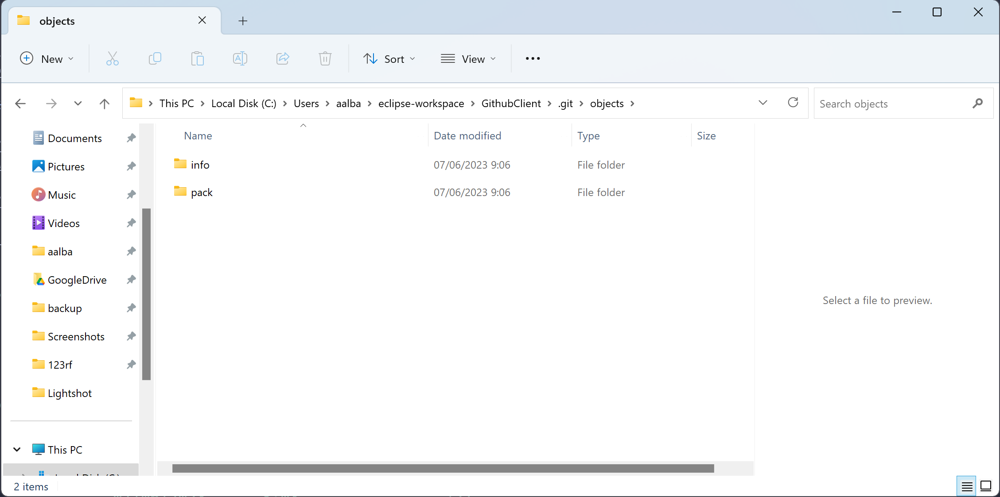

## El fichero .gitignore 

Antes de continuar y hacer el primer commit, debemos añadir al proyecto un fichero 
`.gitignore`. Hablaremos en profundidad sobre este fichero más adelante en el curso.
De momento, solo diré que es un fichero _especial_ que git utiliza para 
no hacer seguimiento de ciertos ficheros.

Para ello, iremos a la página web [gitignore.io](https://gitignore.io), introducimos
`Eclipse` en el buscador y hacemos click en el botón `Create`. Obtendremos una 
página web en texto plano con el contenido del fichero `.gitignore`. 
Creamos el fichero dentro de la carpeta de nuestro proyecto 
(`C:\Users\aalba\eclipse-workspace\GithubClient\.gitignore`)
con el texto que acabamos de copiar, y lo guardamos.

¡Ya estamos en condiciones de hacer el primer commit!

## El primer commit

Abrir `SourceTree` y en la parte izquierda hacer clic sobre 
`File Status`. En la ventana, veremos dos secciones: _Staged files_ y _Unstaged files_.

En la sección _Unstaged files_ (la que está debajo) 
veremos los cambios que hay en nuestro 
área de trabajo. En la sección de _Staged files_ vemos los 
ficheros que están preparados. `SourceTree` nos muestra lo que ha cambiado
en el área de trabajo **con respecto al commit anterior**. Dado que no 
hay commit anterior todavía, git nos dice que estamos viendo ficheros 
nuevos para él (de ahí el icono con la interrogación que `SourceTree`
utiliza para representarlos):


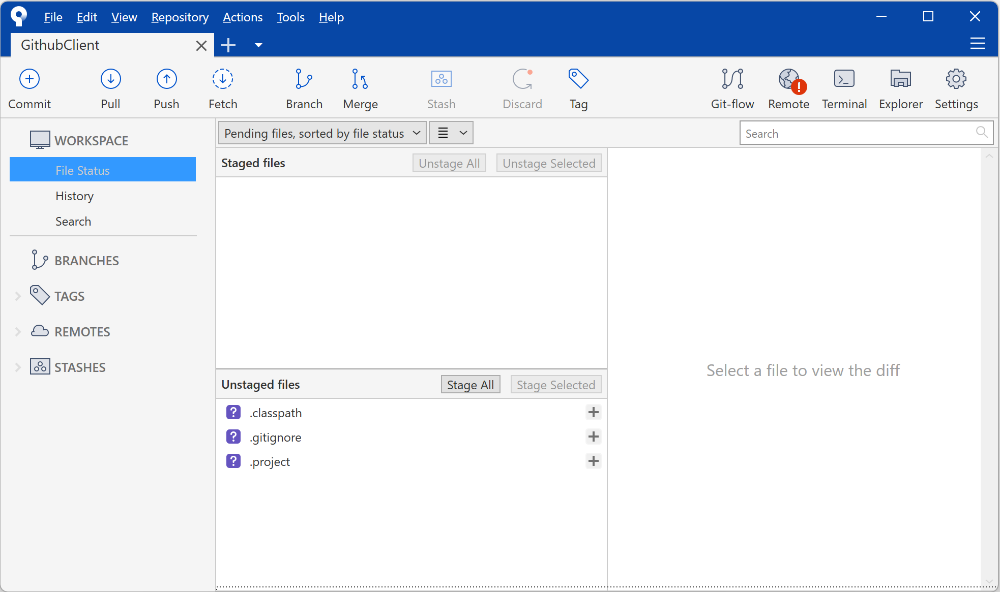


### La carpeta src 
Si nos fijamos en la pantalla anterior, veremos que la carpeta `src/` 
no aparece en la lista de ficheros que git reconoce.
El motivo es que esa carpeta está vacía en este momento y 
**git no gestiona carpetas, sólo gestiona ficheros**. Hablaremos con más detalle 
de esta característica de git más adelante.

Si queremos que la carpeta `src/` forme parte de nuestra primera instánea, 
una práctica habitual es crear un fichero vacío dentro de esa carpeta, 
que se suele llamar `src/.keep` (también lo veremos como `.gitkeep`). 
Creamos el fichero en `Eclipse` y volvemos a `SourceTree`:


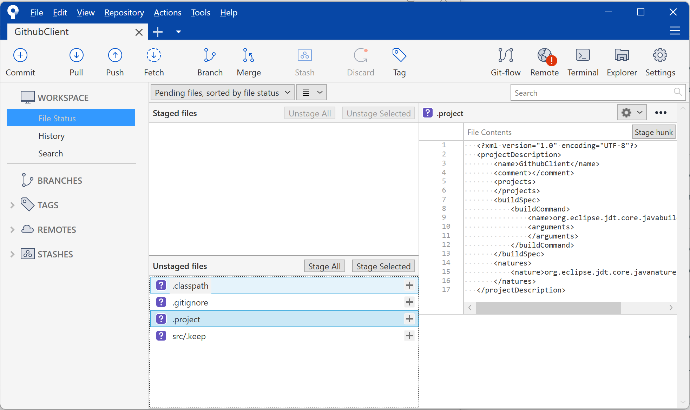

En la ventana _Unstaged files_ veremos que ahora sí aparece el fichero 
`src/.keep`.


### Preparación de los ficheros 

Hacemos clic sobre el botón `Stage all` que está en la ventana _Unstaged files_.
Al hacerlo, veremos que todos los ficheros suben al área de preparación (_staging area_):

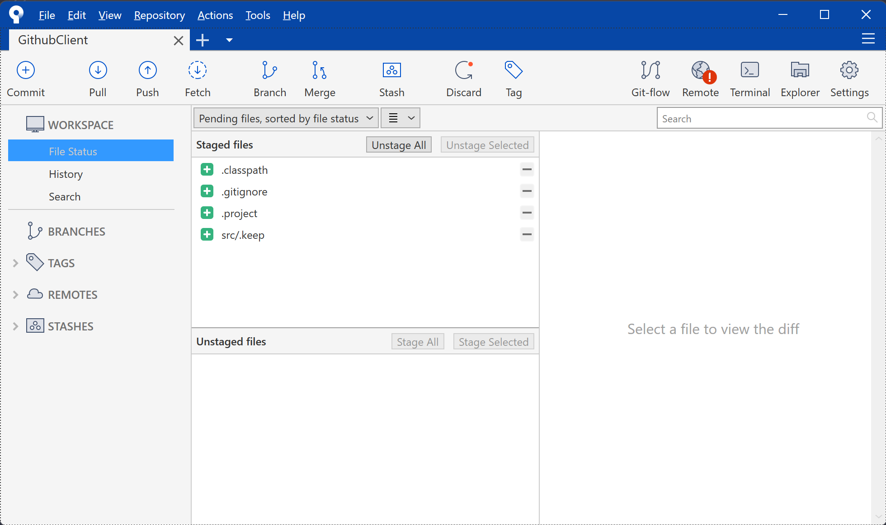

### Haciendo (por fin) el primer commit
A continuación, hacemos clic sobre el botón `Commit` que está en la parte 
superior izquierda de la aplicación. Al hacerlo, en la parte inferior de la 
pantalla aparecerá el mensaje para escribir nuestro mensaje. Escribiremos 
"Esqueleto del proyecto". Para finalizar, hacemos clic sobre el botón `Commit`
que está en la parte inferior derecha, debajo del espacio para escribir 
el mensaje. Al hacerlo, confirmaremos los cambios en el repositorio:

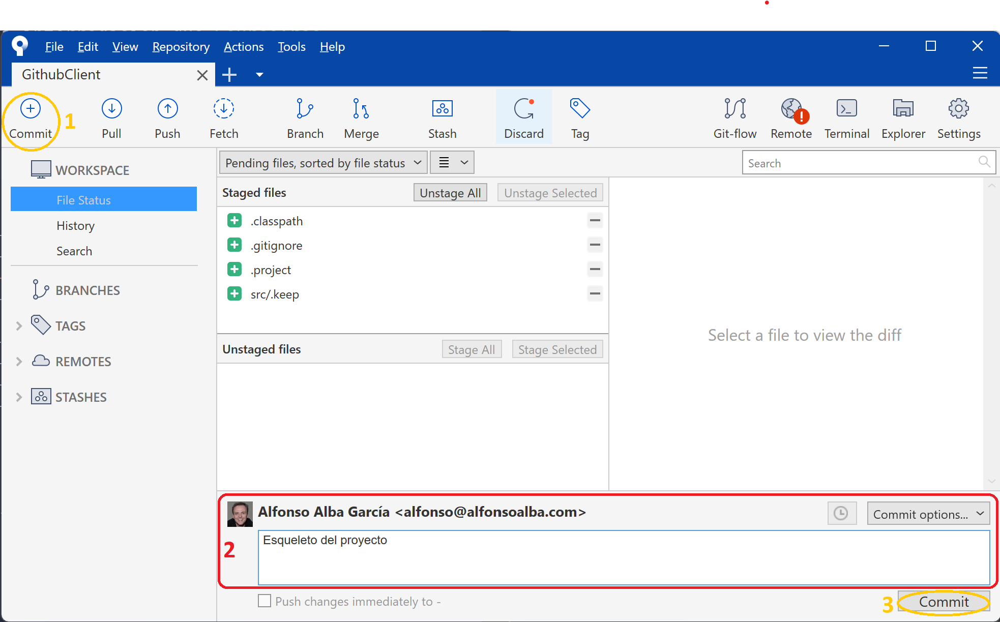

Una vez confirmados los cambios, `SourceTree` nos mostrará la historia del 
repositorio:

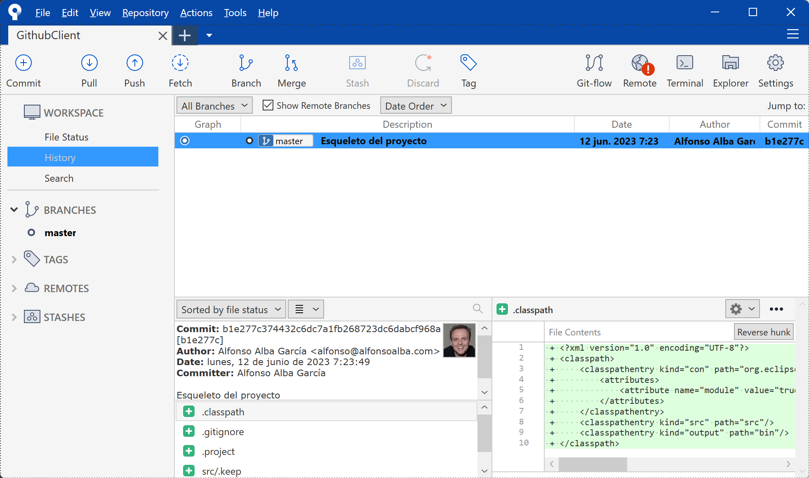

(Si no te aparece esta vista después de confirmar los cambios, puedes acceder
a ella haciendo click sobre `History` en la parte izquierda de la pantalla). 

En esta vista, cuando seleccionamos un _commit_, podremos ver toda su información:
- Nombre (_hash_) de los cambios confirmados
- Autor (nombre y correo electrónico)
- Mensaje
- Fecha
- Nombre (_hash_) del _commit_ anterior, que en este caso no aparece porque
  este es el primero del repositorio
- Cambios que se han confirmado, que en este caso son todo ficheros nuevos al 
  ser nuestro primer _commit_

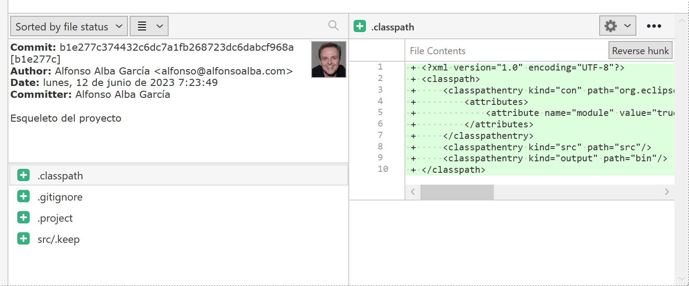


