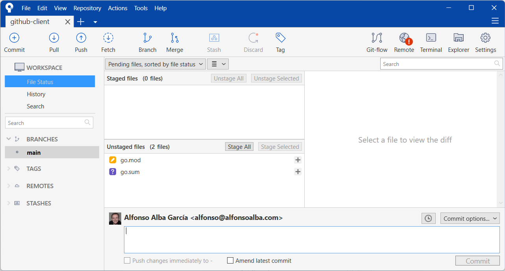
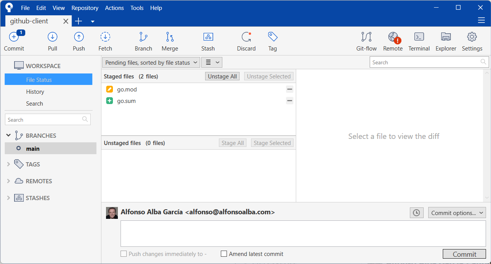
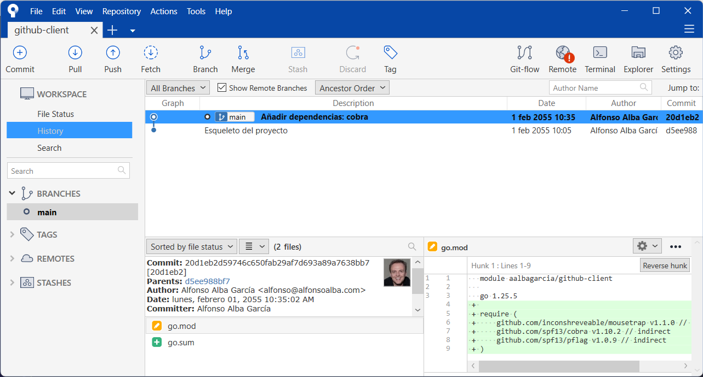
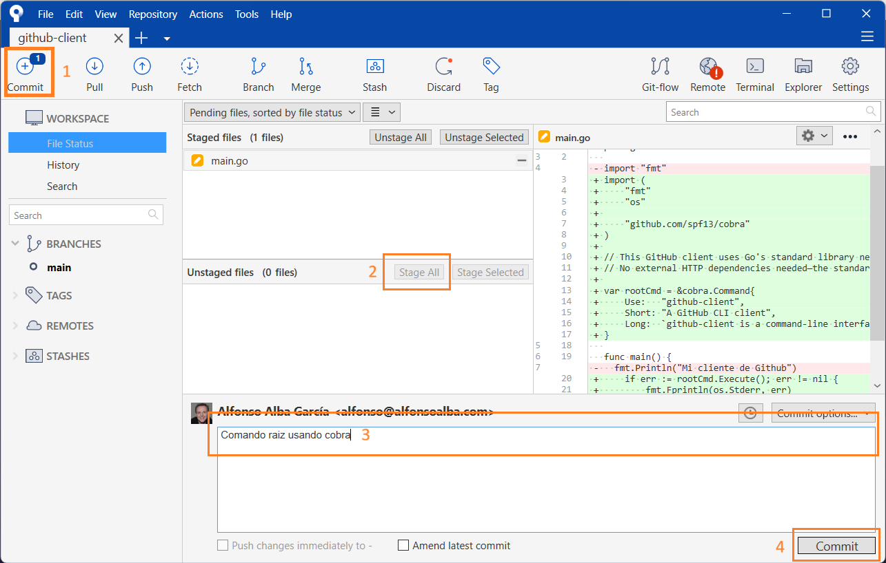
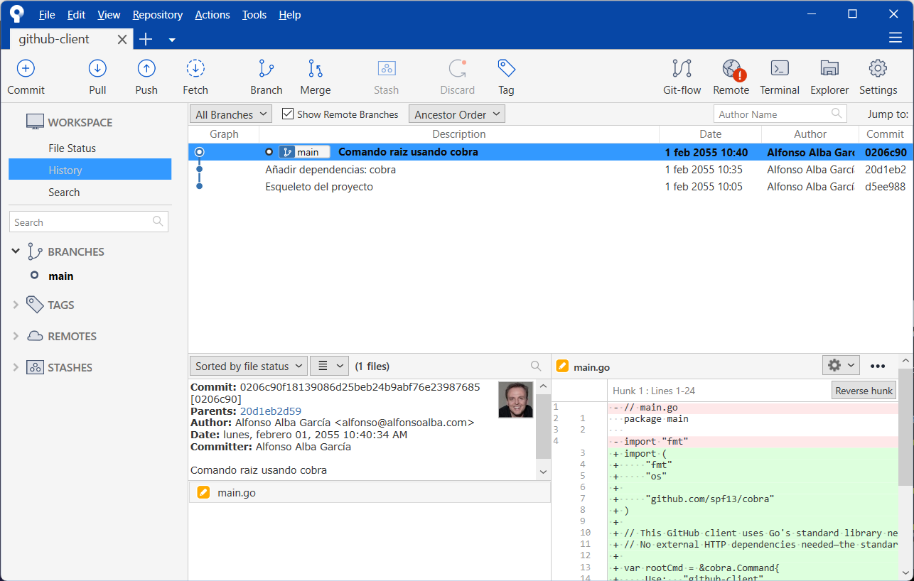
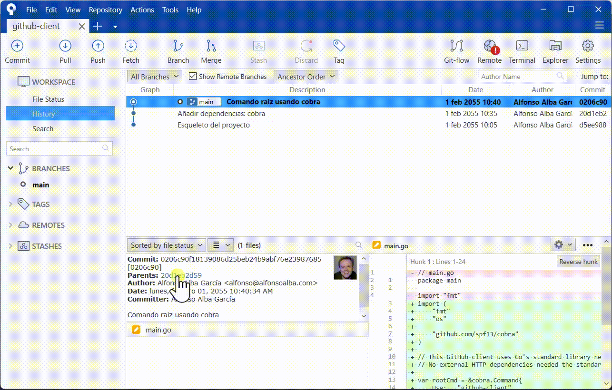

# Taller 2.2 (versión Go con Visual Studio Code): primeros _commits_

## Índice

* This will become a table of contents (this text will be scrapped).
{:toc}

## Requisitos
Este taller es continuación del taller [Taller 2.1: esqueleto del proyecto y primer commit]().

Es necesario haber completado el [taller 2.1]() para poder realizar este taller.
Puedes importar el proyecto [github-client-taller-2-1.zip]() en `Visual Studio Code` y partir de él hacer este taller.

## Objetivos
- Añadir dependencias al proyecto, que este compile y que muestre una primera salida por pantalla
- Confirmar dos cambios más al repositorio
- Ver parte del contenido de la carpeta `.git`
- Ver cómo evoluciona la historia del repositorio

## Segunda confirmación de cambios

### Añadir dependencias

Para hacer el cliente de `GitHub` utilizaremos el módulo [`cobra`](https://github.com/spf13/cobra) de `go`. Este módulo facilita escribir herramientas para consola
definiendo comandos y subcomandos con opciones, al estilo del propio comando `git`.

Abrimos una consola en la raiz del proyecto y ejecutamos el siguiente comando:

```powershell
> go get github.com/spf13/cobra
go: downloading github.com/spf13/cobra v1.10.2
go: downloading github.com/spf13/pflag v1.0.9
go: downloading github.com/inconshreveable/mousetrap v1.1.0
go: added github.com/inconshreveable/mousetrap v1.1.0
go: added github.com/spf13/cobra v1.10.2
go: added github.com/spf13/pflag v1.0.9
```

Este comando añade las dependencias al proyecto. Verificamos que el programa sigue funcionando:

```powershell
> go run .
Mi cliente de Github
```

### Confirmamos los cambios

Abrimos el repositorio con `SourceTree` y vamos a la sección *File Status*. 
Veremos los dos ficheros que hemos creado en la sección *Unstaged changes*:



Añadimos los ficheros área de preparación haciendo clic sobre el botón
`Stage all`. Hacemos cliec sobre el botón `Commit` en la barra superior y 
escribirmos el siguiente mensaje en el cuadro de diálogo: 
"Añadir MainClass y código trivial para verificar que el proyecto se ejecuta correctamente":



Escribimos el mensaje para la confirmación de cambios: *"Añadir dependencias: cobra"*. Después, confirmamos los cambios haciendo clic sobre el 
botón *Commit* de la parte inferior derecha de la ventana. Tras confirmar los cambios, `SourceTree` nos mostrará la histora del respositorio:



### Si lo queremos hacer por consola...

Si queremos hacer estas operaciones por consola, tras modificar el código y 
ejecutar el proyecto, utilizamos el comando `git status` para ver el estado en el 
que se encuentran los ficheros:

```powershell
> git status
On branch main
Changes not staged for commit:
  (use "git add <file>..." to update what will be committed)
  (use "git restore <file>..." to discard changes in working directory)
        modified:   go.mod

Untracked files:
  (use "git add <file>..." to include in what will be committed)
        go.sum

no changes added to commit (use "git add" and/or "git commit -a")
```

Subimos los ficheros al área de preparación usando el comando `git add`. Este comando 
requiere como mínimo una ruta a un fichero o un directorio para marcar los ficheros como 
preparados. Usaremos `git add .` para preparar todos los ficheros:

```powershell 
> git add .
> git status
On branch main
Changes to be committed:
  (use "git restore --staged <file>..." to unstage)
        modified:   go.mod
        new file:   go.sum
```

Vemos cómo los ficheros han pasado de la sección *Untracked files* a la sección *Changes to be committed*.
Confirmamos los cambios usando el comando `git commit`:

```powershell
> git commit -m'Añadir dependencias: cobra'
[main 20d1eb2] Añadir dependencias: cobra
 2 files changed, 16 insertions(+)
 create mode 100644 go.sum
```

Finalmente, para ver la historia podemos usar el comando `git log`:

```powershell
> git log --graph --oneline
* 20d1eb2 (HEAD -> main) Añadir dependencias: cobra
* d5ee988 Esqueleto del proyecto
```

## Tercera confirmación de cambios

A continuación, utilizando `cobra`, mostraremos un primer mensaje al usuario que ejecute nuestra aplicación.

### Modifiacando el código

Editamos el fichero `main.go` y lo sustituimos por el siguiente código:

```go
package main

import (
  "fmt"
  "os"

  "github.com/spf13/cobra"
)

// This GitHub client uses Go's standard library net/http for API calls.
// No external HTTP dependencies needed—the standard library handles everything.

var rootCmd = &cobra.Command{
  Use:   "github-client",
  Short: "A GitHub CLI client",
  Long:  `github-client is a command-line interface for interacting with GitHub's REST API`,
}

func main() {
  if err := rootCmd.Execute(); err != nil {
    fmt.Fprintln(os.Stderr, err)
    os.Exit(1)
  }
}

```

Ejecutamos el proyecto y confirmamos que funciona correctamente:

```powershell
$ go run .
github-client is a command-line interface for interacting with GitHub's REST API
```

Podemos utilizar la opción `--help`, aunque en este momento no nos da mucha información adicional:

```powershell
$ go run . --help
github-client is a command-line interface for interacting with GitHub's REST API
```

Si utilizamos una opción que no existe, veremos como `cobra` nos muestra su mensaje de error por defecto:

```powershell
$ go run . --invalid
Error: unknown flag: --invalid
Usage:

Flags:
  -h, --help   help for github-client

unknown flag: --invalid
exit status 1
```


### Confirmamos los cambios

#### Usando SourceTree 
Confirmamos los cambios usando la interfaz gráfica como hemos hecho 
ya en ocasiones anteriores:



#### Usando la consola
Usamos `git status` para ver los cambios en el área de trabajo:

```powershell
$ git status
On branch main
Changes not staged for commit:
  (use "git add <file>..." to update what will be committed)
  (use "git restore <file>..." to discard changes in working directory)
        modified:   main.go

no changes added to commit (use "git add" and/or "git commit -a")
```

En este caso, vemos los cambios en la sección *Changes not staged for commit*, ya que se trata de modificaciones 
sobre un fichero que `git` ya está monitorizando.

Ejecutamos `git add` y `git commit` para confirmar los cambios:

```
> git add .
> git commit -m'Comando raiz usando cobra'
 git commit -m'Comando raiz usando cobra' --date $DATE
[main 0206c90] Comando raiz usando cobra
 Date: Mon Feb 1 10:40:34 2055 +0100
 1 file changed, 19 insertions(+), 3 deletions(-)
```

### Historia del repositorio

Tras hacer tercera confirmación de cambios, podemos ver la historia del repositorio
haciendo clic a la izquierda sobre _History_:



O usando la consola:

```powershell
> git log --graph --oneline
* 0206c90 (HEAD -> main) Comando raiz usando cobra
* 20d1eb2 Añadir dependencias: cobra
* d5ee988 Esqueleto del proyecto
```

En ambos casos vemos las tres confirmaciones de cambios que hemos realizado.

#### Comprobando que es una lista enlazada

En `SourceTree`, al hacer click sobre una confirmación de cambios, podremos ver los datos de esa
confirmación. Estos datos incluyen un enlace a la confirmación de cambios anterior anterior. Si vamos haciendo clic 
sobre los enlaces, podremos ir hacia atrás en la historia del repositorio:

<!--

-->


Como comentamos en las diapositivas:
- Los _commits_ del repositorio, al incluir una referencia al _commit_ anterior,
  forman parte de una lista simplemente enlazada
- Esta lista solo podemos recorrerla en un sentido (de arriba a abajo según
  la muestra `SourceTree`)
- Una confirmación de cambios no guarda referencias a las confirmaciones de cambios posteriores (descendientes)
  solo guarda referencia a la confirmación de cambios anterior (ancestros)

