# Taller 2 (versión Java con Eclipse): primeros _commits_

## Índice

* This will become a table of contents (this text will be scrapped).
{:toc}

## Requisitos
Este taller es continuación del taller [Taller 1: esqueleto del proyecto y primer commit]().

Es necesario haber completado el [taller 1]() para poder realizar este taller.
Puedes importar el proyecto `java/GithubClient-taller1.zip` en `Eclipse` y partir de él para hacer este taller.

## Objetivos
- Añadir `MainClass` al proyecto, que este compile y que muestre una primera salida por pantalla
- Confirmar dos cambios más al repositorio
- Ver parte del contenido de la carpeta `.git`
- Ver cómo evoluciona la historia del repositorio

## El segundo _commit_

### Crear paquete de Java 
Ir a `File` -> `New` -> `Package` y crear el paquete `com.alfonsoalba`:

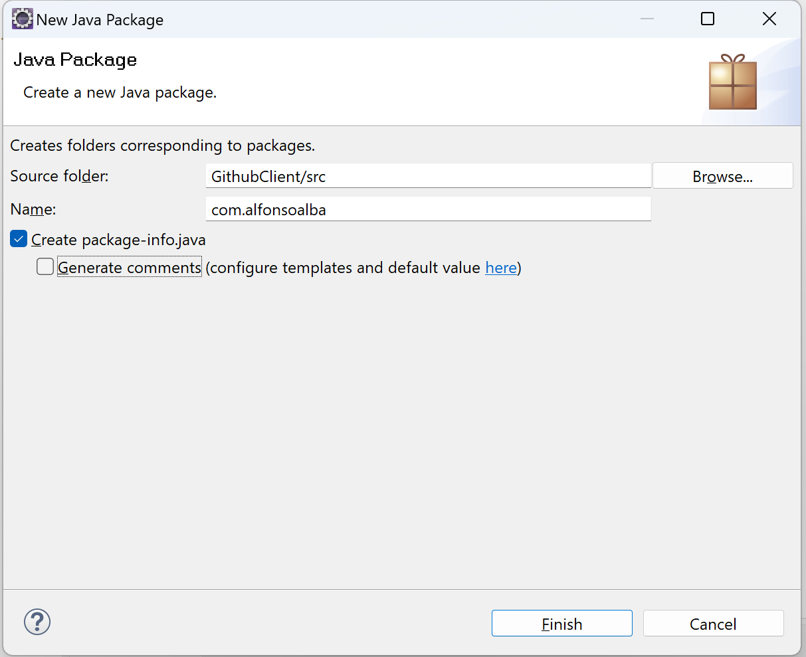


### Crear `MainClass`
Ir a `File` -> `New` -> `Class` y crear la clase `MainClass` asegurándonos de 
marcar la opción para que cree el método `main` y de que la clase 
forma parte del paquete `com.alfonsoalba`:

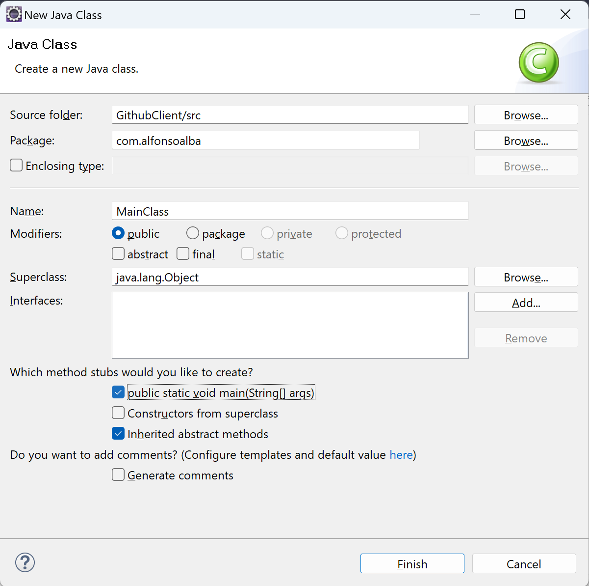

### Ejecutar el código
A continuación, modificamos el contenido del fichero `MainClass` e incluimos
el siguiente código:

```java
package com.alfonsoalba;

public class MainClass {

	public static void main(String[] args) {
		System.out.print("Cliente de Github");
	}

}
```

Guardamos y hacemos click sobre el icono para ejecutar la clase. En la consola 
veremos el texto "Cliente de Github":

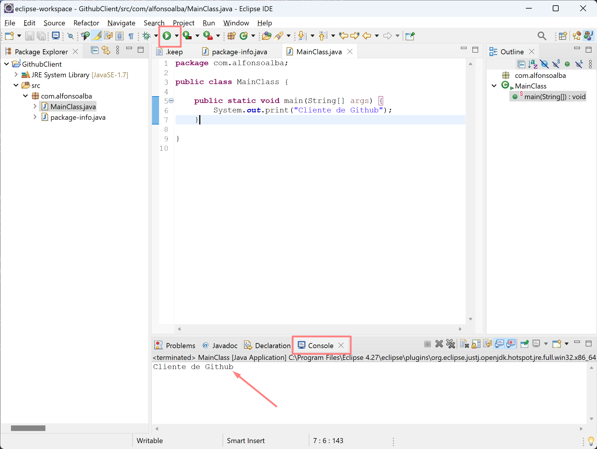

### Confirmamos los cambios

Abrimos el repositorio con `SourceTree` y vamos a la sección _File Status_. 
Veremos los dos ficheros que hemos creado en la sección _Unstaged changes_:

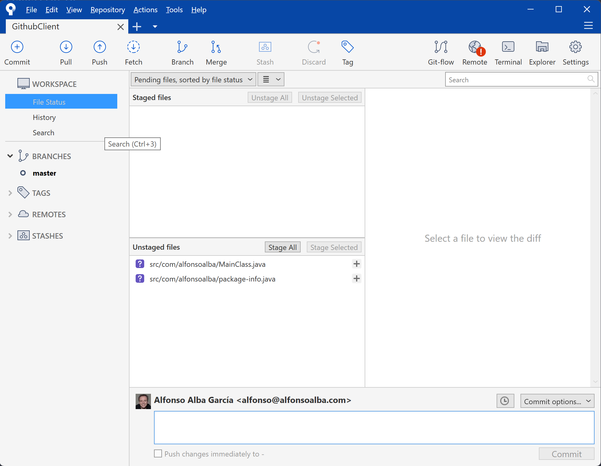

Añadimos los ficheros área de preparación haciendo clic sobre el botón
`Stage all`. Hacemos cliec sobre el botón `Commit` en la barra superior y 
escribirmos el siguiente mensaje en el cuadro de diálogo para el commit: 
"Añadir MainClass y código trivial para verificar que el proyecto se ejecuta correctamente":

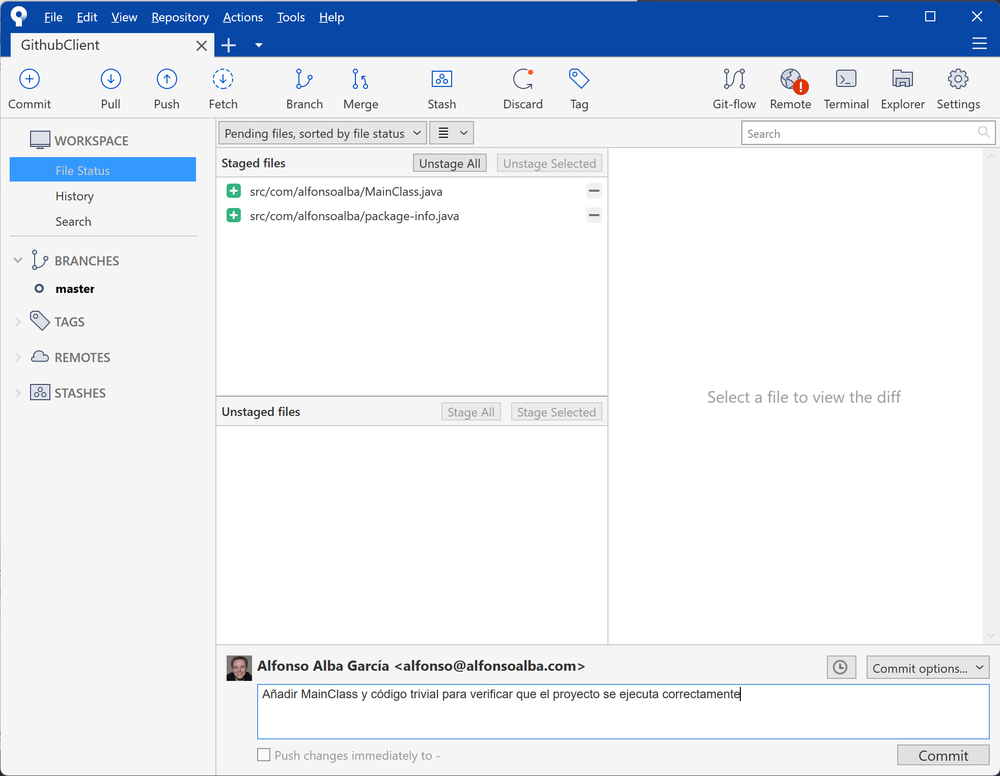

Confirmamos los cambios, tras lo cual `SourceTree` nos mostrará la histora del respositorio:

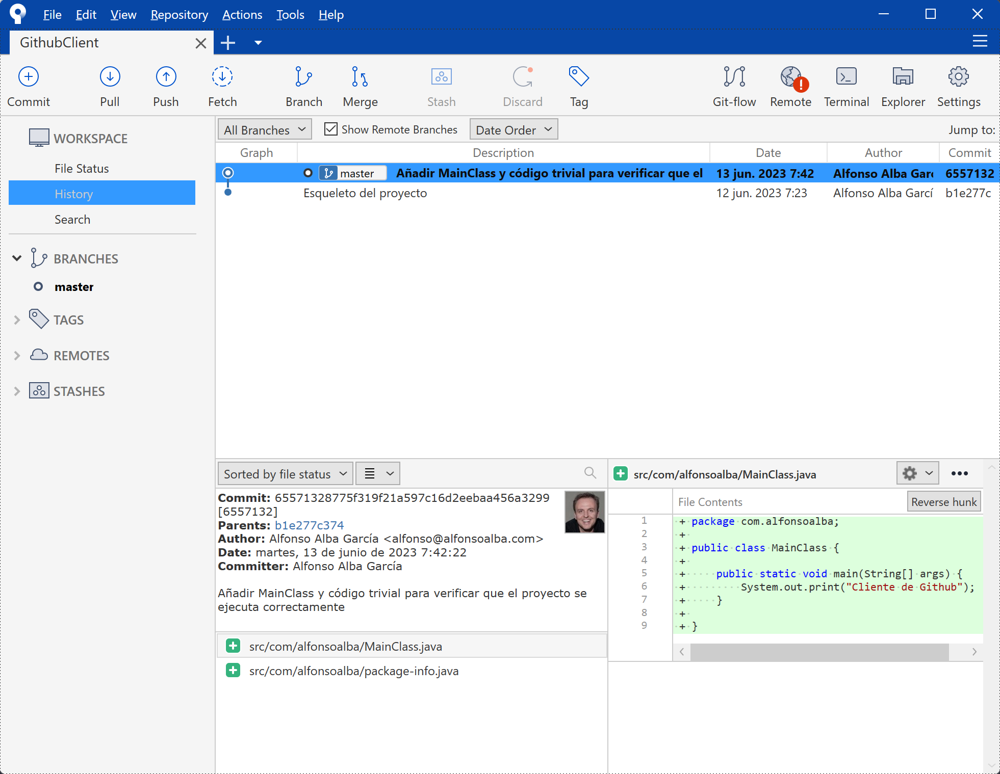

### Si lo queremos hacer por consola...

Si queremos hacer estas operaciones por consola, tras modificar el código en java y 
ejecutar el proyecto, utilizamos el comando `git status` para ver el estado en el 
que se encuentran los ficheros:

```powershell
PS C:\Users\...\GithubClient> git status
On branch master
Untracked files:
  (use "git add <file>..." to include in what will be committed)
        src/com/

nothing added to commit but untracked files present (use "git add" to track)
```

Subimos los ficheros al área de preparación usando el comando `git add`. Este comando 
requiere como mínimo una ruta a un fichero o un directorio para marcar los ficheros como 
preparados. Usaremos `git add .` para preparar todos los ficheros:

```powershell 
PS C:\Users\...\GithubClient> git add .
PS C:\Users\...\GithubClient> git status
On branch master
Changes to be committed:
  (use "git restore --staged <file>..." to unstage)
        new file:   src/com/alfonsoalba/MainClass.java
        new file:   src/com/alfonsoalba/package-info.java
```

Vemos cómo los ficheros han pasado de la sección _Untracked files_ a la sección _Changes to be committed_.
Confirmamos los cambios usando el comando `git commit`:

```powershell
PS C:\Users\...\GithubClient> git commit -m'Añadir MainClass y código trivial para verificar que el proyecto se ejecuta correctamente'
[master 7c5d4ab] Añadir MainClass y código trivial para verificar que el proyecto se ejecuta correctamente
 2 files changed, 10 insertions(+)
 create mode 100644 src/com/alfonsoalba/MainClass.java
 create mode 100644 src/com/alfonsoalba/package-info.java
```

Finalmente, para ver la historia podemos usar el comando `git log`:

```powershell
PS C:\Users\...\GithubClient> git log --graph --oneline
* 7c5d4ab (HEAD -> master) Añadir MainClass y código trivial para verificar que el proyecto se ejecuta correctamente
* b1e277c Esqueleto del proyecto
```

## El tercer _commit_ 

A continuación, convertiremos el proyecto en un proyecto de `Maven` y añadiremos una dependencia al mismo.

### Convertir el proyecto en un proyecto Maven

Seguiremos [la documentación del propio `Eclipse`](https://wiki.eclipse.org/Converting_Eclipse_Java_Project_to_Maven_Project).
Haciendo clic sobre el proyecto, en el menú contextual seleccionamos `Configure` -> `Convert to Maven project`:

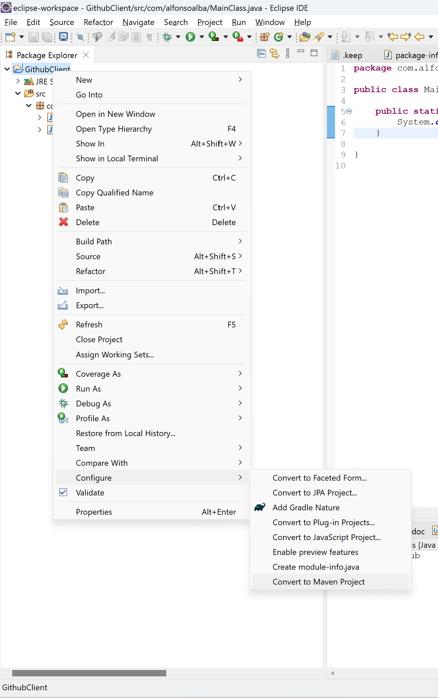

En la ventana emergente que nos aparece, mantenemos las opciones por defecto y hacemos clin en 
el botón `Finish`:

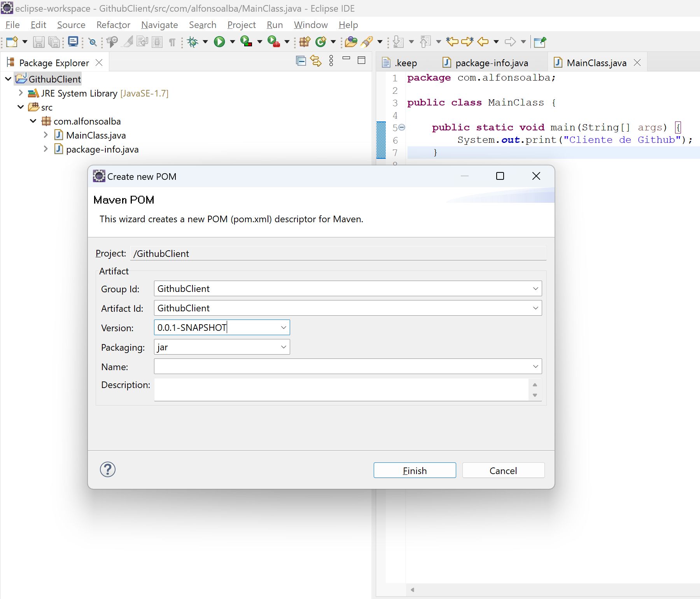

Una vez convertido el proyecto, veremos que nos aparece el fichero `pom.xml` correspondiente y 
la carpeta `target`. El siguiente paso es ejecutar `mvn install`. Para ello, seleccionamos 
`Run` -> `Run As` -> `Maven install`. Al hacerlo, veremos en la consola de `Eclipse` la 
salida del comando en la que no deberíamos ver ningún error:

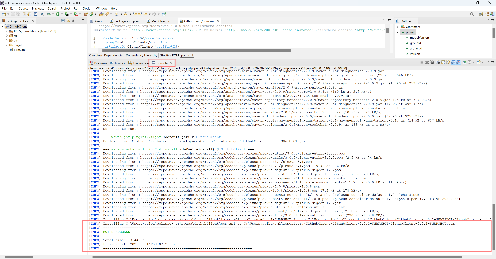

Vamos a terminar de configurar `Maven` para conseguir un ejecutable de nuestro proyecto.
Añadimos el paquete [`maven-jar-plugin`](https://mvnrepository.com/artifact/org.apache.maven.plugins/maven-jar-plugin) 
como una dependencia. Para ello, añadimos el siguiente código al fichero `pom.xml`
en las secciones `plugins` y `dependencies`:

```xml
<project>
  ...
  <build>
    <plugins>
      <plugin>
        <!-- Build an executable JAR -->
        <groupId>org.apache.maven.plugins</groupId>
        <artifactId>maven-jar-plugin</artifactId>
        <version>3.3.0</version>
        <configuration>
          <archive>
            <manifest>
              <addClasspath>true</addClasspath>
              <classpathPrefix>lib/</classpathPrefix>
              <mainClass>com.alfonsoalba.MainClass</mainClass>
            </manifest>
          </archive>
        </configuration>
      </plugin>
    </plugins>
  </build>

  <dependencies>
    <!-- https://mvnrepository.com/artifact/org.apache.maven.plugins/maven-jar-plugin -->
  	<dependency>
	    <groupId>org.apache.maven.plugins</groupId>
	    <artifactId>maven-jar-plugin</artifactId>
	    <version>3.3.0</version>
  	</dependency>
  </dependencies>
</project>
```

Una vez hecho esto, hacemos clic con el botón derecho sobre el proyecto, seleccionamos 
`Run as` y ejecutamos `Maven install`, y a continuación `Maven build`.
En la consola de `Eclipse` comprobamos que ha ido todo bien y que la ejecución de los 
comandos termina correctamente. Una vez hecho esto, confirmamos que el ejecutable 
funciona. Para ello, abrimos una terminal en la raiz del proyecto (que en mi caso
está en la carpeta `C:\Users\aalba\eclipse-workspace\GithubClient`) y lo ejecutamos:

```powershell
PS C:\Users\...\GithubClient> java -jar .\target\GithubClient-0.0.1-SNAPSHOT.jar
Cliente de Github
```

Obtendremos el texto "_Cliente de Github_" como resultado.

### Actualizando el fichero .gitignore
`Maven` tiene sus propias reglas para ignorar ficheros que debemos añadir al 
fichero `.gitignore` antes de confirmar los cambios.

Como hicimos en [el taller 1](#el-fichero-gitignore),
utilizaremos la página [gitignore.io](https://gitignore.io) para obtener las reglas
correspondientes a `Maven` y las añadimos al final del fichero `.gitignore`, debajo de las
reglas de `Eclipse`. Después de pegar el texto, comentaremos
las líneas que ignoran `.project` y `.classpath`:

```.gitignore
# Created by https://www.toptal.com/developers/gitignore/api/maven
# Edit at https://www.toptal.com/developers/gitignore?templates=maven

### Maven ###
target/
pom.xml.tag
pom.xml.releaseBackup
pom.xml.versionsBackup
pom.xml.next
release.properties
dependency-reduced-pom.xml
buildNumber.properties
.mvn/timing.properties
# https://github.com/takari/maven-wrapper#usage-without-binary-jar
.mvn/wrapper/maven-wrapper.jar

# Eclipse m2e generated files
# Eclipse Core
# .project   <<<<<----- COMENTAR ESTA LÍNEA
# JDT-specific (Eclipse Java Development Tools)
# .classpath   <<<<<----- COMENTAR ESTA LÍNEA
# End of https://www.toptal.com/developers/gitignore/api/maven
```

### Confirmamos los cambios

#### Usando SourceTree 
Confirmamos los cambios usando la interfaz gráfica como hemos hecho 
ya en ocasiones anteriores:

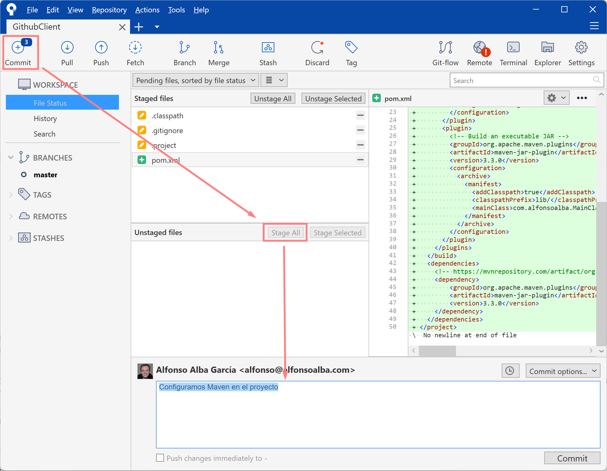

#### Usando la consola
Usamos `git status` para ver los cambios en el área de trabajo:

```powershell
PS C:\Users\...\GithubClient> git status
On branch master
Changes not staged for commit:
  (use "git add <file>..." to update what will be committed)
  (use "git restore <file>..." to discard changes in working directory)
        modified:   .classpath
        modified:   .gitignore
        modified:   .project

Untracked files:
  (use "git add <file>..." to include in what will be committed)
        pom.xml
```

Ejecutamos `git add` y `git commit` para hacer el commit:

```
PS C:\Users\...\GithubClient> git add .
PS C:\Users\...\GithubClient> git commit -m'Configuramos Maven en el proyecto'
[master 90336b5] Configuramos Maven en el proyecto
 4 files changed, 93 insertions(+), 3 deletions(-)
 create mode 100644 pom.xml
```

### Historia del repositorio

Tras hacer este tercer commit, podemos ver la historia del repositorio
haciendo clic a la izquierda sobre _History_:

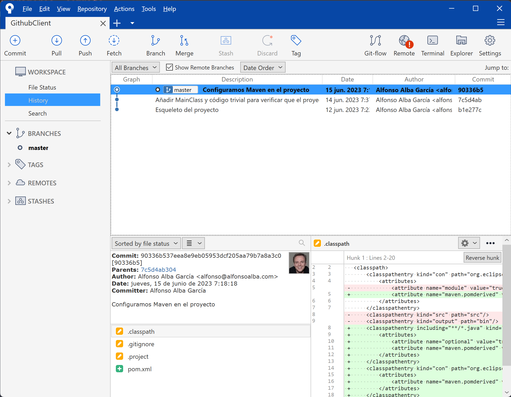

O usando la consola:

```powershell
PS C:\Users\...\GithubClient> git log --graph --oneline
* 90336b5 (HEAD -> master) Configuramos Maven en el proyecto
* 7c5d4ab Añadir MainClass y código trivial para verificar que el proyecto se ejecuta correctamente
* b1e277c Esqueleto del proyecto
```

En ambos casos vemos los tres commits que hemos realizado.

#### Comprobando que es una lista enlazada

En `SourceTree`, al hacer click sobre un _commit_, podremos ver los datos de ese _commit_.
Estos datos incluyen un enlace al commit anterior. Si vamos haciendo clic 
sobre los enlaces, podremos ir hacia atrás en la historia del repositorio:


<!-- 

-->

Como comentamos en las diapositivas:
- Los _commits_ del repositorio, al incluir una referencia al _commit_ anterior,
  forman parte de una lista simplemente enlazada
- Esta lista solo podemos recorrerla en un sentido (de arriba a abajo según
  la muestra `SourceTree`)
- Un _commit_ no guarda referencias a los _commits_ siguientes
