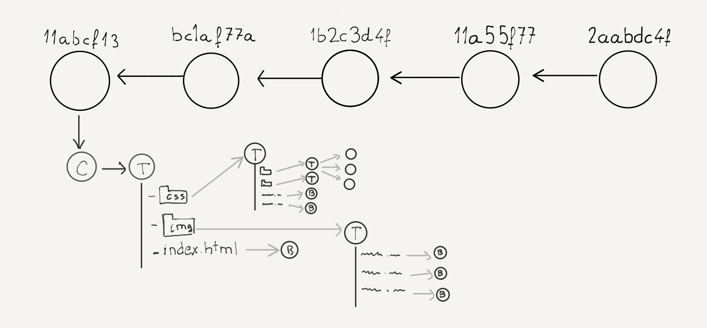
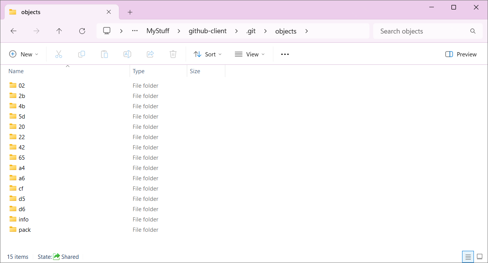
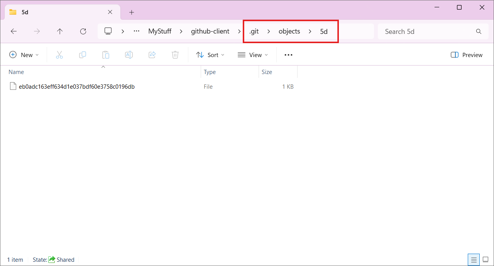
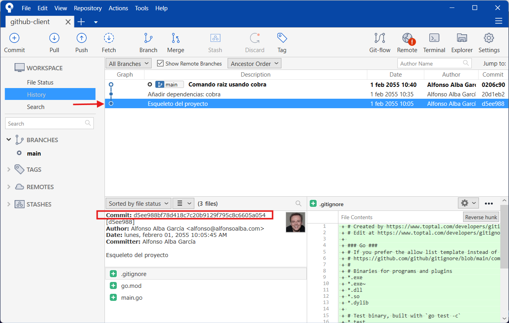
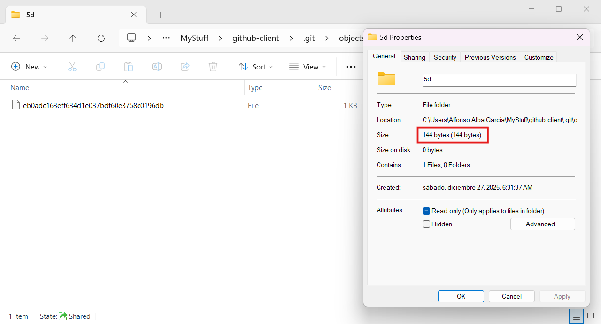

# Taller 2.3 (version Go con Visual Studio Code): inspeccionando la carpeta `.git/objects`

## Índice

* This will become a table of contents (this text will be scrapped).
{:toc}

## Requisitos
Este taller es continuación del taller 
[Taller 2.2: primeros *commits*]().

Es necesario haber completado el 
[taller 2.2]() para poder realizar 
este taller. Puedes importar el proyecto [github-client-taller-2-2.zip]() en 
Visual Studio Code y partir de él para hacer este taller.

## Objetivos

- Ver el contenido de la carpeta `.git/objets`
- Inspeccionar objetos de git con el comando `git cat-file`

## Los objetos de git 

En las diapositivas vimos que cuando se confirman los cambios, no se guarda 
realmente una instantánea nueva y completa de nuestro proyecto. 
Aunque a alto nivel git se comporta como si hiciese eso, a bajo nivel 
está almacenando un conjunto de objetos que forman un mini sistema de ficheros:



Git almacena todos estos objetos en la carpeta `.git/objects` de nuestro 
repositorio. Recuerda que a diferencia de otros sistemas de control de versiones
distribuidos, git almacena los cambios en local. No en un servidor central.

## La carpeta `.git/objects`

Si abres la carpeta `git/objects` de tu proyecto utilizando el explorador de 
archivos de tu sistema operativo, verás algo muy parecido a lo siguiente:



Esta carpeta contiene todos los objetos de git que se han generado hasta el 
momento. Además, como todavía no ha pasado el recolector de basura (comando 
`git gc`), están todavía sin empaquetar.

Para no tener miles de ficheros en una misma carpeta, algo penalizaría 
el rendimiento a nivel de sistema de ficheros y acceso a disco, los objetos 
se van clasificando en subcarpetas.

Si un objeto de git tiene un *hash* `d5ee988bf78d418c7c20b9129f795c8c6605a054`, 
el objeto estará en la ruta 
`.git/objects/d5/ee988bf78d418c7c20b9129f795c8c6605a054`. Los dos primeros caracteres
del *hash* se utilizan para nombrar una carpeta y el resto de caracteres 
se utiliza para nombrar el fichero en sí.



Si dos objetos de git comienzan con los mismos dos caracteres estarán en la 
misma carpeta.

La carpeta `.git/objects` contiene todos los cambios que hemos confirmado 
hasta ahora en los dos talleres anteriores, distribuidos en el 
mini sistema de ficheros que conforman los objetos de git.

¿Y por qué decimos que git implementa un mini sistema de ficheros? Vamos 
a mirar dentro de estos objetos de git para entenderlo.

## El objeto de tipo de `commit` de nuestros primeros cambios confirmados

Utilizando `Sourcetree` o la consola, vamos a averiguar cuál es nombre
(*hash*) de los primeros cambios que confirmamos en el repositorio. Para ello,
abrimos `Sourcetree`, hacemos clic en _History_ en el menú de la izquierda, y 
hacemos clic sobre la primera confirmación de cambios:



En nuestro caso, el nombre es `d5ee988bf78d418c7c20b9129f795c8c6605a054`.

Vamos a buscar el fichero correspondiente a este objeto de git utilizando el 
navegador de archivos de nuestro sistema operativo. Para ello, debemos ir a la 
carpeta `.git/objects/d5/`: 



Lo primero que llama la atención de ese objeto de git es su tamaño: apenas ocupa 
144 bytes.

La primera instantánea de nuestro código ocupa más que eso. Solo el fichero 
`.gitignore` que confirmamos en el primer taller ocupa 707 bytes.
Alquien podría argumentar que el motivo por el que el código ocupa poco es 
porque está comprimido (git comprime los objetos al crearlos y almacenarlos). 
Sin embargo, las cabeceras del fichero comprimido ya ocuparían más que estos 
144 bytes. Podemos hacer la prueba. Si creamos un fichero comprimido con zip 
de los 3 ficheros que confirmamos por primera vez 
(`go.mod`, `.gitignore`, `main.go`) el fichero resultante 
ocupa 1Kb. Bastante más que los 144 bytes que vemos en nuestro disco duro.

Si este objeto de git no contiene la instantánea, ¿dónde está entonces?

## El comando `git cat-file`

Se trata de un comando de git que permite ver el contenido, el tipo y el 
tamaño de los objetos de git. Puedes ver 
[aquí](https://git-scm.com/docs/git-cat-file) la documentación completa del 
comando.



## El contenido de d5ee988bf78d418c7c20b9129f795c8c6605a054


Usando el comando `git cat-file` vamos a ver el contenido del objeto de git 
con el _hash_ `d5ee988bf78d418c7c20b9129f795c8c6605a054`. Para ello:

```powershell
> git cat-file -p d5ee988bf78d418c7c20b9129f795c8c6605a054
tree 65490dd747c80a3861d6a6a409d8856d576377ba
author Alfonso Alba García <alfonso@alfonsoalba.com> 2685085545 +0100
committer Alfonso Alba García <alfonso@alfonsoalba.com> 2685085545 +0100

Esqueleto del proyecto
```

La opción `-p` le dice al comando `git cat-file` que intente averiguar el tipo 
de objeto por si mismo. Si no usamos esa opción, tenemos que especificar el 
tipo de objeto de forma explícita: `git cat-file commit d5ee988bf78d418c7c20b9129f795c8c6605a054`

Como podemos ver, este objeto no contiene la instantánea. Este objeto 
contiene únicamente: 
- los datos del commit (nombre y correo electrónico del autor, fecha y mensaje
  del commit)
- un puntero a otro objeto de git de tipo `tree`

Nota: Al ser los primeros cambios confirmados, no vemos una referencia a la confirmación de cambios 
anterior. Cuando inspeccionemos el segundo objeto de tipo `commit` que creamos
en el taller 2.2, cosa que haremos en las siguientes secciones, sí que veremos
esa referencia a la confiración anterior.


Dentro del objeto de tipo `commit`, tenemos una referencia al objeto de tipo
`tree` de nombre `65490dd747c80a3861d6a6a409d8856d576377ba`. 
Si inspeccionamos este objeto de tipo `tree`, veremos un listado de ficheros 
con punteros a otros objetos de git: 

```powershell
> git cat-file -p 65490dd747c80a3861d6a6a409d8856d576377ba
100644 blob 22642bc34b8f7d3b6a37014b26020d00c62c1fd6    .gitignore
100644 blob a473e351c785bc0d2413a8aa501bb97054528ad1    go.mod
100644 blob d6a0f6ef23f29095ef5f1ae8edc76c7539b3c8ac    main.go
```

Mas adelante haremos referencia a este objeto de tipo `tree` como `tree-1`.

Podemos ver el contenido de alguno de los ficheros que confirmamos
en ese momento inspeccionando los objetos de tipo `blob`:

```powershell
> git cat-file -p d6a0f6ef23f29095ef5f1ae8edc76c7539b3c8ac
// main.go
package main

import "fmt"

func main() {
  fmt.Println("Mi cliente de Github")
}
```

¡El `blob` contiene nuestro código fuente!

Tras inspeccionar los objetos de tipo git, podemos entender mejor por qué 
comentamos antes que git implementa un mini sistema de ficheros. Los 
objetos de tipo `tree` son los equivalentes a nuestros directorios del 
sistema de ficheros, mientras que los objetos de tipo `blob` serían 
nuestros ficheros. Podemos navegar a través de este sistema de ficheros 
siguiendo los punteros incluidos en los diferentes objetos de git.

## El contenido del segundo objeto de tipo `commit`

A modo de recordatorio, la segunda vez que confirmamos cambios en nuestro 
repositorio, añadimos `cobra` como una dependencia.

Como hicimos en el paso anterior, necesitamos averiguar cuál es el nombre del 
segundo _commit_ utilizando `Sourcetree`. En mi caso, el nombre es 
`20d1eb2d59746c650fab29af7d693a89a7638bb7 `

Vamos a inspeccionar este objeto de git:

```powershell
> git cat-file -p 20d1eb2d59746c650fab29af7d693a89a7638bb7 
tree 5deb0adc163eff634d1e037bdf60e3758c0196db
parent d5ee988bf78d418c7c20b9129f795c8c6605a054
author Alfonso Alba García <alfonso@alfonsoalba.com> 2685087302 +0100
committer Alfonso Alba García <alfonso@alfonsoalba.com> 2685087302 +0100

Añadir dependencias: cobra

```

Comparado con el objeto de git del apartado anterior:
- Ahora si vemos una referencia al padre (que es el primer objeto de tipo 
  `commit` que inspeccionamos al principio de este taller)
- El objeto contiene un puntero a un objeto de tipo `tree` diferente (como 
  era de esperar)

Si inspeccionamos ese objeto de tipo `tree` (que denominameremos `tree-2`):

```powershell
> git cat-file -p 5deb0adc163eff634d1e037bdf60e3758c0196db 
100644 blob 22642bc34b8f7d3b6a37014b26020d00c62c1fd6    .gitignore
100644 blob 2b574900fa23ef2594b3f0159b7187caab442224    go.mod
100644 blob a6ee3e0fb39674f5ff47f1f0480a532bde4abf20    go.sum
100644 blob d6a0f6ef23f29095ef5f1ae8edc76c7539b3c8ac    main.go
```

¿Qué es lo que observamos?
- Los punteros a los objetos de tipo `blob` de los ficheros `.gitignore` y `main.go` apuntan al 
  mismo `blob`` que en  `tree-1`, ya que esos ficheros no han cambiado
- El punter al objeto de tipo `blob` para el fichero `go.mod` es distinto
  ya que ha cambiado
- aparece un nuevo objeto de tipo `blob` para el fichero `go.sum` ya que se trata de 
  de un nuevo fichero

Aquí estamos viendo en acción a git. Vemos cómo en lugar de guardar 
una instantánea completa del proyecto cada vez que confirmamos cambios, 
utiliza punteros para  referenciar a los ficheros que no han cambiado. 
Solo ha creado objetos de tipo blob nuevos para los ficheros nuevos que 
hemos creado o aquellos que hemos modificado.

## El contenido del tercer objeto de tipo `commit`



A modo de recordatorio, la tercera vez que confirmamos cambios en el repositorio
introdujimos el comando raiz de cobra (`rootCmd`). Usando  `Sourcetree` o la consola 
obtenemos el nombre de tercera confirmación de cambios (en mi caso `0206c90`).
Utilizamos de nuevo el comando `git cat-file` para ver el objeto de git 
de tipo `commit`:

```powershell
> git cat-file -p 0206c90
tree cf68894b7d50326e3b48cb22be15670dfe4324a3
parent 20d1eb2d59746c650fab29af7d693a89a7638bb7
author Alfonso Alba García <alfonso@alfonsoalba.com> 2685087634 +0100
committer Alfonso Alba García <alfonso@alfonsoalba.com> 2685087634 +0100

Comando raiz usando cobra
```


Veamos que contiene el objeto de tipo `tree` con el nombre `cf68894b`:

```powershell
> git cat-file -p cf68894b
100644 blob 22642bc34b8f7d3b6a37014b26020d00c62c1fd6    .gitignore
100644 blob 2b574900fa23ef2594b3f0159b7187caab442224    go.mod
100644 blob a6ee3e0fb39674f5ff47f1f0480a532bde4abf20    go.sum
100644 blob 42f01a1e51dbe185e19080cb969d161e62f3b79d    main.go
```

Denominameremos a este objeto `tree-3`. Observamos que con respecto
al objeto `tree-2`:
- El puntero al objeto de tipo `blob` de los ficheros `.gitignore`, `go.mod`,
  y `go.sum` no han cambiado
- Se ha creado un nuevo objeto de tipo `blob` que apunta a la nueva versión
  del fichero `main.go`

Si inspeccinamos el objeto `42f01a1e`:

```powershell
> git cat-file -p 42f01a1e
package main

import (
        "fmt"
        "os"

        "github.com/spf13/cobra"
)

// This GitHub client uses Go's standard library net/http for API calls.
// No external HTTP dependencies needed—the standard library handles everything.

var rootCmd = &cobra.Command{
        Use:   "github-client",
        Short: "A GitHub CLI client",
        Long:  `github-client is a command-line interface for interacting with GitHub's REST API`,
}

func main() {
        if err := rootCmd.Execute(); err != nil {
                fmt.Fprintln(os.Stderr, err)
                os.Exit(1)
        }
}

```

Observamos que git ha guardado una copia completa de la nueva versión del fichero `main.go`.



## Resumen de lo que hemos observado

- Hemos creado tres objetos de git de tipo `commit`. 
- Cada uno de estos objetos de tipo `commit` contiene los datos de la confirmación de cambios:
  - Nombre e email del autor
  - Fecha
  - Mensaje
  - Instantánea del código en forma de un puntero a un objeto de tipo `tree`
- Hemos acabado con dos instanáneas distintas del fichero `main.go`:
  - una en el objeto `tree-1` (ver el `blob` `d6a0f6ef`) 
  - otra en el objeto `tree-3` (ver el `blob` `42f01a1e`)
- Aunque no hemos mirado el detalle de los otros ficheros, dentro de la carpeta 
  `.git/objects` tendremos:
  - una única instantánea del fichero `.gitignore`
  - dos instáneas del fichero `go.mod`
  - una instantánea del fichero `go.sum`

## Compresión extra

En este taller hemos comprobado como git guarda una copia nueva del 
fichero dentro de un objeto de tipo `blob` cuando este se modifica. Podríamos 
decir que guardar una copia completa de un fichero si solo hemos modificado un 
caracter no es muy eficiente desde el punto de vista del almacenamiento.

Git es consciente de esto y lo resuelve al crear _packs_. Veremos 
qué es esto más adelante en el curso. Podemos adelantar que git 
empaqueta y comprime regularmente todos los objetos que están en la carpeta 
`.git/objects`. Una de las cosas que hace ese algoritmo de empaquetado y
compresión es almacenar _deltas_ en lugar de la copia completa nueva del fichero.

Ten en cuenta que esto es un mero detalle de implemetación. Para 
nosotros, git sigue comportándose como si guardase instantáneas completas del 
código cada vez que confirmamos los cambios en el repositorio.
