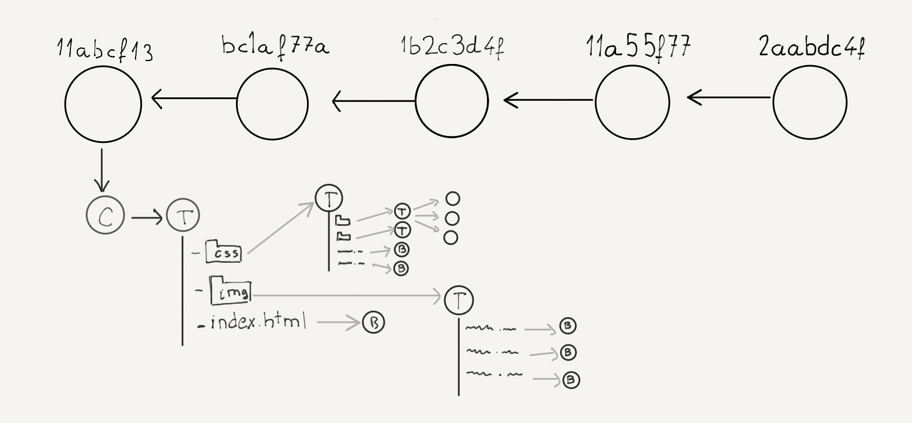
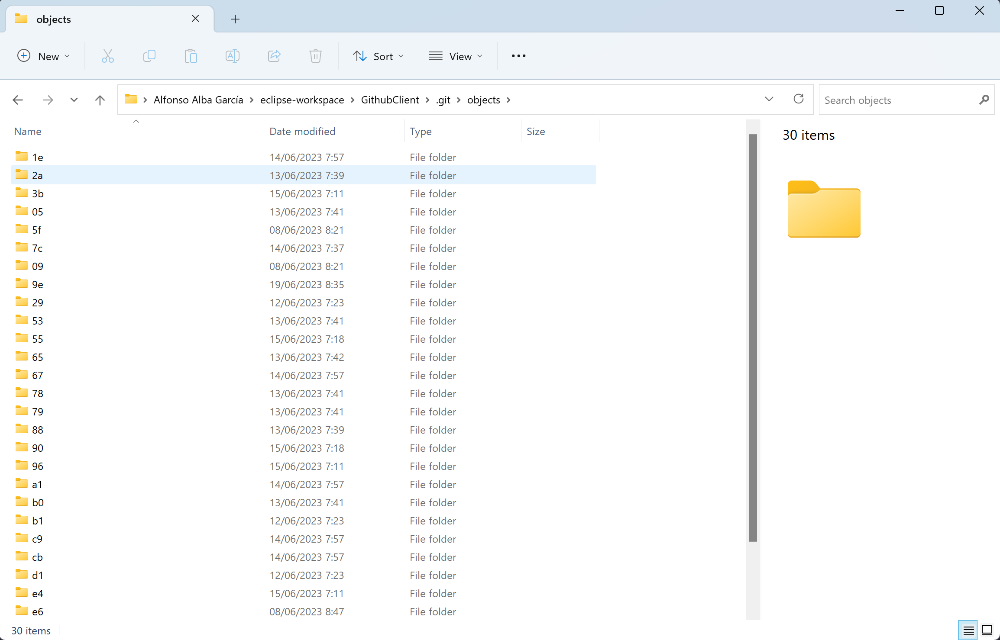
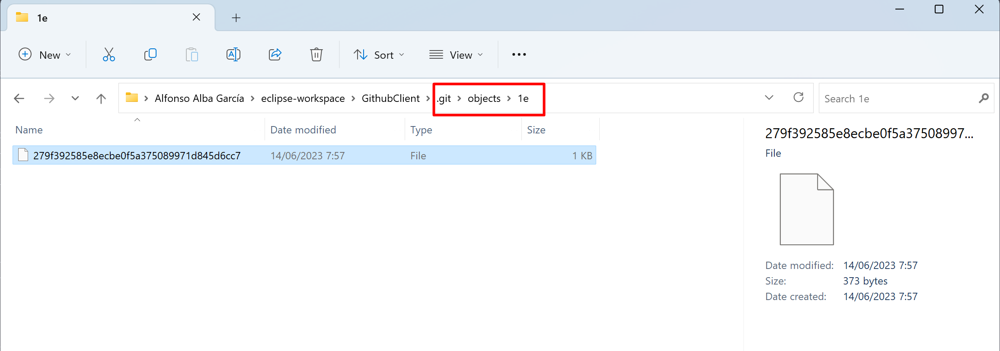
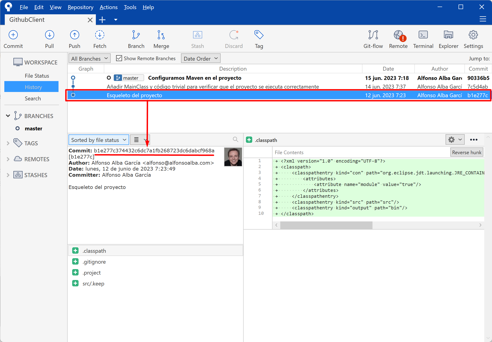
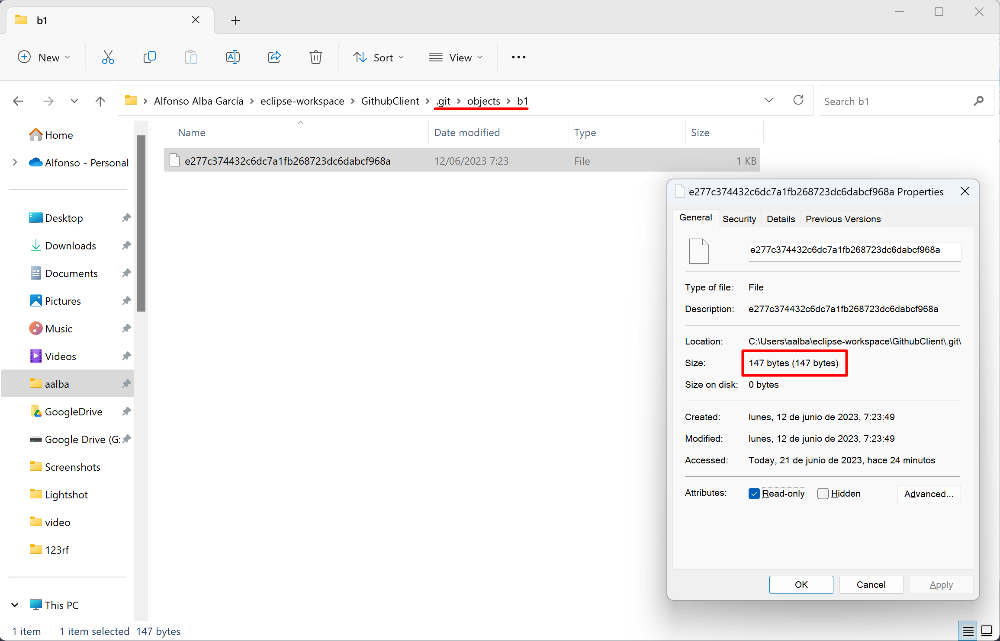
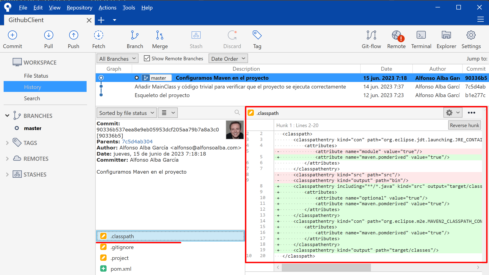

# Taller 3 (version Java con Eclipse): inspeccionando la carpeta `.git/objects`

## Índice

* This will become a table of contents (this text will be scrapped).
{:toc}

## Requisitos
Este taller es continuación del taller 
[Taller 2: esqueleto del proyecto y primer commit]().

Es necesario haber completado el 
[taller 2]() para poder realizar 
este taller. Puedes importar el proyecto `java/GithubClient-taller2.zip` en 
`Eclipse` y partir de él para hacer este taller.

## Objetivos

- Ver el contenido de la carpeta `.git/objets`
- Inspeccionar objetos de git con el comando `git cat-file`

## Los objetos de git 

En las diapositivas vimos que cuando se confirman los cambios, no se guarda 
realmente una instantánea nueva y completa de nuestro proyecto. 
Aunque a alto nivel git se comporta como si hiciese eso, a bajo nivel 
está almacenando un conjunto de objetos que forman un mini sistema de ficheros:



Git almacena todos estos objetos en la carpeta `.git/objects` de nuestro 
repositorio. Recuerda que a diferencia de otros sistemas de control de versiones
distribuidos, git almacena los cambios en local. No en un servidor central.

## La carpeta `.git/objects`

Si abres la carpeta `git/objects` de tu proyecto utilizando el explorador de 
archivos de tu sistema operativo, verás algo muy parecido a lo siguiente:



Esta carpeta contiene todos los objetos de git que se han generado hasta el 
momento. Además, como todavía no ha pasado el recolector de basura (comando 
`git gc`), están todavía sin empaquetar.

Para no tener miles de ficheros en una misma carpeta, algo penalizaría 
el rendimiento a nivel de sistema de ficheros y acceso a disco, los objetos 
se van clasificando en subcarpetas.

Si objeto de git tiene un _hash_ `ab279f392585e8ecbe0f5a375089971d845d6cc7`, 
el objeto estará en la ruta 
`.git/objects/ab/279f392585e8ecbe0f5a375089971d845d6cc7`



Si dos objetos de git comienzan con los mismos dos caracteres estarán en la 
misma carpeta.

La carpeta `.git/objects` contiene todos los cambios que hemos confirmado 
hasta ahora en los dos talleres anteriores, distribuidos en el 
mini sistema de ficheros que conforman los objetos de git.

¿Y por qué decimos que git implementa un mini sistema de ficheros? Vamos 
a mirar dentro de estos objetos de git para entender por qué.

## El objeto de tipo de commit de nuestros primeros cambios confirmados

Utilizando `Eclipse`, vamos a averiguar cuál es nombre
(_hash_) de los primeros cambios que confirmamos en el repositorio. Para ello,
abrimos `Eclipse`, hace clic en _History_ en el menú de la izquierda, y 
hacemos clic sobre el primer _commit_:



En nuestro caso, el nombre es `b1e277c374432c6dc7a1fb268723dc6dabcf968a`.

Vamos a buscar el fichero correspondiente a este objeto de git utilizando el 
navegador de archivos de nuestro sistema operativo. Para ello, debemos ir a la 
carpeta `.git/objects/90/`: 



Lo primero que llama la atención de ese objeto de git es su tamaño: apenas ocupa 
147 bytes.

La primera instantánea de nuestro código ocupa más que eso. Solo el fichero 
`.gitignore` que confirmamos en el primer taller ocupa bastante más.
Alquien podría argumentar que el motivo por el que el código ocupa poco es 
porque está comprimido (git comprime los objetos al crearlos y almacenarlos). 
Sin embargo, las cabeceras del fichero comprimido ya ocuparían más que estos 
147 bytes. Podemos hacer la prueba. Si creamos un fichero comprimido con zip 
de los 4 ficheros que confirmamos por primera vez 
(`.classpath`, `.gitignore`, `.project` y `src/.keep`) el fichero resultante 
ocupa 1,4Kb. Bastante más que los 147bytes que vemos en nuestro disco duro.

Si este objeto de git no contiene la instantánea, ¿dónde está entonces?

## El comando `git cat-file`

Se trata de un comando de git que permite ver el contenido, el tipo y el 
tamaño de los objetos de git. Puedes ver 
[aquí](https://git-scm.com/docs/git-cat-file) la documentación completa del 
comando.



## El contenido de b1e277c374432c6dc7a1fb268723dc6dabcf968a


Usando el comando `git cat-file` vamos a ver el contenido del objeto de git 
con el _hash_ `b1e277c374432c6dc7a1fb268723dc6dabcf968a`. Para ello:

```powershell
PS C:\Users\...\GithubClient> git cat-file -p b1e277c374432c6dc7a1fb268723dc6dabcf968a
tree d1b9af10679047fd1752047757d142e5fe8d5a7c
author Alfonso Alba García <alfonso@alfonsoalba.com> 1686547429 +0200
committer Alfonso Alba García <alfonso@alfonsoalba.com> 1686547429 +0200

Esqueleto del proyecto
```
La opción `-p` le dice al comando `git cat-file` que intente averiguar el tipo 
de objeto por si mismo. Si no usamos esa opción, tenemos que especificar el 
tipo de objeto de forma explícita: `git cat-file commit b1e277c3744`

Como podemos ver, este objeto no contiene la instantánea. Este objeto 
contiene únicamente: 
- los datos del commit (nombre y correo electrónico del autor, fecha y mensaje
  del commit)
- un puntero a otro objeto de git de tipo `tree`

Nota: Al ser los primeros cambios confirmados, no vemos una referencia al _commit_ 
anterior. Cuando inspeccionemos el segundo objeto de tipo `commit` que creamos
en el taller 2, cosa que haremos en las siguientes secciones, sí que veremos
esa referencia al _commit_ anterior.


Dentro del objeto de tipo `commit`, tenemos una referencia al objeto de tipo
`tree` de nombre `d1b9af10679047fd1752047757d142e5fe8d5a7c`. 
Si inspeccionamos este objeto de tipo `tree`, veremos un listado de ficheros 
con punteros a otros objetos de git: 

```powershell
PS C:\Users\...\GithubClient> git cat-file -p d1b9af10679047fd1752047757d142e5fe8d5a7c
100644 blob 090dfff0ee050f087ea61118884db34740f41002    .classpath
100644 blob 5f25fc7aed5eaff3def6da7ffc5ea9b50e945e68    .gitignore
100644 blob efc67646997848990d1db6458eb0b4fae2371655    .project
040000 tree 29a422c19251aeaeb907175e9b3219a9bed6c616    src
```

Mas adelante haremos referencia a este objeto de tipo `tree` como `tree-1`.

Podemos ver el contenido de alguno de los ficheros que confirmamos
en ese momento inspeccionando los objetos de tipo `blob`:

```powershell
PS C:\Users\...\GithubClient> git cat-file -p 090dfff0ee050f087ea61118884db34740f41002
<?xml version="1.0" encoding="UTF-8"?>
<classpath>
        <classpathentry kind="con" path="org.eclipse.jdt.launching.JRE_CONTAINER/org.eclipse.jdt.internal.debug.ui.launcher.StandardVMType/JavaSE-1.7">
                <attributes>
                        <attribute name="module" value="true"/>
                </attributes>
        </classpathentry>
        <classpathentry kind="src" path="src"/>
        <classpathentry kind="output" path="bin"/>
</classpath>
```

Tras inspeccionar los objetos de tipo git, podemos entender mejor por qué 
comentamos antes que git implementa un mini sistema de ficheros. Los 
objetos de tipo `tree` son los equivalentes a nuestros directorios del 
sistema de ficheros, mientras que los objetos de tipo `blob` serían 
nuestros ficheros. Podemos navegar a través de este sistema de ficheros 
siguiendo los punteros incluidos en los diferentes objetos de git.

## El contenido del segundo objeto de tipo _commit_

A modo de recordatorio, la segunda vez que confirmamos cambios en nuestro 
repositorio, añadimos la clase `MainClass` a nuestro proyecto.

Como hicimos en el paso anterior, necesitamos averiguar cuál es el nombre del 
segundo _commit_ utilizando `Eclipse`. En mi caso, el nombre es 
`7c5d4ab3048392df73a167c3b38eb0d4334ccdf1`

Vamos a inspeccionar este objeto de git:

```powershell
PS C:\Users\...\GithubClient> git cat-file -p 7c5d4ab3048392df73a167c3b38eb0d4334ccdf1
tree 5394005972c75f6207ba2f78dc1237394a32d92d
parent b1e277c374432c6dc7a1fb268723dc6dabcf968a
author Alfonso Alba García <alfonso@alfonsoalba.com> 1686721063 +0200
committer Alfonso Alba García <alfonso@alfonsoalba.com> 1686721063 +0200

Añadir MainClass y código trivial para verificar que el proyecto se ejecuta correctamente
```

Comparado con el objeto de git del apartado anterior:
- Ahora si vemos una referencia al padre (que es el primer objeto de tipo 
  `commit` que inspeccionamos al principio de este taller)
- El objeto contiene un puntero a un objeto de tipo `tree` diferente (como 
  era de esperar)

Si inspeccionamos ese objeto de tipo `tree` (que denominameremos `tree-2`):

```powershell
PS C:\Users\...\GithubClient> git cat-file -p 5394005972c75f6207ba2f78dc1237394a32d92d
100644 blob 090dfff0ee050f087ea61118884db34740f41002    .classpath
100644 blob 5f25fc7aed5eaff3def6da7ffc5ea9b50e945e68    .gitignore
100644 blob efc67646997848990d1db6458eb0b4fae2371655    .project
040000 tree 79d5b72f25917b6072ab046e6b4fc3c5889eb7b8    src
```

¿Qué es lo que observamos?
- Los tres punteros a los objetos de tipo `blob` apuntan a los mismos objetos 
  de tipo `blob` que el objeto `tree-1` que vimos en los apartados anteriores
- El puntero de tipo `tree` que hace referencian al directorio `src`,
  si apunta a un objeto de git diferente, ya que esa carpeta ha cambiado (es 
  la que contiene los nuevos ficheros que confirmamos en su momento)

Aquí estamos viendo en acción a git. Vemos cómo en lugar de guardar 
una copia completa del fichero en cada instantánea, utiliza punteros para 
referenciar a los ficheros que no han cambiado. Solo ha creado objetos de tipo 
blob nuevos para los ficheros nuevos que hemos creado.

## El contenido del tercer objeto de tipo _commit_



A modo de recordatorio, la tercera vez que confirmamos cambios en el repositorio
convertimos el proyecto a un proyecto de tipo `Maven`.


Al confirmar esos cambios, una de las cosas que ocurrió cuando hicimos esta 
conversión fue que se modificó el fichero `.classpath`:



Utilizando `Eclipse`, buscamos de nuevo el nombre de la tercera confirmación
de cambios, que en mi caso es `90336b5`. Lo puedes ver 
en la captura de `SourceTree` anterior. Vamos a inspeccionar este objeto: 

```powershell
PS C:\Users\...\GithubClient> git cat-file -p 90336b5
tree 55376d2799c336a357e8a23c799713ad5a11eb63
parent 7c5d4ab3048392df73a167c3b38eb0d4334ccdf1
author Alfonso Alba García <alfonso@alfonsoalba.com> 1686806298 +0200
committer Alfonso Alba García <alfonso@alfonsoalba.com> 1686806298 +0200

Configuramos Maven en el proyecto
```

El objeto de tipo `tree` al que apunta `90336b5` es `55376d2`. Si lo 
inspeccionamos:

```powershell
PS C:\Users\aalba\eclipse-workspace\GithubClient> git cat-file -p 55376d
100644 blob e410a60d8837c66225b79f4da92d7cee3c7c80f8    .classpath
100644 blob 96b7599c958e76ce4207e584f1250da523e27eea    .gitignore
100644 blob 3b223607d6665208c913af7ea450136074610061    .project
100644 blob e9ca0a150f68430d52a26e674af936b0f959de02    pom.xml
040000 tree 79d5b72f25917b6072ab046e6b4fc3c5889eb7b8    src
```

Vemos que los nombres (_hashes_) de los objetos de tipo `blob` son todos 
distintos a los que teníamos en los objetos `tree-1` y `tree-2` anteriores.
Esto es porque cuando confirmamos estos cambios, modificamos los tres ficheros.


Si inspeccionemos el objeto de git `e410a60` de tipo `blob`, que corresponde 
al fichero `.classpath`:

```powershell
PS C:\Users\aalba\eclipse-workspace\GithubClient> git cat-file -p e410a60
<?xml version="1.0" encoding="UTF-8"?>
<classpath>
        <classpathentry kind="con" path="org.eclipse.jdt.launching.JRE_CONTAINER/org.eclipse.jdt.internal.debug.ui.launcher.StandardVMType/JavaSE-1.7">
                <attributes>
                        <attribute name="maven.pomderived" value="true"/>
                </attributes>
        </classpathentry>
        <classpathentry including="**/*.java" kind="src" output="target/classes" path="src">
                <attributes>
                        <attribute name="optional" value="true"/>
                        <attribute name="maven.pomderived" value="true"/>
                </attributes>
        </classpathentry>
        <classpathentry kind="con" path="org.eclipse.m2e.MAVEN2_CLASSPATH_CONTAINER">
                <attributes>
                        <attribute name="maven.pomderived" value="true"/>
                </attributes>
        </classpathentry>
        <classpathentry kind="output" path="target/classes"/>
```

Vemos que git guarda una copia completa de la nueva versión del fichero.



## Compresión extra

En la sección anterior hemos comprobado como git guarda una copia nueva del 
fichero dentro de un objeto de tipo `blob` cuando este se modifica. Podríamos 
decir que guardar una copia completa de un fichero si solo hemos modificado un 
caracter no es muy eficiente desde el punto de vista del almacenamiento.

Git es consciente de esto y lo resuelve al crear _packs_. Veremos 
qué es esto más adelante en el curso. Podemos adelantar que git 
empaqueta y comprime regularmente todos los objetos que están en la carpeta 
`.git/objects`. Una de las cosas que hace ese algoritmo de empaquetado y
compresión es almacenar _deltas_ en lugar de la copia completa nueva del fichero.

Ten en cuenta que esto es un mero detalle de implemetación. Para 
nosotros, git sigue comportándose como si guardase instantáneas completas del 
código cada vez que confirmamos los cambios en el repositorio.
