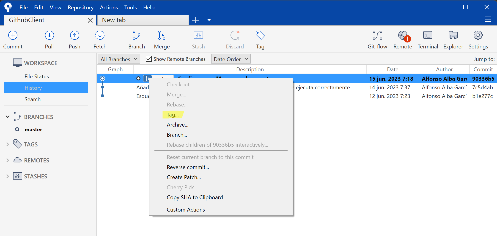
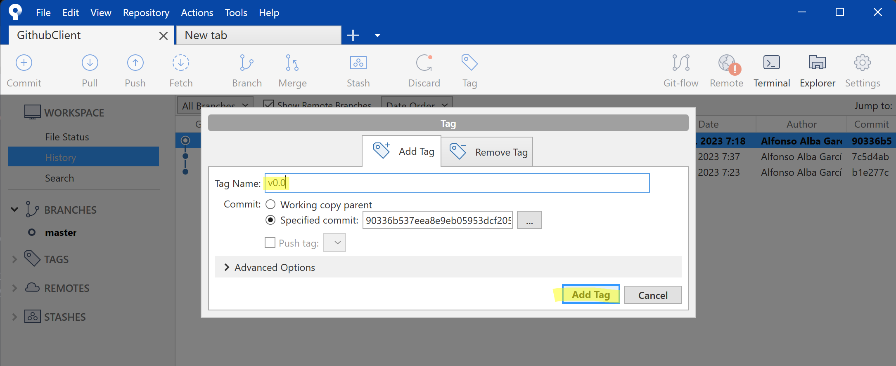
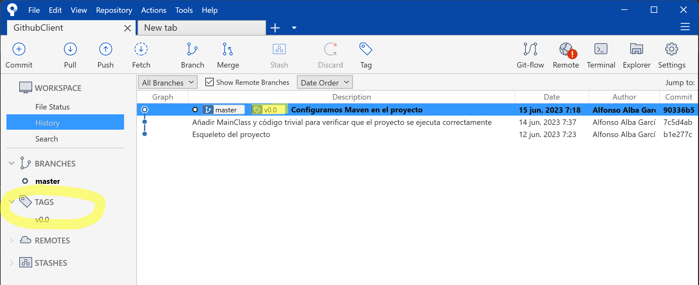
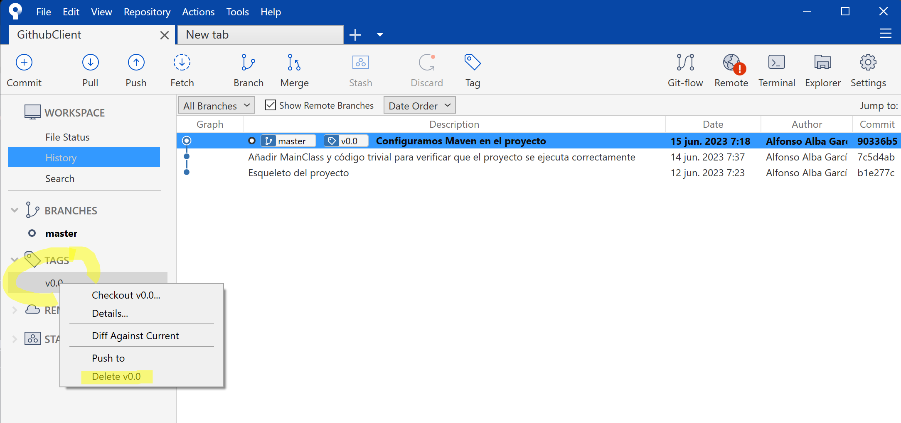
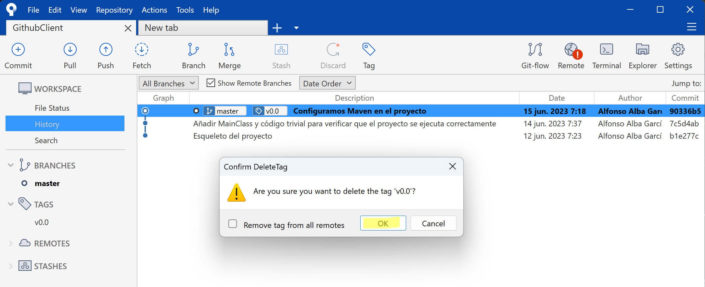

# Taller 3.1 (version Java con Eclipse): crear y borrar etiquetas

## Índice

* This will become a table of contents (this text will be scrapped).
{:toc}

## Descarga 
- [java/GithubClient-taller-3-1.zip &#x1F4E5; ](../talleres/zipfiles/java/GithubClient-taller-3-1.zip)

## Requisitos
Este taller es continuación del taller 
[Taller 2.3: inspeccionando la carpeta `.git/objects`]().

Es necesario haber completado el 
[taller 2.2]() para poder realizar 
este taller. Puedes importar el proyecto `java/GithubClient-taller2.zip` en 
`Eclipse` y partir de él para hacer este taller.

## Objetivos

- Crear etiquetas
- Borrar etiquetas 

## Utilizando `Sourcetree`

Vamos a crear la etiqueta `v0.0` en la última confirmación del repositorio
que hicimos en el taller 2.2.

### Crear etiqueta
Situamos el ratón en la última confirmación y hacemos clic sobre ella con el 
botón derecho. Seleccionamos la opción _Tag..._:


En el cuadro de diálogo que nos aparece, introducimos `v0.0` en el nombre
del tag. Hacemos clic sobre botón _Add tag_:


Una vez creada, podemos ver la etiqueta:
- En la historia del repositorio, delante del mensaje de la confirmación
- En la parte izquierda de la interfaz de `Sourcetree`, en la sección _Tags_


### Borrar una etiqueta 

Para borrar la etiqueta, desplegamos la sección _Tags_ en el menú izquierdo 
de _Sourcetree_. Buscamos la etiqueta que queremos borrar, en este caso `v0.0`,
y hacemos clic con el botón derecho sobre ella. Seleccionamos la opción 
_Delete v0.0_: 


Nos saldrá un cuadro de diálogo para confirmar el borrado. Mantenemos la opción
_Remove tag from all remotes_ sin marcar, como se muestra en la siguiente
captura, y hacemos clic en OK:



Tras esta operación, la etiqueta desaparecerá.



## Utilizando la consola

### Crear etiqueta 
Para crear la etiqueta por consola, utilizaremos el comando `git tag`. 
Creamos la etiqueta `v0.0` en la última confirmación, que en nuestro caso es 
`90336b5`:

```shell
> git tag v0.0 90336b5
```

Podemos ver la etiqueta en `Sourcetree` o utilizando el comando `git log`:

```shell
> git log --oneline
90336b5 (HEAD -> master, tag: v0.0) Configuramos Maven en el proyecto
7c5d4ab Añadir MainClass y código trivial para verificar que el proyecto se ejecuta correctamente
b1e277c Esqueleto del proyecto
```

### Listar etiquetas

Para listar las etiquetas utilizamos:

```shell
> git tag -l
v0.0
```

o directamente 

```shell
> git tag
v0.0
```

### Borrar etiqueta

Para borrar la etiqueta:

```shell
> git tag -d v0.0
Deleted tag 'v0.0' (was 90336b5)
```

El comando nos indica dónde estaba la etiqueta que acabamos de borrar.

Antes de terminar el taller, volvemos a crear la etiqueta, aunque utilizaremos un comando ligeramente diferente:

```shell
> git tag -a -m '' v0.0
```

En [el siguiente taller]() explicaremos qué es la opción `-a` y hablaremos de los 
diferentes tipos de etiquetas. Por el momento, diremos que creamos la etiqueta de esta manera para imitar el 
comportamiento por defecto de `Sourtree` al crear etiquetas.

## Mover etiquetas 

Como veremos en más detalle en las diapositivas, las etiquetas no se pueden 
mover. El procedimiento para crear una etiqueta sería borrarla y volverla
a crear en la confirmación correcta.

