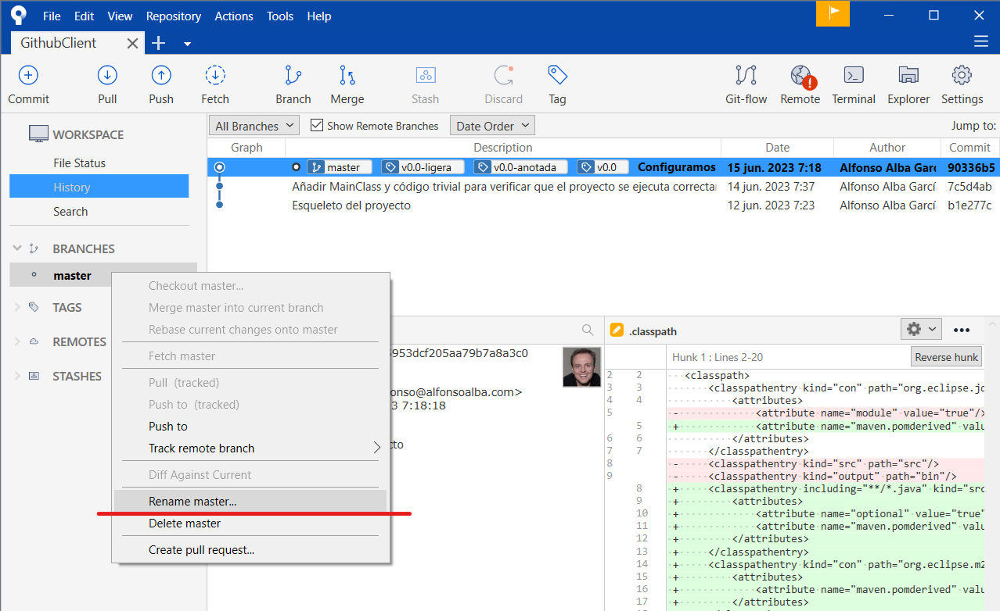
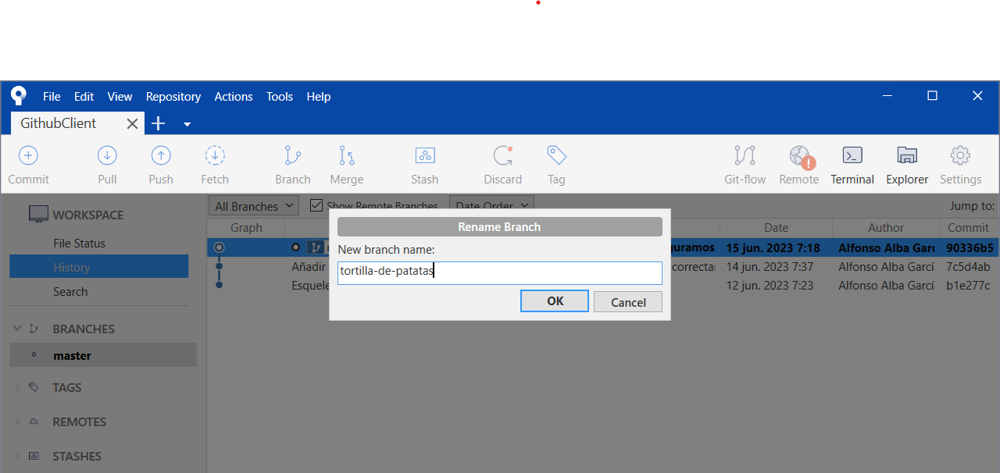
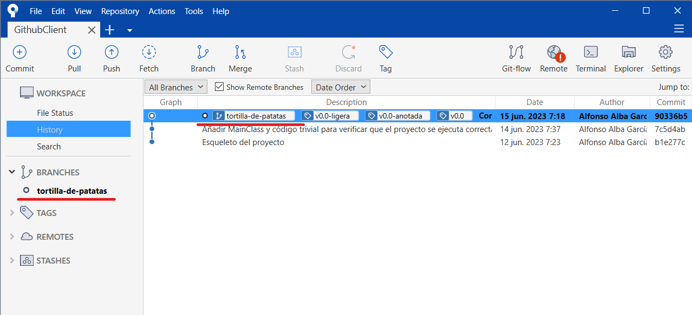
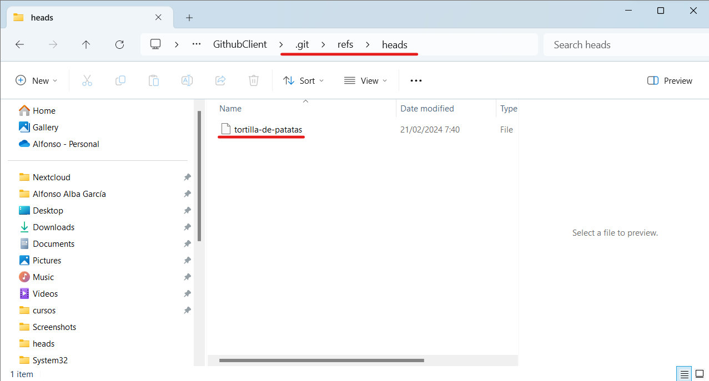
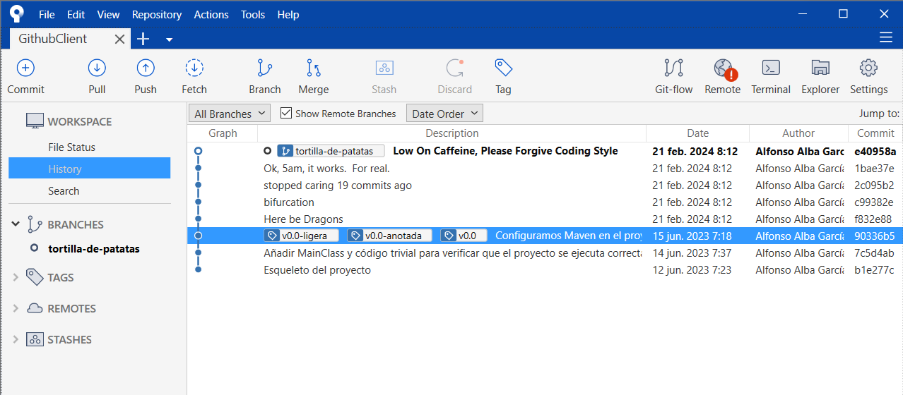

# Taller 3.3 (version Java con Eclipse): ¿Qué es master?

## Índice

* This will become a table of contents (this text will be scrapped).
{:toc}

## Descarga 

Este taller no tiene fichero descargable ya que al final del mismo, el repositorio acabará en el mismo estado en 
el que empieza

## Requisitos

Este taller es continuación del taller 
[Taller 3.2: crear etiquetas y ramas]().

Es necesario haber completado el 
[taller 3.2]() para poder realizar 
este taller. Puedes importar el proyecto `java/GithubClient-taller-3-2.zip`  en 
`Eclipse` y partir de él para hacer este taller ([descargar fichero](../talleres/zipfiles/java/GithubClient-taller-3-2.zip)).

## Objetivos

Ver que `master` no es más que un nombre arbitrario para un puntero.

## Usando `SourceTree`

En el menú lateral izquierdo, hacer clic con el botón derecho sobre `master` y seleccionar la opción 
*Rename master...*:



Seleccionamos en nuevo nombre de la rama. Podemos seleccionar un nombre tan arbitrario y absurdo como queramos,
por ejemplo `tortilla-de-patatas`:




¡Listo! ya tenemos un repositorio con una rama principal que tiene un nombre absurdo:




Si abrimos la carpeta `.git/refs/heads` veremos que el fichero de texto plano `master`
ya no está, y ahora tenemos otro llamado `tortilla-de-patatas`. Este fichero contiene
el *checksum* de la última confirmación de cambios:



¿Qué ocurriría si ahora continuamos haciendo cambios en el repositorio? Git haría lo mismo
que ha estado haciendo hasta ahora:
- Crear una instantánea
- Añadir los datos (autor, correo electrónico, mensaje, fecha, *checksum* de la confirmación anterior)
- Calcular el *checksum*
- Guardar los objetos de `git` en la carpeta `.git/objects`
- **Mover la rama activa**, que en este caso sería `tortilla-de-patatas`



Antes de terminar el ejercicio, renombrar la rama de vuelta a `master`.

(Los mensajes para las confirmaciones se han obtenido de [whatthecommit.com](https://whatthecommit.com/))

## Usando la consola

Para renombrar una rama, usamos la opción `-m` del comando `git branch`:

```shell
> git branch -m master tortilla-de-patatas
```

Si listamos las ramas veremos el cambio:

```shell
> git branch -l
* tortilla-de-patatas
```

En la carpeta `.git/refs/heads` veremos que el fichero `master` ya no está y en su lugar
tenemos el fichero `tortilla-de-patatas`:

```shell 
> ls .git/refs/heads
tortilla-de-patatas
```

¿Qué ocurriría si ahora continuamos haciendo cambios en el repositorio? Git haría lo mismo
que ha estado haciendo hasta ahora:
- Crear una instantánea
- Añadir los datos (autor, correo electrónico, mensaje, fecha, *checksum* de la confirmación anterior)
- Calcular el *checksum*
- Guardar los objetos de `git` en la carpeta `.git/objects`
- **Mover la rama activa**, que en este caso sería `tortilla-de-patatas`

```shell
> git log --graph --oneline
* e40958a (HEAD -> tortilla-de-patatas) Low On Caffeine, Please Forgive Coding Style
* 1bae37e Ok, 5am, it works.  For real.
* 2c095b2 stopped caring 19 commits ago
* c99382e bifurcation
* f832e88 Here be Dragons
* 90336b5 (tag: v0.0-ligera, tag: v0.0-anotada, tag: v0.0) Configuramos Maven en el proyecto
* 7c5d4ab Añadir MainClass y código trivial para verificar que el proyecto se ejecuta correctamente
* b1e277c Esqueleto del proyecto
```

Antes de terminar, volvemos nombrar la rama `master`:

```shell
> git branch -m tortilla-de-patatas master
```

## Consideraciones finales

Como hemos visto en este taller, cuando cambiamos el nombre a `master`,
**`git` sigue como si nada hubiese pasado**. Ni `git` por línea de comandos 
ni `SourceTree` se quejan, no te avisan de que `master` va a desaparecer y con ella todo tu proyecto. 
¡No hacen nada! ...porque `master` no es más que el nombre de un puntero.

Somos nosotros los que le damos significado a ese nombre. Somos nosotros los que 
decidimos que `master` va a ser el último código que se subió a producción (si 
es que este es el convenio que decidimo adoptar).

