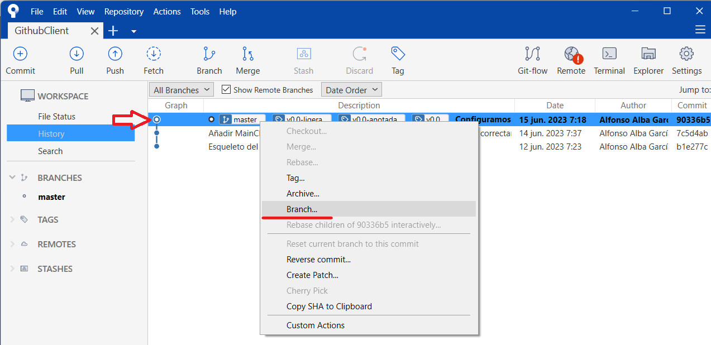
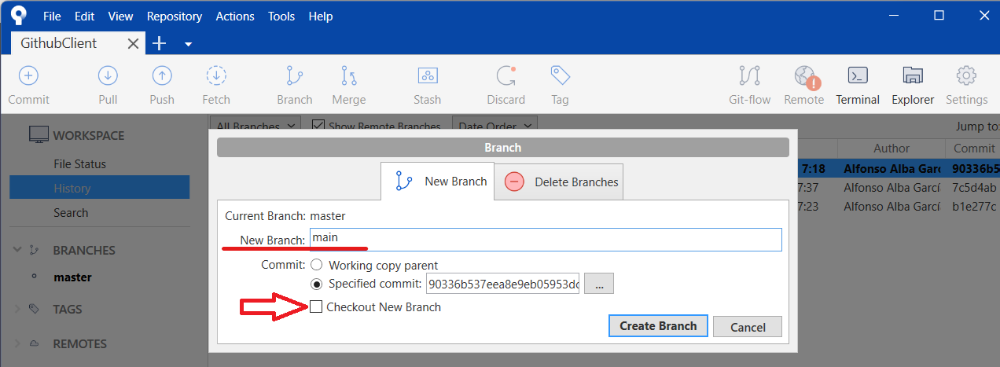
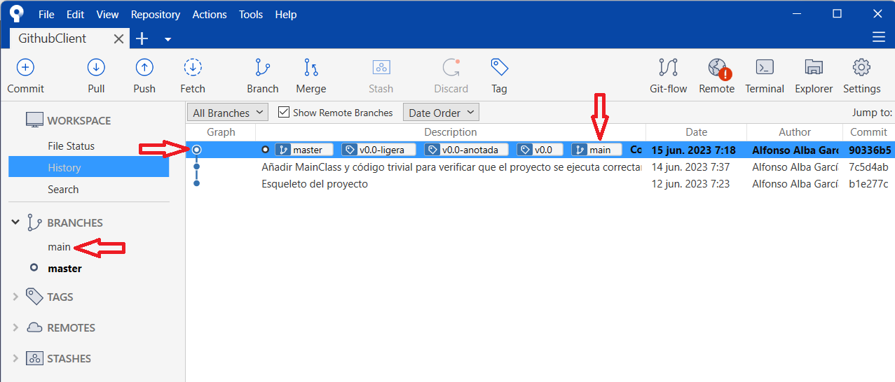
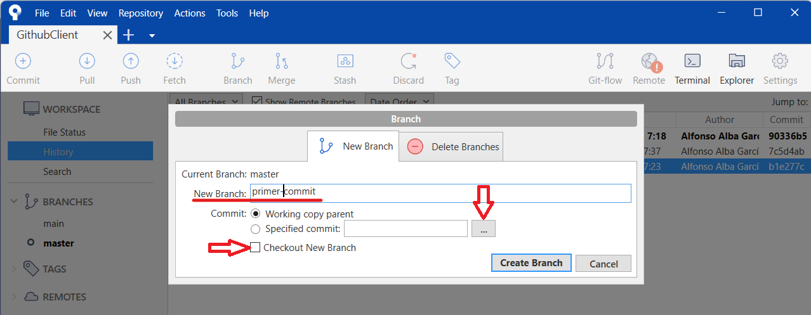
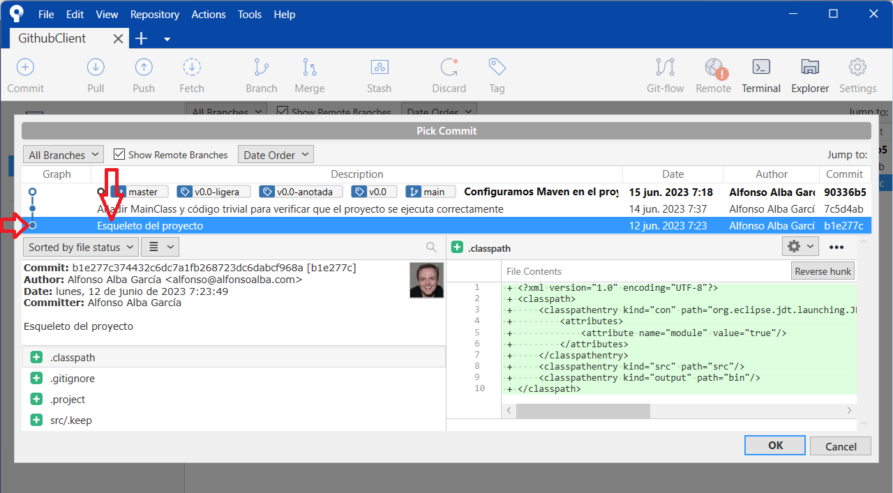
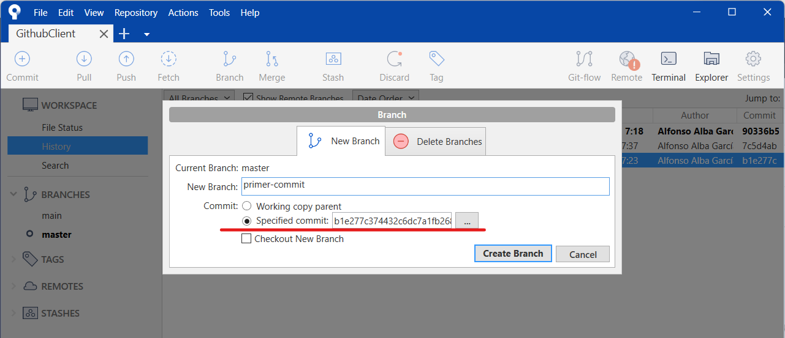
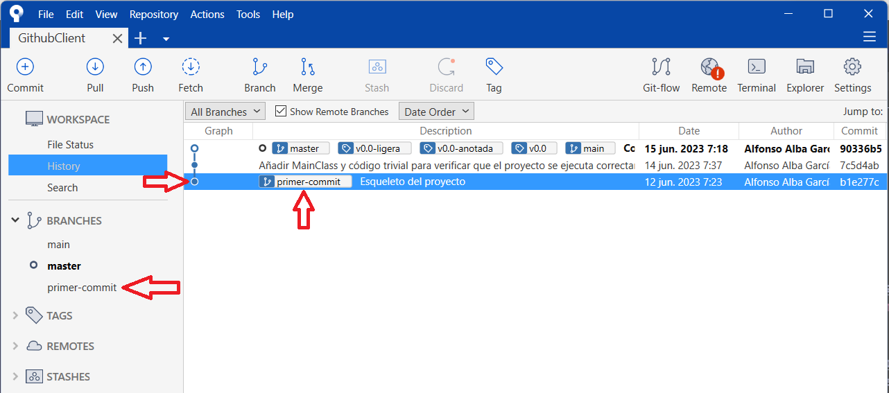
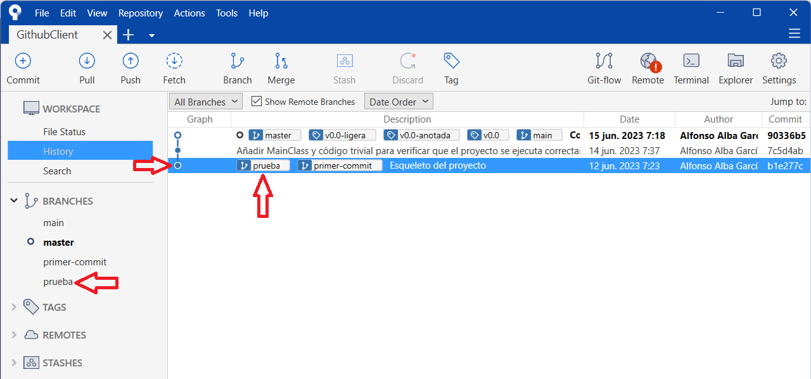
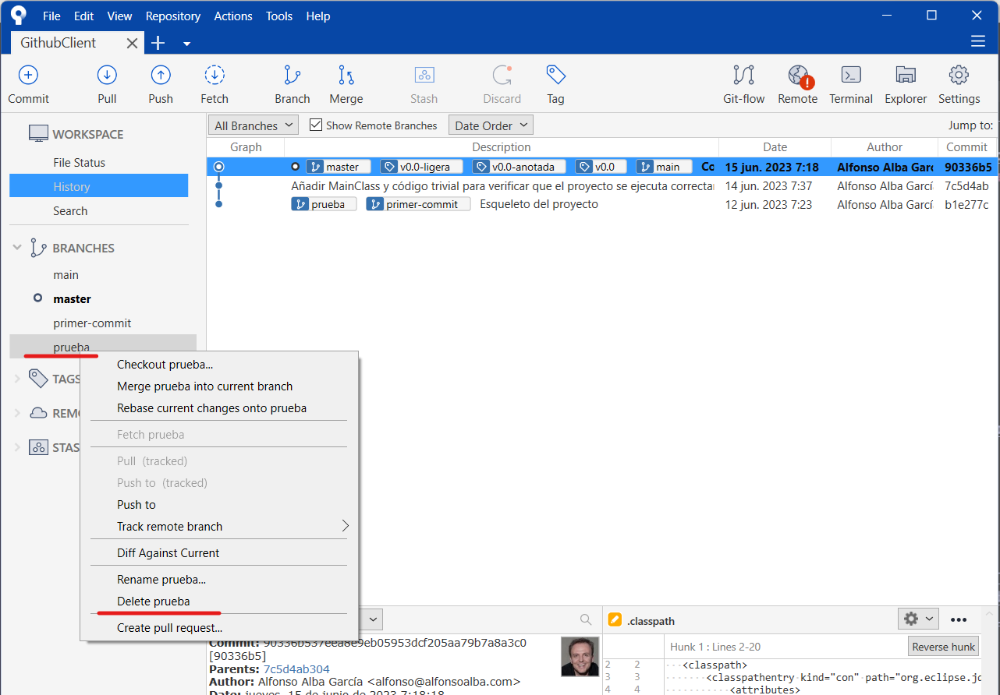
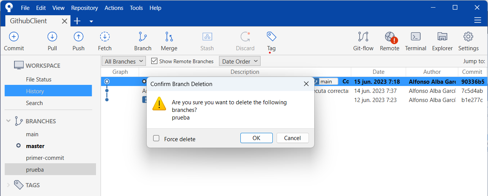

# Taller 3.4 (version Java con Eclipse): Creación y borrado de ramas locales

## Índice

* This will become a table of contents (this text will be scrapped).
{:toc}

## Descarga 
- [java/GithubClient-taller-3-4.zip &#x1F4E5; ](../talleres/zipfiles/java/GithubClient-taller-3-4.zip)

## Requisitos

Este taller es continuación del taller 
[Taller 3.2: crear etiquetas y ramas]() (el taller 3.3 no tiene fichero descargable) .

Es necesario haber completado el 
[taller 3.2]() para poder realizar 
este taller. Puedes importar el proyecto `java/GithubClient-taller-3-2.zip`  en 
`Eclipse` y partir de él para hacer este taller ([descargar fichero](../talleres/zipfiles/java/GithubClient-taller-3-2.zip)).

## Objetivos

- Crear ramas locales
- Borrar ramas locales



## Utilizando `Sourcetree`

### Crear una rama a la misma altura de `master`

Seleccionamos la confirmación sobre la que queremos crear la rama y hacemos clic en el botón derecho.
Se desplegará el menú contextual y seleccionaremos *Branch...*:



En el cuadro de diálogo que se abre, seleccionaremos el nombre de la rama (`main`) y nos aseguramos de 
de que la opción *Checkout New Branch* **no está marcada**, como se indica en la siguiente captura:



En siguientes talleres hablaremos de `HEAD` y de como cambiar la rama activa y veremos qué hace esta opción.

Hacemos clic sobre el botón _Create Branch_ y veremos que la rama se ha creado correctamente:



### Crear una segunda rama 

Vamos a crear una segunda rama, esta la crearemos en la primera confirmación de cambios que hicimos al 
empezar el curso. En este caso, crearemos la rama de una manera diferente: utilizando el botón _Branch_ del menú
superior de `Sourcetree`, para ver cómo funciona.

Hacemos clic sobre el botón _Branch_ que está en el menú superior. En el cuadro de diálogo que nos aparece,
introducimos el nombre de la rama (`primer-commit`) y desmarcamos la opción _Checkout New Branch_. Antes de continuar
seleccionamos dónde crear la rama. Para ello, hacemos clic sobre el botón con los tres puntos junto a la opción 
*Specified commit*:



En el cuadro de diálogo que se abre, seleccionamos la primera confirmación de cambios y a continuación hacemos clic 
sobre el botón _OK_:



Tras hacer clic en _Ok_, volvemos al primer cuadro de diálogo. Vemos que el campo *Specified commit* contiene
el *checksum* de la confirmación que acabamos de seleccionar. Hacemos clic sobre el botón *Create Branch* para crear
la rama:




Podemos ver la nueva rama en la sección _Branches_ el menú izquierdo y el el log:



### Crear una tercera rama 

Siguiendo cualquiera de los métodos anteriores, creamos una tercera rama que llamaremos `prueba`, apuntando también 
a la primera confirmación de cambios:



### Borrar la rama `prueba`

Para borrar la rama prueba, nos tenemos que asegurar de que `prueba` no es la rama activa. Veremos más adelante
qué es esto de la rama activa. Si por cualquier motivo, al seguir los pasos anteriores, has acabado con 
`prueba` siendo la rama activa (la rama activa aparece en negrita y con un punto blanco en el menú izquierdo), haz doble
clic sobre la rama `master` (para hacerla la rama activa) antes de continuar.

En la sección *Branches* del menú izquierdo, hacemos clic con el botón derecho sobre `prueba`. En el menú contextual
seleccionaremos la opción *Delete prueba*:



Se abriará un cuadro de diálogo para confirmar la operación. Le damos a _Ok_, tras lo cual la rama prueba habrá desaparecido:



## Utilizando la consola

### Crear una rama a la misma altura de `master`

Para crear las ramas sin que se conviertan en la rama activa, utilizaremos el comando `git branch`.

Creamos una rama `main` apuntando a la misma confirmación a la que apunta `master`. El comando `git brach`
acepta dos argumentos:
- el primero es el nombre de la nueva rama
- el segundo es el lugar en el que la queremos poner

El segundo segundo (dónde la queremos poner) acepta una referencia, lo que significa que podemos poner
el *checksum* de un _commit_, el nombre de otra rama o el nombre de una etiqueta por ejemplo. En nuestro
caso, como queremos que `main` apunte a la misma confirmación que `master`, ejecutamos:

```shell 
> git branch main master
```

Si miramos el log de `git` veremos la nueva rama, junto a `master` y las etiquetas, apuntando a la última
confirmación de cambios:

```shell 
> git log --oneline --graph --all
* 90336b5 (HEAD -> master, tag: v0.0-ligera, tag: v0.0-anotada, tag: v0.0, main) Configuramos Maven en el proyecto
* 7c5d4ab Añadir MainClass y código trivial para verificar que el proyecto se ejecuta correctamente
* b1e277c Esqueleto del proyecto
```

Podemos ver que se ha creado el fichero `.git/ref/heads/main`:

```shell 
> ls .git/refs/heads/
main  master
```


### Crear una segunda rama 

Vamos a crear una segunda rama que llamaremos `primer-commit`. Esta rama la crearemos en la primera confirmación 
de cambios que hicimos al empezar el curso. En este caso, vamos a utilizar el *checksum* de la primera confirmación como 
segundo argumento, que en mi caso es:

```shell
> git branch primer-commit b1e277c
```

Usando el comando `git log` podemos ver la nueva rama apuntando a la primera confirmación de cambios:

```shell
$ git log --oneline --graph --all

* 90336b5 (HEAD -> master, tag: v0.0-ligera, tag: v0.0-anotada, tag: v0.0, main) Configuramos Maven en el proyecto
* 7c5d4ab Añadir MainClass y código trivial para verificar que el proyecto se ejecuta correctamente
* b1e277c (primer-commit) Esqueleto del proyecto
```

### Crear una tercera rama 

Creamos una tercera rama que llamaremos `prueba`, apuntando también 
a la primera confirmación de cambios:

```shell
> git branch prueba b1e277c
```
Usando el comando `git log` podemos ver la nueva rama apuntando a la primera confirmación de cambios:

```shell
$ git log --oneline --graph --all

* 90336b5 (HEAD -> master, tag: v0.0-ligera, tag: v0.0-anotada, tag: v0.0, main) Configuramos Maven en el proyecto
* 7c5d4ab Añadir MainClass y código trivial para verificar que el proyecto se ejecuta correctamente
* b1e277c (prueba, primer-commit) Esqueleto del proyecto
```
Podemos ver todas las ramas que hemos creado utilizando el comando `git branch`

```shell 
> git branch
  main
* master
  primer-commit
  prueba
```
Si queremos ver a qué confirmación apunta cada una de ellas podemos usar la opción `-v`:

```shell 
> git branch -v
  main          90336b5 Configuramos Maven en el proyecto
* master        90336b5 Configuramos Maven en el proyecto
  primer-commit b1e277c Esqueleto del proyecto
  prueba        b1e277c Esqueleto del proyecto
```

Si miramos el contenido de la carpeta `.git/refs/heads/` veremos los ficheros correspondientes a las ramas:

```shell 
$ ls -l .git/refs/heads/
total 4
-rw-r--r-- 1 aalba 197121 41 Feb 28 07:56 main
-rw-r--r-- 1 aalba 197121 41 Feb 21 09:03 master
-rw-r--r-- 1 aalba 197121 41 Feb 28 08:05 primer-commit
-rw-r--r-- 1 aalba 197121 41 Feb 28 08:07 prueba
```
### Borrar la rama `prueba`

Para borrar la rama `prueba` utilizamos la opción `-d` del comando `git branch`:

```shell
> git branch -d prueba
Deleted branch prueba (was b1e277c).
```

Cuando borrarmos una rama por consola, `git` nos dice dónde estaba apuntando. Esto es últil
por si nos hemos equivocado, por ejemplo, y queremos volver crear la rama apuntando al mismo 
sitio al que estaba apuntando.

Podemos comprobar que la rama ya no está:

```shell
> git branch -v
  main          90336b5 Configuramos Maven en el proyecto
* master        90336b5 Configuramos Maven en el proyecto
  primer-commit b1e277c Esqueleto del proyecto
```
