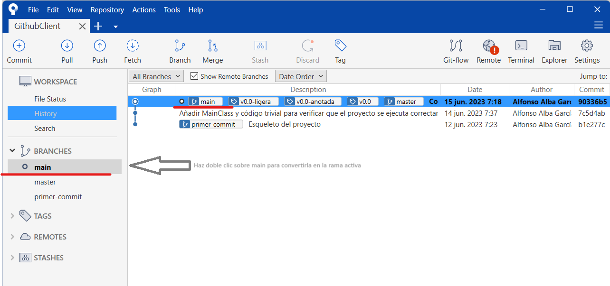
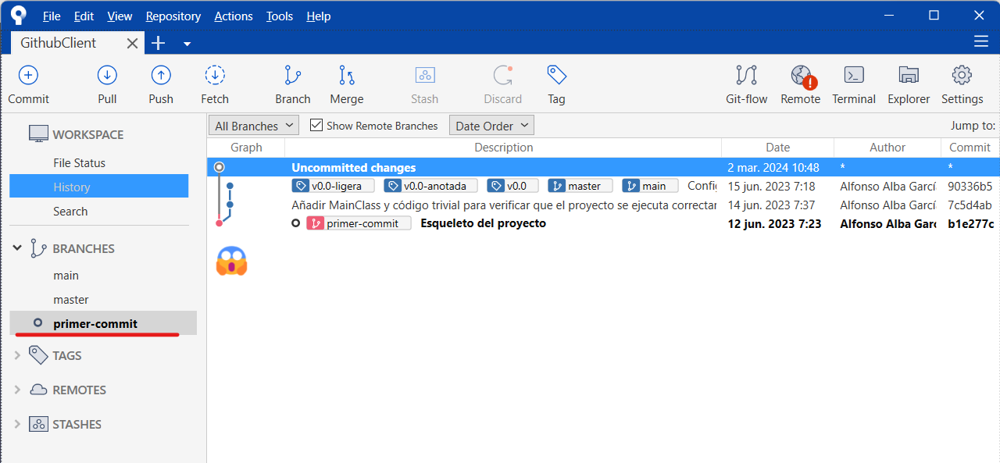
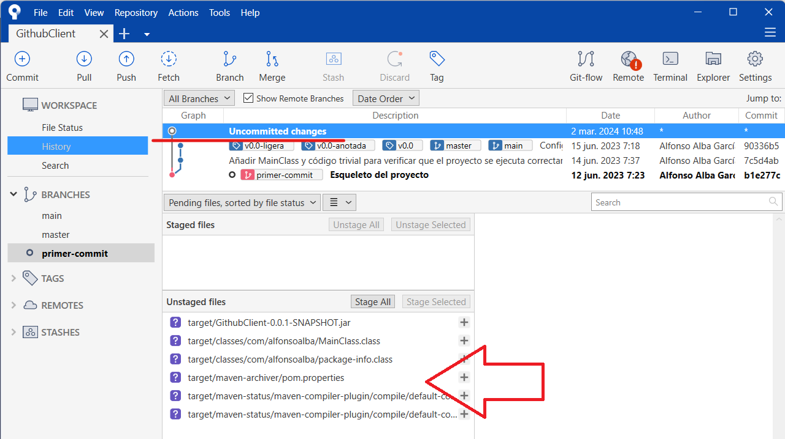
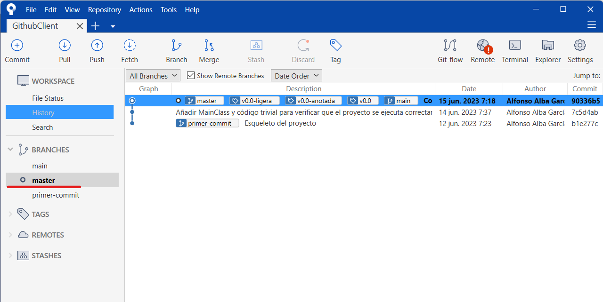

# Taller 3.5 (version Java con Eclipse): Cambiar rama activa

## Índice

* This will become a table of contents (this text will be scrapped).
{:toc}

## Descarga 

Este taller no tiene fichero descargable ya que al final del mismo, el repositorio acabará en el mismo estado en 
el que empieza

## Requisitos

Este taller es continuación del taller 
[Taller 3.4: crear etiquetas y ramas]().

Es necesario haber completado el 
[taller 3.4]() para poder realizar 
este taller. Puedes importar el proyecto `java/GithubClient-taller-3-4.zip`  en 
`Eclipse` y partir de él para hacer este taller ([descargar fichero](../talleres/zipfiles/java/GithubClient-taller-3-4.zip)).

## Objetivos

Entender en qué consiste la operación de cambiar la rama activa.

## Usando `Sourcetree`

La forma más sencilla de cambiar la rama activa en `Sourcetree` el hacer doble clic sobre la rama que 
queremos activar en el menú de la izquierda.

Vamos a hacer doble clic sobre `main` en la sección *Branches* del menú de la izquierda para hacer `main` la rama
activa:

Como comentamos en las diapositivas, al hacer esta operación van a ocurrir dos cosas:
- El puntero `HEAD` apunta a la rama `main` en lugar de a `master`
- En el área de trabajo, veremos los ficheros de la instantánea a la que apunta `main`

Como `master` y `main` apuntan a la misma instantánea, **no veremos ningún cambio en nuestro área de trabajo**.

### Cambiar a una rama que cambia el área de trabajo

Hacemos doble clic sobre la rama `primer-commit` para hacerla la rama principal:

¿Por qué nos aparece esa línea gris en el log? Si seleccionas ese *commit* gris 
con la descripción *Uncommitted changes* que está arriba en el log y miras
en `Sourcetree` los cambios en el área de trabajo, verás sencillamente que el fichero 
`.gitignore` está haciendo su función:

Entraremos en mucho más detalle de por qué ha pasado esto cuando veamos el fichero `.gitignore` y el índice de `git`
en profundidad. De momento, solo adelantaremos que esos ficheros, que son los ficheros resultado de la compilación de 
`Java`, ya no se están ignorando porque en nuestro área de trabajo ya no tenemos el fichero `.gitignore`.

¿Qué ha pasado cuando hemos hecho `primer-commit` nuestra rama activa?
- Se ha cambiado el contenido de `.git/HEAD`, que ahora apunta a  `primer-commit`
- Se ha extraido al área de trabajo la instantánea a la que apunta la rama activa.

Ya hemos visto cómo al hacer `primer-commit` la rama activa, nuestro fichero `.gitignore` ha desaparecido, porque 
no estaba en esa instantánea. Pero no ha sido el único cambio. Ha pasado lo mismo con el contenido de la carpeta 
`src/` que vuelve a estar vacía (salvo el fichero `.keep`).

Como dijimos en las diapositivas, es como si `git` hubiese borrado el área de trabajo y extraído la nueva instantánea.
Vuelvo a hacer énfasis en que esto no es exactamente lo que está pasando (si no, los ficheros de la carpeta `target/`
no estarían ahí). Entraremos en más detalle cuando veamos el índice de git.

Volvemos a hacer doble clic sobre `master` para hacerla la rama activa:

Vemos cómo recuperamos la última instantánea que creamos, con el fichero `.gitignore` y nuestra clase `Main` en 
la carpeta `src`.

## Usando la consola

