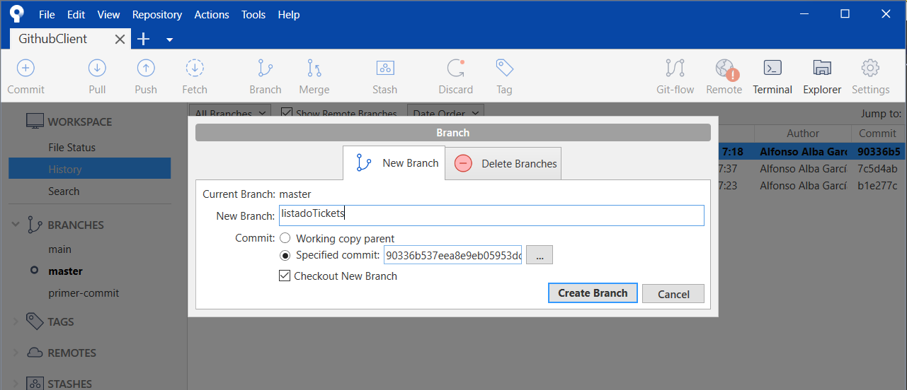
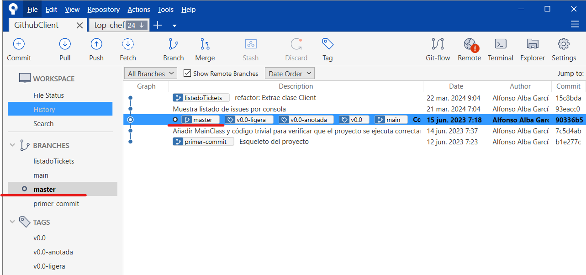
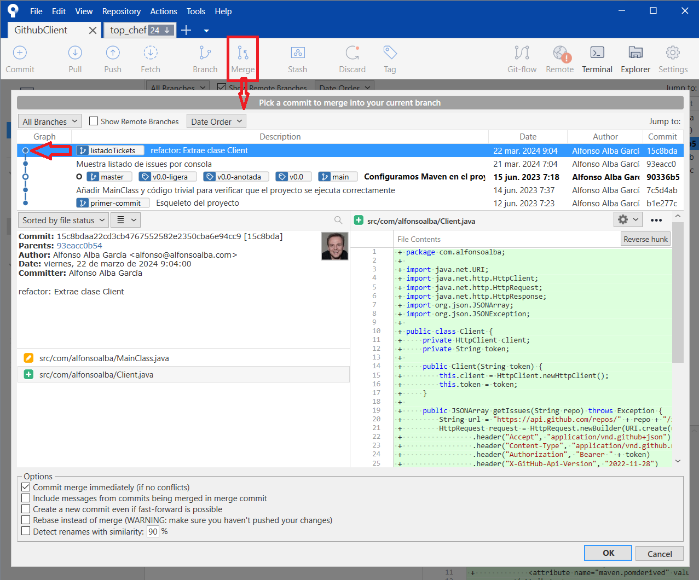
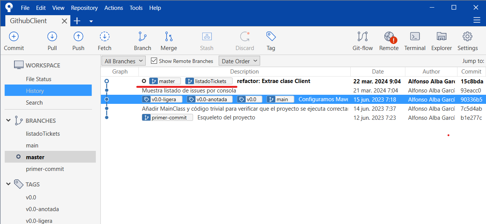

# Taller 3.6 (version Java con Eclipse): ramas de funcionalidad y *fast-forward merge*

## Índice

* This will become a table of contents (this text will be scrapped).
{:toc}

## Descarga 
- [java/GithubClient-taller-3-6.zip &#x1F4E5; ](../talleres/zipfiles/java/GithubClient-taller-3-6.zip)

## Requisitos

Este taller es continuación del taller 
[Taller 3.4: crear etiquetas y ramas]() (el taller 3.5 no tiene fichero descargable) .

Es necesario haber completado el 
[taller 3.4]() para poder realizar 
este taller. Puedes importar el proyecto `java/GithubClient-taller-3-4.zip`  en 
`Eclipse` y partir de él para hacer este taller ([descargar fichero](../talleres/zipfiles/java/GithubClient-taller-3-4.zip)).

## Objetivos

- Utilizar ramas de funcionalidad para cambiar de contexto
- Integrar ramas utilizando *fast-forward merge*


## Crear *token* en GitHub 


## Convenios

Al empezar a trabajar con ramas, vamos a adoptar ciertos convenios:
- Crearemos una rama para cada funcionalidad que vayamos a desarrollar
- Usaremos nomenclatura *camelCase* para nombrar las ramas 
- La rama `master` debe apuntar siempre al último código que hemos distribuido a nuestros usuarios 

Otro convenio que voy a adoptar durante el taller es que voy a confirmar cambios cuando:
- Tenga código que implemente una funcionalidad y funcione, aunque lo tenga que refactorizar
- Si tengo una funcionalidad grande, alcance hitos durante su desarrollo
- Alcance un punto en el que tenga una nueva versión para distribuir

## Despliegues

En un proyecto real, tendríamos que responder a ciertas preguntas como por ejemplo cómo vamos a desplegar el 
código en producción. Es decir, dónde almacenamos la aplicación, cómo verificamos que la aplicación funciona 
correctamente antes de distribuir una nueva versión y cómo la distribuimos a nuestros usuarios.

Siendo esto un taller de un curso de `git`, vamos a buscar una manera sencilla de responder a estas preguntas 
para dar contexto al procedimiento que seguiremos durante el ejercicio:
- Para probar que la aplicación funciona, le enviaremos el ejecutable *al jefe* para que lo pruebe y de el OK
- Integramos en la rama `master` el código de la nueva versión (cuando tengamos el Ok *del jefe*, por supuesto)
- La distribuiremos mediante un email con un enlace a la carpeta para que los usuario se instalen la nueva versión

Como os imagináis, únicamente realizaremos la segunda de las acciones durante el taller, aunque me escucharéis hablar de 
los otros pasos del procemiento para darle contexto a lo que estamos haciendo.

Es decir, cada vez que pregunte _¿Cómo se despliega este proyecto?_ podréis venir aquí a encontrar la respuesta.

## Utilizando `Sourcetree`

### Crear rama 

En `Sourcetree`, creamos una rama que llamaremos `listadoTickets`. Vimos cómo crear ramas 
en el [Taller 3.4](). Hacemos clic con el botón derecho en el último *commit* del repositorio, seleccionamos *Branch...* en el menú contextual.
Se nos abrirá el cuadro de diálogo para crear la rama. Rellenamos los valores y dejamos 
marcada la opción *Checkout New Branch*:



Hacemos clic sobre el botón *Create Branch* y creamos la rama:


### Crear variable de entorno en Eclipse 



### Primeros cambios 


Volvemos a `Sourcetree` y confirmamos los cambios utilizando el mensaje *Muestra listado de issues por consola*. 
Tras confirmarlos, este será el estado de nuestro repositorio:


Vemos como el repositorio sigue siendo una lista simplemente enlazada,
que se representa como una línea recta. No se tuerce ni se birfurca.

### Refactorización 



Una vez comprobamos que funciona, confirmamos los cambios en `Sourcetree` con el mensaje _refactor: Extrae clase Client_:


Tras confirmar los cambios, comprobamos en `Sourcetree` que el repositorio sigue siendo una lista simplemente enlazada.

### Despliegue 



Hacemos `master` la rama activa en `Sourcetree` haciendo doble clic sobre ella:



Hacemos clic sobre el botón _Merge_ en el menú superior. El código que queremos integrar está en `listadoTickets`,
así que en la ventana emergente que aparece, buscamos la rama `listadoTickets` en el grafo, seleccionamos 
la rama y hacemos clic sobre el botón *Ok*:



Como resultado, la rama `master` apuntará a la misma confirmación a la que apunta `listadoTickets`, ya que 
estamos ante un *fast-forward merge*:



Como comentamos en las diapositivas, `git` sabe que puede hacer un *fast-forward merge* y lo hace, ya que este
es el comportamiento por defecto.

Llegados a este punto, estamos en condiciones de construir un nuevo ejecutable, subirlo a la carpeta compartida
y enviar el correo electrónico a nuestros usuarios para que se descarguen la nueva versión.

## Utilizando la consola

### Crear rama

Creamos la rama `listadoTickets` y la convertimos en la rama activa. Podemos hacer las dos operaciones
a la vez utilizando la opción `--create` del comando `git switch`:

```shell
> git switch --create listadoTickets
```

Al no indicarle al comando dónde queremos crear la rama, esta se creará apuntando a la misma
confirmación a la que apunta `HEAD` que en este caso es `master`:

```shell
> git log --all --oneline
90336b5 (HEAD -> listadoTickets, tag: v0.0-ligera, tag: v0.0-anotada, tag: v0.0, master, main) Configuramos Maven en el proyecto
7c5d4ab Añadir MainClass y código trivial para verificar que el proyecto se ejecuta correctamente
b1e277c (primer-commit) Esqueleto del proyecto
```

### Crear variable de entorno en Eclipse 


### Primeros cambios 


Veamos los cambios que tenemos en nuestro área de trabajo. Para ello
ejecutamos el comando `git status`:

```shell 
> git status
On branch listadoTickets
Changes not staged for commit:
  (use "git add <file>..." to update what will be committed)
  (use "git restore <file>..." to discard changes in working directory)
        modified:   pom.xml
        modified:   src/com/alfonsoalba/MainClass.java

no changes added to commit (use "git add" and/or "git commit -a")
```

Subimos los cambios al *staging area*:

```shell 
> git add .
```

Confirmamos los cambios:
```shell 
> git commit -m'Nuestra listado de issues por consola'
[listadoTickets 0fe51de] Nuestra listado de issues por consola
 2 files changed, 57 insertions(+), 3 deletions(-)
```
Tras confirmar los cambios, vemos como el repositorio sigue siendo una lista 
simplemente enlazada, que se representa como una línea recta. 
No se tuerce ni se birfurca:


```shell 
> $ git log --all --oneline --graph

* 93eacc0 (HEAD -> listadoTickets) Muestra listado de issues por consola
* 90336b5 (tag: v0.0-ligera, tag: v0.0-anotada, tag: v0.0, master, main) Configuramos Maven en el proyecto
* 7c5d4ab Añadir MainClass y código trivial para verificar que el proyecto se ejecuta correctamente
* b1e277c (primer-commit) Esqueleto del proyecto
```

### Refactorización 



Veamos el estado en el que está el repositorio. Abrimos la consola y ejecutamos `git status`:

```shell
> git status

On branch listadoTickets
Changes not staged for commit:
  (use "git add <file>..." to update what will be committed)
  (use "git restore <file>..." to discard changes in working directory)
        modified:   src/com/alfonsoalba/MainClass.java

Untracked files:
  (use "git add <file>..." to include in what will be committed)
        src/com/alfonsoalba/Client.java

no changes added to commit (use "git add" and/or "git commit -a")
```
Tenemos un fichero modificado (en la sección *Changes not staged for commit*) y un fichero 
nuevo (en la sección *Untracked files*), confirmamos los cambios con el 
mensaje _refactor: Extrae clase Client_:

```shell
> git add .
> git commit -m'refactor: Extrae clase Client'

[listadoTickets 15c8bda] refactor: Extrae clase Client
 2 files changed, 50 insertions(+), 40 deletions(-)
 create mode 100644 src/com/alfonsoalba/Client.java
```
Tras confirmar los cambios, vemos cómo el repositorio sigue siendo una lista enlazada:

```shell
> git log --all --oneline --graph

* 15c8bda (HEAD -> listadoTickets) refactor: Extrae clase Client
* 93eacc0 Muestra listado de issues por consola
* 90336b5 (tag: v0.0-ligera, tag: v0.0-anotada, tag: v0.0, master, main) Configuramos Maven en el proyecto
* 7c5d4ab Añadir MainClass y código trivial para verificar que el proyecto se ejecuta correctamente
* b1e277c (primer-commit) Esqueleto del proyecto
```
### Despliegue 



Vemos cuál es la rama activa:

```shell
$ git branch --show-current
listadoTickets
```

Hacemos `master` la rama activa con el comando `git switch` en caso de que no lo sea:

```shell
> git switch master

Switched to branch 'master'
```

Integramos el código de `listadoTickets`:

```shell
> git merge listadoTickets
Updating 90336b5..15c8bda
Fast-forward
 pom.xml                            |  5 +++++
 src/com/alfonsoalba/Client.java    | 41 ++++++++++++++++++++++++++++++++++++++
 src/com/alfonsoalba/MainClass.java | 26 ++++++++++++++++++++----
 3 files changed, 68 insertions(+), 4 deletions(-)
 create mode 100644 src/com/alfonsoalba/Client.java
```

En la salida del comando `git merge`, vemos como  `git` nos avisa de que ha sido un *fast-forward merge*, 
no hemos tenido que decirle nada al ejecutar el comando. Este es el comportamiento por defecto.


Llegados a este punto, estamos en condiciones de construir un nuevo ejecutable, subirlo a la carpeta compartida
y enviar el correo electrónico a nuestros usuarios para que se descarguen la nueva versión.

