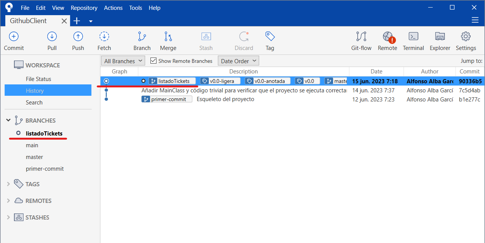
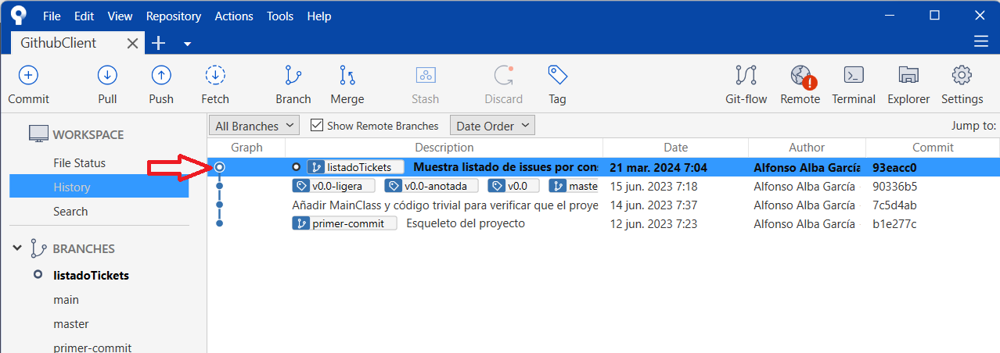
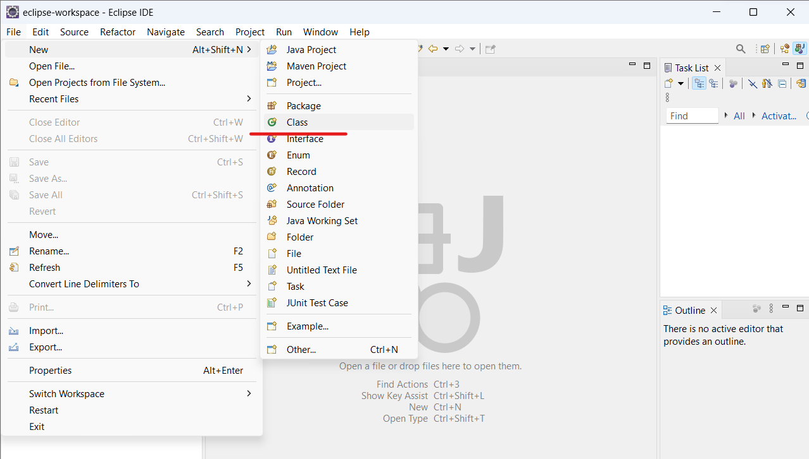
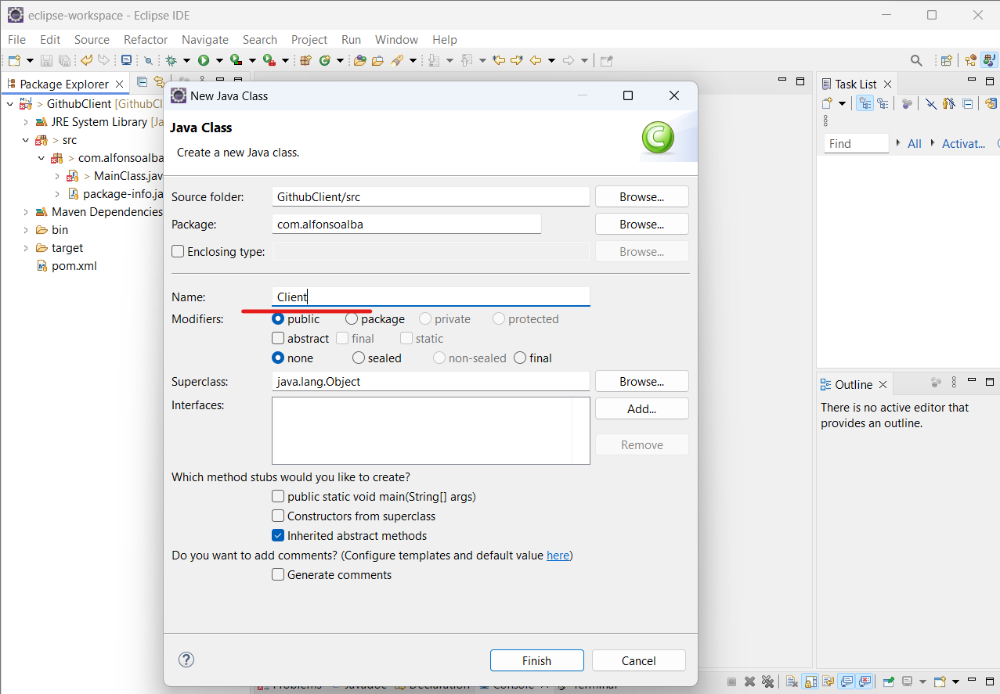
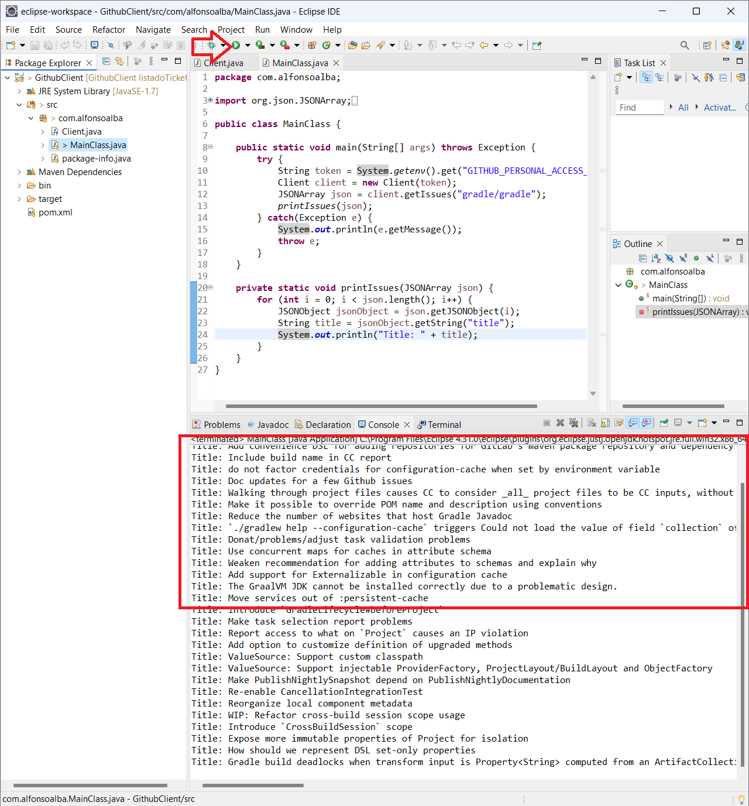
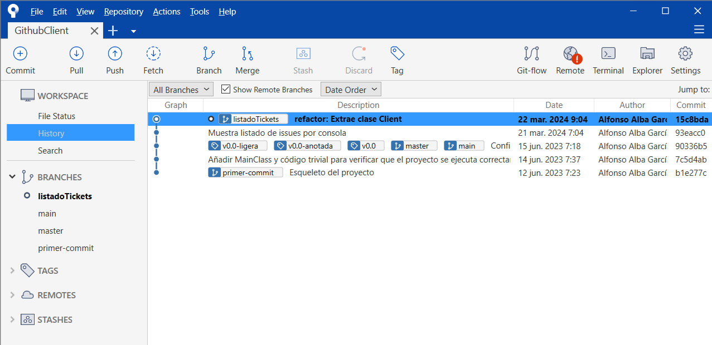

# Taller 3.6 (version Java con Eclipse): ramas de funcionalidad y *fast-forward merge*

## Índice

* This will become a table of contents (this text will be scrapped).
{:toc}

## Descarga 
- [java/GithubClient-taller-3-6.zip &#x1F4E5; ](../talleres/zipfiles/java/GithubClient-taller-3-6.zip)

## Requisitos

Este taller es continuación del taller 
[Taller 3.4: crear etiquetas y ramas]() (el taller 3.5 no tiene fichero descargable) .

Es necesario haber completado el 
[taller 3.4]() para poder realizar 
este taller. Puedes importar el proyecto `java/GithubClient-taller-3-4.zip`  en 
`Eclipse` y partir de él para hacer este taller ([descargar fichero](../talleres/zipfiles/java/GithubClient-taller-3-4.zip)).

## Objetivos

- Utilizar ramas de funcionalidad para cambiar de contexto
- Integrar ramas utilizando *fast-forward merge*


## Crear *token* en GitHub 



## Utilizando `Sourcetree`

### Crear rama 

En `Sourcetree`, creamos una rama que llamaremos `listadoTickets`. Vimos cómo crear ramas 
en el [Taller 3.4](). Hacemos clic con el botón derecho en el último *commit* del repositorio, seleccionamos *Branch...* en el menú contextual.
Se nos abrirá el cuadro de diálogo para crear la rama. Rellenamos los valores y dejamos 
marcada la opción *Checkout New Branch*:


Hacemos clic sobre el botón *Create Branch* y creamos la rama:




### Crear variable de entorno en Eclipse 



### Primeros cambios 


Volvemos a `Sourcetree` y confirmamos los cambios utilizando el mensaje *Muestra listado de issues por consola*. 
Tras confirmarlos, este será el estado de nuestro repositorio:




Vemos como el repositorio sigue siendo una lista simplemente enlazada,
que se representa como una línea recta. No se tuerce ni se birfurca.

### Refactorización 

Antes de dar por terminada la tarea, vamos a refactorizar el código:
- Extraemos una clase `Client` que contendrá el código relacionado con la petición HTTP y el parseo de la respuesta
- Utilizaremos la nueva clase `Client` dentro de `MainClass` para obtener el array con la respuesta en JSON

Añadimos una nueva clase al proyecto. En `Eclipse`, desplegamos el menú *File* -> *New* -> *Class*:



Seleccionamos `Client` como nombre de la clase y hacemos clic sobre el botón *Finish*:



A continuación, modificamos el código de los ficheros `MainClass.java` y `Client.java`:

```java 
// src/com/alfonsoalba/Client.java
package com.alfonsoalba;

import java.net.URI;
import java.net.http.HttpClient;
import java.net.http.HttpRequest;
import java.net.http.HttpResponse;
import org.json.JSONArray;
import org.json.JSONException;

public class Client {
	private HttpClient client;
	private String token;

	public Client(String token) {
		this.client = HttpClient.newHttpClient();
		this.token = token;
	}

	public JSONArray getIssues(String repo) throws Exception {
		String url = "https://api.github.com/repos/" + repo + "/issues";
		HttpRequest request = HttpRequest.newBuilder(URI.create(url))
				.header("Accept", "application/vnd.github+json")
				.header("Content-Type", "application/vnd.github.raw+json")
				.header("Authorization", "Bearer " + token)
				.header("X-GitHub-Api-Version", "2022-11-28")
				.build();

		HttpResponse<String> response = client.send(request, HttpResponse.BodyHandlers.ofString());

		return getJSONFromResponse(response);
	}

	private JSONArray getJSONFromResponse(HttpResponse<String> response) throws JSONException {
		try {
			return new JSONArray(response.body());
		} catch (JSONException e) {
			e.printStackTrace();
			throw e;
		}
	}
}
```

```java
// src/com/alfonsoalba/MainClass.java
package com.alfonsoalba;

import org.json.JSONArray;
import org.json.JSONObject;

public class MainClass {

  public static void main(String[] args) throws Exception {
    try {
      String token = System.getenv().get("GITHUB_PERSONAL_ACCESS_TOKEN");
      Client client = new Client(token);
	        JSONArray json = client.getIssues("gradle/gradle");
	        printIssues(json);
    } catch(Exception e) {
      System.out.println(e.getMessage());
      throw e;
    }
  }

  private static void printIssues(JSONArray json) {
    for (int i = 0; i < json.length(); i++) {
      JSONObject jsonObject = json.getJSONObject(i);
      String title = jsonObject.getString("title");
      System.out.println("Title: " + title);
    }
  }
}
```

Ejecutamos la solución en eclipse y comprobamos que funciona correctamente, mostrando el listado de *Pull Requests*
por la consola:



Una vez comprobamos que funciona, confirmamos los cambios en eclipse con el mensaje _refactor: Extrae clase Client_:



## Utilizando la consola

### Crear rama

Creamos la rama `listadoTickets` y la convertimos en la rama activa. Podemos hacer las dos operaciones
a la vez utilizando la opción `--create` del comando `git switch`:

```shell
> git switch --create listadoTickets
```

Al no indicarle al comando dónde queremos crear la rama, esta se creará apuntando a la misma
confirmación a la que apunta `HEAD` que en este caso es `master`:

```shell
> git log --all --oneline
90336b5 (HEAD -> listadoTickets, tag: v0.0-ligera, tag: v0.0-anotada, tag: v0.0, master, main) Configuramos Maven en el proyecto
7c5d4ab Añadir MainClass y código trivial para verificar que el proyecto se ejecuta correctamente
b1e277c (primer-commit) Esqueleto del proyecto
```

### Crear variable de entorno en Eclipse 


### Primeros cambios 


Veamos los cambios que tenemos en nuestro área de trabajo. Para ello
ejecutamos el comando `git status`:

```shell 
> git status
On branch listadoTickets
Changes not staged for commit:
  (use "git add <file>..." to update what will be committed)
  (use "git restore <file>..." to discard changes in working directory)
        modified:   pom.xml
        modified:   src/com/alfonsoalba/MainClass.java

no changes added to commit (use "git add" and/or "git commit -a")
```

Subimos los cambios al *staging area*:

```shell 
> git add .
```

Confirmamos los cambios:
```shell 
> git commit -m'Nuestra listado de issues por consola'
[listadoTickets 0fe51de] Nuestra listado de issues por consola
 2 files changed, 57 insertions(+), 3 deletions(-)
```
Tras confirmar los cambios, vemos como el repositorio sigue siendo una lista 
simplemente enlazada, que se representa como una línea recta. 
No se tuerce ni se birfurca:


```shell 
> $ git log --all --oneline --graph

* 93eacc0 (HEAD -> listadoTickets) Muestra listado de issues por consola
* 90336b5 (tag: v0.0-ligera, tag: v0.0-anotada, tag: v0.0, master, main) Configuramos Maven en el proyecto
* 7c5d4ab Añadir MainClass y código trivial para verificar que el proyecto se ejecuta correctamente
* b1e277c (primer-commit) Esqueleto del proyecto
```

