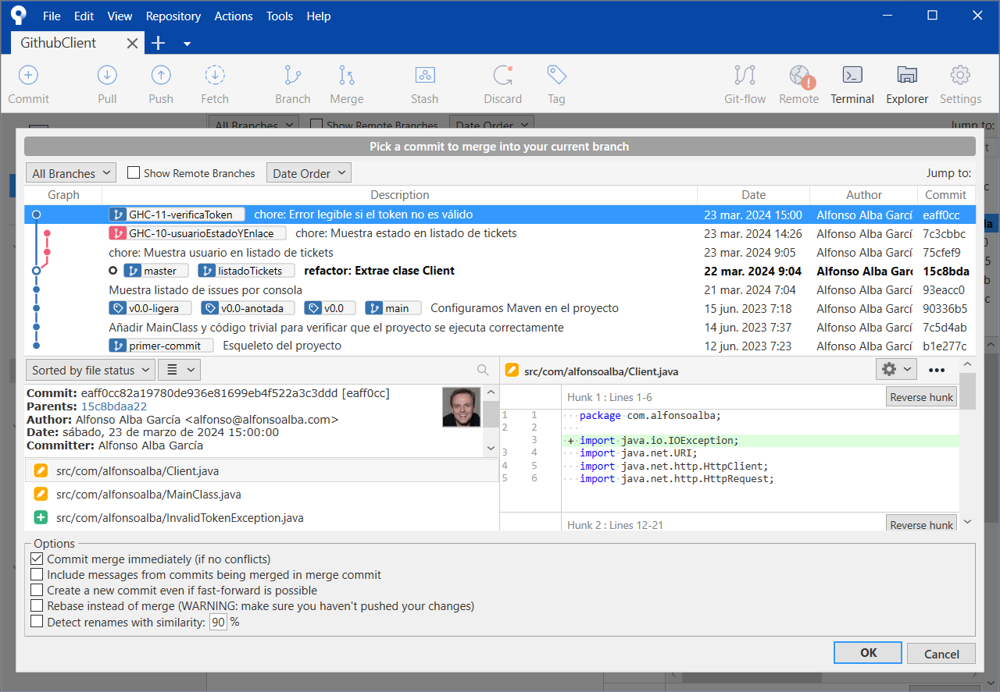
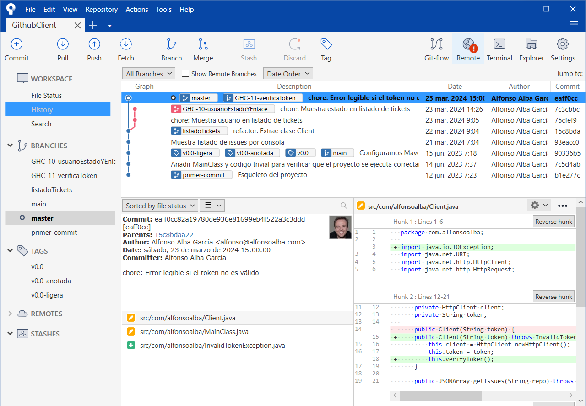

# Taller 3.7 (version Go con Visual Studio Code): Cambios de contexto y *merge commits*

## Índice

* This will become a table of contents (this text will be scrapped).
{:toc}

## Descarga 
- [go/github-client-taller-3-7.zip &#x1F4E5; ]()

## Requisitos

Este taller es continuación del taller 
[Taller 3.6: crear etiquetas y ramas]().

Es necesario haber completado el 
[taller 3.6]() para poder realizar 
este taller. Puedes importar el proyecto [`go/github-client-taller-3-6.zip`]()  en 
`Visual Studio Code` y partir de él hacer este taller.


## Qué vamos a hacer 

En este taller, empezaremos el desarrollo de una nueva funcionalidad: añadir al listado de tickets
el usuario, el estado del ticket y un enlace.

Mientras estamos desarrollando esta funcionalidad, nos interrumpirán 
para que resolvamos un problema que se ha reportado en la versión actual. Tendremos que 
interrumpir nuestro trabajo para corregirlo y desplegar una nueva versión.

Una vez corregido el problema, retomaremos el trabajo que está sin terminar y lo finalizaremos.

## Objetivos

- Utilizar ramas de funcionalidad para cambiar de contexto
- Integrar ramas creando *fast-forward merge*
- Integrar ramas creando *merge commits*

## Convenios

Seguiremos los mismos convenios sobre ramas que utilizamos en el 
[taller 3.6](). 

Además añadiremos un nuevo convenio y es que el nombre de las ramas incluirá el ID del 
ticket de nuestro sistema de gestión de proyectos. Existen multitud de sistemas de 
gestión de proyectos, así que seleccionaré uno de los más utilizados: Jira.

En Jira, cada vez que se crea un ticket se le asigna un ID único. Este consiste 
en un código de proyecto (por ejemplo `GHC`, de `GutHub Client`) seguido de un guión y un número 
entero consecutivo que va creciendo con cada ticket nuevo que se crea. Por ejemplo `GHC-10`.
Las ramas que creemos en adelante incluirán un código de tarea en Jira (que es ficticio, ya que no usaremos
Jira en ninguno de los talleres.)

Cada sistema de gestión de proyectos se integra con `git` a su manera, por lo que 
no entraremos en detalle en profundidad. En el caso particular de Jira, 
si se activa la integración con `GitHub` y el nombre de la rama contiene el 
ID del ticket, Jira nos mostrará las ramas relacionadas con el ticket y enlaces a 
las `Pull Requests` en la web de `GitHub`.

Mira la documentación de tu sistema de control de proyectos así como los plugins que ofrece 
tu proveedor de repositorios de `git` para ver de qué opciones de integración dispones. Siguiendo con 
el ejemplo de Jira, estos son dos enlaces con los que puedes empezar:
- [Smart Commits](https://support.atlassian.com/jira-cloud-administration/docs/enable-smart-commits/)
- [Integración entre Jira y GitHub](https://support.atlassian.com/jira-cloud-administration/docs/integrate-with-github/)

## Despliegues

Seguiremos el mismo procedimiento de despliegue que describimos en el 
[taller 3.6](#despliegues). 

## Utilizando `Sourcetree`



### Paso 1: Crear rama y primera implementación 

#### Crear rama `GHC-10-comando-pr-list`
En `Sourcetree`, creamos una rama que llamaremos `GHC-10-comando-pr-list`. Vimos cómo crear ramas 
en el [taller 3.4]() y en el 
[taller 3.6](). Al crear la rama, nos aseguramos de 
marcar la casilla para hacer *checkout* y que sea la rama activa. Mostramos aquí únicamente
el resultado de la operación después de hacerla en `Sourcetree`:


#### Primera confirmación de cambios



Abrimos `Sourcetree` y en el menú de la izquierda vamos a *File Status*. Veremos el fichero que hemos modificado 
y si lo seleccionamos, los cambios del mismo:


Subimos los cambios al área de ensayo haciendo clic en *Stage All*, escribimos el mensaje 
"*feat: Implementa comando pr list*" en la parte inferior y hacemos clic sobre `Commit`:


Tras confirmar los cambios, hacemos clic en *History* en el menú de la izquierda y vemos que el repositorio sigue siendo una lista simplemente enlazada:


### Paso 2: Gestión de errores

 

Confirmamos en `Sourcetree` los cambios siguiendo los mismos pasos. Abrimos `Sourcetree` y en el menú de la izquierda vamos a
*File Status*. Veremos el fichero que hemos modificado y si lo seleccionamos, los cambios del mismo:


Subimos los cambios al área de ensayo haciendo clic en *Stage All*, escribimos el mensaje 
"*chore: Mejora en la gestión de errores en comando pr list*" en la parte inferior y hacemos clic sobre `Commit`:


Tras confirmar los cambios, hacemos clic en *History* en el menú de la izquierda y vemos que el repositorio sigue siendo una lista simplemente enlazada:


### Interrupción



#### Crear rama `GHC-11-token-en-variable-de-entorno`



Creamos en `Sourcetree` la rama `GHC-11-token-en-variable-de-entorno` a la misma altura que `main`. Para ello, hacemos clic usando 
el botón derecho sobre la confirmación a la que apunta `main` y en el menú contextual seleccionamos *Branch*:


En el nombre de la rama introducimos  `GHC-11-token-en-variable-de-entorno`, dejamos marcada la casilla *Checkout New Branch*, ya 
que en ese caso sí queremos que la nueva rama pase a ser la rama activa, y hacemos clic sobre *Create Branch*:


Una vez creada la rama, comprobamos que aparece una nueva referencia `GHC-11-token-en-variable-de-entorno` que apunta a la 
confirmación `9611db0` (al mismo sitio al que apunta `main`):


Observamos como una vez más no se bifurca el grafo, seguimos teniendo una lista enlazada con un nuevo puntero.

#### Confirmar los cambios



Vamos a confirmar los cambios. Volvamos a `Sourcetree` y hagamos clic sobre la sección *History* en el menú de la 
izquierda. Si observamos el log, vamos a ver varias cosas diferentes:


- En primer lugar, el color de algunos *commits* ha cambiado de azul a rojo: puedes ignorarlo. `Sourcetree` utiliza 
  colores para ayudarte a navegar por el grafo, cambiando el color cuando hay bifurcaciones en la estrucutura
  de datos. Esos cambios de color son muy confusos además, porque no son consistentes (es decir, lo que ahora se pinta 
  de rojo, de repente se pinta de azul o amarillo o verde si aparecen más bifurcaciones). Lo dicho, de momento lo 
  mejor es ignorar los colores 
- En segundo lugar, `Sourcetree` nos da una pista de qué va a pasar cuando confirmemos los cambios, es lo que nos 
  muestra en color gris usando ese *commit* con el comentario *Uncommitted changes*. También es una forma 
  que `Sourcetree` tiene de decirnos que hay cambios pendientes de confirmar en el área de trabajando

Vamos a confirmar los cambios. En el menú de la izquierda, hacemos clic en *File Status*. En la sección *Unstaged files*
hacemos clic sobre sobre *Stage All* y en el cuadro de diálogo para introducir el mensaje escribimos 
el siguiente mensaje:

> feat: comando auth status utiliza GHC_TOKEN para leer el token
>
> Este cambio permite utilizar diferentes tokens por entorno (producción, pruebas, entorno local) sin necesidad de persistir ficheros. 
> Este comportamiento está alineado con los estándares del equipo de infraestructura.
> Si la variable no existe, se busca el fichero ~/.config/github-client/token. 

Como hemos hecho en confirmaciones anteriores, incluimos junto al mensaje el porqué estamos introduciendo este cambio.


Hacemos clic sobre el botón *Commit* y confirmamos los cambios:


Tras confirmar los cambios, vemos que el respositorio ha dejado de ser una lista simplemente enlazada ya que ha 
aparecido una bifurcación en nuestra estructura de datos. Esta bifurcación no aparece por que creamos una rama,
sino porque **partiendo de un mismo código fuente, hemos confirmado dos modificaciones diferentes**.

Estamos listos para desplegar una nueva versión.

#### Desplegar `GHC-11`



En `Sourcetree`, hacemos doble clic sobre `main`:


La siguiente pregunta es ¿dónde están los cambios que queremos integrar? La respuesta es en la rama `GHC-11-token-en-variable-de-entorno`.
Hacemos clic sobre el botón *Merge* en el menú superior y seleccionamos la rama que queremos integrar, en este 
caso `GHC-11-token-en-variable-de-entorno`:



Tras hacer clic en *OK*, `git` hace un `fast-forward merge`:



¡Ya podemos volver a la rama `GHC-10-usuarioEstadoYEnlace` y terminarla!

### Paso 3: añadir información adicional



#### Confirmar terceros cambios: mostrar autor y URL del *Pull Request*



En `Sourcetree`, confirmamos los cambios con el mensaje *feat: comando pr list muestra autor y enlace*: 


¡Ya casi estamos listos para desplegar `GHC-10`!

#### ¿Qué pasa con la petición de nuestra compañera?



Parece que todo funciona correctamente así que confirmamos los cambios con el mensaje 
*feat: pr list lee token the GHC_TOKEN si está definida*. Tras la confirmación nuestro
repositorio queda en el siguiente estado:

#### Desplegar



Vamos a `Sourcetree` y hacemos `main` la rama activa haciendo doble clic sobre ella en el menú de la izquierda:


La segunda pregunta es ¿dónde está el código que queremos integrar? La respuesta es en `GHC-10-comando-pr-list`, así
que integremos esa rama en `main`.
Hacemos clic sobre el botón *Merge* en el menú superior, seleccionamos la rama que queremos integrar en `main`, 
que es `GHC-10-comando-pr-list`:


Al hacer clic sobre el botón *OK*, vemos que `git` ha creado un `merge commit` ya que este `merge` no 
era `fast-forward`:


Si hacemos clic sobre el *merge commit* vemos que es un commit con la misma información que tienen los otros 
*commits*: nombre e email del autor, fecha, mensaje y *checksum* del *commit* anterior. La diferencia es que 
este tiene dos *commits* anteriores y el mensaje lo ha creado `Sourcetree` sin preguntarnos.

Antes de distribuir el ejecutable a los usuarios, se lo enviaríamos *al jefe* para que hiciese un último chequeo 
de que todo funciona correctamente. 

## Utilizando la consola



### Paso 1: Crear rama y primera implementación 

#### Crear rama `GHC-10-comando-pr-list`

Creamos una rama que llamaremos `GHC-10-comando-pr-list`. Vimos cómo crear ramas 
en el [taller 3.4]() y en el 
[taller 3.6](), seguimos los mismos
pasos aquí:

```powershell
> git switch -c GHC-10-comando-pr-list main
```

#### Primera confirmación de cambios



Subimos los cambios al área de ensayo usando el comando `git add` y confirmamos los cambios con el mensaje 
"*feat: Implementa comando pr list*":


```powershell
> git add .
> git commit -m'feat: Implementa comando pr list'
[GHC-10-comando-pr-list f2b1636] feat: Implementa comando pr list
 Date: Sat Feb 1 13:07:09 2025 +0100
 1 file changed, 84 insertions(+)
```

Tras confirmar los cambios, utilizamos el comando git log para ver el estado del repositorio.
Podemos observar que sigue siendo una lista enlazada:

```powershell
git log --oneline --graph --all
* f2b1636 (HEAD -> GHC-10-comando-pr-list) feat: Implementa comando pr list
* 9611db0 (main, comando-auth) feat: implementa el comando auth status
* 5344602 feat: Implementa el comando auth login
* 0206c90 (tag: v0.0-ligera, tag: v0.0-anotada, tag: v0.0, master) Comando raiz usando cobra
* 20d1eb2 Añadir dependencias: cobra
* d5ee988 (primer-commit) Esqueleto del proyecto
```


### Paso 2: Gestión de errores

 

Subimos los cambios al área de ensayo usando el comando `git add` y confirmamos los cambios con el mensaje 
"*chore: Mejora en la gestión de errores en comando pr list*":

```powershell
> git add .
> git commit -m'chore: Mejora en la gestión de errores en comando pr list'
[GHC-10-comando-pr-list 9ba307b] chore: Mejora en la gestión de errores en comando pr list
 Date: Sat Feb 1 13:22:42 2025 +0100
 1 file changed, 26 insertions(+), 7 deletions(-)
```

Tras confirmar los cambios, utilizamos el comando git log para ver el estado del repositorio.
Podemos observar que sigue siendo una lista enlazada:

```powershell
 git log --oneline --graph --all
* 9ba307b (HEAD -> GHC-10-comando-pr-list) chore: Mejora en la gestión de errores en comando pr list
* f2b1636 feat: Implementa comando pr list
* 9611db0 (main, comando-auth) feat: implementa el comando auth status
* 5344602 feat: Implementa el comando auth login
* 0206c90 (tag: v0.0-ligera, tag: v0.0-anotada, tag: v0.0, master) Comando raiz usando cobra
* 20d1eb2 Añadir dependencias: cobra
* d5ee988 (primer-commit) Esqueleto del proyecto

```

### Interrupción



#### Crear rama `GHC-11-token-en-variable-de-entorno`



Creamos la rama `GHC-11-token-en-variable-de-entorno` a la misma altura que `main` y hacemos checkout de la misma 
utilizando la opción `-c` del comando `git switch`:

```powershell
> git switch -c GHC-11-token-en-variable-de-entorno main
```

Podemos hacer esta operación en dos pasos usando los comandos `git branch` para crear la rama y `git switch` para
hacerla la rama activa:

```powershell
> git branch GHC-11-token-en-variable-de-entorno main
> git switch GHC-11-token-en-variable-de-entorno
```

Una vez creada la rama, comprobamos que aparece una nueva referencia `GHC-11-token-en-variable-de-entorno` que apunta a la 
confirmación `9611db0` (al mismo sitio al que apunta `main`):

```powershell
 git log --oneline --graph --all
* 9ba307b (GHC-10-comando-pr-list) chore: Mejora en la gestión de errores en comando pr list
* f2b1636 feat: Implementa comando pr list
* 9611db0 (HEAD -> GHC-11-token-en-variable-de-entorno, main, comando-auth) feat: implementa el comando auth status
* 5344602 feat: Implementa el comando auth login
* 0206c90 (tag: v0.0-ligera, tag: v0.0-anotada, tag: v0.0, master) Comando raiz usando cobra
* 20d1eb2 Añadir dependencias: cobra
* d5ee988 (primer-commit) Esqueleto del proyecto
```


Observamos como una vez más no se bifurca el grafo, seguimos teniendo una lista enlazada con un nuevo puntero.

#### Confirmar los cambios



Subimos los cambios al área de ensayo usando el comando `git add` y confirmamos los cambios con el mensaje:

> feat: comando auth status utiliza GHC_TOKEN para leer el token
>
> Este cambio permite utilizar diferentes tokens por entorno (producción, pruebas, entorno local) sin necesidad de persistir ficheros. 
> Este comportamiento está alineado con los estándares del equipo de infraestructura.
> Si la variable no existe, se busca el fichero ~/.config/github-client/token. 

Como hemos hecho en confirmaciones anteriores, incluimos junto al mensaje el porqué estamos introduciendo este cambio:

```powershell
> git commit -m'feat: comando auth status utiliza GHC_TOKEN para leer el token

Este cambio permite utilizar diferentes tokens por entorno (producción, pruebas, entorno local) sin necesidad de persistir ficheros.
Este comportamiento está alineado con los estándares del equipo de infraestructura.
Si la variable no existe, se busca el fichero ~/.config/github-client/token.'
[GHC-11-token-en-variable-de-entorno c494502] feat: comando auth status utiliza GHC_TOKEN para leer el token
 Date: Sat Feb 1 13:38:31 2025 +0100
 1 file changed, 24 insertions(+), 12 deletions(-)
```

Tras confirmar los cambios, verfiquemos el estado del repositorio:


```powershell
$ git log --all --oneline --graph
* c494502 (HEAD -> GHC-11-token-en-variable-de-entorno) feat: comando auth status utiliza GHC_TOKEN para leer el token
| * 9ba307b (GHC-10-comando-pr-list) chore: Mejora en la gestión de errores en comando pr list
| * f2b1636 feat: Implementa comando pr list
|/
* 9611db0 (main, comando-auth) feat: implementa el comando auth status
* 5344602 feat: Implementa el comando auth login
* 0206c90 (tag: v0.0-ligera, tag: v0.0-anotada, tag: v0.0, master) Comando raiz usando cobra
* 20d1eb2 Añadir dependencias: cobra
* d5ee988 (primer-commit) Esqueleto del proyecto
```

vemos que el respositorio ha dejado de ser una lista simplemente enlazada ya que ha 
aparecido una bifurcación en nuestra estructura de datos. Esta bifurcación no aparece por que creamos una rama,
sino porque **partiendo de un mismo código fuente, hemos confirmado dos modificaciones diferentes**.

Estamos listos para desplegar una nueva versión.

#### Desplegar `GHC-11`



Utizamos el comando `git switch` para hacer `main` la rama activa:

```powershell
> git switch main
Switched to branch 'main'
```

La siguiente pregunta es ¿dónde están los cambios que queremos integrar? La respuesta es en la rama `GHC-11-token-en-variable-de-entorno`.
Integramos esta rama en la rama activa usando el comando `git merge`:

```powershell
> git merge GHC-11-token-en-variable-de-entorno
Updating 9611db0..c494502
Fast-forward
 main.go | 36 ++++++++++++++++++++++++------------
 1 file changed, 24 insertions(+), 12 deletions(-)
```

Se trata de un *fast-forward merge* como el que vimos en el taller 3.5, por lo que lo único que ocurrirá en el grafo 
es que la rama `main` se moverá a la misma confirmación a la que apunta `GHC-11-token-en-variable-de-entorno`:

```powershell
$ git log --all --oneline --graph
* c494502 (HEAD -> main, GHC-11-token-en-variable-de-entorno) feat: comando auth status utiliza GHC_TOKEN para leer el token
| * 9ba307b (GHC-10-comando-pr-list) chore: Mejora en la gestión de errores en comando pr list
| * f2b1636 feat: Implementa comando pr list
|/
* 9611db0 (comando-auth) feat: implementa el comando auth status
* 5344602 feat: Implementa el comando auth login
* 0206c90 (tag: v0.0-ligera, tag: v0.0-anotada, tag: v0.0, master) Comando raiz usando cobra
* 20d1eb2 Añadir dependencias: cobra
* d5ee988 (primer-commit) Esqueleto del proyecto
```


### Paso 3: añadir información adicional



#### Confirmar terceros cambios: mostrar autor y URL del *Pull Request*



Subimos los cambios al área de ensayo usando el comando `git add` y confirmamos los cambios con el mensaje 
*feat: comando pr list muestra autor y enlace*:

```powershell
> git add .
> git commit -m'feat: comando pr list muestra autor y enlace'
[GHC-10-comando-pr-list e29ba6b] feat: comando pr list muestra autor y enlace
 Date: Mon Feb 1 13:54:22 2055 +0100
 1 file changed, 8 insertions(+), 2 deletions(-)
```

Verificamos el estado del repositorio:

```powershell
> git log --all --oneline --graph
* e29ba6b (HEAD -> GHC-10-comando-pr-list) feat: comando pr list muestra autor y enlace
* 9ba307b chore: Mejora en la gestión de errores en comando pr list
* f2b1636 feat: Implementa comando pr list
| * c494502 (main, GHC-11-token-en-variable-de-entorno) feat: comando auth status utiliza GHC_TOKEN para leer el token
|/
* 9611db0 (comando-auth) feat: implementa el comando auth status
* 5344602 feat: Implementa el comando auth login
* 0206c90 (tag: v0.0-ligera, tag: v0.0-anotada, tag: v0.0, master) Comando raiz usando cobra
* 20d1eb2 Añadir dependencias: cobra
* d5ee988 (primer-commit) Esqueleto del proyecto
```

¡Ya casi estamos listos para desplegar `GHC-10`!

#### ¿Qué pasa con la petición de nuestra compañera?



Parece que todo funciona correctamente así que confirmamos los cambios con el mensaje 
*feat: pr list lee token the GHC_TOKEN si está definida*: 

```powershell
> git add .
> git commit -m'feat: pr list lee token the GHC_TOKEN si está definida'
[GHC-10-comando-pr-list 9200582] feat: pr list lee token the GHC_TOKEN si está definida
 Date: Mon Feb 1 14:08:18 2055 +0100
 1 file changed, 24 insertions(+), 12 deletions(-)
```


Tras la confirmación nuestro repositorio queda en el siguiente estado:

```powershell
> git log --all --oneline --graph
* 9200582 (HEAD -> GHC-10-comando-pr-list) feat: pr list lee token the GHC_TOKEN si está definida
* e29ba6b feat: comando pr list muestra autor y enlace
* 9ba307b chore: Mejora en la gestión de errores en comando pr list
* f2b1636 feat: Implementa comando pr list
| * c494502 (main, GHC-11-token-en-variable-de-entorno) feat: comando auth status utiliza GHC_TOKEN para leer el token
|/
* 9611db0 (comando-auth) feat: implementa el comando auth status
* 5344602 feat: Implementa el comando auth login
* 0206c90 (tag: v0.0-ligera, tag: v0.0-anotada, tag: v0.0, master) Comando raiz usando cobra
* 20d1eb2 Añadir dependencias: cobra
* d5ee988 (primer-commit) Esqueleto del proyecto
```

#### Desplegar



Usando el comando `git switch` hacemos `main` la rama activa:

```powershell
> git switch main
Switched to branch 'main'
```

La segunda pregunta es ¿dónde está el código que queremos integrar? La respuesta es en `GHC-10-comando-pr-list`, así
que integremos esa rama en `main` usando el comando `git merge`:

```powershell
> git merge GHC-10-comando-pr-list

```
Al ejecutar el comando, se abre el editor por defecto para darnos la opción de cambia el mensaje por defecto
del *merge commit*:

```text
Merge branch 'GHC-10-comando-pr-list'
# Please enter a commit message to explain why this merge is necessary,
# especially if it merges an updated upstream into a topic branch.
#
# Lines starting with '#' will be ignored, and an empty message aborts
# the commit.
```

Podemos mantener el mensaje, para lo cual salimos del editor `vi` tecleando `:q`. Al hacerlo `git`
genera el *merge commit*:

```powershell
Auto-merging main.go
Merge made by the 'ort' strategy.
 main.go | 121 ++++++++++++++++++++++++++++++++++++++++++++++++++++++++++++++++
 1 file changed, 121 insertions(+)
```

Utilizamos el comando `git log` para ver el estado del repositorio:

```powershell
 git log --all --oneline --graph
*   aa46ac1 (main) Merge branch 'GHC-10-comando-pr-list'
|\
| * 9200582 (HEAD -> GHC-10-comando-pr-list) feat: pr list lee token the GHC_TOKEN si está definida
| * e29ba6b feat: comando pr list muestra autor y enlace
| * 9ba307b chore: Mejora en la gestión de errores en comando pr list
| * f2b1636 feat: Implementa comando pr list
* | c494502 (GHC-11-token-en-variable-de-entorno) feat: comando auth status utiliza GHC_TOKEN para leer el token
|/
* 9611db0 (comando-auth) feat: implementa el comando auth status
* 5344602 feat: Implementa el comando auth login
* 0206c90 (tag: v0.0-ligera, tag: v0.0-anotada, tag: v0.0, master) Comando raiz usando cobra
* 20d1eb2 Añadir dependencias: cobra
* d5ee988 (primer-commit) Esqueleto del proyecto
```


Podemos utilizar el comando `git show` para ver los detalles del *merge commit*:

```powershell
$ git show
commit aa46ac1d862a2f79be776f24a127ae44d259d535
Merge: c494502 9200582
Author: Alfonso Alba García <alfonso@alfonsoalba.com>
Date:   Mon Feb 1 14:14:49 2055 +0100

    Merge branch 'GHC-10-comando-pr-list'
```

Observamos que se trata de un *merge commit* en el que se se han mezclado los cambios de 
`c494502` y `9200582`.

Antes de distribuir el ejecutable a los usuarios, se lo enviaríamos *al jefe* para que hiciese un último chequeo 
de que todo funciona correctamente. 
