# Taller 3.6 (version Java con Eclipse): Cambios de contexto y *merge commits*

## Índice

* This will become a table of contents (this text will be scrapped).
{:toc}

## Descarga 
- [java/GithubClient-taller-3-7.zip &#x1F4E5; ](../talleres/zipfiles/java/GithubClient-taller-3-7.zip)

## Requisitos

Este taller es continuación del taller 
[Taller 3.6: crear etiquetas y ramas]().

Es necesario haber completado el 
[taller 3.6]() para poder realizar 
este taller. Puedes importar el proyecto `java/GithubClient-taller-3-6.zip`  en 
`Eclipse` y partir de él para hacer este taller ([descargar fichero](../talleres/zipfiles/java/GithubClient-taller-3-6.zip)).


## Qué vamos a hacer 

En este taller, empezaremos el desarrollo de una nueva funcionalidad: añadir al listado de tickets
el usuario, el estado del ticket y un enlace.

Mientras estamos desarrollando esta funcionalidad, nos interrumpirán 
para que resolvamos un problema que se ha reportado en la versión actual. Tendremos que 
interrumpir nuestro trabajo para corregirlo y desplegar una nueva versión.

Una vez corregido el problema, retomaremos el trabajo que está sin terminar y lo finalizaremos.

## Objetivos

- Utilizar ramas de funcionalidad para cambiar de contexto
- Integrar ramas creando *fast-forward merge*
- Integrar ramas creando *merge commits*

## Convenios

Seguiremos los mismos convenios sobre ramas que utilizamos en el 
[taller 3.6](). 

Además añadiremos un nuevo convenio y es que el nombre de las ramas incluirá el ID del 
ticket de nuestro sistema de gestión de proyectos. Existen multitud de sistemas de 
gestión de proyectos, así que seleccionaré uno de los más utilizados: Jira.

En Jira, cada vez que se crea un ticket se le asigna un ID único. Este consiste 
en un código de proyecto (por ejemplo `GHC`, de `GutHub Client`) seguido de un guión y un número 
entero consecutivo que va creciendo con cada ticket nuevo que se crea. Por ejemplo `GHC-10`.
Las ramas que creemos en adelante incluirán un código de tarea en Jira (que es ficticio, ya que no usaremos
Jira en ninguno de los talleres.)

Cada sistema de gestión de proyectos se integra con `git` a su manera, por lo que 
no entraremos en detalle en profundidad. En el caso particular de Jira, 
si se activa la integración con `GitHub` y el nombre de la rama contiene el 
ID del ticket, Jira nos mostrará las ramas relacionadas con el ticket y enlaces a 
las `Pull Requests` en la web de `GitHub`.

Mira la documentación de tu sistema de control de proyectos así como los plugins que ofrece 
tu proveedor de repositorios de `git` para ver de qué opciones de integración dispones. Siguiendo con 
el ejemplo de Jira, estos son dos enlaces con los que puedes empezar:
- [Smart Commits](https://support.atlassian.com/jira-cloud-administration/docs/enable-smart-commits/)
- [Integración entre Jira y GitHub](https://support.atlassian.com/jira-cloud-administration/docs/integrate-with-github/)

## Despliegues

Seguiremos el mismo procedimiento de despliegue que describimos en el 
[taller 3.6](). 

## Utilizando `Sourcetree`

### Crear rama 

Nos han pedido que al escueto listado que nos muestra los tickets de GitHub por pantalla,
añadamos la siguiente información:
- Usuario que creó el ticket
- Estado del ticket
- Enlace al ticket 

Imaginemos que esta tarea tiene asignado el ticket de Jira número `GHC-10`.

En `Sourcetree`, creamos una rama que llamaremos `GHC-10-usuarioEstadoYEnlace`. Vimos cómo crear ramas 
en el [taller 3.4]() y en el 
[taller 3.6](). Al crear la rama, nos aseguramos de 
marcar la casilla para hacer *checkout* y que sea la rama activa. Mostramos aquí únicamente
el resultado de la operación después de hacerla en `Sourcetree`:

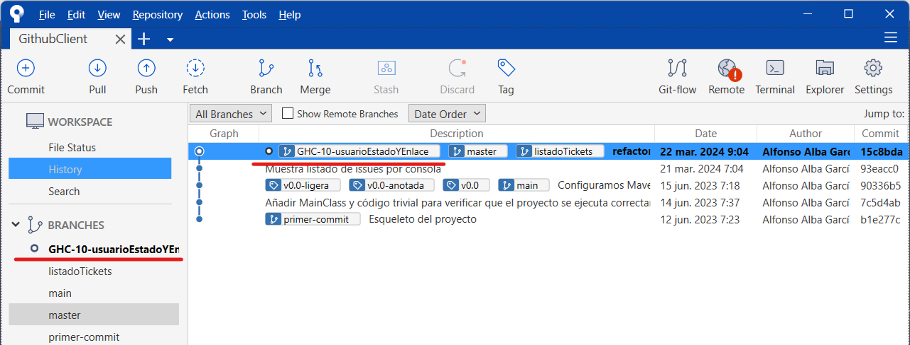

### Confirmar primeros cambios: usuario

Nos han pedido que mostremos más información sobre el _issue_ de `GitHub` en nuestro cliente: usuario, 
estado del ticket y un enlace al ticket. Empezaremos por añadir el usuario.

Antes de continuar, nos aseguramos de que la rama `GHC-10-usuarioEstadoYEnlace` es la rama activa. 

Mirando la [Documentación de la API de GitHub](https://docs.github.com/en/rest/issues/issues?apiVersion=2022-11-28), 
podemos ver la respuesta `JSON` y cómo extraer el usuario. Modificamos el fichero `src/com/alfonsoalba/MainClass.java`
e incluimos el código que muestra el usuario:

```java
// src/com/alfonsoalba/MainClass.java
package com.alfonsoalba;

import org.json.JSONArray;
import org.json.JSONObject;

public class MainClass {

  public static void main(String[] args) throws Exception {
    try {
      String token = System.getenv().get("GITHUB_PERSONAL_ACCESS_TOKEN");
      Client client = new Client(token);
      JSONArray json = client.getIssues("gradle/gradle");
      printIssues(json);
    } catch(Exception e) {
      System.out.println(e.getMessage());
      throw e;
    }
  }
	
  private static void printIssues(JSONArray json) {
    for (int i = 0; i < json.length(); i++) {
      JSONObject jsonObject = json.getJSONObject(i);
      String title = jsonObject.getString("title");

      JSONObject userObject = jsonObject.getJSONObject("user");
      String user = userObject.getString("login");


      System.out.println("[" + user + "] " + title);
    }
  }
}
```

Ejecutamos la solución en `Eclipse` y verificamos que funciona correctamente:

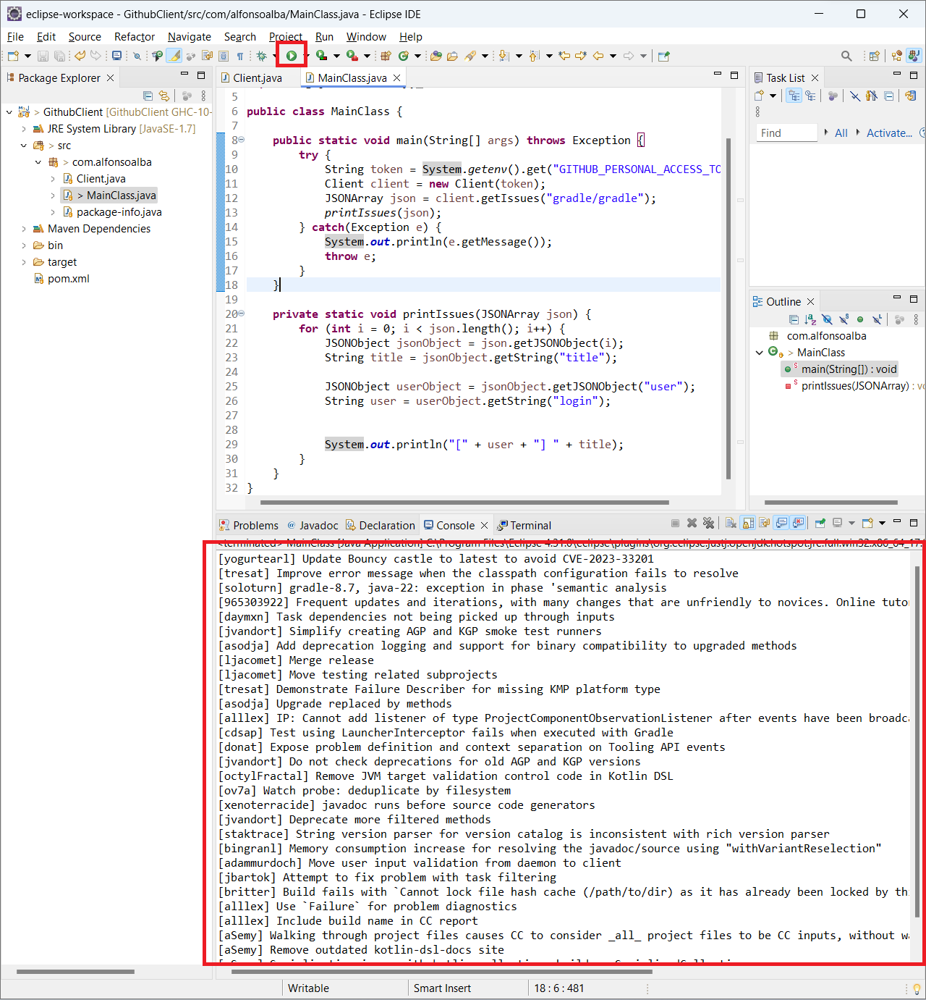

Una vez comprobamos que el código funciona, y antes de pasar al siguiente paso (mostrar el estado), vamos a 
confirmar los cambios. Una buena práctica de `git` es realizar *commits* atómicos, y cada uno de los tres 
cambios que tenemos que hacer se pueden considerar atómicos (usuario, estado y URL del *issue*). Esta decisión es 
arbitraria y algunos podéis considerar que los tres cambios se podrían incluir en un mismo *commit* ya que están 
relacionados. También consideraríais que ese *commit* con el usuario, el estado y la URL sería atómico. Dependiendo 
del contexto en el que se tenga que tomar esta decisión, estoy de acuerdo con ella. Sin embargo, en este contexto 
(en el contexto de este taller), tiene sentido 
hacer tres *commits* y así es como vamos a proceder. Con este párrafo pretendo ilustrar que las decisiones y buenas 
prácticas de `git` son muchas veces relativas y, al final, debemos usar el sentido comnún y aquello que 
le funciona al equipo o proyecto en el que estemos.

Abrimos `Sourcetree` y en el menú de la izquierda vamos a *File Status*. Veremos el fichero que hemos modificado 
y si lo seleccionamos, los cambios del mismo:

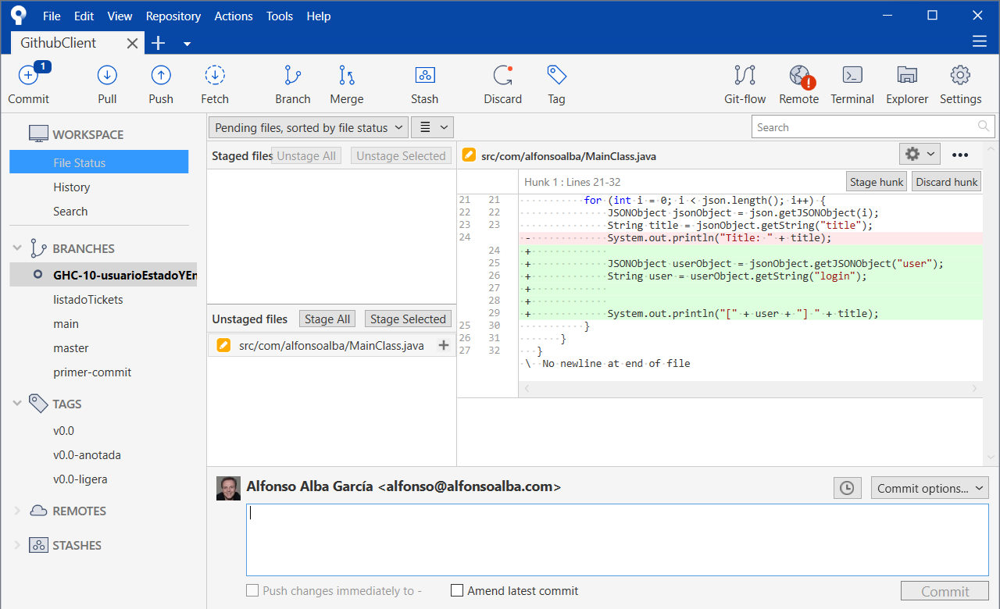

Subimos los cambios al área de ensayo haciendo clic en *Stage All*, escribimos el mensaje 
"*chore: Muestra usuario en listado de tickets*" en la parte inferior y hacemos clic sobre `Commit`:

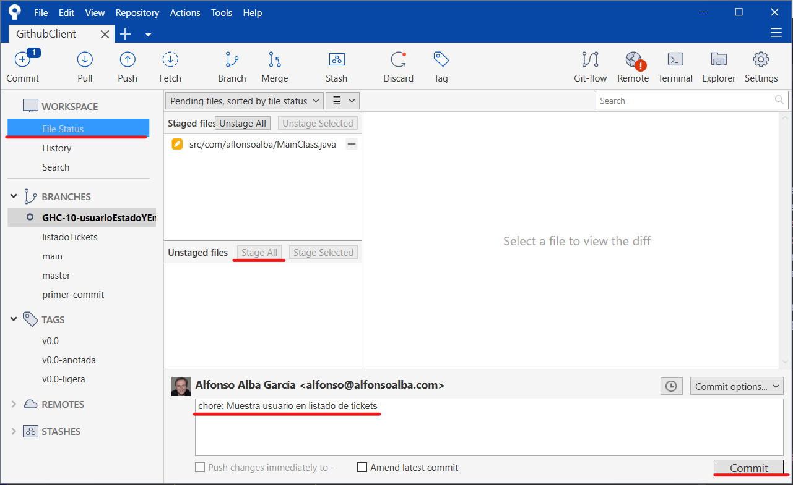
Tras confirmar los cambios, vemos que el repositorio sigue siendo una lista simplemente enlazada:

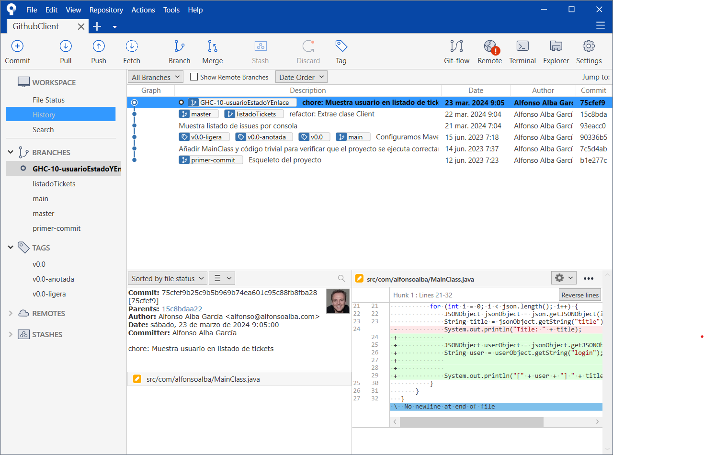

### Confirmar segundos cambios: estado 

Seguimos trabajando en nuestro ticket, y el siguiente paso es añadir el estado.

Mirando la [Documentación de la API de GitHub](https://docs.github.com/en/rest/issues/issues?apiVersion=2022-11-28), 
podemos ver la respuesta `JSON` y cómo extraer el estado. Modificamos el fichero `src/com/alfonsoalba/MainClass.java`
e incluimos el código para mostrarlo:

```java
package com.alfonsoalba;

import org.json.JSONArray;
import org.json.JSONObject;

public class MainClass {

  public static void main(String[] args) throws Exception {
    try {
      String token = System.getenv().get("GITHUB_PERSONAL_ACCESS_TOKEN");
      Client client = new Client(token);
          JSONArray json = client.getIssues("gradle/gradle");
          printIssues(json);
    } catch(Exception e) {
      System.out.println(e.getMessage());
      throw e;
    }
  }
  
  private static void printIssues(JSONArray json) {
    for (int i = 0; i < json.length(); i++) {
      JSONObject jsonObject = json.getJSONObject(i);
      String title = jsonObject.getString("title");
      String state = jsonObject.getString("state");

      JSONObject userObject = jsonObject.getJSONObject("user");
      String user = userObject.getString("login");


      System.out.println("[" + user + "] - (" + state + ") - " + title);
    }
  }
}
```
Compilamos la solución y verificamos que efectivamente se muestra el usuario y el estado:

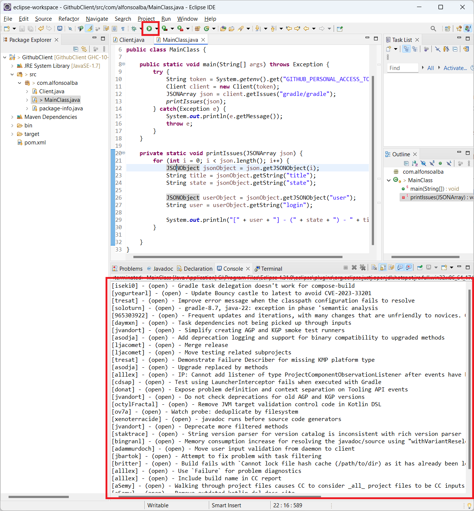

Volvemos a `Sourcetree` y seguimos los mismos pasos que en la sección anterior para confirmar los cambios, en este
caso con el mensaje "*chore: Muestra estado en listado de Tickets*". Tras hacerlo, el repositorio queda:


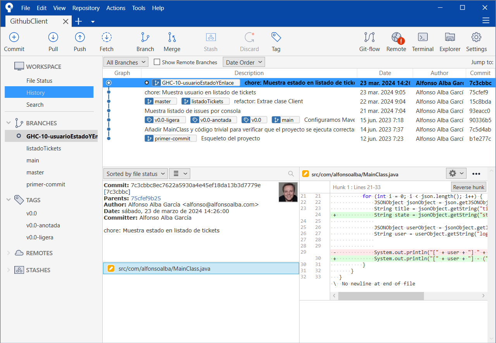

Como vemos, el repositorio sigue siendo una línea recta, es decir, una lista simplemente enlazada.

### Interrupción: Crear rama 

Llegados a este punto, nos interrumpen y nos comunican que a una compañera le está saltando una excepción al 
ejecutar la aplicación:

```java 
org.json.JSONException: A JSONArray text must start with '[' at 1 [character 2 line 1]
	at org.json.JSONTokener.syntaxError(JSONTokener.java:507)
	at org.json.JSONArray.<init>(JSONArray.java:109)
	at org.json.JSONArray.<init>(JSONArray.java:162)
	at com.alfonsoalba.Client.getJSONFromResponse(Client.java:35)
	at com.alfonsoalba.Client.getIssues(Client.java:30)
	at com.alfonsoalba.MainClass.main(MainClass.java:12)
A JSONArray text must start with '[' at 1 [character 2 line 1]
Exception in thread "main" org.json.JSONException: A JSONArray text must start with '[' at 1 [character 2 line 1]
	at org.json.JSONTokener.syntaxError(JSONTokener.java:507)
	at org.json.JSONArray.<init>(JSONArray.java:109)
	at org.json.JSONArray.<init>(JSONArray.java:162)
	at com.alfonsoalba.Client.getJSONFromResponse(Client.java:35)
	at com.alfonsoalba.Client.getIssues(Client.java:30)
	at com.alfonsoalba.MainClass.main(MainClass.java:12)
```
🤔 Tras depurar el error nos damos cuenta de que el problema se debe a que el *token* que está usando nuestro 
compañero no es válido. Imaginemos que este error es lo suficientemente crítico como para tener que detener el trabajo 
que estamos haciendo en la rama `GHC-10-usuarioEstadoYEnlace` y corregirlo. Creamos una tarea en Jira para trabajar en 
la correción del error, `GHC-11`.

Llegados a este punto necesitamos poder **cambiar de contexto**, es decir, poder pasar de la tarea `GHC-10` a la 
tarea `GHC-11` y viceversa. En estos cambios de contexto es donde las ramas de `git` resultan extremadamente potentes.

Antes de crear la rama, vamos a añadir un poco de contexto: 
- La rama `GHC-10-usuarioEstadoYEnlace` 
  está todavía sin terminar y no sabemos cuándo la terminaremos, por lo que esperar a que esta rama termine para resolver 
  el error y desplegarlo todo junto no es una opción
- Como consecuencia, debemos seleccionar una instantánea anterior sobre la que trabajar, corregir el error y desplegar. 
  ¿Qué instantánea seleccionamos? El sentido común nos indica que debe ser la última que está en producción 
- El puntero que nos indica qué instantánea está en producción es `master`, por lo que crearemos nuestra nueva rama 
  apuntando a la misma confirmación a la que apunta `master`

Como ves, para decidir dónde creo la rama nos hemos parado pensar qué queremos hacer (hemos 
respondido a la pregunta *¿qué queremos hacer con nuestra vida?* de la que hablamos en las diapositivas). Entiende la 
diferencia entre ese procedimiento y otras maneras de tomar la decisión como:
- pongo la rama en `master` porque es la más importante
- pongo la rama en `master` porque es la única que tengo 
- pongo la rama en `master` porque lo pone en `Stackoverflow` o me lo dijo un señor en un curso de `git` 

Seguramente en un caso tan sencillo como este te pueda parecer innecesario hacer toda esta reflexión para crear una 
rama. A medida que el curso se complique, o cuando salgas de estos talleres enlatados y te enfrentes a un repositorio 
real, verás que sabiendo qué quieres hacer, realizar las operaciones de `git` es más fácil y cometerás menos errores.

Creamos en `Sourcetree` la rama `GHC-11-verificaToken` a la misma altura que `master`. Para ello, hacemos clic usando 
el botón derecho sobre la confirmación a la que apunta `master` y en le menú contextual seleccionamos *Branch*:

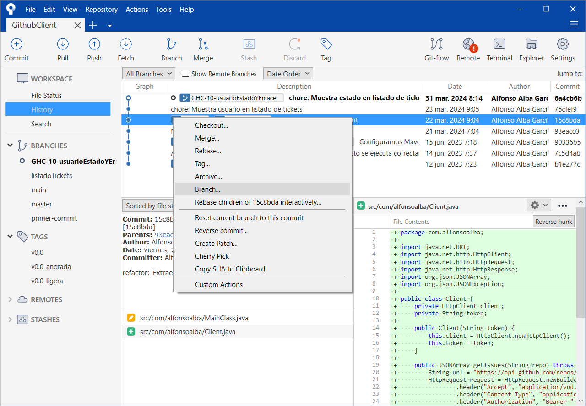

En el nombre de la rama introducimos  `GHC-11-verificaToken`, dejamos marcada la casilla *Checkout New Branch*, ya 
que en ese caso sí queremos que la nueva rama pase a ser la rama activa, y hacemos clic sobre *Create Branch*:

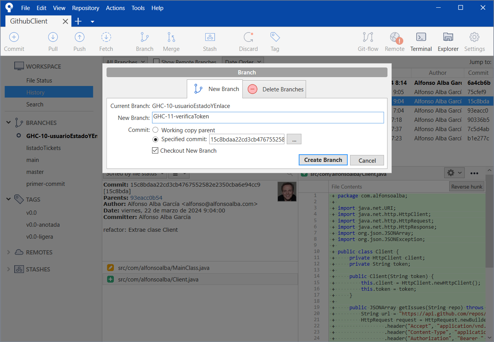

Una vez creada la rama, comprobamos que aparece una nueva referencia `GHC-11-verificaToken` que apunta a la 
confirmación `15c8bda` (al mismo sitio al que apunta `master`):

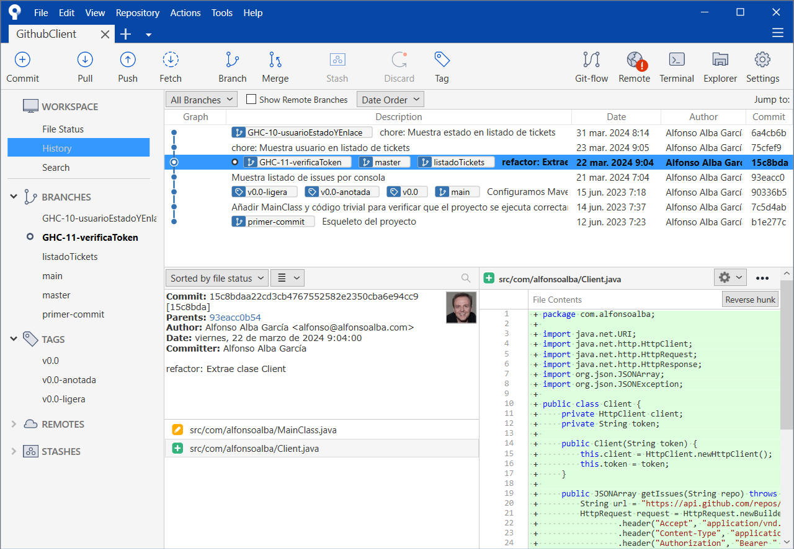

### Corregir el error 

El primer paso para corregir el error va a ser crear una nueva clase `InvalidTokenException` en `Eclipse` que 
utilizaremos para capturar el error y mostrar un mensaje por consola más amigable que el error que se muestra 
en este momento. 

En `Eclipse`, hacemos clic usando el botón derecho sobre el paquete `com.alfonsoalba`. En el menú contextual 
seleccionamos *New* -> *Class*:
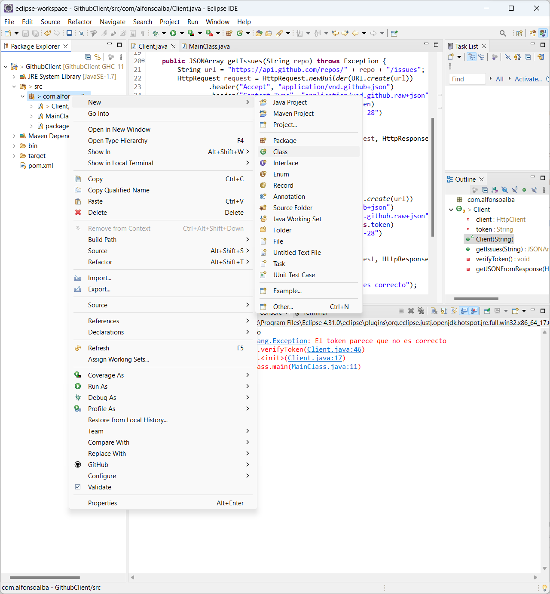

El nombre de la clase será `InvalidTokenException` y el nombre de la clase padre (campo `superclass`) será `Exception`:

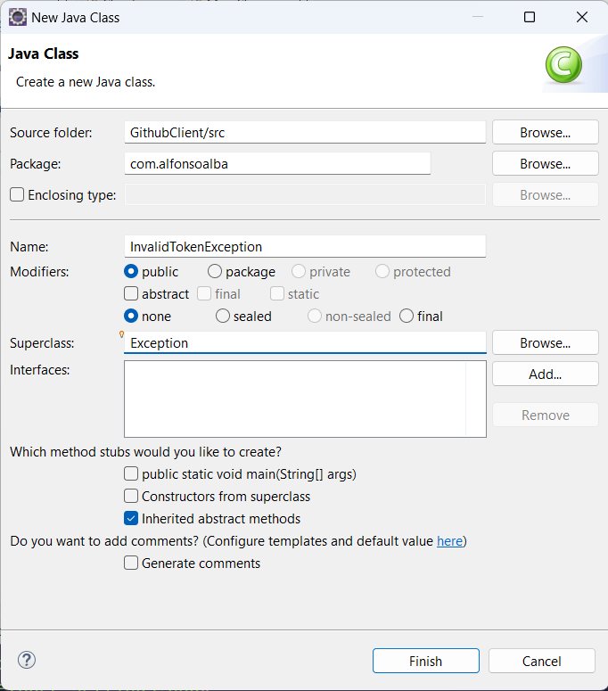

Editamos el fichero `src/com/alfonsoalba/InvalidTokenException.java` y añadimos el siguiente código:
```java 
// src/com/alfonsoalba/InvalidTokenException.java
package com.alfonsoalba;

public class InvalidTokenException extends Exception {
  public InvalidTokenException(String errorMessage) {
        super(errorMessage);
    }
}
```

Por otro lado, modificamos `Client.java` para que verifique el `token` antes de hacer cualquier cosa y lance 
esta nueva excepción si no es válido:

```java
// src/com/alfonsoalba/Client.java
package com.alfonsoalba;

import java.io.IOException;
import java.net.URI;
import java.net.http.HttpClient;
import java.net.http.HttpRequest;
import java.net.http.HttpResponse;
import org.json.JSONArray;
import org.json.JSONException;

public class Client {
  private HttpClient client;
  private String token;

  public Client(String token) throws InvalidTokenException, IOException, InterruptedException {
    this.client = HttpClient.newHttpClient();
    this.token = token;
    this.verifyToken();
  }

  public JSONArray getIssues(String repo) throws Exception {
    String url = "https://api.github.com/repos/" + repo + "/issues";
    HttpRequest request = HttpRequest.newBuilder(URI.create(url))
        .header("Accept", "application/vnd.github+json")
        .header("Content-Type", "application/vnd.github.raw+json")
        .header("Authorization", "Bearer " + token)
        .header("X-GitHub-Api-Version", "2022-11-28")
        .build();

    HttpResponse<String> response = client.send(request, HttpResponse.BodyHandlers.ofString());

    return getJSONFromResponse(response);
  }

  private void verifyToken() throws InvalidTokenException, IOException, InterruptedException {
    String url = "https://api.github.com/octocat/";
    HttpRequest request = HttpRequest.newBuilder(URI.create(url))
        .header("Accept", "application/vnd.github+json")
        .header("Content-Type", "application/vnd.github.raw+json")
        .header("Authorization", "Bearer " + this.token)
        .header("X-GitHub-Api-Version", "2022-11-28")
        .build();

    HttpResponse<String> response = client.send(request, HttpResponse.BodyHandlers.ofString());

    if (response.statusCode() == 401) {
      throw new InvalidTokenException("El token parece que no es correcto");
    }
  }
  
  private JSONArray getJSONFromResponse(HttpResponse<String> response) throws JSONException {
    try {
      return new JSONArray(response.body());
    } catch (JSONException e) {
      e.printStackTrace();
      throw e;
    }
  }
}
```

Finalmente, modificamos `MainClass.java` para capturar la excepción y mostrar el mensaje de error:
```java
// src/com/alfonsoalba/MainClass.java
package com.alfonsoalba;

import org.json.JSONArray;
import org.json.JSONObject;

public class MainClass {

  public static void main(String[] args) throws Exception {
    try {
      String token = System.getenv().get("GITHUB_PERSONAL_ACCESS_TOKEN");
      Client client = new Client(token);
      JSONArray json = client.getIssues("gradle/gradle");
      printIssues(json);
    } catch(InvalidTokenException e) {
      System.out.println(e.getMessage());
      System.exit(1);
    } catch(Exception e) {
      System.out.println(e.getMessage());
      throw e;
    }
  }
  
  private static void printIssues(JSONArray json) {
    for (int i = 0; i < json.length(); i++) {
      JSONObject jsonObject = json.getJSONObject(i);
      String title = jsonObject.getString("title");
      System.out.println("Title: " + title);
    }
  }
}
```

Si no lo hemos hecho ya, editamos la variable de entorno `GITHUB_PERSONAL_ACCESS_TOKEN` y ponemos `...` al principio 
para tener un `token` que no es válido. Ejecutamos la solución y verificamos que se muestra el mensaje
en lugar de la excepción:

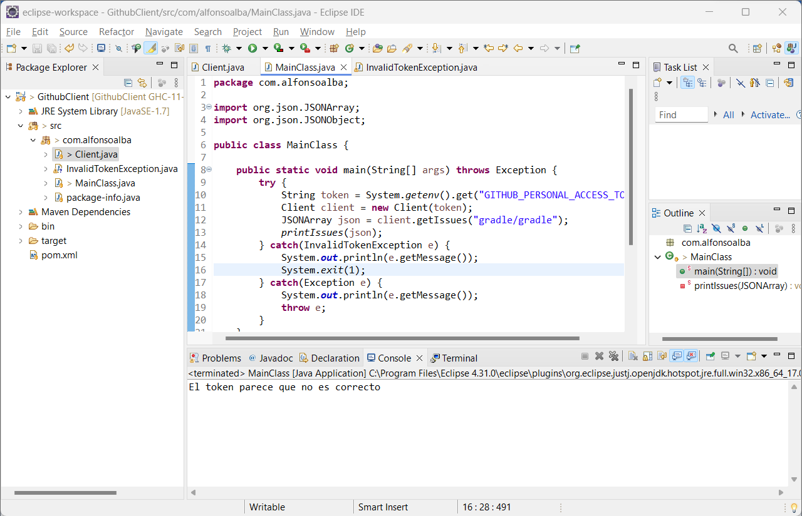

Vamos a confirmar los cambios. Volvamos a `Sourcetree` y hagamos clic sobre la sección *History* en el menú de la 
izquierda. Si observamos el log, vamos a ver varias cosas diferentes:

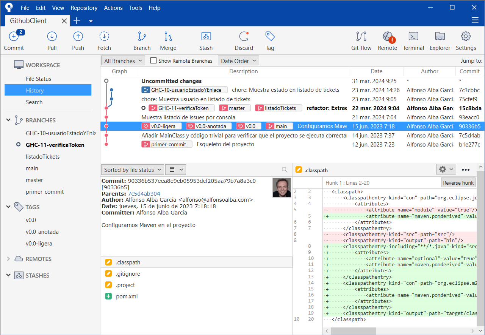

- En primer lugar, el color de algunos *commits* han cambiado de azul a rojo: puedes ignorarlo. `Sourcetree` utiliza 
  colores para ayudarte a navegar por el grafo usando diferentes colores cuando hay bifurcaciones en la estrucutura
  de datos. Esos cambios de color son muy confusos además, porque no son consistentes (es decir, lo que ahora se pinta 
  de rojo, de repente se pinta de azul o amarillo o verde si aparecen más bifurcaciones). Lo dicho, de momento lo 
  mejor es ignorar los colores 
- En segundo lugar, `Sourcetree` nos da una pista de qué va a pasar cuando confirmemos los cambios, es lo que nos 
  muestra en color gris usando ese *commit* con el comentario *Uncommitted changes*. También es una forma 
  que `Sourcetree` tiene de decirnos que hay cambios pendientes de confirmar en el área de trabajando

Vamos a confirmar los cambios. Hacemos clic en el menú de la izquierda en *File Status*. En la sección *Unstaged files*
hacemos clic sobre sobre *Stage All*. En el cuadro de diálogo para introducir el mensaje escribimos 
*chore: error legible si el token no es válido*:

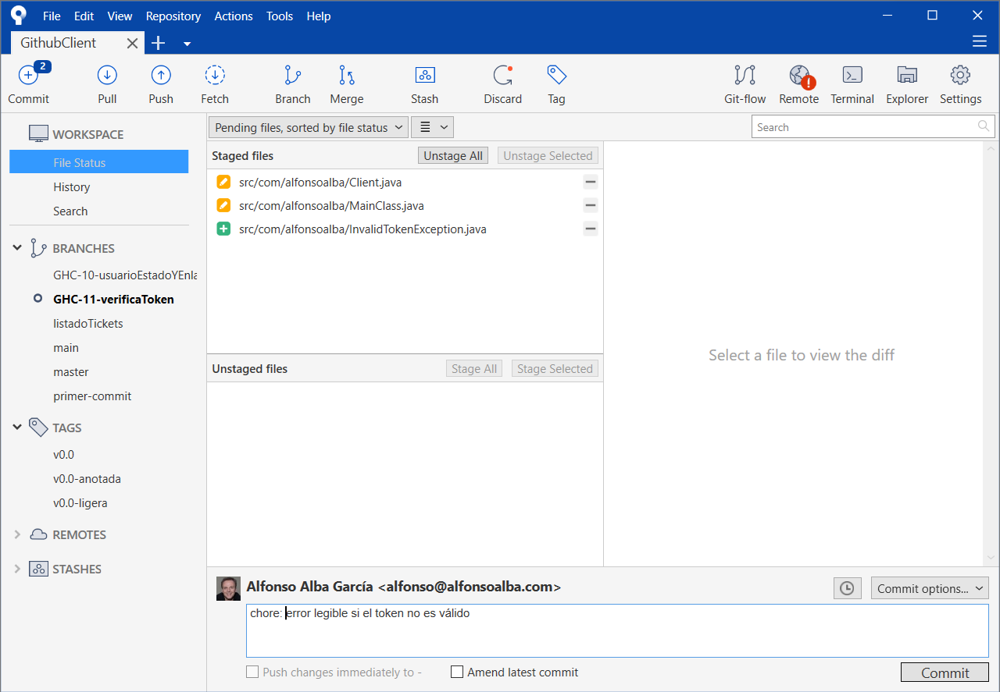

Hacemos clic sobre el botón *Commit* y confirmamos los cambios:

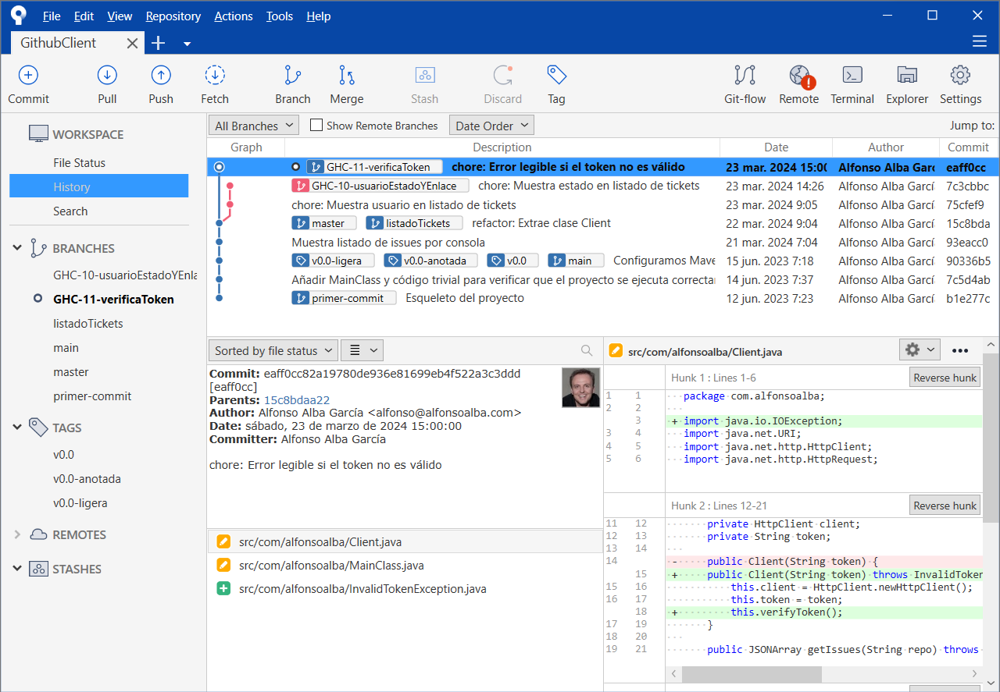

Tras confirmar los cambios, vemos que el respositorio ha dejado de ser una lista simplemente enlazada ya que ha 
aparecido una bifurcación en nuestra estructura de datos. Esta bifurcación no aparece por que creamos una rama,
sino porque **partiendo de un mismo código fuente, hemos confirmado dos modificaciones diferentes**.

Estamos listos para desplegar una nueva versión.

### Desplegar

Una vez corregido el error, vamos a desplegarlo. En este proyecto, el primer paso para desplegar es enviarle el 
ejecutable *al jefe* para que lo pruebe. Supongamos que recibimos luz verde para desplegar. Seguramente este 
procedimiento se pueda mejorar a medida que el proyecto avance, por ejemplo añadiendo tests automatizados, 
para evitar depender de que una persona haga estas pruebas. Veremos si llegamos a ese punto en algún momento.

El siguiente paso integrar en la rama `master` el código de la nueva versión, que está en  `GHC-11-verificaToken`. 
Queremos integrar en `master`, así que hacemos `master` la rama activa. en `Sourcetree`, hacemos doble clic sobre 
`master`:

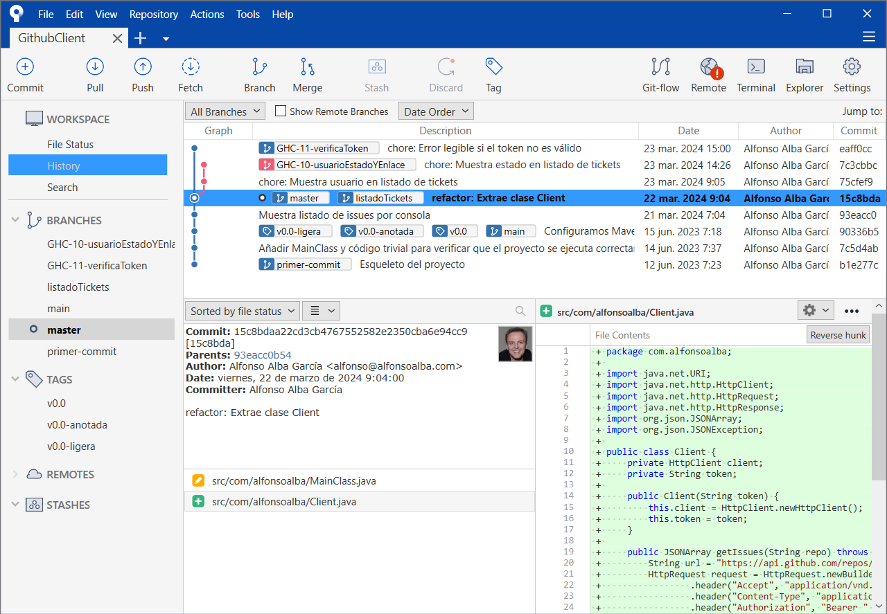

La rama que contiene el código que queremos integrar es `GHC-11-verificaToken`. Hacemos clic sobre el botón 
*Merge* en el menú superior y seleccionamos la rama que queremos integrar:

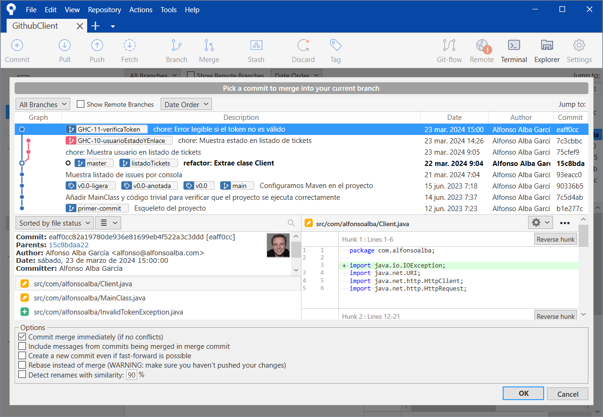

Tras hacer clic en *OK*, `git` hace un `fast-forward merge`:

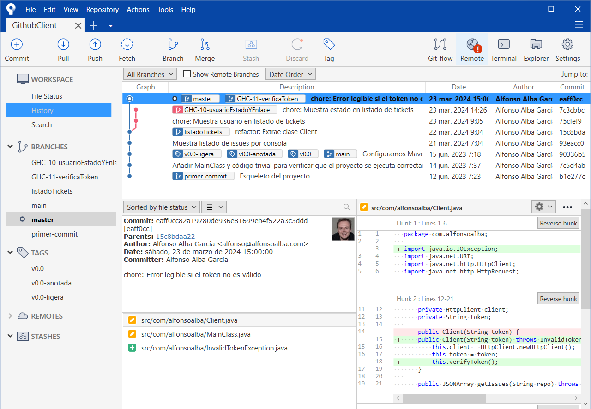

¡Ya podemos volver a la rama `GHC-10-usuarioEstadoYEnlace` y terminarla!

### Confirmar terceros cambios: mostrar URL del ticket

Nos encontramos ahora ante un dilema, así que es importante tener claro *qué queremos hacer con nuestra vida*: queremos 
terminar el trabajo que hemos empezado en `GHC-10-usuarioEstadoYEnlace` para desplegarlo. Podemos seguir dos caminos:
- Integrar el código que corrige el error (y que está en `master`) en nuestra rama `GHC-10-usuarioEstadoYEnlace`,
  añadir la URL y desplegar (integrarlo en `master`)
- Terminar la tarea mostrando la URL en la rama `GHC-10-usuarioEstadoYEnlace` y una vez terminada, desplegarlo 
  (integrarlo en `master`) donde el error ya está corregido 

En este caso, cualquiera de los dos caminos es válido. Podemos acabar discutiendo durante un buen rato sobre cuál es 
mejor, cuál nos gusta más, cuál pensamos que es el más *lógico* según nuestro sentido común. Con este contexto y 
para este código fuente, la verdad es que cualquiera de los dos caminos es válido. Daos cuenta de que he escrito 
*con este contexto y para este código fuente*, en otro contexto puede que uno de los dos caminos no sea el mejor 
o directamente no sea viable. Una vez más insisto en la importancia de *saber qué queremos hacer con nuestra vida* para 
decidir qué operaciones de `git` vamos a ejecutar.

Vamos a seguir el segundo camino. Antes de continuar, editamos la variable de entorno `GITHUB_PERSONAL_ACCESS_TOKEN`
y quitamos los `...` del `token` para que la aplicación muestre de nuevo el listado de tickets de `GitHub`.

En `Sourcetree`, nos aseguramos de que la rama activa es 
`GHC-10-usuarioEstadoYEnlace`. Mirando la 
[Documentación de la API de GitHub](https://docs.github.com/en/rest/issues/issues?apiVersion=2022-11-28), 
podemos ver la respuesta `JSON` y cómo extraer el enlace. Modificamos el fichero `src/com/alfonsoalba/MainClass.java`
e incluimos el código que muestra el enlace. 

En `Eclipse`, editamos el fichero `MainClass.java` y añadimos el enlace:

```java
// src/com/alfonsoalba/MainClass.java
package com.alfonsoalba;

import org.json.JSONArray;
import org.json.JSONObject;

public class MainClass {

  public static void main(String[] args) throws Exception {
    try {
      String token = System.getenv().get("GITHUB_PERSONAL_ACCESS_TOKEN");
      Client client = new Client(token);
      JSONArray json = client.getIssues("gradle/gradle");
      printIssues(json);
    } catch(Exception e) {
      System.out.println(e.getMessage());
      throw e;
    }
  }
  
  private static void printIssues(JSONArray json) {
    for (int i = 0; i < json.length(); i++) {
      JSONObject jsonObject = json.getJSONObject(i);
      String title = jsonObject.getString("title");
      String state = jsonObject.getString("state");
      String url = jsonObject.getString("url");

      JSONObject userObject = jsonObject.getJSONObject("user");
      String user = userObject.getString("login");


      System.out.println("[" + user + "] - (" + state + ") - " + title);
      System.out.println("\t" + url );
    }
  }
}
```

Ejecutamos la solución y verificamos que se muestra el enlace:

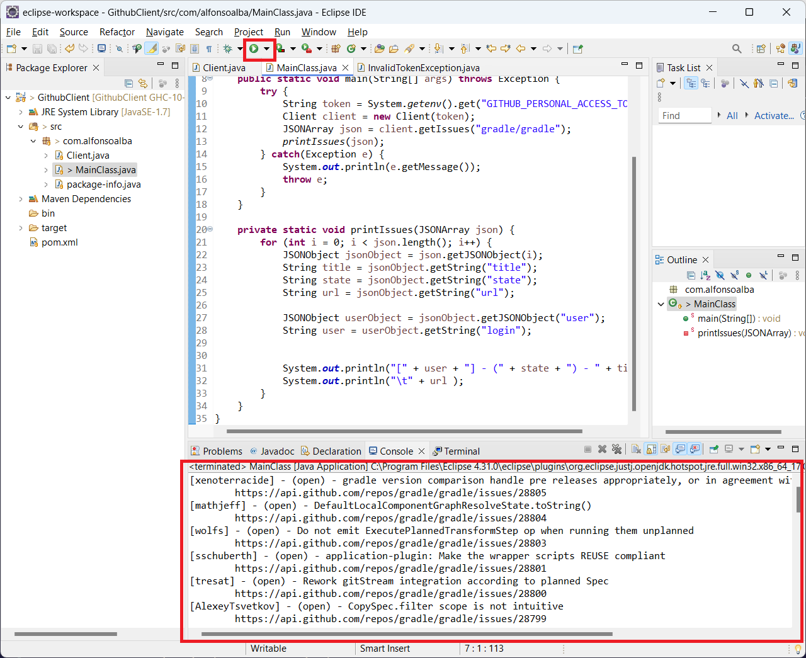

En `Sourcetree`, confirmamos los cambios con el mensaje *chore: Muestra enlace en listado de tickets*:

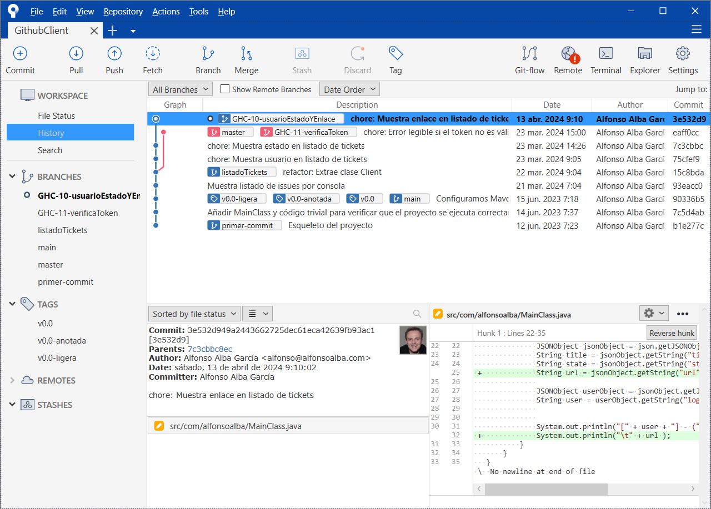

¡Estamos listos para desplegar `GHC-10`!

### Desplegar


Terminada la tarea `GHC-10`, vamos a desplegarla. En este proyecto, el primer paso para desplegar es enviarle el 
ejecutable *al jefe* para que lo pruebe. Supongamos que recibimos luz verde para desplegar. Tendremos que avisar 
al jefe de que en este ejecutable que le enviamos, se sigue mostrando una excepción en lugar de un mensaje 
cuando el `token` no es válido. Cuando pruebe la versión final a distribuir verá que todo funciona correctamente.

Dado que estamos desplegando, lo que queremos hacer es integrar `GHC-10-usuarioEstadoYEnlace` en `master`. 
Vamos a `Sourcetree` y hacemos `master` la rama activa:

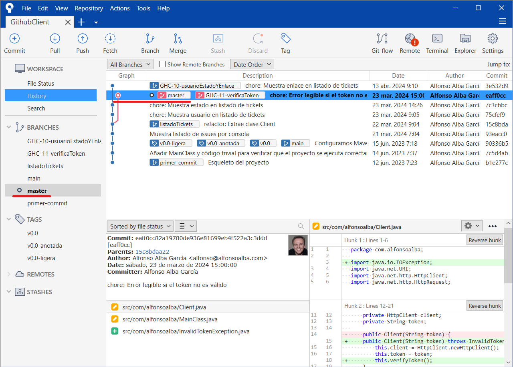

Hacemos clic sobre el botón *Merge* en el menú superior, seleccionamos la rama que queremos integrar en `master`, 
que es `GHC-10-usuarioEstadoYEnlace`:


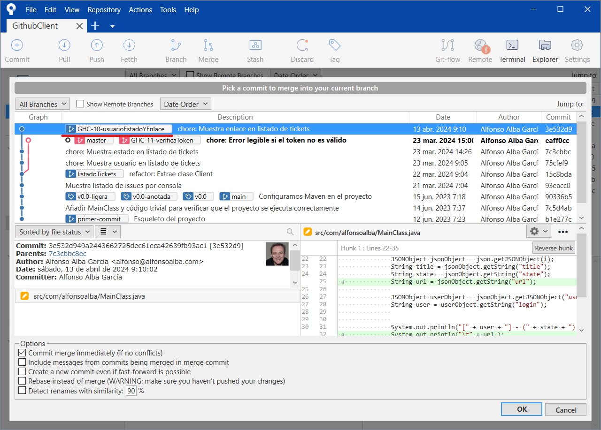

Al hacer clic sobre el botón *OK*, vemos que `git` ha creado un `merge commit` ya que este `merge` no 
era `fast-forward`:

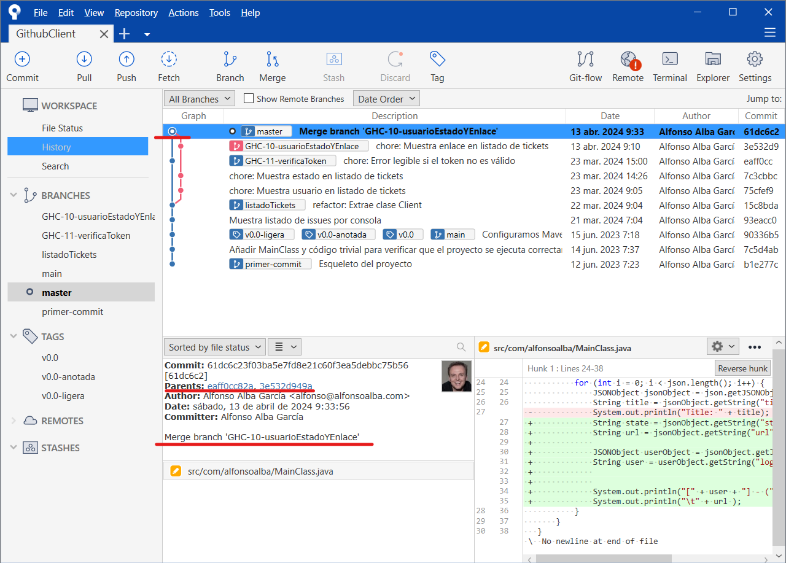

Si hacemos clic sobre el *merge commit* vemos que es un commit con la misma información que tienen los otros 
*commits*: nombre e email del autor, fecha, mensaje y *checksum* del *commit* anterior. La diferencia es que 
este tiene dos *commits* anteriores y el mensaje lo ha creado `git` sin preguntarnos.

Antes de distribuir el ejecutable a los usuarios, se lo enviaríamos *al jefe* para que hiciese un último chequeo 
de que todo funciona correctamente. 


