# Taller 3.8 (version Java con Eclipse): Resolución de conflictos durante `git merge`

## Índice

* This will become a table of contents (this text will be scrapped).
{:toc}

## Descargas 
- Antes del taller: [java/GithubClient-taller-3-8-inicio.zip &#x1F4E5; ](../talleres/zipfiles/java/GithubClient-taller-3-8.zip)
- Ejercicio finalizado: [java/GithubClient-taller-3-8.zip &#x1F4E5; ](../talleres/zipfiles/java/GithubClient-taller-3-8.zip)

## Requisitos



Descarga e importa el proyecto `java/GithubClient-taller-3-8-inicio.zip`  en 
`Eclipse`. A diferencia de los talleres anteriores, que empezaban donde terminaba un taller 
anterior, en este taller partimos de un repositorio que ya contiene las ramas y el código 
con el que vamos a trabajar. ([Descargar fichero](../talleres/zipfiles/java/GithubClient-taller-3-8-inicio.zip)).


## Qué vamos a hacer

Queremos desplegar las ramas `GHC-12-extraePrintIssues` y la rama `GHC-13-usaColorEnListadoDeTickets` que se muestran a continuación:

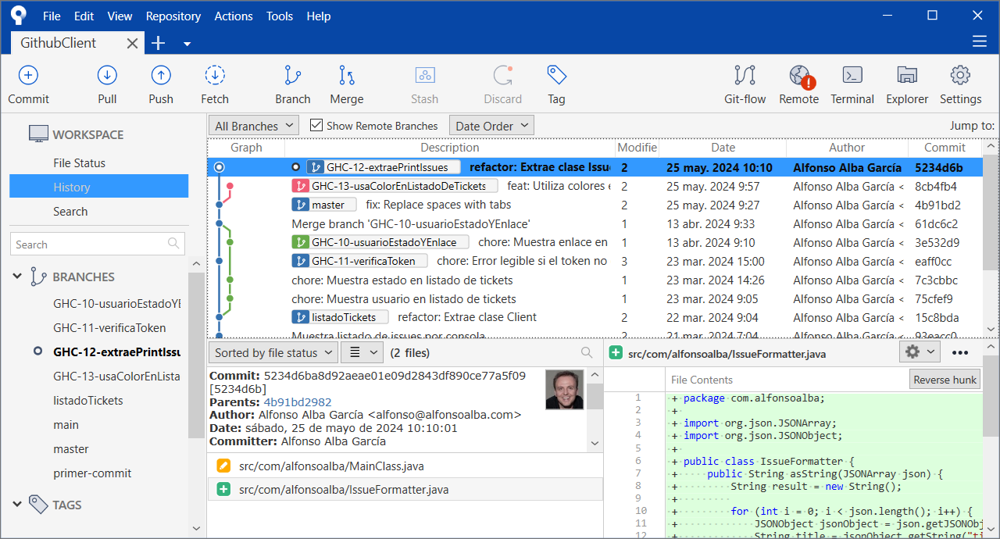

Al hacer las integraciones, tendremos conflictos que deberemos resolver. ¿Por qué tendremos conflictos? Si miras el código, verás que en la rama `GHC-13-usaColorEnListadoDeTickets`
se modifica el código de la función privada `printIssues` mientras que en la rama `GHC-12-extraePrintIssues` esa función se extrae a una clase.

## Objetivos

Aprender a resolver conflictos durante un `merge` de ramas.

## Convenios

Seguiremos los mismos convenios sobre ramas que utilizamos en el 
[taller 3.7](). 

## Despliegues

Seguiremos el mismo procedimiento de despliegue que describimos en el 
[taller 3.7](). 

## Utilizando `Sourcetree` 

### ¿Qué queremos hacer?

Utilizaremos las preguntas para guiarnos en el proceso. Recuerda que lo más 
importante al utilizar `git` es saber qué quieres hacer ya que dependiendo de 
la respuesta a esa pregunta y el contexto, ejecutarás unos comandos u otros. 

La primera pregunta que tenemos que responder es *¿Qué quiero hacer con mi vida?* La
respuesta a esa pregunta es *desplegar las ramas `GHC-12-extraePrintIssues` y
`GHC-13-usaColorEnListadoDeTickets`*.

La siguiente pregunta es *¿En qué rama quiero integrar?*. Recordamos que para desplegar en 
este proyecto debemos integrar en `master` y luego subir el código por FTP. La respuesta a 
la pregunta es `master`, queremos integrar en la rama `master`, así que hacemos 
`master` la rama activa haciendo doble clic sobre ella:

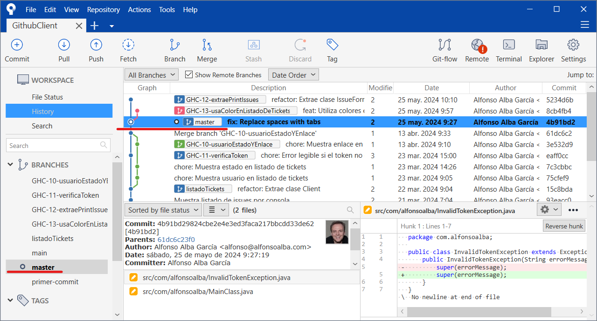

La siguiente pregunta es *¿Dónde está el código que queremos integrar?* En este caso,
la respuesta a la pregunta es que el código que queremos integrar en `master` está en 
`GHC-12-extraePrintIssues` y en `GHC-13-usaColorEnListadoDeTickets`, 
**lo que significa que tendremos que integrar dos veces**.

### Integrando `GHC-12-extraePrintIssues`

Empezamos por integrar la rama `GHC-12-extraePrintIssues`. Siguiendo las mismos 
pasos que en talleres anteriores, hacemos clic sobre el botón *Merge* de `Sourcetree`
y seleccionamos la rama `GHC-12-extraePrintIssues`:

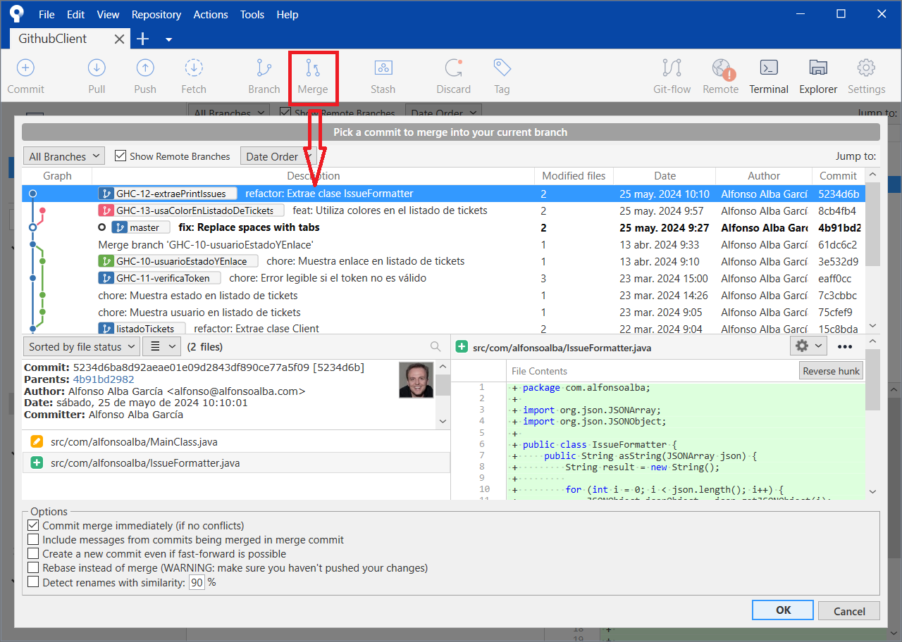

Hacemos clic en el botón `Ok` para integrar. Se trata de un *fast-forward merge* por lo que la rama `master` pasará a apuntar 
a la misma confirmación a la que apunta `GHC-12-extraePrintIssues`:

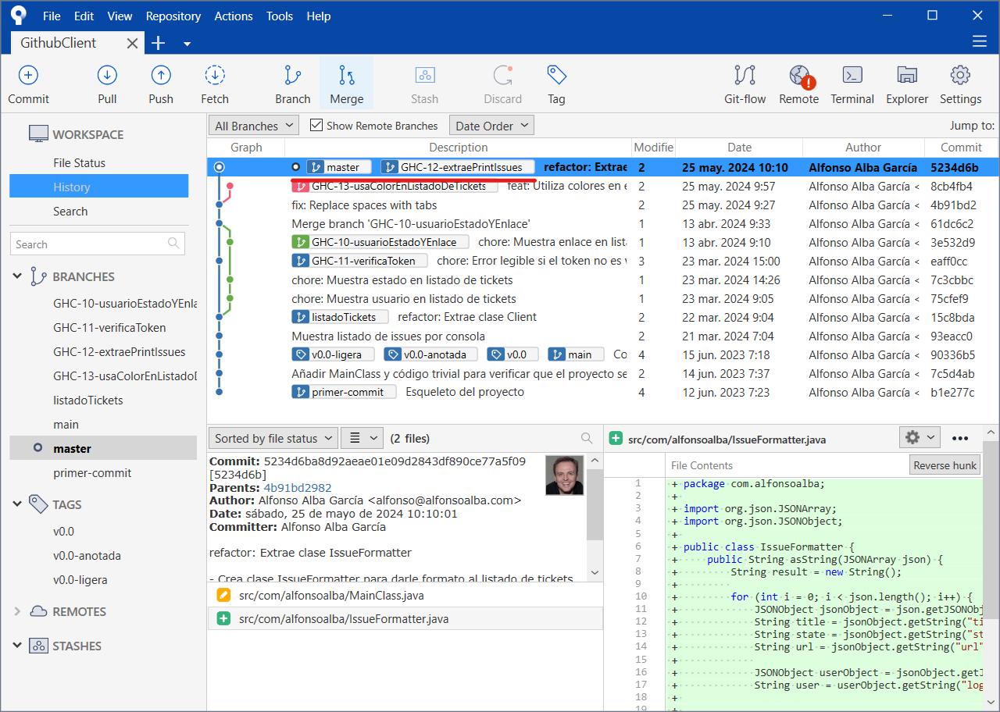

### Integrando la rama `GHC-13-usaColorEnListadoDeTickets`

Realizada la primera integración, nos preguntamos si hemos conseguido lo que queríamos 
conseguir con nuestra vida. Lo que queríamos conseguir era 
*desplegar las ramas `GHC-12-extraePrintIssues` y `GHC-13-usaColorEnListadoDeTickets`*, 
así que todavía no hemos terminado. Nos falta integrar la rama `GHC-13-usaColorEnListadoDeTickets`. ¡Vamos a ello!

Volvemos a preguntarnos *¿En qué rama quiero integrar?*. La respuesta a esta pregunta sigue 
siendo `master` porque lo que quiero hacer con mi vida es desplegar, y para desplegar en este 
proyecto hay que integrar en `master` y subir el código por FTP. Nos aseguramos de que 
`master` sigue siendo la rama activa antes de continuar. Si no lo es, hacemos doble clic sobre 
ella.

Por último, nos preguntamos *¿En qué rama está el código que quiero integrar?*. La respuesta 
a esta pregunta es `GHC-13-usaColorEnListadoDeTickets`. Hacemos clic sobre el  
botón *Merge* y seleccionamos la rama `GHC-13-usaColorEnListadoDeTickets`:


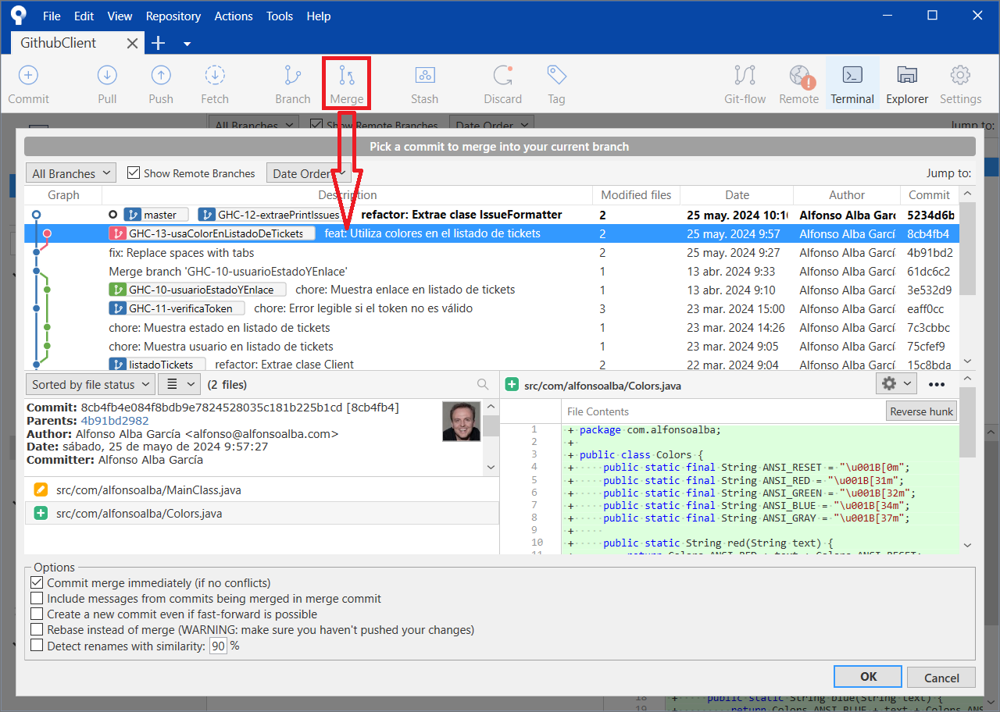

Al darle al botón *Ok*, `Sourcetree` nos indicará que `git` no ha podido hacer 
la operación porque ha encontrado conflictos:

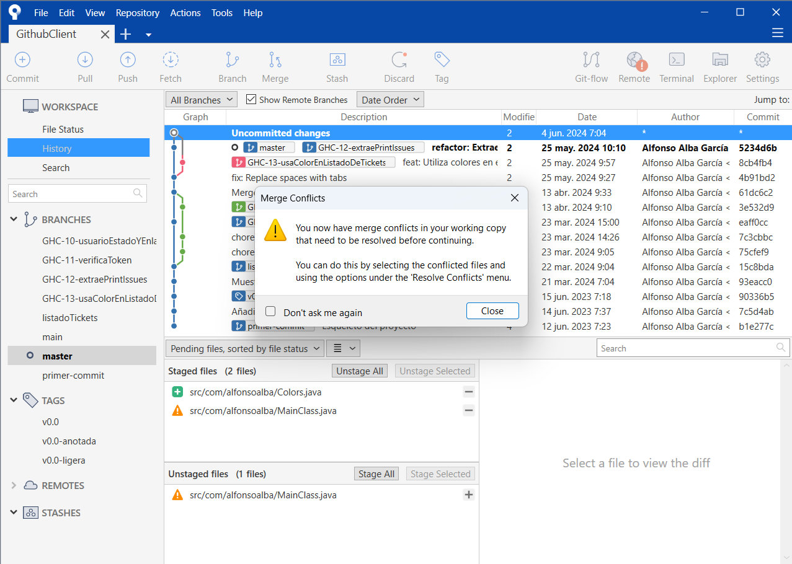

Hacemos clic sobre *Close*. `Sourcetree` nos muestra que hemos tenido conflictos al hacer la integración:
- En el grafo, vemos que aparece el *merge commit* en gris y en la descripción se indica *Uncommitted changes*
- Los ficheros con conflictos se muestran tanto en el área de ensayo como en el área de trabajo con un icono de 
  peligro (⚠️)

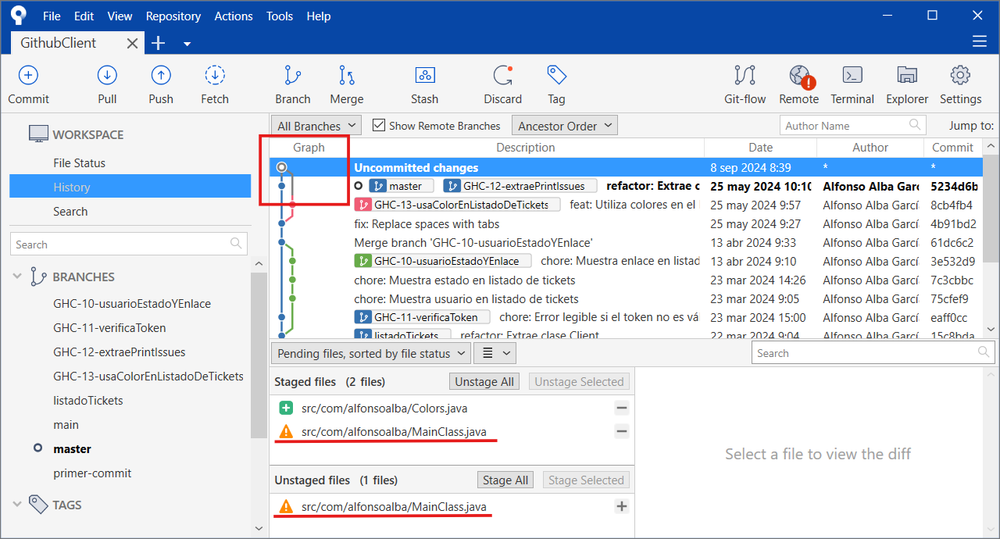

### Resolviendo los conflictos

Como mostramos en las diapositivas, necesitamos mezclar el código de aquellas partes del fichero que `git` no pudo 
mezclar. Abrimos el fichero `src\com\alfonsoalba\MainClass.java` en Eclipse y veremo en la parte inferior el 
cómo git nos ha marcado los conflictos:


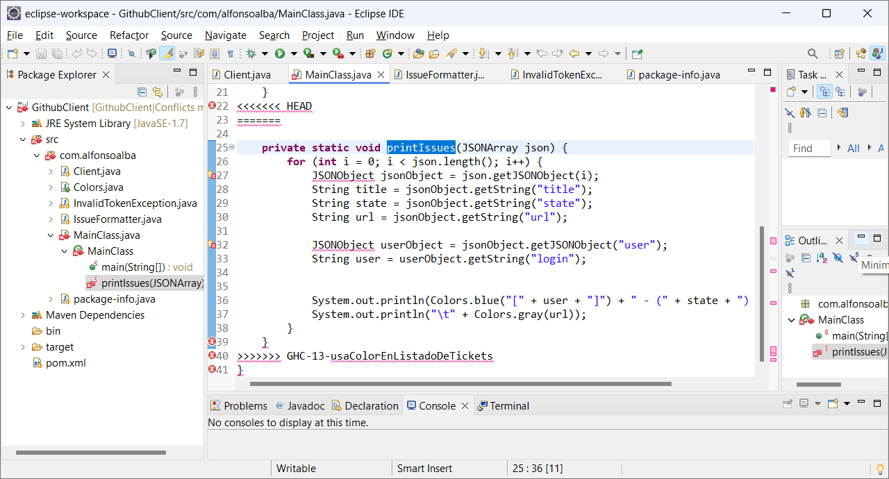

Lo que git nos está diciendo es que en esa sección del fichero, en la rama activa (`HEAD`) no hay nada:

```text
<<<<<<< HEAD
=======
```

mientras que en la rama `GHC-13-usaColorEnListadoDeTicket` en esa misma parte del fichero, teníamos este código:

```text
=======
	
	private static void printIssues(JSONArray json) {
		for (int i = 0; i < json.length(); i++) {
			JSONObject jsonObject = json.getJSONObject(i);
			String title = jsonObject.getString("title");
			String state = jsonObject.getString("state");
			String url = jsonObject.getString("url");
			
			JSONObject userObject = jsonObject.getJSONObject("user");
			String user = userObject.getString("login");


			System.out.println(Colors.blue("[" + user + "]") + " - (" + state + ") - " + title);
			System.out.println("\t" + Colors.gray(url));
		}
	}
>>>>>>> GHC-13-usaColorEnListadoDeTickets
```

Efectivamente, si miramos los últimos cambios confirmados en la rama `GHC-12-extraePrintIssues`, vemos que ese es 
el código que se movió a la clase `src/com/alfonsoalba/IssueFormater.java`:


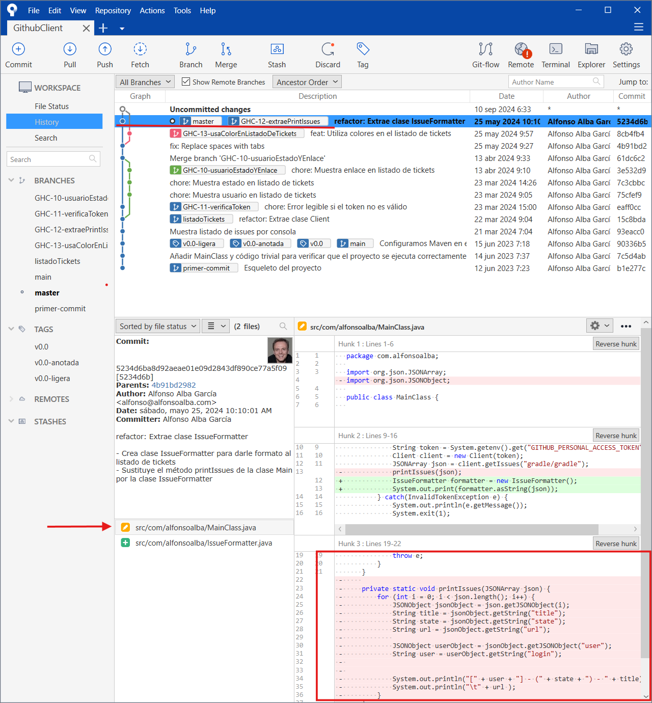

La forma de resolver el conflicto entonces sería dejar esta parte del fichero en blanco, ya que ese es el código 
que se movió a la clase `IssueFormater` (la flecha indica el código que hemos borrado):


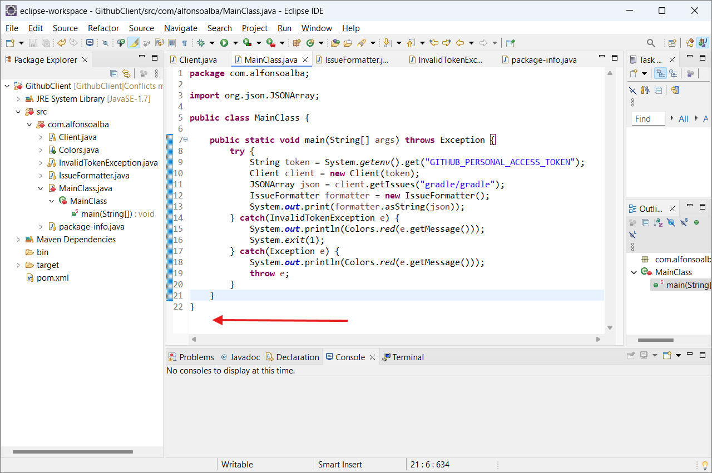

Hecho esto, podemos marcar los conflictos como resueltos. Tenemos dos opciones para hacerlo:
- Subir el fichero `MainClass.java` al área de ensayo
- Hacer clic con el botón derecho sobre `MainClass.java` y utilizar el menú contextual para marcarlo como resuelto 


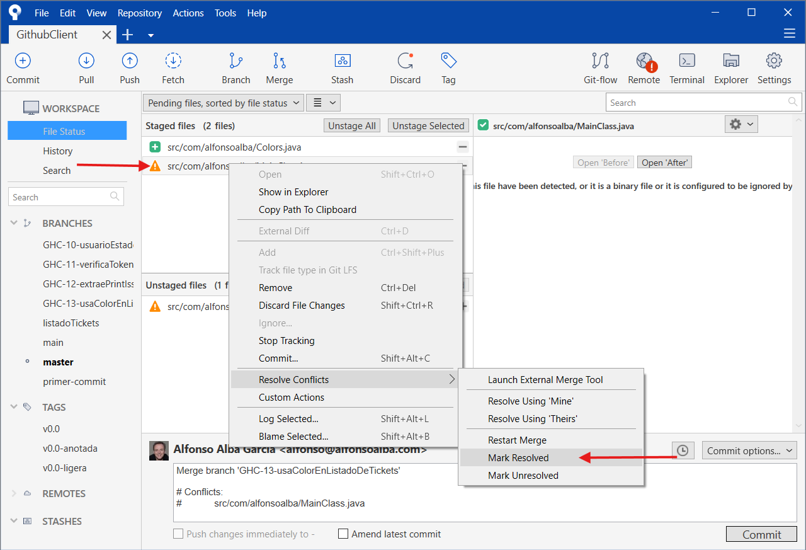
Al marcarlo como resuelto, `Sourcetree` nos dice que `git` no encontró ningún fichero más con conflictos:


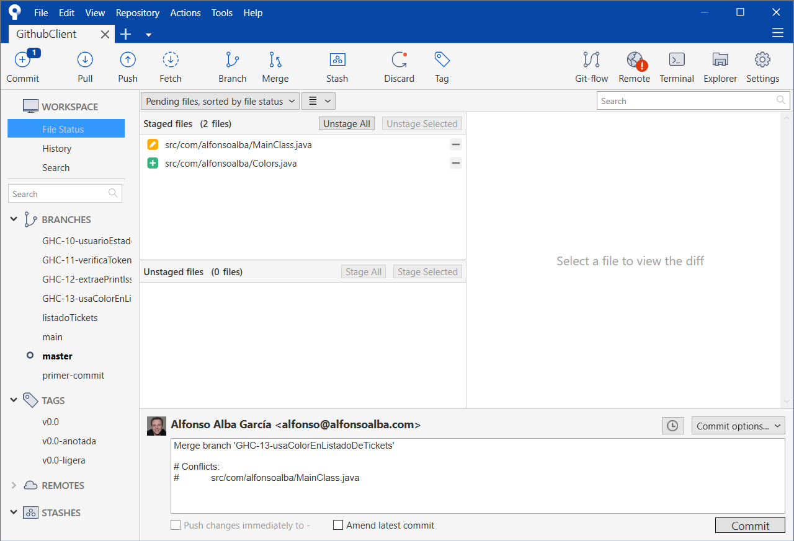

A pesar de lo que dice `git` ¿hemos terminado de resolver los conflictos? Antes de continuar vamos a detenernos un minuto 
para responder a esta pregunta...
🤔 

🤔 

🤔 

🤔 

🤔 

🤔 

🤔 

🤔 

🤔 

🤔 

🤔 

La respuesta es que no, `git` no nos está avisando de que **acabamos de borrar los colores en la salida del 
método  `IssueFormatter#asString()`**:


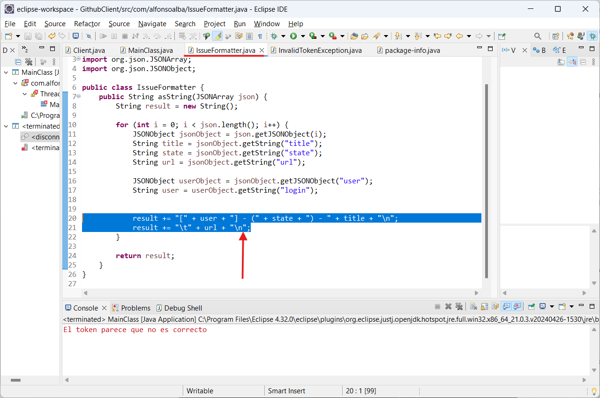
Editamos las líneas 20 y 21 del fichero `IssueFormatter.class` y añadimos el color al texto 
que devuelve el método:

```java
			result += Colors.blue("[" + user + "] - (" + state + ") - " + title + "\n");
			result += "\t" + Colors.gray(url) + "\n";
```

Compilamos y ejecutamos la aplicación para comprobar que sigue funcionando.
**Ahora sí hemos terminado de resolver el conflicto**.
Volvemos a `Sourcetree` y subimos los cambios 
en el fichero `IssueFormatter.class` al área de ensayo.

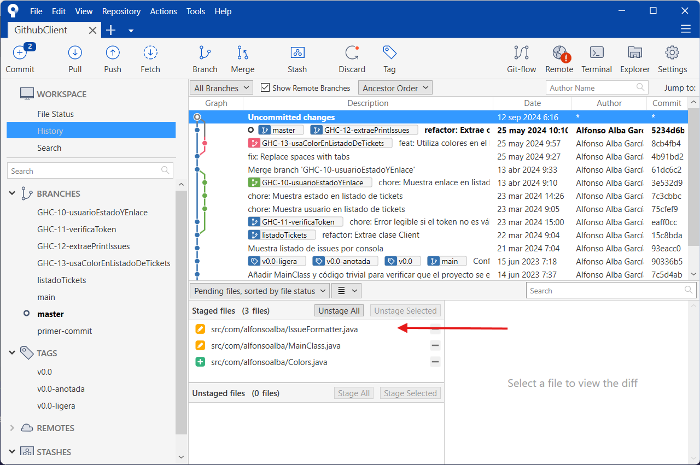

### Confirmamos los cambios

Una vez hemos resuelto los conflictos, lo último que nos queda por hacer es confirmar los 
cambios. Recuerda que `git` se quedó a medias y no pudo confirmarlos porque no sabía como 
mezclar las instantáneas. Tras mezclarlas nosotros y verificar que la aplicación funciona, podemos terminar la integración. Hacemos clic sobre el botón *commit* y vemos en la parte 
inferior que al mensaje estándar que `git` utiliza para el *merge commit*, `git` ha 
añadido los ficheros en los que encontró conflictos:


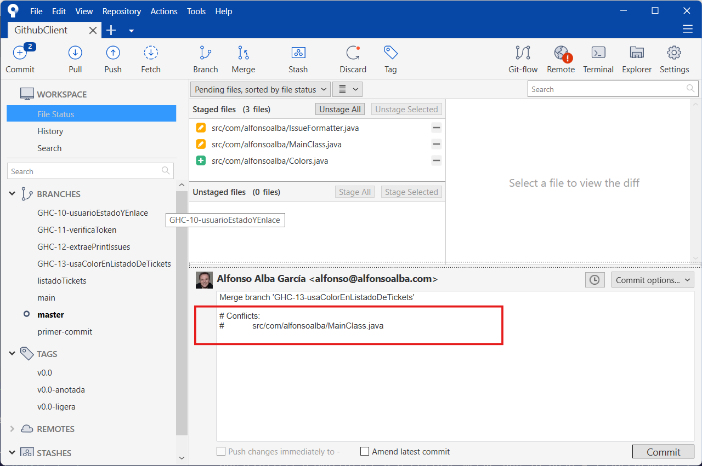

Como comentaremos en las diapositivas, la resolución de conflictos es el proceso más
delicado cuando trabajamos con `git`. En este ejemplo hemos visto cómo si no 
hubiésemos tenido cuidado, habríamos eliminado parte de una funcionalidad. Guardando
en el mansaje los ficheros en los que hubo conflictos, `git` de alguna manera nos 
está diciendo por dónde podemos empezar a mirar si en el futuro nos damos cuenta de que
ha habido un problema durante la resolución de conflictos.

Continuando con el taller, `Sourcetree` nos da la opción de modificar el mensaje por defecto que se genera. 
En este caso lo mantendremos como está, y haremos clic sobre el botón *commit* para terminar
de confirmar los cambios:


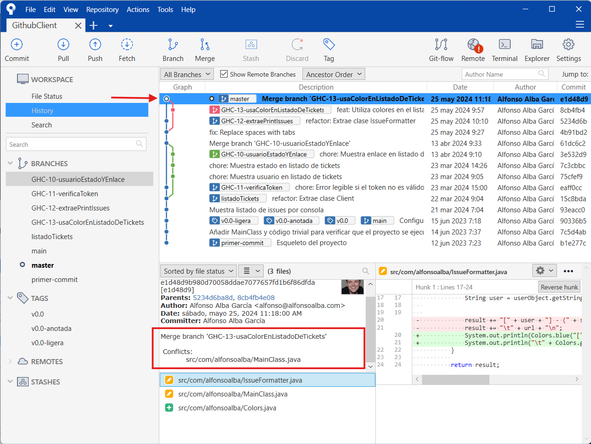

Como en las integraciones anteriores, `git` hace la instantánea del código (que hemos
preparado nosotros resolviendo los conflictos), le añade los datos, guarda
los objetos de `git` en la carpeta `.git/objects` y mueve la rama activa (`master`).

## Utilizando la consola
