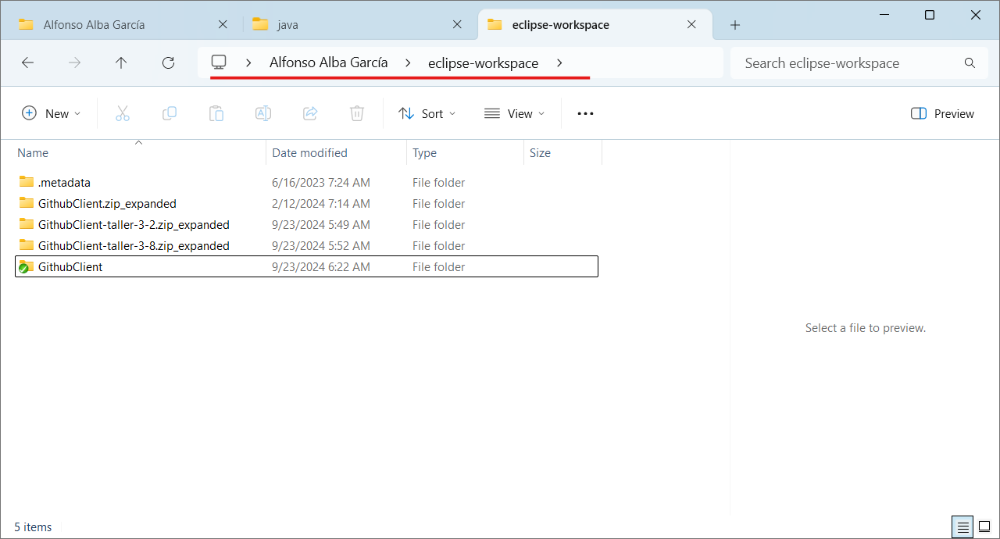
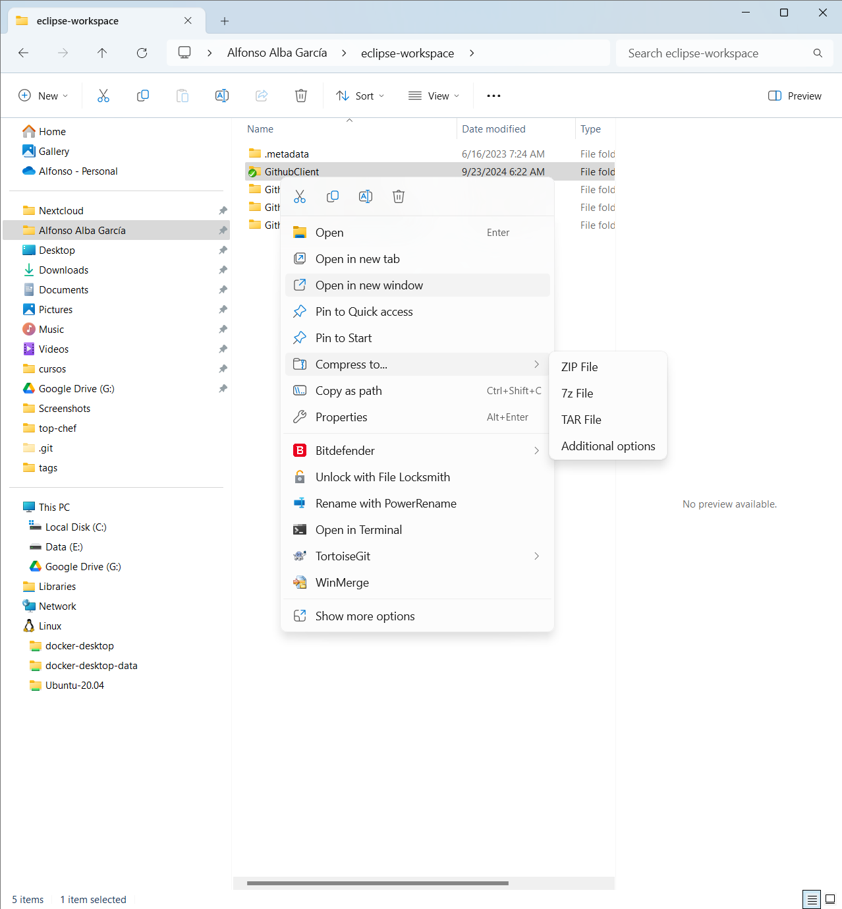

# Taller 4.1 (version Java con Eclipse): Copia de seguridad

## Índice

* This will become a table of contents (this text will be scrapped).
{:toc}

## Descarga 
- [java/GithubClient-taller-3-8.zip &#x1F4E5; ](../talleres/zipfiles/java/GithubClient-taller-3-8.zip)

## Requisitos

Este taller es continuación del taller 
[Taller 3.8: crear etiquetas y ramas]().

Es necesario haber completado el 
[taller 3.8]() para poder realizar 
este taller. Puedes importar el proyecto `java/GithubClient-taller-3-8.zip`  en 
`Eclipse` y partir de él para hacer este taller ([descargar fichero](../talleres/zipfiles/java/GithubClient-taller-3-8.zip)).

## Qué vamos a hacer 

## Objetivos
- Hacer una copia de seguridad del repositorio para poder romperlo con tranquilidad

## Convenios

Seguiremos los mismos convenios sobre ramas que utilizamos en el 
[taller 3.7](). 

## Despliegues

No hay despliegues en este taller.

## Realizar copia de seguridad

Abrimos el espacio de trabajo de `Eclipse` en el navegador de archivos de Windows. Si estás utilizando la configuración
por defecto, el espacio de trabajo se encontrará en `$HOME/eclipse-workspace`. Depende de qué tengas en `Eclipse`
y de los proyectos en los que trabajes usando ese IDE, la siguiente captura puede no parecerse en nada a lo que tú
veas:

Las carpetas con extensión `.zip_expanded` son resultado de la importación de los proyectos de eclipse archivados
en otros talleres.

Localiza en el espacio de trabajo cuál es la carpeta que contiene to proyecto de `Eclipse`. En mi caso es la carpeta
`GithubClient` que está seleccionada en la captura anterior. Cierra eclipse y, haciendo clic sobre la carpeta 
selecciona la opción *Comprimir A -> Archivo ZIP*:

Moveremos el fichero `zip` a nuestra carpeta de usuario. Lo necesitaremos más tarde para restaurar el repositorio.
