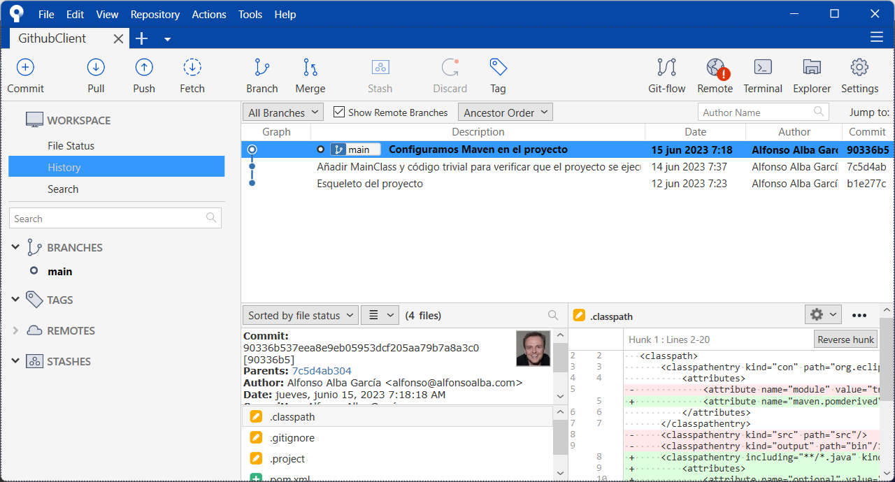
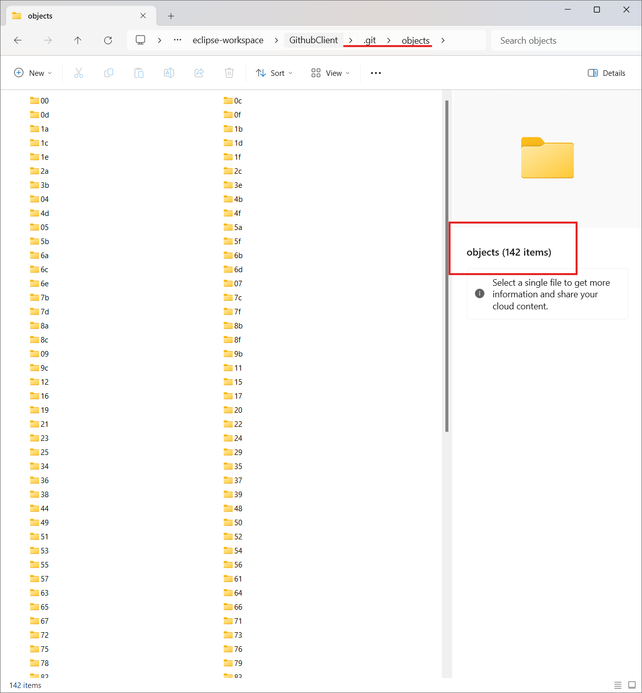

# Taller 4.2 (version Java con Eclipse): Borrando el grafo

## Índice

* This will become a table of contents (this text will be scrapped).
{:toc}

## Descarga 
- [java/GithubClient-taller-4-2.zip &#x1F4E5; ](../talleres/zipfiles/java/GithubClient-taller-4-2.zip)

## Requisitos

Este taller es continuación del taller 
[Taller 4.1: Copia de seguridad]().

Es recomendable haber completado el 
[taller 4.1]() y tener la copia de seguridad de tu repositorio 
antes de comenzar este taller.

## Qué vamos a hacer 

Borrar todas las referencias excepto una.

## Objetivos
- Ver cómo a medida que borramos las ramas del repositorio, *dejamos de ver* parte del grafo.
- Entender que aunque no *veamos el grafo*, las confirmaciones de cambios y, en general todos los objetos de
  `git` siguen en la carpeta `.git/objects`

## Convenios

Seguiremos los mismos convenios sobre ramas que utilizamos en el 
[taller 3.7](). 


## Despliegues

No hay despliegues en este taller.

## Usando `Sourcetree`

Vamos a borrar todas las referencias, excepto una: la rama `main`. Como vimos en las diapositivas, `git` no puede 
borrar la rama activa, por lo que hacemos *checkout* de  `main` (la rama que no queremos borrar) y usando `Sourcetree`
borramos el resto de las ramas y todas las etiquetas. Será necesario forzar el borrado de todas las
ramas excepto `primer-commit`. Cuando hayamos terminado, este será el aspecto de nuestro
repositorio:


¿Hemos perdido el repositorio? No, nuestra historia (todos los cambios que hemos confirmados hasta ahora)
sigue estando en la carpeta `.git/objects`:



Nuestros cambios están ahí, sigen en la carpeta `.git/objects`, pero no podemos verlos porque hemos borrado 
las referencias. Si recordamos cómo `Sourcetree` dibuja el grafo, el único punto entrada
es la rama `main`, así que sólo vemos las confirmaciones de cambios
a las que podemos llegar desde esa rama.

En el siguiente taller veremos cómo recuperarlo.


## Usando la consola

Vamos a borrar todas las referencias, excepto una: la rama `main`. Como vimos en las diapositivas, `git` no puede 
borrar la rama activa, por lo que hacemos *checkout* de  `main` (la rama que no queremos borrar):

```shell
$ git switch main
```

A continuación, borramos todas las ramas que no están integradas en `main` usando la opción `-D`, que fuerza
el borrado de las ramas:

```shell
$ git branch -D master \
GHC-13-usaColorEnListadoDeTickets \
GHC-12-extraePrintIssues \
GHC-11-verificaToken \
GHC-10-usuarioEstadoYEnlace \
listadoTickets

Deleted branch master (was e1d48d9)
Deleted branch GHC-13-usaColorEnListadoDeTickets (was 8cb4fb4).
Deleted branch GHC-12-extraePrintIssues (was 5234d6b).
Deleted branch GHC-11-verificaToken (was eaff0cc).
Deleted branch GHC-10-usuarioEstadoYEnlace (was 3e532d9).
Deleted branch listadoTickets (was 15c8bda).
```

Borramos a hora la rama `primer-commit`, que al estar ya integrada en la rama `main`, podemos borrar sin
forzar el borrado usando la opción `-d`:

```shel
$ git branch -d primer-commit
Deleted branch primer-commit (was b1e277c).
```

Por ultimo, borramos las etiquetas:

```shell
$ git tag -d v0.0 v0.0-anotada  v0.0-ligera
Deleted tag 'v0.0' (was e000cf7)
Deleted tag 'v0.0-anotada' (was 38cda6b)
Deleted tag 'v0.0-ligera' (was 90336b5)
```
Cuando hayamos terminado, este será el aspecto de nuestro repositorio:

```shell
$ $ git log --graph --oneline

* 90336b5 (HEAD -> main) Configuramos Maven en el proyecto
* 7c5d4ab Añadir MainClass y código trivial para verificar que el proyecto se ejecuta correctamente
* b1e277c Esqueleto del proyecto
```

¿Hemos perdido el repositorio? No, nuestra historia (todos los cambios que hemos confirmados hasta ahora)
sigue estando en la carpeta `.git/objects`:

```shell
$ ls .git/objects

00/  15/  20/  35/  4b/  57/  6a/  78/  87/  9b/  ad/  c6/  d8/  e9/  info/
04/  16/  21/  36/  4d/  5a/  6b/  79/  88/  9c/  b0/  c9/  db/  ea/  pack/
05/  17/  22/  37/  4f/  5b/  6c/  7b/  8a/  a1/  b1/  cb/  dd/  ef/
07/  19/  23/  38/  50/  5f/  6d/  7c/  8b/  a2/  b4/  cc/  e0/  f3/
09/  1a/  24/  39/  51/  61/  6e/  7d/  8c/  a3/  b6/  ce/  e1/  f5/
0c/  1b/  25/  3b/  52/  63/  71/  7f/  8f/  a4/  b8/  cf/  e2/  f8/
0d/  1c/  29/  3e/  53/  64/  72/  82/  90/  a5/  ba/  d1/  e4/  f9/
0f/  1d/  2a/  44/  54/  65/  73/  83/  93/  a8/  c1/  d3/  e5/  fa/
11/  1e/  2c/  48/  55/  66/  75/  84/  96/  a9/  c4/  d4/  e6/  fb/
12/  1f/  34/  49/  56/  67/  76/  86/  98/  ac/  c5/  d6/  e8/  ff/

$ du -sh .git/objects
319K    .git/objects/
```

Nuestros cambios están ahí, sigen en la carpeta `.git/objects`, pero no podemos verlos porque hemos borrado 
las referencias. Si recordamos cómo `Sourcetree` dibuja el grafo, el único punto de entrada
es la rama `main`, así que sólo vemos las confirmaciones de cambios
a las que podemos llegar desde esa rama.

En el siguiente taller veremos cómo recuperarlo.

