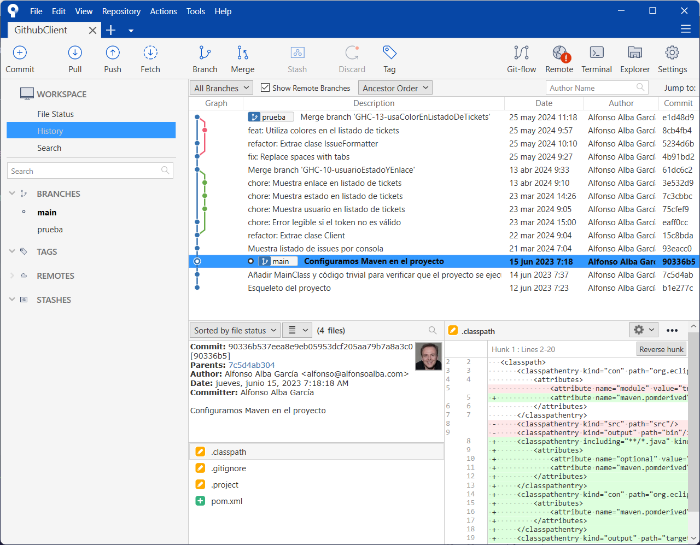

# Taller 4.3 (version Java con Eclipse): Recuperando el grafo usando el `reflog`

## Índice

* This will become a table of contents (this text will be scrapped).
{:toc}

## Descarga 
- [java/GithubClient-taller-4-3.zip &#x1F4E5; ](../talleres/zipfiles/java/GithubClient-taller-4-3.zip)

## Requisitos

Este taller es continuación del taller 
[Taller 4.2: Borrando el grafo]().

## Qué vamos a hacer 

Recuperar todas las confirmaciones de cambios que hemos dejado de ver.

## Objetivos
- Utilizar el comando `git reflog` para ver las operaciones realizadas sobre `HEAD`
- Interpretar la líneas del `reflog`
- Volver a ver toda la historia de nuestro repositorio

## Despliegues

No hay despliegues en este taller.

## Usando `Sourcetree`

Este taller lo realizaremos usando la consola ya que `Sourcetree` no dispone de la opción de visualizar el `reflog`
cuando se desarrolló este taller.

## Usando la consola

### Tirando de memoria

Si hacemos un poco de memoria, los últimos cambios que confirmamos fueron la integración de
las ramas `GHC-12` y `GHC-13` en la rama `master`.

Miremos qué nos devuelve el comand `git relog`:

```shell
> git reflog
90336b5 HEAD@{0}: checkout: moving from master to main
e1d48d9 HEAD@{1}: reset: moving to e1d48d9b980d70058ddae7077657fd1b6f86dfda
e1d48d9 HEAD@{2}: commit (merge): Merge branch 'GHC-13-usaColorEnListadoDeTickets'
5234d6b HEAD@{3}: reset: moving to 5234d6ba8d92aeae01e09d2843df890ce77a5f09
1fd15f3 HEAD@{4}: commit (merge): Merge branch 'GHC-13-usaColorEnListadoDeTickets'
5234d6b HEAD@{5}: reset: moving to HEAD
5234d6b HEAD@{6}: merge GHC-12-extraePrintIssues: Fast-forward
4b91bd2 HEAD@{7}: checkout: moving from GHC-12-extraePrintIssues to master
5234d6b HEAD@{8}: commit: refactor: Extrae clase IssueFormatter
4b91bd2 HEAD@{9}: checkout: moving from GHC-13-usaColorEnListadoDeTickets to GHC-12-extraePrintIssues
8cb4fb4 HEAD@{10}: commit: feat: Utiliza colores en el listado de tickets
4b91bd2 HEAD@{11}: checkout: moving from GHC-12-extraePrintIssues to GHC-13-usaColorEnListadoDeTickets
4b91bd2 HEAD@{12}: checkout: moving from master to GHC-12-extraePrintIssues
4b91bd2 HEAD@{13}: commit: fix: Replace spaces with tabs
61dc6c2 HEAD@{14}: merge GHC-10-usuarioEstadoYEnlace: Merge made by the 'ort' strategy.
eaff0cc HEAD@{15}: checkout: moving from GHC-10-usuarioEstadoYEnlace to master
3e532d9 HEAD@{16}: commit: chore: Muestra enlace en listado de tickets
7c3cbbc HEAD@{17}: checkout: moving from GHC-11-verificaToken to GHC-10-usuarioEstadoYEnlace
eaff0cc HEAD@{18}: checkout: moving from GHC-10-usuarioEstadoYEnlace to GHC-11-verificaToken
7c3cbbc HEAD@{19}: checkout: moving from master to GHC-10-usuarioEstadoYEnlace
eaff0cc HEAD@{20}: merge GHC-11-verificaToken: Fast-forward
15c8bda HEAD@{21}: checkout: moving from GHC-11-verificaToken to master
eaff0cc HEAD@{22}: commit: chore: Error legible si el token no es válido
15c8bda HEAD@{23}: checkout: moving from GHC-10-usuarioEstadoYEnlace to GHC-11-verificaToken
7c3cbbc HEAD@{24}: commit: chore: Muestra estado en listado de tickets
75cfef9 HEAD@{25}: reset: moving to 75cfef9b25c9b5b969b74ea601c95c88fb8fba28
6a4cb6b HEAD@{26}: checkout: moving from GHC-11-verificaToken to GHC-10-usuarioEstadoYEnlace
75cfef9 HEAD@{27}: checkout: moving from GHC-10-usuarioEstadoYEnlace to GHC-11-verificaToken
6a4cb6b HEAD@{28}: reset: moving to 6a4cb6b
6a4cb6b HEAD@{29}: checkout: moving from GHC-11-verificaToken to GHC-10-usuarioEstadoYEnlace
75cfef9 HEAD@{30}: reset: moving to 75cfef9b25c9b5b969b74ea601c95c88fb8fba28
15c8bda HEAD@{31}: reset: moving to HEAD
15c8bda HEAD@{32}: reset: moving to 15c8bdaa22cd3cb4767552582e2350cba6e94cc9
5a4931f HEAD@{33}: commit: chore: error legible si el token no es válido
15c8bda HEAD@{34}: checkout: moving from GHC-10-usuarioEstadoYEnlace to GHC-11-verificaToken
6a4cb6b HEAD@{35}: checkout: moving from GHC-11-verificaToken to GHC-10-usuarioEstadoYEnlace
15c8bda HEAD@{36}: checkout: moving from GHC-10-usuarioEstadoYEnlace to GHC-11-verificaToken
6a4cb6b HEAD@{37}: commit (amend): chore: Muestra estado en listado de tickets
8fc25ea HEAD@{38}: commit (amend): chore: Muestra estado en listado de tickets
51f14b6 HEAD@{39}: commit (amend): chore: Muestra estado en listado de tickets
ffc7edb HEAD@{40}: commit: chore: Muestra estado en listado de tickets
75cfef9 HEAD@{41}: commit: chore: Muestra usuario en listado de tickets
```

Recuerda que cuando ejecutes este comando sobre tu repositorio, sólo verás lo mismo
si has descargado y restaurado una copia del taller 4.2 en tu máquina. Si has
seguido los talleres haciendo tus propios *commits* el `reflog` será diferente.

Mirando las operaciones de `git`, puedo ver cómo integramos la rama `GHC-12` en la
rama `master` y luego integramos la rama `GHC-13`: 

```shell
> git reflog
e1d48d9 HEAD@{2}: commit (merge): Merge branch 'GHC-13-usaColorEnListadoDeTickets'
5234d6b HEAD@{6}: merge GHC-12-extraePrintIssues: Fast-forward
4b91bd2 HEAD@{7}: checkout: moving from GHC-12-extraePrintIssues to master
5234d6b HEAD@{8}: commit: refactor: Extrae clase IssueFormatter
```

He limpiado el `reflog` y he dejado únicamente las operaciones de `git` relacionadas
con la integración de las ramas `GHC-12` y `GHC-13`. La línea `HEAD{2}` es la que
contiene la integración (`merge`) de la rama `GHC-13`. Al hacer esa operación,
la rama activa apuntaba a `e1d48d9`, y ese es el *hash* de la confirmación de cambios
que estamos buscando.

### Recuperando el grafo

Veamos cómo está el grafo en este momento:

```shell
> git log --graph --oneline' --all
* 90336b5 (HEAD -> main) Configuramos Maven en el proyecto
* 7c5d4ab Añadir MainClass y código trivial para verificar que el proyecto se ejecuta correctamente
* b1e277c Esqueleto del proyecto 
```


Sólo vemos los tres primeros *commits*. Vamos a crear una rama `prueba`
que apunte al *commit* `e1d48d9`, que es el que hemos identificado como *último commit* usando el
`reflog`:

```shell
> git branch prueba e1d48d9
```

Creada la rama, veamos cómo se ve el grafo:

```shell
> git log --graph --oneline --all
*   e1d48d9 (prueba) Merge branch 'GHC-13-usaColorEnListadoDeTickets'
|\
| * 8cb4fb4 feat: Utiliza colores en el listado de tickets
* | 5234d6b refactor: Extrae clase IssueFormatter
|/
* 4b91bd2 fix: Replace spaces with tabs
*   61dc6c2 Merge branch 'GHC-10-usuarioEstadoYEnlace'
|\
| * 3e532d9 chore: Muestra enlace en listado de tickets
| * 7c3cbbc chore: Muestra estado en listado de tickets
| * 75cfef9 chore: Muestra usuario en listado de tickets
* | eaff0cc chore: Error legible si el token no es válido
|/
* 15c8bda refactor: Extrae clase Client
* 93eacc0 Muestra listado de issues por consola
* 90336b5 (HEAD -> main) Configuramos Maven en el proyecto
* 7c5d4ab Añadir MainClass y código
* b1e277c Esqueleto del proyecto
```

¡Ya volvemos a ver todo el repositorio! Si vuelves a `Sourcetree` y recargas,
verás que volvemos a ver todas las confirmaciones de cambios que hemos hecho:




### Filtrando el `reflog`

En esta sección vamos a filtrar la salida del comando `git reflog`. Este comando
tiene varios subcomandos:
- `show`
- `list`
- `expire`
- `delete`
- `exists`

Si se llama sin subcomando, como lo estamos llamando hasta ahora, se utiliza
el subcomando por defecto, que es `git reflog show`. Así que cada vez que veas
ejecutar `git reflog`, en realidad estamos ejecutando `git reflog show`.
Puedes ver más información sobre esto en la [página de manual](https://git-scm.com/docs/git-reflog).

Como se indica en la página de manual, el comando `git reflog show`, acepta las
mismas opciones que el comando  `git log` para el filtrado. Puedes ver
todas esas opciones en la [página de manual de git-log](https://git-scm.com/docs/git-log#_options).
Hay unas cuantas, y el objetivo del taller no es verlas todas así que sólo
utilizaré aquellas que necesite para conseguir el objetivo que esté buscando.

Aclarado esto sobre las opciones del comando `git reflog`, otra manera de encontrar
el *hash* que estamos buscando sería filtrando el `reflog`.
Nos acordamos de que el *commit* que buscamos es el resultado de ejecutar el comando
`git merge`, así que podemos filtrar el reflog para que nos muestre sólo
aquellas entradas que contienen la palabra *merge*:

```shell
> git reflog --no-decorate --grep-reflog='merge'
e1d48d9 HEAD@{2}: commit (merge): Merge branch 'GHC-13-usaColorEnListadoDeTickets'
1fd15f3 HEAD@{4}: commit (merge): Merge branch 'GHC-13-usaColorEnListadoDeTickets'
5234d6b HEAD@{6}: merge GHC-12-extraePrintIssues: Fast-forward
61dc6c2 HEAD@{14}: merge GHC-10-usuarioEstadoYEnlace: Merge made by the 'ort' strategy.
eaff0cc HEAD@{20}: merge GHC-11-verificaToken: Fast-forward
15c8bda HEAD@{43}: merge listadoTickets: Fast-forward
15c8bda HEAD@{47}: merge listadoTickets: Fast-forward
15c8bda HEAD@{54}: merge 15c8bdaa22cd3cb4767552582e2350cba6e94cc9: Fast-forward
```

Las dos primeras líneas muestran la misma operación dos veces: 
`Merge branch 'GHC-13-usaColorEnListadoDeTickets'`. ¿Cómo es posible? Recuerda que estás
viendo mi repositorio, y lo he preparado para que esto ocurra. Si has hecho los
talleres y tienes tus propias confirmaciones de cambios, en este punto no verás esta
entrada dos veces en tu `reflog`.

Vamos a ver qué ha pasado en el reflog entre `HEAD{6}` y `HEAD{0}`:

```shell
$ git reflog --no-decorate -n 7
90336b5 HEAD@{0}: checkout: moving from master to main
e1d48d9 HEAD@{1}: reset: moving to e1d48d9b980d70058ddae7077657fd1b6f86dfda
e1d48d9 HEAD@{2}: commit (merge): Merge branch 'GHC-13-usaColorEnListadoDeTickets'
5234d6b HEAD@{3}: reset: moving to 5234d6ba8d92aeae01e09d2843df890ce77a5f09
1fd15f3 HEAD@{4}: commit (merge): Merge branch 'GHC-13-usaColorEnListadoDeTickets'
5234d6b HEAD@{5}: reset: moving to HEAD
5234d6b HEAD@{6}: merge GHC-12-extraePrintIssues: Fast-forward
```
En este caso hemos usado la opción `-n 7` que nos muestra solo 7 resultados.
Lo que ha pasado es lo siguiente:
- se hizo *merge* de la rama `GHC-12` (`HEAD@{6}`)
- se ejecutó el comando `reset` (`HEAD@{5}`) operación que veremos en el siguiente capítulo del curso. 
  Aunque no conozcas la operación todavía, fijate en la primera columna y verás que depués de ejecutarse
  el `reset`, `HEAD` 
  seguía apuntando al  mismo `commit`: `5234d6b`. Así que parece que este `reset` no movió la rama activa
- después se hizo *merge* de la rama `GHC-13` (`HEAD@{4}`) y se creó el `commit` `1fd15f3`
- entonces se volvió a ejecutar el comando `reset` (`HEAD@{3}`) pero en este caso si que afectó a `HEAD`.
  Mirando la primera columna vemos que `HEAD` volvió a apuntar al `commit`
  `5234d6b`. Es decir **se está descartando el `commit` `1fd15f3`**, estoy descartando el *merge*.
- finalmente, se vuelve a hacer *merge* de la rama `GHC-13` (`HEAD@{2}`) y `HEAD` apunta a `e1d48d9`,
  que es el *hash* de la confirmación de cambios que estamos buscando

Este es un caso un poco más realista de lo que nos podemos encontrar en *la vida real*. Lo que  busco ilustrar
es que el `reflog` no es un fichero sencillo de descifrar, y que entender lo que ha pasado puede resultar
una tarea tediosa y complicada, especialmente si estás buscando *commits* antiguos y no te acuerdas 
de lo que pasó cuando los creaste.

### ¿Qué pasa con el resto de las ramas y etiquetas?

Hemos conseguido volver a ver la historia de nuestro repositorio creando una rama `prueba` pero
¿qué pasa con el resto de ramas y etiquetas?

En el `reflog` de `HEAD` no queda constancia de estas operaciones, por lo que no tenemos
forma de recuperar esta información. Por suerte, hicimos una copia de seguridad
de nuestro repositorio y cuando la restauremos en el Taller 4.5 recuperaremos esta
información.
