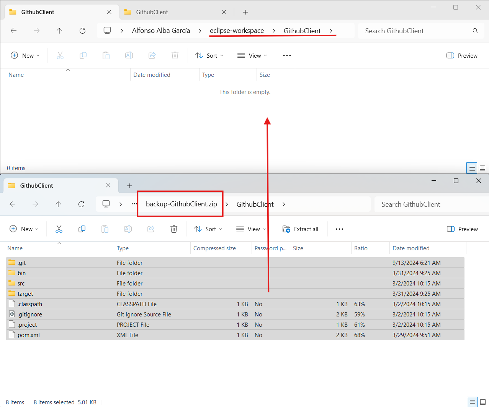

# Taller 4.4 (version Java con Eclipse): Borrando la historia del repositorio

## Índice

* This will become a table of contents (this text will be scrapped).
{:toc}

## Descarga 
Este taller no tiene descarga. Cuando lo finalicemos será necesario recuperar el repositorio de
la copia de seguridad que hicimos en el 
[Taller 4.1]().

## Requisitos

Este taller es continuación del taller 
[Taller 4.3: Borrando el grafo]().

Para evitar problemas de bloqueos de ficheros en Windows, cierra `Sourcetree` y `Eclipse`. El plugin de `git` de
`Eclipse` puede mantener abiertos algunos ficheros de la carpeta `.git` y algún comando podría fallar.

## Qué vamos a hacer 

Borrar todas las confirmaciones de cambios del repositorio de manera definitiva.


## Objetivos
- Utilizar el comando `git reflog expire` para borrar las referencias a las confirmaciones
  de cambios del `reflog`
- Utilizar el comando `git gc` para borrar las confirmaciones de cambios de la carpeta `.git/objects`


## Despliegues

No hay despliegues en este taller.

## Usando `Sourcetree`

Este taller lo realizaremos usando la consola ya que `Sourcetree` no dispone de la opción de visualizar el `reflog`
cuando se desarrolló este taller.

## Usando la consola

### Primera ejecución del comando `git gc`: empaquetado

En el [Taller 4.3: Borrando el grafo](), terminamos
creando una rama prueba que nos permitía *ver* de nuevo todo el grafo.

Lo que buscamos es quedarnos sólo con la rama `main` y borrar de forma definitiva todas
las confirmaciones de cambios que se hicieron después.

Recordemos que para que el recolector de basura pueda borrar los objetos de `git` se tienen
que dar dos condiciones:
- Que sean más antiguos al periodo de gracia de 14 días configurado por defecto
- Que no exista ninguna referencia que nos permita llegar a esos objetos

Si miramos el grafo:

```shell
> $ git log --graph --oneline --all
*   e1d48d9 (prueba) Merge branch 'GHC-13-usaColorEnListadoDeTickets'
|\
| * 8cb4fb4 feat: Utiliza colores en el listado de tickets
* | 5234d6b refactor: Extrae clase IssueFormatter
|/
* 4b91bd2 fix: Replace spaces with tabs
* 61dc6c2 Merge branch 'GHC-10-usuarioEstadoYEnlace'
|\
| * 3e532d9 chore: Muestra enlace en listado de tickets
| * 7c3cbbc chore: Muestra estado en listado de tickets
| * 75cfef9 chore: Muestra usuario en listado de tickets
* | eaff0cc chore: Error legible si el token no es válido
|/
* 15c8bda refactor: Extrae clase Client
* 93eacc0 Muestra listado de issues por consola
* 90336b5 (HEAD -> main) Configuramos Maven en el proyecto
* 7c5d4ab Añadir MainClass y código trivial para verificar que el proyecto se ejecuta correctamente
* b1e277c Esqueleto del proyecto
```

al tener la rama `prueba`, el recolector de basura no borrará ninguno de esos objetos. Aunque 
no pueda borrar objetos, lo que si hará el recolector de basura es empaquetarlos,
así que vamos a hacerlo. Si miramos el contenido de la carpeta `.git/objects`:

```shell
> $ ls .git/objects/
00/  0c/  15/  1b/  20/  25/  35/  3b/  4b/  52/  57/  63/  6a/  71/  78/  7f/  87/  8f/  9b/  a4/  ad/  b8/  c6/  cf/  d8/  e2/  e9/  f8/  info/
04/  0d/  16/  1c/  21/  29/  36/  3e/  4d/  53/  5a/  64/  6b/  72/  79/  82/  88/  90/  9c/  a5/  b0/  ba/  c9/  d1/  db/  e4/  ea/  f9/  pack/
05/  0f/  17/  1d/  22/  2a/  37/  44/  4f/  54/  5b/  65/  6c/  73/  7b/  83/  8a/  93/  a1/  a8/  b1/  c1/  cb/  d3/  dd/  e5/  ef/  fa/
07/  11/  19/  1e/  23/  2c/  38/  48/  50/  55/  5f/  66/  6d/  75/  7c/  84/  8b/  96/  a2/  a9/  b4/  c4/  cc/  d4/  e0/  e6/  f3/  fb/
09/  12/  1a/  1f/  24/  34/  39/  49/  51/  56/  61/  67/  6e/  76/  7d/  86/  8c/  98/  a3/  ac/  b6/  c5/  ce/  d6/  e1/  e8/  f5/  ff/
```
Vemos que los objetos de `git` siguen estando como hasta ahora. Ejecutamos el comando `git gc`:

```shell
git gc
Enumerating objects: 94, done.
Counting objects: 100% (94/94), done.
Delta compression using up to 16 threads
Compressing objects: 100% (79/79), done.
Writing objects: 100% (94/94), done.
Total 94 (delta 37), reused 0 (delta 0), pack-reused 0 (from 0)
Enumerating cruft objects: 103, done.
Traversing cruft objects: 126, done.
Counting objects: 100% (103/103), done.
Delta compression using up to 16 threads
Compressing objects: 100% (82/82), done.
Writing objects: 100% (103/103), done.
Total 103 (delta 34), reused 0 (delta 0), pack-reused 0 (from 0)
```

Si volvemos a mirar el contenido de la carpeta `.git/objects`:

```shell
> ls -lR .git/objects/
.git/objects/:
total 4
drwxr-xr-x 1 Alfonso Alba García 197121 0 Oct 18 05:52 info/
drwxr-xr-x 1 Alfonso Alba García 197121 0 Oct 18 05:52 pack/

.git/objects/info:
total 5
-r--r--r-- 1 Alfonso Alba García 197121 1952 Oct 18 05:52 commit-graph
-rw-r--r-- 1 Alfonso Alba García 197121  107 Oct 18 05:52 packs

.git/objects/pack:
total 39
-r--r--r-- 1 Alfonso Alba García 197121  3956 Oct 18 05:52 pack-60b61f3126cd157e381191369fa0b8d33b8a7ba9.idx
-r--r--r-- 1 Alfonso Alba García 197121   464 Oct 18 05:52 pack-60b61f3126cd157e381191369fa0b8d33b8a7ba9.mtimes
-r--r--r-- 1 Alfonso Alba García 197121 15655 Oct 18 05:52 pack-60b61f3126cd157e381191369fa0b8d33b8a7ba9.pack
-r--r--r-- 1 Alfonso Alba García 197121   464 Oct 18 05:52 pack-60b61f3126cd157e381191369fa0b8d33b8a7ba9.rev
-r--r--r-- 1 Alfonso Alba García 197121  3704 Oct 18 05:52 pack-a1b78513e64d1f0f96d50af30dfce5d853d291f3.idx
-r--r--r-- 1 Alfonso Alba García 197121 11497 Oct 18 05:52 pack-a1b78513e64d1f0f96d50af30dfce5d853d291f3.pack
-r--r--r-- 1 Alfonso Alba García 197121   428 Oct 18 05:52 pack-a1b78513e64d1f0f96d50af30dfce5d853d291f3.rev
```
Vemos que todos los objetos de `git` se han empaquedato en dos `packs` indexados. Como tenemos
todavía la rama `prueba`, el recolector de basura no ha borrado ninguna de nuestras confirmaciones
de cambios. Si ejecutamos el comando `git log` de nuevo, seguiremos viendo la historia completa
del repositorio.

### Borrando la rama `prueba`

Vamos a borrar la rama `prueba`. Para ello hacemos primero `main` la rama activa si no
lo es ya (recuerda que no se puede borrar la activa)

```shell
> git switch main
> git branch -D prueba
Deleted branch prueba (was e1d48d9).
```

Si mostramos de nuevo el grafo:

```shell
> git log --graph --oneline
* 90336b5 (HEAD -> main) Configuramos Maven en el proyecto
* 7c5d4ab Añadir MainClass y código trivial para verificar que el proyecto se ejecuta correctamente
* b1e277c Esqueleto del proyecto
```

Dejamos de ver todas las confirmaciones de cambios que se hicieron después de
`90336b5`. Como vimos en las diapositivas y talleres anteriores, no vemos esa
parte de la historia porque no tenemos ninguna rama o etiqueta que nos permita
llegar a esas confirmaciones de cambios. Pero están en nuestra carpeta
`.git/objects`, concretamente en los `packs` que el comando `git gc` ha creado
en su última ejecución (ver más arriba).

### Segunda ejecución del comando `git gc`

Si volvemos a ejecutar el comando `git gc`:

```shell
> git gc
Enumerating objects: 94, done.
Counting objects: 100% (94/94), done.
Delta compression using up to 16 threads
Compressing objects: 100% (42/42), done.
Writing objects: 100% (94/94), done.
Total 94 (delta 37), reused 94 (delta 37), pack-reused 0 (from 0)
Enumerating cruft objects: 103, done.
Traversing cruft objects: 126, done.
Counting objects: 100% (103/103), done.
Delta compression using up to 16 threads
Compressing objects: 100% (48/48), done.
Writing objects: 100% (103/103), done.
Total 103 (delta 34), reused 103 (delta 34), pack-reused 0 (from 0)
```

¿Habrá borrado `git` esos *commits* que no podemos ver? La respuesta es que no,
porque en el `reflog` todavía podemos tener referencias a esos *commits* y,
además, los últimos cambios que has confirmado son más recientes que el período
de gracia de 14 días (Nota: esta parte del taller tiene una fuerte dependencia
de la fecha. Si estás usando el zip del taller 4.3, o alguno de los `.zip` anteriores como punto de partida, y
estás siguiendo este taller meses después de que lo crease, el resultado
de los comandos `git gc` y `git reflog expire` serán diferentes a lo que
expongo aquí. Estoy asumiendo que estás haciendo los talleres uno detrás de
otro como hacemos durante el curso)

¿Cómo podemos saber si el recolector de basura ha borrado esos *commits*?
¿Es necesario mirar dentro de los `packs`? No, podemos usar el comando
`git cat-file` para preguntarle a `git`:

```shell
> git cat-file -e e1d48d9^{commit}
> echo $?
0
```

Este comando devuelve `0` si se enuentra el *commit* `e1d48d9`. Si no lo encuentra,
como veremos luego, devuelve algo distinto de cero y muestra  un mensaje por la salida de error (`stderr`).
En este caso, nuestros cambios siguen en la carpeta `.git/objects` porque
el recolector de basura no lo puede borrar.

Otra opción, si no te gusta este comando de bajo nivel,
es crear una rama o una etiqueta en la confirmación de cambios `e1d48d9`. Si no existe, el comando dará un error. 
**Si utilizas este método, acuerdate de borrar la rama o la etiqueta que crees, en caso contrario la siguiente sección
del taller no te funcionará.**

### Tercera ejecución del comando `git gc`: borrando *commits*

Si has seguido el curso hasta este punto, las confirmaciones de cambios de tu repostorio no superan los 90 días 
que el comando `git reflog expire` da para borrar las entradas del `reflog`. En lugar de esperar esos 90 días,
vamos a cambiar la configuración. Para ello ejecutamos los siguientes dos comandos:

```shell
> git config --local gc.reflogExpire now
> git config --local gc.reflogExpireUnreachable now
```
Estos dos comandos hacen lo siguiente:
- la opción `--local` hace que esta configuración se aplique sólo a este repositorio. **Asegurate de que no se te olvida
  para que no afecte al resto de repositorios que puedas tener en tu ordenador**
- `gc.reflogExpire now` hace que se puedan borrar las entradas más antiguas de este momento (es decir, todas las entradas)
- `gc.reflogExpireUnreachable` hace que se puedan borrar las entradas a las que no se puede llegar desde la rama activa
  y que sean más antiguas de este momento

Antes de volver a ejecutar `git gc`, veamos cómo es el `reflog` de la rama activa:

```shell
> git reflog --no-decorate main

90336b5 main@{0}: branch: Created from master
```

y el `reflog` the `HEAD`:

```shell
$ git reflog --no-decorate
90336b5 HEAD@{0}: checkout: moving from master to main
e1d48d9 HEAD@{1}: reset: moving to e1d48d9b980d70058ddae7077657fd1b6f86dfda
e1d48d9 HEAD@{2}: commit (merge): Merge branch 'GHC-13-usaColorEnListadoDeTickets'
5234d6b HEAD@{3}: reset: moving to 5234d6ba8d92aeae01e09d2843df890ce77a5f09
1fd15f3 HEAD@{4}: commit (merge): Merge branch 'GHC-13-usaColorEnListadoDeTickets'
5234d6b HEAD@{5}: reset: moving to HEAD
5234d6b HEAD@{6}: merge GHC-12-extraePrintIssues: Fast-forward
4b91bd2 HEAD@{7}: checkout: moving from GHC-12-extraePrintIssues to master
5234d6b HEAD@{8}: commit: refactor: Extrae clase IssueFormatter
...
...
...
```

Pasemos el recolector de basura:

```shell
$ git gc
Enumerating objects: 20, done.
Counting objects: 100% (20/20), done.
Delta compression using up to 16 threads
Compressing objects: 100% (16/16), done.
Writing objects: 100% (20/20), done.
Total 20 (delta 4), reused 0 (delta 0), pack-reused 0 (from 0)
Enumerating cruft objects: 177, done.
Traversing cruft objects: 185, done.
Counting objects: 100% (177/177), done.
Delta compression using up to 16 threads
Compressing objects: 100% (145/145), done.
Writing objects: 100% (177/177), done.
Total 177 (delta 65), reused 0 (delta 0), pack-reused 0 (from 0)
```


¿Seguirá existiendo la confirmación de cambios `e1d48d9`? Vamos a comprobarlo:

```shell
> git cat-file -e e1d48d9^{commit}
> echo $?
0
```

Si, todavía existe. ¿Qué ha pasado con el `reflog` de `main` y de `HEAD`? 


```shell
> git reflog --no-decorate main

> git reflog --no-decorate

```

¡Están vacíos! Es decir, `git gc` ha expirado el reflog pero no ha borrado los *commits*. ¿El motivo? que el comando
`git gc` nos da 14 días de gracia antes de borrar esos *commits*. Nos podemos saltar ese período de gracia con la opción `--prune`:

```shell
>  git gc --prune=now
Enumerating objects: 22, done.
Counting objects: 100% (22/22), done.
Delta compression using up to 16 threads
Compressing objects: 100% (13/13), done.
Writing objects: 100% (22/22), done.
Total 22 (delta 5), reused 22 (delta 5), pack-reused 0 (from 0)
```

y ahora podemos comprobar que el `commit` ya no está:

```shell
> git cat-file -e e1d48d9^{commit}
fatal: Not a valid object name e1d48d9^{commit}
```

Ahora sí, hemos borrado de manera definitiva la historia de nuestro repositorio. 
Por suerte, hicimos una copia de seguridad.

### Restaurar copia de seguridad

Esto podemos hacerlo fácilmente desde el explorador de archivos de Windows:

- Borramos todos los ficheros de la carpeta del proyecto
- Abrimos el fichero `.zip` con la copia de segurdad
- Arrastramos los ficheros desde el `.zip` a la carpeta del proyecto



Con esto, recuperamos nuestro repositorio:

```shell
> git log --graph --oneline --all

* e1d48d9 (HEAD -> master) Merge branch 'GHC-13-usaColorEnListadoDeTickets'
|\
| * 8cb4fb4 (GHC-13-usaColorEnListadoDeTickets) feat: Utiliza colores en el listado de tickets
* | 5234d6b (GHC-12-extraePrintIssues) refactor: Extrae clase IssueFormatter
|/
* 4b91bd2 fix: Replace spaces with tabs
*   61dc6c2 Merge branch 'GHC-10-usuarioEstadoYEnlace'
|\
| * 3e532d9 (GHC-10-usuarioEstadoYEnlace) chore: Muestra enlace en listado de tickets
| * 7c3cbbc chore: Muestra estado en listado de tickets
| * 75cfef9 chore: Muestra usuario en listado de tickets
* | eaff0cc (GHC-11-verificaToken) chore: Error legible si el token no es válido
|/
* 15c8bda (listadoTickets) refactor: Extrae clase Client
* 93eacc0 Muestra listado de issues por consola
* 90336b5 (tag: v0.0-ligera, tag: v0.0-anotada, tag: v0.0, main) Configuramos Maven en el proyecto
* 7c5d4ab Añadir MainClass y código trivial para verificar que el proyecto se ejecuta correctamente
* b1e277c (primer-commit) Esqueleto del proyecto
```

