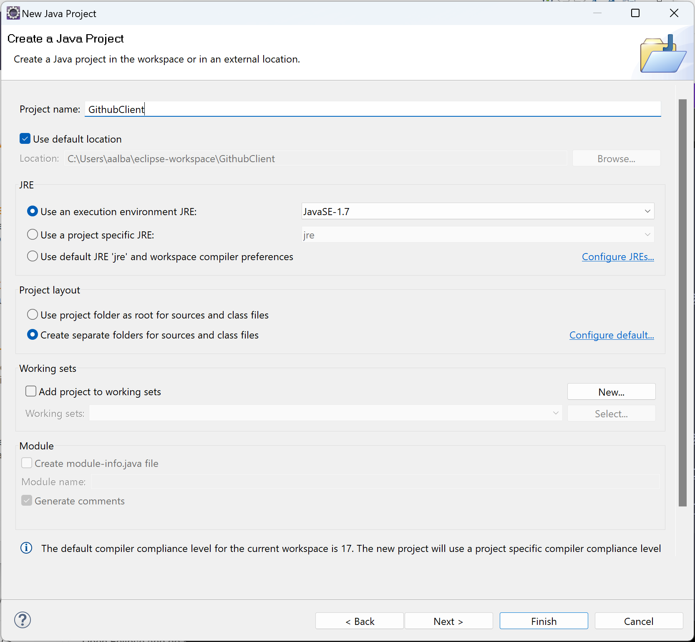
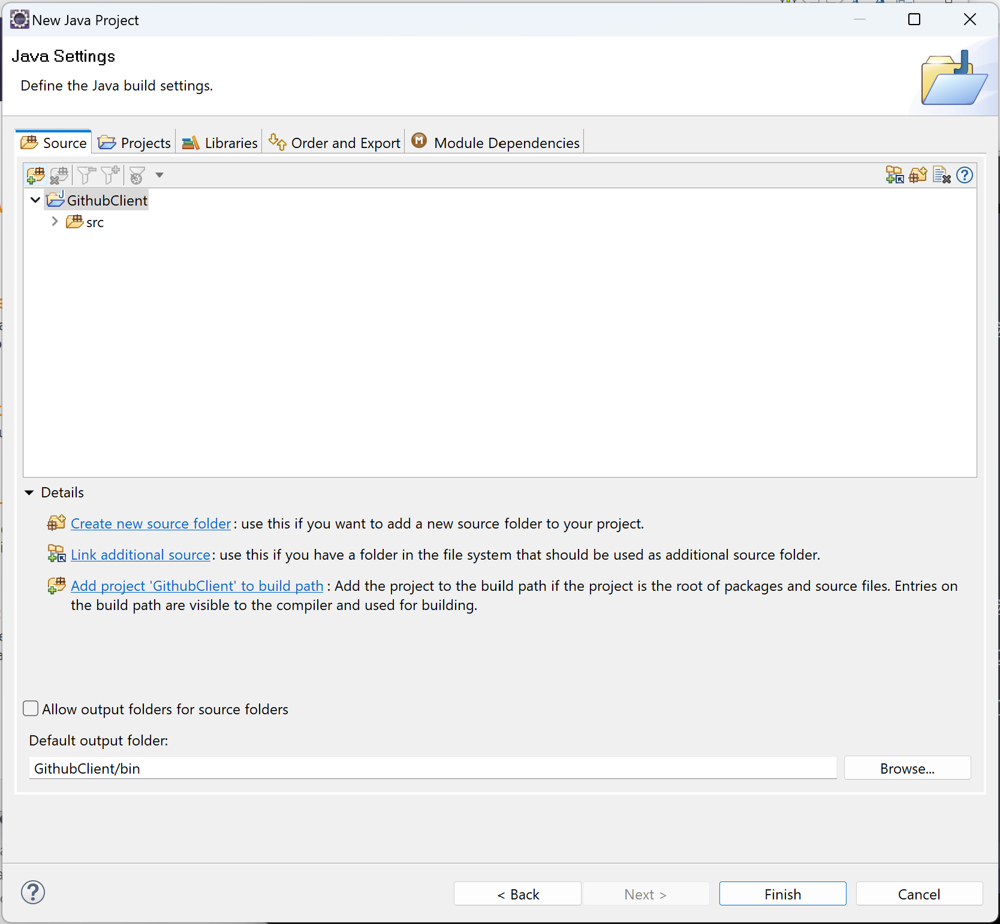
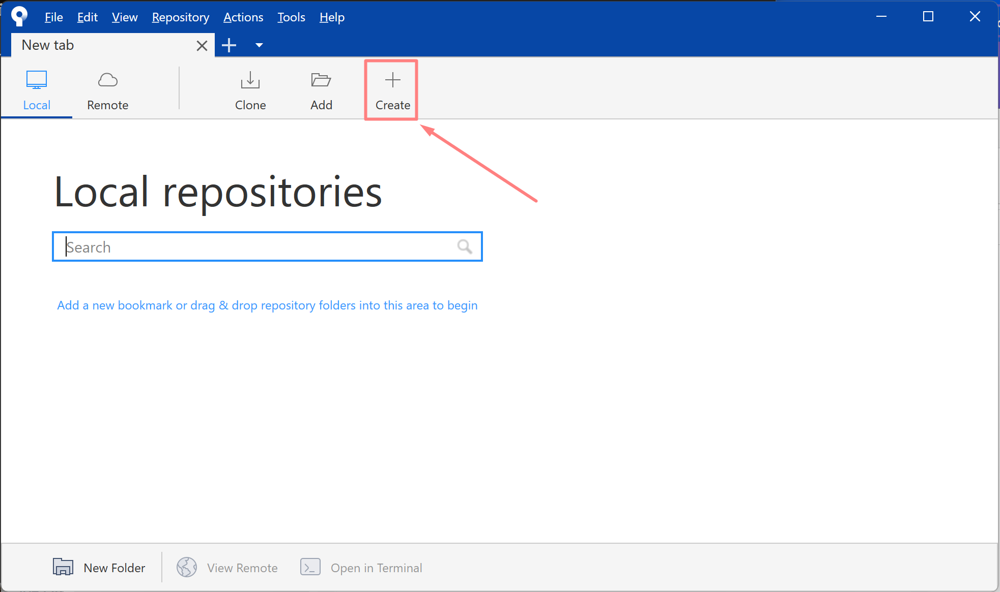
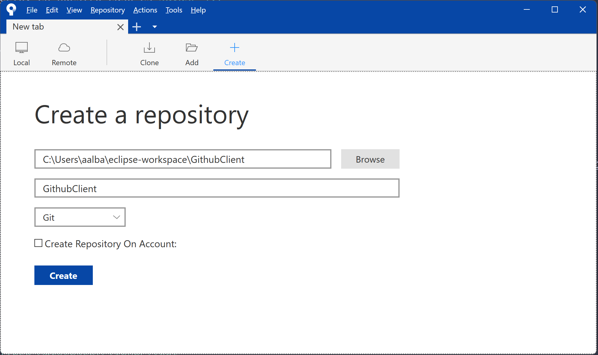
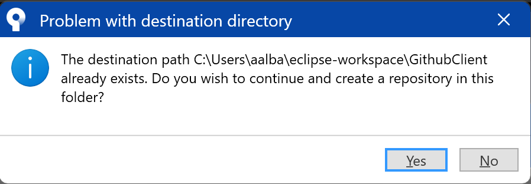
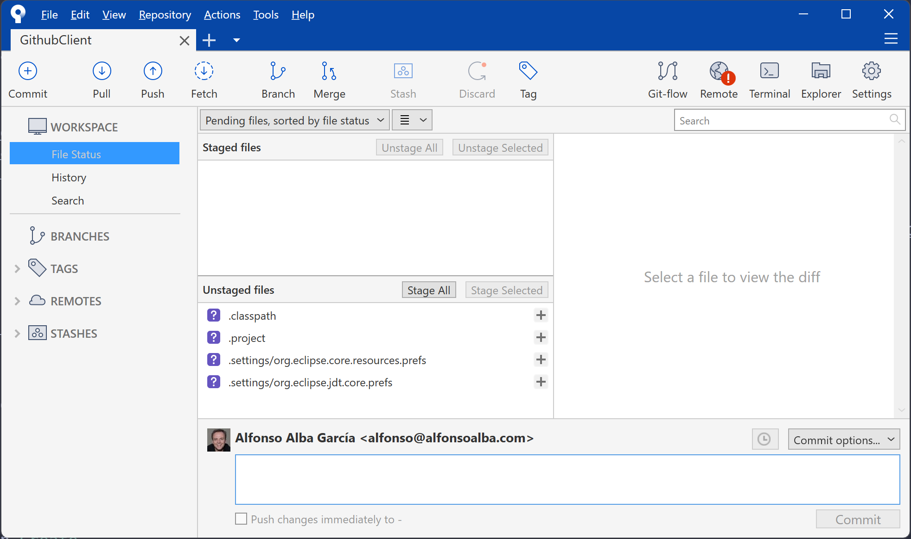

# Taller 1: version Java con Eclipse

## Requisitos
Para realizar este taller es necesario tener instalado el siguiente software:
- SourceTree
- git
- eclipse
- Java 

## Objetivos
- Inicializar el proyecto y realizar nuestro primer commit

## Inicializar el proyecto en eclipse

Ir a `File` -> `New` -> `Project` y en la ventana que se abre seleccionar `Java project`.

En la pantalla de configuración del proyecto, seleccionamos:
- Nombre: `GithubClient`
- JRE: el que instala eclipse por defecto, en nuestro caso es `JavaSE-1.7`



Hacemos clic sobre `Next`. Llegamos a la siguiente pantalla:



De momento no incluiremos ninguna dependencia, las iremos añadiendo 
a medida que las vamos necesitando. Hacemos clic sobre `Finish`,
y si el editor nos pregunta, aceptamos que nos lleve a la vista de Java.




## Inicializando el repositorio

⚠️ Realizar la operación una sola vez, bien usando `SourceTree` o la consola. Ambas operaciones
son idénticas, lo único que cambia es el cliente de git que la ejecutará.

### Usando SourceTree
Abrimos `SourceTree` y en la pantalla de inicio, hacemos clic sobre 
el icono `Create`:



En la ventana emergente, seleccionar la ruta al proyecto de eclipse, que 
en este ejemplo es `C:\Users\aalba\eclipse-workspace\GithubClient`. Una vez
seleccionada la ruta, hacemos click en `Create`

 

Al hacerlo, `SourceTree` nos mostrará un aviso de que la carpeta no está vacía: 



Hacemos click en `Yes` para continuar. Si todo ha ido bien, `SourceTree` nos llevará 
a la pantalla con el repositorio:



### Usando la consola

Abrir una consola PowerShell y ejecutar los siguientes comandos:

```powershell
> cd C:\Users\aalba\eclipse-workspace\GithubClient
> git init
Initialized empty Git repository in C:/Users/aalba/eclipse-workspace/GithubClient/.git/
```

Si estás en `Linux` os `MacOS`, sólo tienes que adaptar las rutas a tu sistema operativo.

## La carpeta .git


